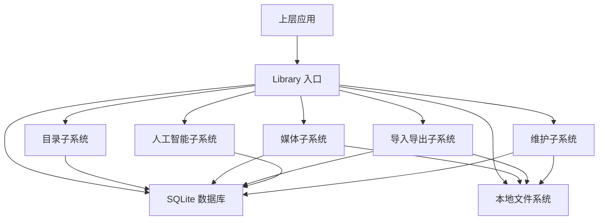
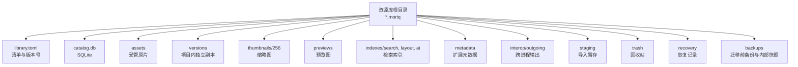
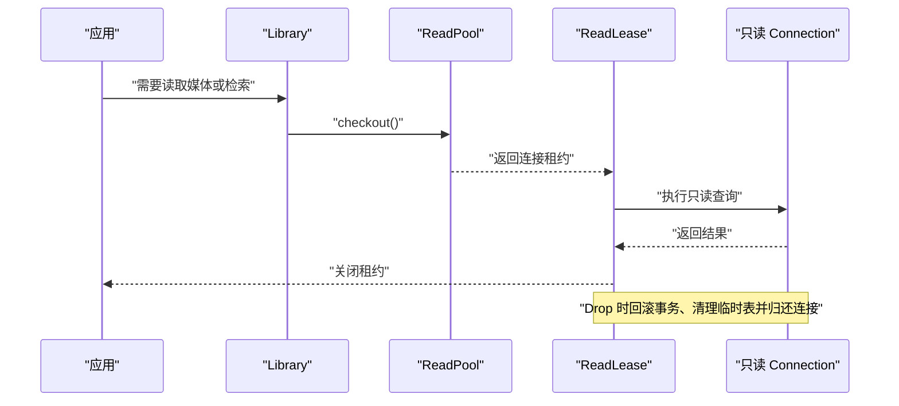
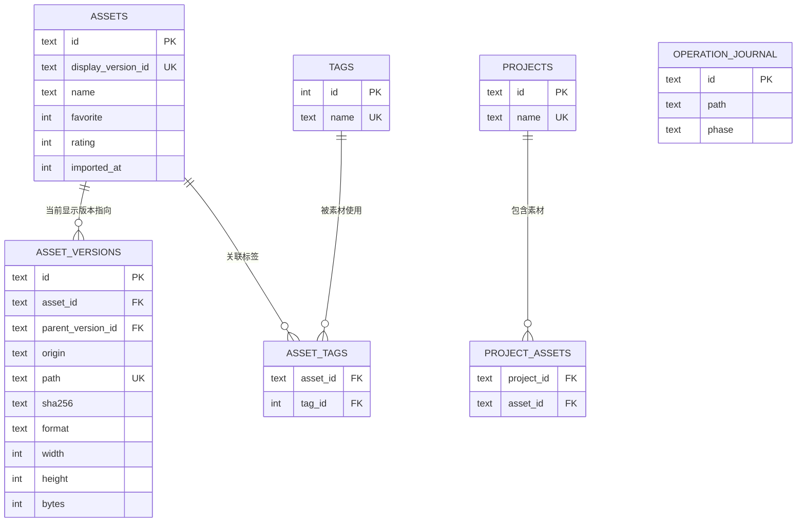
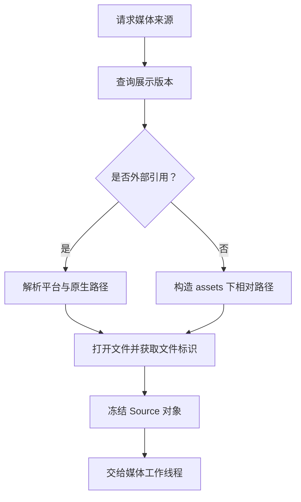
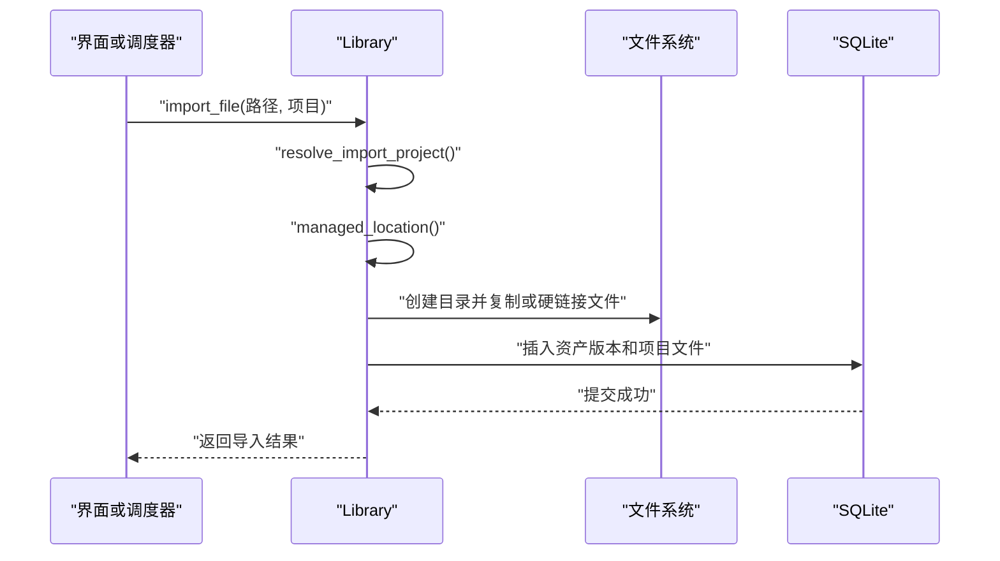
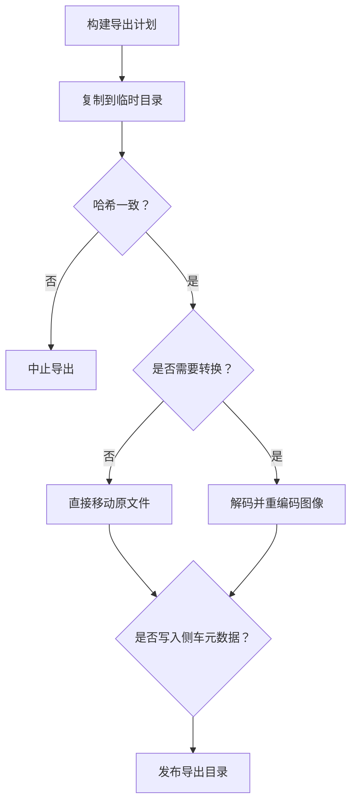
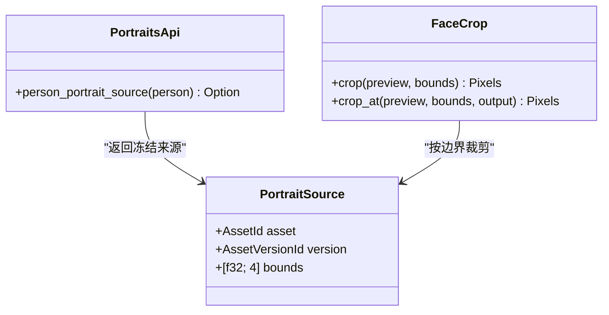
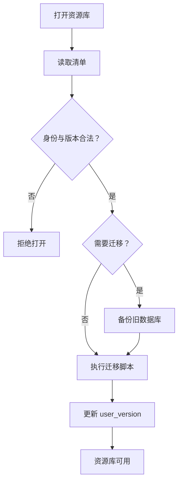
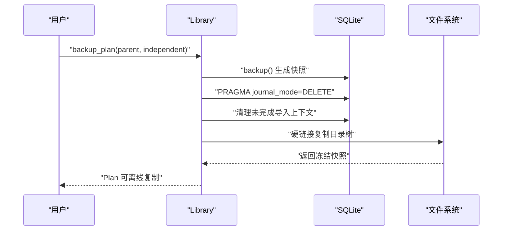

# 资源库持久层（moriq-library）

> Repo Wiki 节点 `library-persistence`
> 导出自 Qoder 知识库快照 `8fbe02f6-57c2-4874-b725-1a8130851fd9`，代码基线 `7a7a8e75e18bd90294e09cd422dd7ed5a04813a0`（分支 main，zh-CN）。

<cite>
**本文引用的文件**   
- [lib.rs](../../../crates/moriq-library/src/lib.rs)
- [core.rs](../../../crates/moriq-library/src/library/core.rs)
- [lifecycle.rs](../../../crates/moriq-library/src/library/lifecycle.rs)
- [journal.rs](../../../crates/moriq-library/src/database/journal.rs)
- [read_pool.rs](../../../crates/moriq-library/src/database/read_pool.rs)
- [schema.sql](../../../crates/moriq-library/src/database/schema.sql)
- [catalog.rs](../../../crates/moriq-library/src/catalog/catalog.rs)
- [media.rs](../../../crates/moriq-library/src/media/media.rs)
- [import.rs](../../../crates/moriq-library/src/transfer/import.rs)
- [export.rs](../../../crates/moriq-library/src/transfer/export.rs)
- [portraits.rs](../../../crates/moriq-library/src/ai/portraits.rs)
- [similarity.rs](../../../crates/moriq-library/src/ai/similarity.rs)
- [backup.rs](../../../crates/moriq-library/src/maintenance/backup.rs)
</cite>

## 目录
1. [简介](#简介)
2. [项目结构与职责划分](#项目结构与职责划分)
3. [核心组件总览](#核心组件总览)
4. [架构总览](#架构总览)
5. [数据库连接、事务与并发控制](#数据库连接事务与并发控制)
6. [资源库目录结构规范](#资源库目录结构规范)
7. [目录表设计、索引策略与查询优化](#目录表设计索引策略与查询优化)
8. [媒体子系统：解码、缓存与元数据](#媒体子系统解码缓存与元数据)
9. [导入导出与一致性保障](#导入导出与一致性保障)
10. [人工智能功能的数据存储](#人工智能功能的数据存储)
11. [迁移历史与备份恢复](#迁移历史与备份恢复)
12. [典型 SQL 查询示例](#典型-sql-查询示例)
13. [Rust API 调用模式](#rust-api-调用模式)
14. [性能与容量限制](#性能与容量限制)
15. [故障排查指南](#故障排查指南)
16. [结论](#结论)

## 简介
本文面向 Moriq Space 的资源库持久层，聚焦 `moriq-library` 模块。它负责 SQLite 单写者资源库的创建、打开、升级、导入、导出、媒体访问、AI 结果持久化以及备份维护。整体设计以“一个写入端 + 多个只读连接”为核心：所有变更通过单个 `rusqlite::Connection` 完成，读取和媒体工作线程通过共享只读连接池或冻结的源对象访问数据，从而避免 SQLite 多写冲突并降低锁竞争。

## 项目结构与职责划分
`moriq-library` 按领域分层组织源码，而不是按技术类型简单拆分：

| 目录 | 主要职责 |
|---|---|
| `library/*` | 资源库生命周期、清单校验、名称与浏览状态、外部引用重连 |
| `database/*` | Schema、迁移、WAL 日志、只读连接池 |
| `catalog/*` | 素材目录、标签、项目树、查询快照、工作区隔离 |
| `media/*` | 媒体版本路径解析、缩略图、预览、色彩、区域、向量与视频 |
| `ai/*` | 人脸识别、相似指纹、内容分析、人物头像 |
| `transfer/*` | 导入计划、受管位置、提交、导出、恢复与同步 |
| `maintenance/*` | 备份、清理、孤儿文件、存储诊断 |
| `tasks/*` | 任务取消与工作项 |
| `tests/*` | 回归测试、AI 测试、工作区测试 |



**图示来源**
- [lib.rs:1-120](../../../crates/moriq-library/src/lib.rs#L1-L120)
- [core.rs:1-120](../../../crates/moriq-library/src/library/core.rs#L1-L120)

**章节来源**
- [lib.rs:1-120](../../../crates/moriq-library/src/lib.rs#L1-L120)

## 核心组件总览
- **Library 入口**：封装根路径、清单、主数据库连接、写入锁、只读连接池、查询作用域等。
- **Schema 与迁移**：初始建库脚本位于 `database/schema.sql`，后续版本迁移按编号递增的 SQL 文件执行。
- **目录子系统**：提供素材分页、锚点邻域、选择范围、项目树、标签、工作区、查询快照等能力。
- **媒体子系统**：从数据库冻结版本信息后打开文件，支持内部版本、外部引用、缩略图重建、详情组装。
- **导入导出子系统**：将扫描结果落盘到受管目录，生成不可变导出计划，并在复制阶段校验哈希。
- **人工智能子系统**：持久化人脸、相似指纹、内容分类和 OCR 结果，并提供人物代表头像裁剪。
- **维护子系统**：使用 WAL 快照、硬链接复制和资源库级一致性检查实现备份。

**章节来源**
- [lib.rs:1-200](../../../crates/moriq-library/src/lib.rs#L1-L200)
- [schema.sql:1-42](../../../crates/moriq-library/src/database/schema.sql#L1-L42)

## 架构总览
资源库采用“清单 + SQLite + 文件系统”的组合：



**图示来源**
- [lib.rs:80-120](../../../crates/moriq-library/src/lib.rs#L80-L120)
- [core.rs:30-90](../../../crates/moriq-library/src/library/core.rs#L30-L90)

**章节来源**
- [lib.rs:80-120](../../../crates/moriq-library/src/lib.rs#L80-L120)
- [core.rs:30-120](../../../crates/moriq-library/src/library/core.rs#L30-L120)

## 数据库连接、事务与并发控制

### 单写者模型
- 资源库打开时获取独占文件锁；若被其他窗口或进程占用，返回锁定错误。
- 主数据库连接以读写标志打开，启用外键约束，并设置较短的忙等待超时。
- 所有变更操作都通过 `self.db.transaction()` 显式提交；失败时自动回滚。

### 只读连接池
- `ReadPool` 持有资源库租约，避免在读取期间资源库被删除。
- 最多缓存少量只读连接，首次借用时配置较大缓存、临时文件存储和较长忙等待时间。
- `ReadLease` 在释放时回滚遗留事务、清理临时表，并把连接归还池中。



**图示来源**
- [read_pool.rs:1-97](../../../crates/moriq-library/src/database/read_pool.rs#L1-L97)

**章节来源**
- [core.rs:90-170](../../../crates/moriq-library/src/library/core.rs#L90-L170)
- [read_pool.rs:1-97](../../../crates/moriq-library/src/database/read_pool.rs#L1-L97)

## 资源库目录结构规范
系统定义 13 个标准目录，用于分离可管理数据、索引、中间文件和备份：

| 目录 | 含义与规则 |
|---|---|
| `assets` | 受管原片存放目录，按项目和相对路径组织 |
| `versions` | 项目内独立版本副本，供项目隔离使用 |
| `projects` | 清单中不直接保存二进制，但项目 ID、名称、父级与存储映射由数据库维护 |
| `thumbnails/256` | 256 像素缩略图 PNG |
| `previews` | 预览图像缓存 |
| `indexes/search` | 搜索索引 |
| `indexes/layout` | 布局索引 |
| `indexes/ai` | AI 相关索引 |
| `metadata` | 扩展元数据，如浏览历史 |
| `interop/outgoing` | 跨进程输出缓冲 |
| `staging` | 导入、导出、恢复过程中的临时文件 |
| `trash` | 已删除素材的软回收站 |
| `recovery` | 恢复辅助数据 |
| `backups` | 迁移前数据库快照与内部备份 |

这些目录由 `DIRECTORIES` 常量统一声明，并在创建、备份、跳过拷贝时复用。

**章节来源**
- [lib.rs:80-120](../../../crates/moriq-library/src/lib.rs#L80-L120)
- [backup.rs:1-120](../../../crates/moriq-library/src/maintenance/backup.rs#L1-L120)

## 目录表设计、索引策略与查询优化

### 核心实体关系
初始 Schema 定义了资源库身份、素材、素材版本、项目、标签、操作日志等基础表，并通过触发器维护顺序。



**图示来源**
- [schema.sql:1-42](../../../crates/moriq-library/src/database/schema.sql#L1-L42)

### 关键索引与设计要点
- `asset_versions.sha256`：去重、重复检测和内容一致性校验。
- `asset_versions.asset_id`：快速查找某个素材的所有版本。
- `asset_versions.parent_version_id`：版本链回溯。
- `assets.imported_at DESC` 与 `assets.favorites`：导入时间与收藏排序。
- `asset_order.position`：稠密排名表，避免深 `OFFSET` 分页。
- `asset_tags.tag_id` 反向索引：按标签查素材。
- `operation_journal`：记录导入、迁移等操作阶段，用于恢复与清理。

### 查询优化策略
- 默认查询使用 `asset_order`，过滤查询使用 `query_snapshot`，两者都基于 `position` 做有界范围扫描。
- 邻域查询只拉取锚点附近少量行，避免全量加载。
- 选择范围限制最大跨度，防止超大范围导致大量数据库往返。
- 事件与通知使用游标分页，避免无界扫描。

**章节来源**
- [schema.sql:1-42](../../../crates/moriq-library/src/database/schema.sql#L1-L42)
- [catalog.rs:1-120](../../../crates/moriq-library/src/catalog/catalog.rs#L1-L120)
- [journal.rs:1-120](../../../crates/moriq-library/src/database/journal.rs#L1-L120)

## 媒体子系统：解码、缓存与元数据

### 媒体来源冻结
`Source` 从只读连接中冻结以下信息：
- 素材 ID 与版本 ID。
- SHA-256、格式、宽高。
- 内部相对路径或外部引用平台与原生路径。
- 实际文件句柄、文件标识和预期哈希。
- 资源库租约，确保读取期间资源库不被删除。



**图示来源**
- [media.rs:1-120](../../../crates/moriq-library/src/media/media.rs#L1-L120)

### 缩略图缓存与重建
- 优先从 `thumbnails/256/{version_id}.png` 读取。
- 缺失时根据版本 ID 反查素材 ID，再构建 `Source` 重建缩略图。
- 批量缩略图计划限制一次最多处理固定数量，避免一次性打开过多文件。

### 详情组装
- 从 `assets`、`asset_versions`、`ai_results`、`workspace_vocabulary` 等表组合标题、标签、类别、OCR 等字段。
- 对历史 OCR 保持兼容，即使当前 AI 模型描述发生变化仍可读取。

**章节来源**
- [media.rs:1-200](../../../crates/moriq-library/src/media/media.rs#L1-L200)

## 导入导出与一致性保障

### 导入流程
1. 解析目标项目：优先使用显式项目，否则按 `project_name` 查找或创建顶级项目。
2. 计算受管路径：根据项目存储目录、相对路径、文件名与序列号生成唯一目标路径。
3. 创建目录并建立硬链接或复制文件。
4. 更新 `asset_versions`、`project_files`、`operation_journal` 等表。
5. 对重复内容，在相同项目下创建独立项目文件关联，而不覆盖原片。



**图示来源**
- [import.rs:1-120](../../../crates/moriq-library/src/transfer/import.rs#L1-L120)

### 导出流程
- `export_plan` 冻结所选素材的有效版本、名称、SHA-256、备注、标签、EXIF、项目归属和 AI 元数据。
- `run` 在临时目录中复制源文件，再次校验哈希，然后按格式、尺寸、旋转、目录模板进行转换或原样输出。
- 禁止导出到资源库内部目录，防止嵌套导出破坏资源库结构。



**图示来源**
- [export.rs:1-200](../../../crates/moriq-library/src/transfer/export.rs#L1-L200)

**章节来源**
- [import.rs:1-200](../../../crates/moriq-library/src/transfer/import.rs#L1-L200)
- [export.rs:1-200](../../../crates/moriq-library/src/transfer/export.rs#L1-L200)

## 人工智能功能的数据存储

### 人脸识别与人物头像
- 人脸检测结果保存在 `detected_faces`，包含版本 ID、边界框、向量和人物 ID。
- 人物代表头像从当前展示版本且未回收的素材中选择面积最大的人脸。
- 裁剪函数对归一化坐标和像素完整性进行严格校验。



**图示来源**
- [portraits.rs:1-120](../../../crates/moriq-library/src/ai/portraits.rs#L1-L120)

### 相似性搜索
- 使用 32×32 缩放图像、DCT-like 系数、颜色均值和宽高比生成感知指纹。
- 指纹写入 `image_fingerprints`，允许同版本覆盖更新。
- 相似性查询通过独立的只读租约执行，避免阻塞写入端。

**章节来源**
- [portraits.rs:1-166](../../../crates/moriq-library/src/ai/portraits.rs#L1-L166)
- [similarity.rs:1-131](../../../crates/moriq-library/src/ai/similarity.rs#L1-L131)

## 迁移历史与备份恢复

### 迁移策略
- 打开资源库时读取 `user_version` 和 `library_identity`，并与清单中的 `schema_version`、`library_id` 对比。
- 如果版本低于当前支持的 `SCHEMA`，则依次执行迁移脚本。
- 迁移前会复制当前数据库到 `backups/schema-{version}-{uuid}.db`，形成可追溯的预迁移快照。
- 每个迁移通常包裹在事务中，失败时回滚整个迁移批次。



**图示来源**
- [core.rs:60-170](../../../crates/moriq-library/src/library/core.rs#L60-L170)

### 备份机制
- 使用 rusqlite 的 `backup` 接口生成数据库快照。
- 切换为 DELETE 模式以确保 WAL 已合并，避免复制仅存在于 WAL 中的未提交更改。
- 清理未完成导入上下文，保留中断导入以便恢复。
- 通过硬链接复制受管原片和版本，减少重复 IO。
- 可选克隆模式会重新生成资源库 ID、清空同步任务和后台作业状态。



**图示来源**
- [backup.rs:1-200](../../../crates/moriq-library/src/maintenance/backup.rs#L1-L200)

**章节来源**
- [core.rs:60-200](../../../crates/moriq-library/src/library/core.rs#L60-L200)
- [backup.rs:1-200](../../../crates/moriq-library/src/maintenance/backup.rs#L1-L200)

## 典型 SQL 查询示例

以下示例用于说明持久层常见查询形态；实际实现可能包装在 Rust 方法中。

| 场景 | SQL 意图 | 对应实现位置 |
|---|---|---|
| 查找某素材当前展示版本 | 从 `assets` 查询 `display_version_id` | [media.rs:80-120](../../../crates/moriq-library/src/media/media.rs#L80-L120) |
| 按版本 ID 验证归属 | 查询 `asset_versions` 中指定 `asset_id` 与 `id` | [media.rs:120-180](../../../crates/moriq-library/src/media/media.rs#L120-L180) |
| 分页浏览默认顺序 | 从 `asset_order` 按 `position` 查询 | [catalog.rs:20-60](../../../crates/moriq-library/src/catalog/catalog.rs#L20-L60) |
| 按标签查素材 | 使用 `effective_asset_tags` 与 `asset_workspaces` 联合 | [catalog.rs:100-160](../../../crates/moriq-library/src/catalog/catalog.rs#L100-L160) |
| 查找人物代表人脸 | 按人脸面积排序并从当前展示版本筛选 | [portraits.rs:10-40](../../../crates/moriq-library/src/ai/portraits.rs#L10-L40) |
| 查询活动与通知 | 使用游标分页并统计未读数 | [journal.rs:60-140](../../../crates/moriq-library/src/database/journal.rs#L60-L140) |
| 导出元数据 | 联合 `assets`、`asset_versions`、`effective_asset_tags`、`version_exif` | [export.rs:20-80](../../../crates/moriq-library/src/transfer/export.rs#L20-L80) |

**章节来源**
- [media.rs:80-180](../../../crates/moriq-library/src/media/media.rs#L80-L180)
- [catalog.rs:20-160](../../../crates/moriq-library/src/catalog/catalog.rs#L20-L160)
- [portraits.rs:10-40](../../../crates/moriq-library/src/ai/portraits.rs#L10-L40)
- [journal.rs:60-140](../../../crates/moriq-library/src/database/journal.rs#L60-L140)
- [export.rs:20-80](../../../crates/moriq-library/src/transfer/export.rs#L20-L80)

## Rust API 调用模式

### 创建资源库
```text
Library::create(parent_path, library_name)
→ 创建临时目录
→ 初始化 DIRECTORIES
→ 写入 library.toml
→ 执行 schema.sql
→ 写入 library_identity
→ 原子移动到目标路径
→ 打开资源库
```

**章节来源**
- [core.rs:30-120](../../../crates/moriq-library/src/library/core.rs#L30-L120)

### 打开资源库
```text
Library::open(root)
→ 读取并校验 library.toml
→ 获取独占锁
→ 打开 catalog.db
→ 校验 user_version 与 library_identity
→ 迁移前备份
→ 顺序执行迁移脚本
```

**章节来源**
- [core.rs:90-200](../../../crates/moriq-library/src/library/core.rs#L90-L200)

### 导入文件
```text
Library::import_file(file, project, referenced)
→ resolve_import_project
→ managed_location
→ 创建受管路径
→ 硬链接或复制
→ 更新资产版本与项目文件
```

**章节来源**
- [import.rs:1-160](../../../crates/moriq-library/src/transfer/import.rs#L1-L160)

### 导出素材
```text
Library::export_plan(ids)
→ 冻结有效版本、名称、哈希、备注、标签、EXIF、项目
run(items, parent, options)
→ 校验导出选项
→ 复制到临时目录
→ 校验哈希
→ 转换或原样输出
→ 可选写入 metadata.json
```

**章节来源**
- [export.rs:1-200](../../../crates/moriq-library/src/transfer/export.rs#L1-L200)

### 媒体读取
```text
Library::media_source(asset_id)
→ 查询 display_version_id
→ version_source(version_id)
→ 构造 Source 并返回给媒体线程
```

**章节来源**
- [media.rs:60-140](../../../crates/moriq-library/src/media/media.rs#L60-L140)

### 相似性搜索
```text
Library::similarity_plan()
→ 从 ReadPool 获取只读租约
SimilarityPlan::search(asset_id)
→ 读取指纹并执行相似性匹配
```

**章节来源**
- [similarity.rs:80-131](../../../crates/moriq-library/src/ai/similarity.rs#L80-L131)

### 人物头像
```text
Library::person_portrait_source(person_id)
→ 查询 detected_faces 与 assets.display_version_id
→ 返回 PortraitSource
FaceCrop::crop(preview, bounds)
→ 校验边界与像素
→ 裁切并缩放为人像头像
```

**章节来源**
- [portraits.rs:10-120](../../../crates/moriq-library/src/ai/portraits.rs#L10-L120)

### 备份
```text
Library::backup_plan(parent, independent)
→ 生成 catalog.db 快照
→ 清理未完成导入
→ 硬链接复制目录
Plan::copy(control)
→ 遍历冻结目录
→ 校验原片哈希
→ 发布备份
```

**章节来源**
- [backup.rs:1-200](../../../crates/moriq-library/src/maintenance/backup.rs#L1-L200)

## 性能与容量限制

| 操作 | 限制或优化 |
|---|---|
| 单次选择范围 | 最多 10000 张素材，避免超大范围扫描 |
| 批量缩略图 | 最多 128 张，避免同时打开过多文件 |
| 导出数量 | 1～10000 张，防止 UI 卡顿和内存压力 |
| 导航历史 | 最大长度和预算有限制，防止 JSON 过大 |
| 只读连接池 | 限制空闲连接数，避免连接泄漏 |
| 媒体预览尺寸 | 人脸裁剪输入尺寸上限为 1600 |
| 数据库忙等待 | 写入连接短超时，只读连接更长超时 |
| 备份 | 深度受限遍历，避免一次性收集全部文件列表 |

这些限制既保护 SQLite 稳定性，也保护桌面应用的响应性。

**章节来源**
- [catalog.rs:60-120](../../../crates/moriq-library/src/catalog/catalog.rs#L60-L120)
- [media.rs:140-200](../../../crates/moriq-library/src/media/media.rs#L140-L200)
- [export.rs:1-60](../../../crates/moriq-library/src/transfer/export.rs#L1-L60)
- [lifecycle.rs:1-60](../../../crates/moriq-library/src/library/lifecycle.rs#L1-L60)
- [read_pool.rs:40-97](../../../crates/moriq-library/src/database/read_pool.rs#L40-L97)
- [portraits.rs:40-100](../../../crates/moriq-library/src/ai/portraits.rs#L40-L100)
- [backup.rs:120-200](../../../crates/moriq-library/src/maintenance/backup.rs#L120-L200)

## 故障排查指南

| 现象 | 可能原因 | 建议处理 |
|---|---|---|
| 打开资源库时报锁定 | 另一个窗口或进程仍持有独占锁 | 关闭其他实例或强制结束残留进程 |
| 打开时报清单损坏 | `library.toml` 损坏或版本不兼容 | 从 `backups` 恢复数据库，或使用备份目录恢复 |
| 导入后找不到文件 | 外部引用路径失效或被移动 | 使用 `reconnect_page` 与 `apply_reconnect` 重新定位 |
| 导出中断 | 临时文件哈希不一致或目标目录非法 | 检查导出路径是否在资源库内，并重新执行导出 |
| 缩略图缺失 | 缩略图缓存未生成或被清理 | 通过 `thumbnail_plan` 重建 |
| 备份失败 | 备份位置在资源库内或原片哈希不符 | 选择外部磁盘，并确保受管原片未被修改 |
| 相似性结果异常 | 指纹未生成或模型行为变化 | 确认导入过程已生成 `image_fingerprints`，并重新运行分析 |

**章节来源**
- [core.rs:90-170](../../../crates/moriq-library/src/library/core.rs#L90-L170)
- [lifecycle.rs:60-177](../../../crates/moriq-library/src/library/lifecycle.rs#L60-L177)
- [export.rs:60-200](../../../crates/moriq-library/src/transfer/export.rs#L60-L200)
- [backup.rs:120-200](../../../crates/moriq-library/src/maintenance/backup.rs#L120-L200)

## 结论
Moriq Space 的资源库持久层以 SQLite 单写者为核心，围绕清单、目录表、版本链和文件系统共同实现强一致的数据存储。其优势包括：
- 明确的目录分工，便于备份、恢复和迁移。
- 基于稠密排名的目录分页，避免深偏移扫描。
- 冻结式媒体访问，避免长时间持有数据库连接。
- 严格的哈希校验，贯穿导入、导出和备份。
- 可扩展的 AI 数据结构，支持人脸、相似性与内容分析。
- 版本化迁移与预迁移备份，降低升级风险。

未来演进时可继续遵循现有模式：新增表结构放在迁移脚本，新增只读逻辑优先使用 `ReadPool`，新增文件操作优先使用硬链接与不可变路径，确保资源库在多线程和进程间保持稳定。