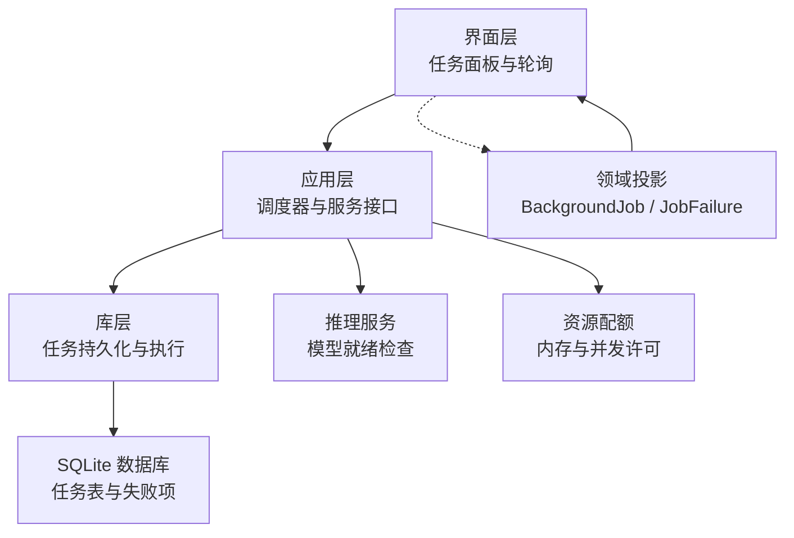
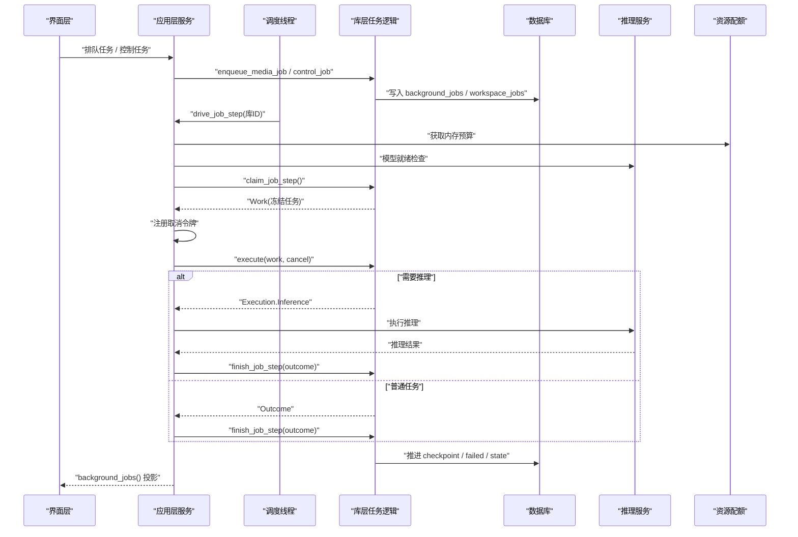
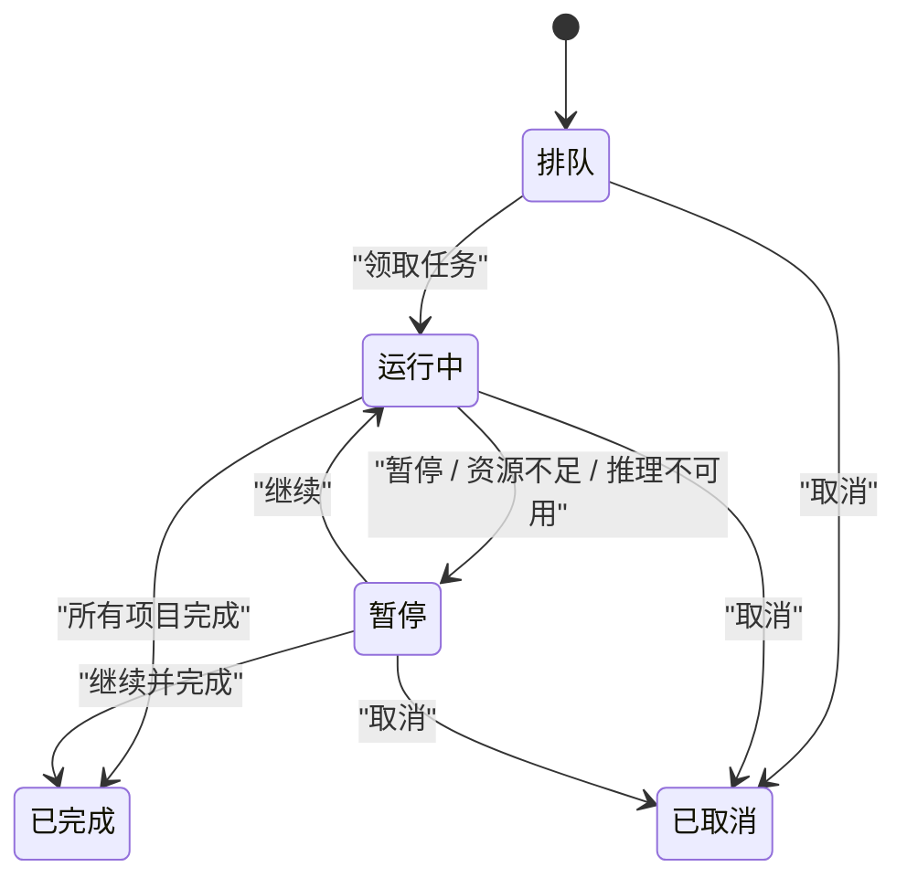
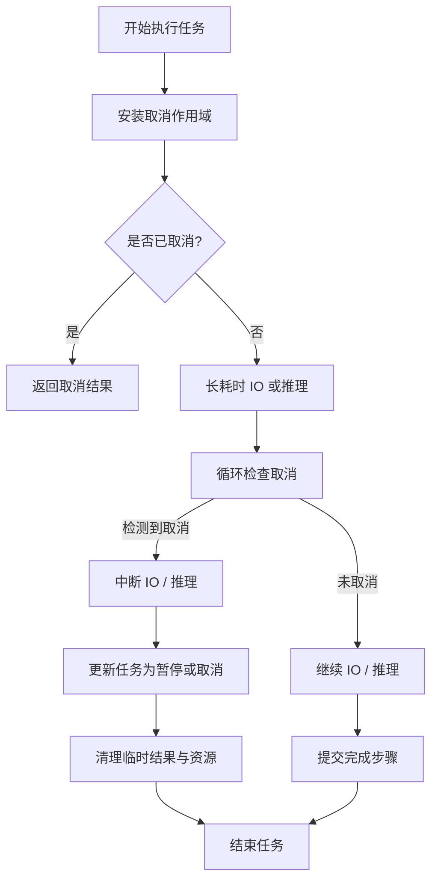
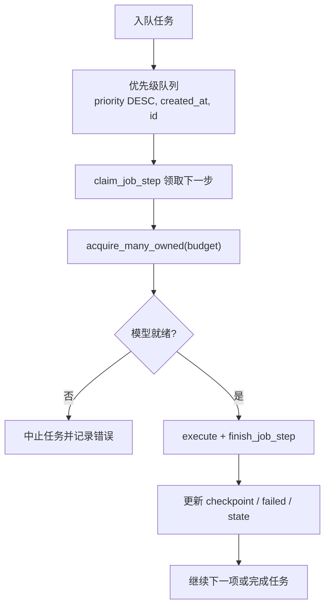
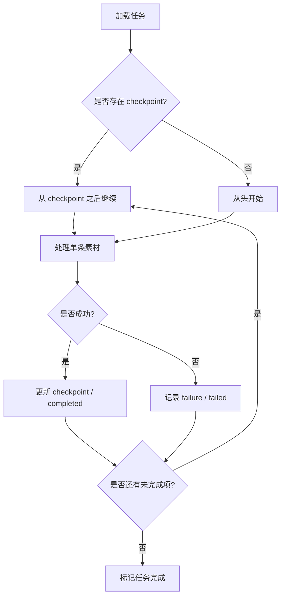
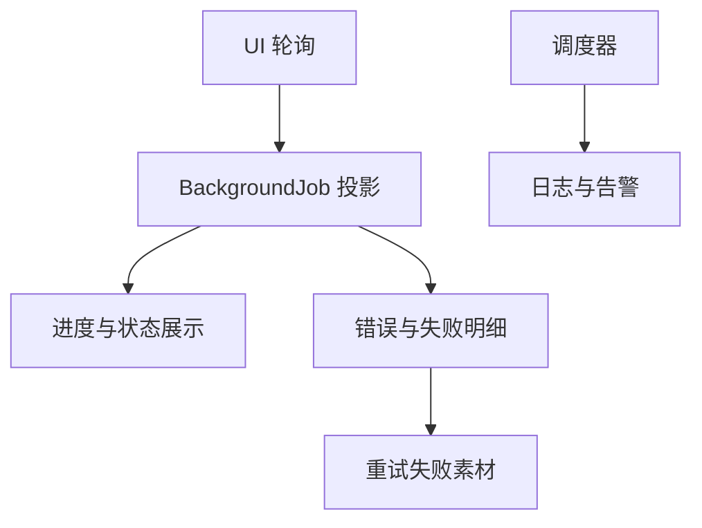
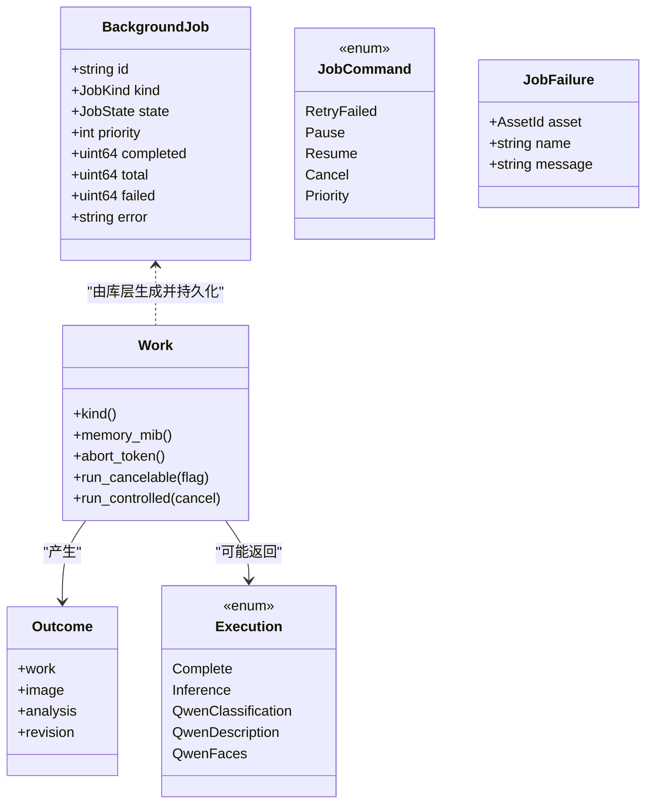

# 任务管理系统（Tasks）

> Repo Wiki 节点 `task-management`
> 导出自 Qoder 知识库快照 `8fbe02f6-57c2-4874-b725-1a8130851fd9`，代码基线 `7a7a8e75e18bd90294e09cd422dd7ed5a04813a0`（分支 main，zh-CN）。

<cite>
**本文引用的文件**   
- [crates/moriq-domain/src/jobs.rs](../../../crates/moriq-domain/src/jobs.rs)
- [crates/moriq-domain/src/lib.rs](../../../crates/moriq-domain/src/lib.rs)
- [crates/moriq-library/src/tasks/jobs.rs](../../../crates/moriq-library/src/tasks/jobs.rs)
- [crates/moriq-library/src/tasks/cancel.rs](../../../crates/moriq-library/src/tasks/cancel.rs)
- [crates/moriq-app/src/scheduler.rs](../../../crates/moriq-app/src/scheduler.rs)
- [crates/moriq-app/src/jobs.rs](../../../crates/moriq-app/src/jobs.rs)
- [crates/moriq-ui/src/tasks.rs](../../../crates/moriq-ui/src/tasks.rs)
</cite>

## 目录
1. [引言](#引言)
2. [项目结构](#项目结构)
3. [核心组件](#核心组件)
4. [架构总览](#架构总览)
5. [详细组件分析](#详细组件分析)
6. [依赖关系分析](#依赖关系分析)
7. [性能与并发特性](#性能与并发特性)
8. [故障排查指南](#故障排查指南)
9. [结论](#结论)
10. [附录：API 参考与使用模式](#附录api-参考与使用模式)

## 引言
本文件系统性地梳理 Moriq Space 的任务管理子系统，围绕“任务（Job）生命周期、取消机制、任务队列、持久化、监控与 API”展开。该系统采用领域模型与应用调度分离的设计：领域层定义任务类型、状态和错误；库层负责按项目范围持久化和执行单个任务步骤；应用层提供调度器、资源预算、推理服务接入和取消中心；UI 层仅轮询任务投影并展示进度。

## 项目结构
任务相关代码分布在四个层次：
- 领域层：定义任务种类、状态、模型标识、错误类型以及 UI 投影数据。
- 库层：实现任务登记、优先级领取、分步执行、结果提交、失败记录与断点续传。
- 应用层：维护取消令牌、调度线程、资源配额（内存/并发）、推理服务调用。
- UI 层：展示任务列表、控制命令、失败明细和导入/Synco 等扩展任务入口。

**图示来源**
- [crates/moriq-ui/src/tasks.rs:1-200](../../../crates/moriq-ui/src/tasks.rs#L1-L200)
- [crates/moriq-app/src/scheduler.rs:1-200](../../../crates/moriq-app/src/scheduler.rs#L1-L200)
- [crates/moriq-library/src/tasks/jobs.rs:1-200](../../../crates/moriq-library/src/tasks/jobs.rs#L1-L200)
- [crates/moriq-domain/src/lib.rs:230-310](../../../crates/moriq-domain/src/lib.rs#L230-L310)

**章节来源**
- [crates/moriq-ui/src/tasks.rs:1-200](../../../crates/moriq-ui/src/tasks.rs#L1-L200)
- [crates/moriq-app/src/scheduler.rs:1-200](../../../crates/moriq-app/src/scheduler.rs#L1-L200)
- [crates/moriq-library/src/tasks/jobs.rs:1-200](../../../crates/moriq-library/src/tasks/jobs.rs#L1-L200)
- [crates/moriq-domain/src/lib.rs:230-310](../../../crates/moriq-domain/src/lib.rs#L230-L310)

## 核心组件
- 领域模型
  - 任务种类：元数据、完整性校验、指纹索引、缩略图、批量编辑、多种 AI 分析与 Qwen 系列任务。
  - 任务状态：排队、运行中、暂停、已完成、已取消。
  - 模型标识：用于区分不同 AI 模型及协议版本。
  - 任务错误：取消、过期资源库、输入无效、存储错误、运行时错误、服务不可用。
- 库层任务对象
  - Work：冻结后的媒体任务上下文，包含工作区、项目范围、任务身份、世代号、种类、负载、媒体源。
  - Outcome：任务步骤完成结果，含图片、分析结果、模型修订与原始 Work。
  - Execution：普通结果或待外部推理的执行分支。
- 应用层
  - Cancellation：跨任务取消令牌注册、定向停止与自动清理弱引用。
  - Scheduler：独立调度线程、重试退避、连续失败暂停、服务释放后停止。
  - Service：任务入队、控制命令、失败查询、驱动任务步骤、背景任务投影。
- UI 层
  - 任务面板：显示任务名称、进度、优先级、失败数与错误信息。
  - 控制按钮：暂停/继续、提高/降低优先级、完全停止、查看失败明细、重试失败素材。
  - 模型任务批量操作：暂停全部、恢复、完全停止。

**章节来源**
- [crates/moriq-domain/src/jobs.rs:1-200](../../../crates/moriq-domain/src/jobs.rs#L1-L200)
- [crates/moriq-domain/src/lib.rs:230-310](../../../crates/moriq-domain/src/lib.rs#L230-L310)
- [crates/moriq-library/src/tasks/jobs.rs:1-200](../../../crates/moriq-library/src/tasks/jobs.rs#L1-L200)
- [crates/moriq-app/src/scheduler.rs:1-200](../../../crates/moriq-app/src/scheduler.rs#L1-L200)
- [crates/moriq-app/src/jobs.rs:1-175](../../../crates/moriq-app/src/jobs.rs#L1-L175)
- [crates/moriq-ui/src/tasks.rs:1-200](../../../crates/moriq-ui/src/tasks.rs#L1-L200)

## 架构总览
任务从 UI 触发到最终落库的流程如下：

**图示来源**
- [crates/moriq-app/src/jobs.rs:1-175](../../../crates/moriq-app/src/jobs.rs#L1-L175)
- [crates/moriq-library/src/tasks/jobs.rs:201-551](../../../crates/moriq-library/src/tasks/jobs.rs#L201-L551)
- [crates/moriq-library/src/tasks/jobs.rs:552-927](../../../crates/moriq-library/src/tasks/jobs.rs#L552-L927)
- [crates/moriq-ui/src/tasks.rs:1-200](../../../crates/moriq-ui/src/tasks.rs#L1-L200)

## 详细组件分析

### 任务生命周期与状态转换
任务生命周期包括创建、排队、领取、执行、完成或失败、可暂停与可恢复、最终完成或取消。

- 创建与排队
  - UI 通过 `queue_media_job` 提交任务；若涉及模型，先调用推理服务进行就绪检查。
  - 库层在事务中写入 `background_jobs`、`workspace_jobs`，并在必要时写入分类配置负载。
  - 同一项目范围内同种类任务会去重，避免重复排队。
- 领取与执行
  - 调度器驱动 `drive_job_step`，按优先级领取下一步；为每个任务注册取消令牌。
  - 库层 `claim_job_step` 根据 `priority DESC, created_at, id` 选择下一个任务，并从 `background_job_items` 读取未完成的下一项。
  - 普通任务直接生成 `Outcome`；AI 任务可能返回 `Execution::Inference`，由应用层执行推理后再封装为 `Outcome`。
- 完成与回滚
  - `finish_job_step` 校验任务归属、世代号与工作区；在事务中更新分析结果、缩略图或指纹，并记录失败项。
  - 如果库切换或工作区不一致，任务被拒绝并标记暂停，保留已完成的检查点。
- 暂停与恢复
  - `control_job` 支持暂停、恢复、优先级调整；模型任务还可通过批量命令暂停/恢复/取消。
  - 暂停时会将 `inflight` 置零并将世代号加一，防止旧执行覆盖新状态。
- 取消与完成终止
  - 取消将任务状态设为 `cancelled`，并向对应执行线程的取消标志写入 true。
  - 取消不删除已完成的结果；后续重新打开库后，已完成检查点仍会被保留。

**图示来源**
- [crates/moriq-domain/src/jobs.rs:1-200](../../../crates/moriq-domain/src/jobs.rs#L1-L200)
- [crates/moriq-library/src/tasks/jobs.rs:201-551](../../../crates/moriq-library/src/tasks/jobs.rs#L201-L551)
- [crates/moriq-library/src/tasks/jobs.rs:552-927](../../../crates/moriq-library/src/tasks/jobs.rs#L552-L927)
- [crates/moriq-app/src/jobs.rs:1-175](../../../crates/moriq-app/src/jobs.rs#L1-L175)

**章节来源**
- [crates/moriq-library/src/tasks/jobs.rs:201-551](../../../crates/moriq-library/src/tasks/jobs.rs#L201-L551)
- [crates/moriq-library/src/tasks/jobs.rs:552-927](../../../crates/moriq-library/src/tasks/jobs.rs#L552-L927)
- [crates/moriq-app/src/jobs.rs:1-175](../../../crates/moriq-app/src/jobs.rs#L1-L175)

### 取消机制（cancel）
取消是任务中断、资源清理与状态回滚的关键机制。

- 作用域式取消
  - 库层通过 `Scope::enter(flag)` 在当前线程安装取消标志，并在 `Drop` 时恢复上一个作用域，避免取消状态泄漏到下一个任务。
  - 阻塞型 IO 复制函数在块间检查取消，返回中断错误以便上层捕获。
- 应用层取消中心
  - `Cancellation` 维护 `(LibraryId, job, Weak<AtomicBool>)` 列表，支持单项取消或全部取消。
  - 当目标任务的弱引用失效时，自动清理记录；只设置对应任务的原子布尔值，不影响其他任务。
- 任务执行中的取消
  - `run_cancelable` 在进入受控执行前安装取消作用域。
  - `drive_job_step` 在执行前和执行后检查取消标志；推理不可用或内存等待期间也会周期性检查。
  - 取消后不会提交旧结果；`finish_job_step` 通过世代号和工作区双重校验拒绝过期回执。

**图示来源**
- [crates/moriq-library/src/tasks/cancel.rs:1-85](../../../crates/moriq-library/src/tasks/cancel.rs#L1-L85)
- [crates/moriq-library/src/tasks/jobs.rs:1-200](../../../crates/moriq-library/src/tasks/jobs.rs#L1-L200)
- [crates/moriq-app/src/scheduler.rs:1-200](../../../crates/moriq-app/src/scheduler.rs#L1-L200)
- [crates/moriq-app/src/jobs.rs:1-175](../../../crates/moriq-app/src/jobs.rs#L1-L175)

**章节来源**
- [crates/moriq-library/src/tasks/cancel.rs:1-85](../../../crates/moriq-library/src/tasks/cancel.rs#L1-L85)
- [crates/moriq-app/src/scheduler.rs:1-200](../../../crates/moriq-app/src/scheduler.rs#L1-L200)
- [crates/moriq-app/src/jobs.rs:1-175](../../../crates/moriq-app/src/jobs.rs#L1-L175)

### 任务队列设计：优先级、并发与负载均衡
- 优先级调度
  - 任务按 `priority DESC, created_at, id` 顺序领取，支持用户动态调整优先级（-100～100）。
  - 模型任务与普通任务共享队列；模型任务在执行推理阶段可能被中断，但已完成的项目检查点保留。
- 并发控制
  - 调度器使用两个 tokio worker 线程，并通过 `job_slot` 限制同时执行的任务数量。
  - 内存预算通过 `import_memory` 分配，任务执行前必须成功获取所需内存；等待期间周期性检查取消。
- 负载均衡与容错
  - 调度失败时指数退避重试，最多放大至固定上限。
  - 连续失败达到阈值后，自动暂停该库下所有活动任务，并记录错误详情。
  - 最后一个公开服务释放后，调度线程停止；在途任务完成后再释放工作区，避免悬挂检查点。

**图示来源**
- [crates/moriq-app/src/scheduler.rs:1-200](../../../crates/moriq-app/src/scheduler.rs#L1-L200)
- [crates/moriq-app/src/jobs.rs:1-175](../../../crates/moriq-app/src/jobs.rs#L1-L175)
- [crates/moriq-library/src/tasks/jobs.rs:201-551](../../../crates/moriq-library/src/tasks/jobs.rs#L201-L551)

**章节来源**
- [crates/moriq-app/src/scheduler.rs:1-200](../../../crates/moriq-app/src/scheduler.rs#L1-L200)
- [crates/moriq-app/src/jobs.rs:1-175](../../../crates/moriq-app/src/jobs.rs#L1-L175)
- [crates/moriq-library/src/tasks/jobs.rs:201-551](../../../crates/moriq-library/src/tasks/jobs.rs#L201-L551)

### 任务持久化策略：状态保存、断点续传与故障恢复
- 状态保存
  - 任务基础信息保存在 `background_jobs`，包含种类、状态、优先级、检查点、总数、失败数和错误消息。
  - 项目隔离通过 `workspace_jobs` 绑定任务与工作区键，确保跨库切换时旧任务不会被误用。
- 断点续传
  - 每项任务在 `background_job_items` 中记录序列号与版本 ID；`checkpoint` 指向最近处理成功的序列号。
  - `claim_job_step` 从 `checkpoint` 之后读取下一项；若无更多项，则标记任务为已完成并清理项目项。
- 故障恢复
  - 任务失败写入 `background_job_errors`，支持按任务查看前 100 项失败明细。
  - 支持“仅重试失败素材”，基于失败项重建新任务，继承原任务优先级与负载。
  - 库切换或工作区不一致时，任务被暂停并增加世代号，旧执行无法覆盖新状态。
  - 分类配置变更后，相关任务会被取消并提示重新整理。

**图示来源**
- [crates/moriq-library/src/tasks/jobs.rs:201-551](../../../crates/moriq-library/src/tasks/jobs.rs#L201-L551)
- [crates/moriq-library/src/tasks/jobs.rs:552-927](../../../crates/moriq-library/src/tasks/jobs.rs#L552-L927)

**章节来源**
- [crates/moriq-library/src/tasks/jobs.rs:201-551](../../../crates/moriq-library/src/tasks/jobs.rs#L201-L551)
- [crates/moriq-library/src/tasks/jobs.rs:552-927](../../../crates/moriq-library/src/tasks/jobs.rs#L552-L927)

### 任务监控：进度跟踪、性能统计与异常告警
- 进度跟踪
  - UI 轮询 `background_jobs`，展示任务 ID、种类、状态、优先级、已完成、总数、失败数和错误。
  - 模型任务进度以 `(completed, failed, state)` 三元组表示，变更时刷新分类与筛选布局。
- 性能统计
  - 导入任务在 UI 面板显示已处理、已发现、解码中、上限、峰值、等待内存等指标。
  - 调度器对连续失败计数并记录警告日志。
- 异常告警
  - 任务失败写入 `background_job_errors`，UI 提供“查看失败明细”入口。
  - 连续失败超过阈值时，系统自动暂停任务并写入错误详情，引导用户诊断。

**图示来源**
- [crates/moriq-ui/src/tasks.rs:200-509](../../../crates/moriq-ui/src/tasks.rs#L200-L509)
- [crates/moriq-app/src/scheduler.rs:1-200](../../../crates/moriq-app/src/scheduler.rs#L1-L200)
- [crates/moriq-library/src/tasks/jobs.rs:201-551](../../../crates/moriq-library/src/tasks/jobs.rs#L201-L551)

**章节来源**
- [crates/moriq-ui/src/tasks.rs:200-509](../../../crates/moriq-ui/src/tasks.rs#L200-L509)
- [crates/moriq-app/src/scheduler.rs:1-200](../../../crates/moriq-app/src/scheduler.rs#L1-L200)
- [crates/moriq-library/src/tasks/jobs.rs:201-551](../../../crates/moriq-library/src/tasks/jobs.rs#L201-L551)

## 依赖关系分析
- 领域层与库层解耦
  - 领域层仅提供枚举、标识与投影结构，不包含 I/O。
  - 库层依赖 SQLite 与媒体、分析、项目隔离等模块，但不暴露 UI 细节。
- 应用层协调
  - 调度器持有弱引用队列，保证服务释放后停止调度。
  - Service 统一封装入队、控制、失败查询与驱动步骤。
- UI 层仅消费投影
  - UI 不直接驱动任务执行，而是通过 `background_jobs` 刷新视图。
  - 控制命令通过 `control_job` 与 `control_model_jobs` 下发。

**图示来源**
- [crates/moriq-domain/src/lib.rs:230-310](../../../crates/moriq-domain/src/lib.rs#L230-L310)
- [crates/moriq-library/src/tasks/jobs.rs:1-200](../../../crates/moriq-library/src/tasks/jobs.rs#L1-L200)
- [crates/moriq-library/src/tasks/jobs.rs:201-551](../../../crates/moriq-library/src/tasks/jobs.rs#L201-L551)

**章节来源**
- [crates/moriq-domain/src/lib.rs:230-310](../../../crates/moriq-domain/src/lib.rs#L230-L310)
- [crates/moriq-library/src/tasks/jobs.rs:1-200](../../../crates/moriq-library/src/tasks/jobs.rs#L1-L200)
- [crates/moriq-library/src/tasks/jobs.rs:201-551](../../../crates/moriq-library/src/tasks/jobs.rs#L201-L551)

## 性能与并发特性
- 调度线程
  - 使用多 tokio worker 线程与独立线程启动调度循环。
  - 调度失败指数退避，上限为固定毫秒数，避免雪崩。
- 资源配额
  - 内存预算按任务种类分配，推理任务与指纹/缩略图任务具有更高预算。
  - 内存获取失败或超时会导致任务暂停或中止。
- 并发安全
  - 取消令牌使用原子布尔值与作用域，避免跨任务泄漏。
  - 任务状态更新使用世代号与 `inflight` 标志，防止旧结果覆盖。
- 批量优化
  - 模型任务批量控制减少数据库往返。
  - UI 轮询节流，避免频繁刷新导致渲染抖动。

[本节为通用性能讨论，不直接分析具体文件]

## 故障排查指南
- 任务列表暂时不可用
  - UI 显示“任务列表暂时无法读取”，应重新打开资源库并查看日志。
- 任务连续失败
  - 调度器会在连续失败次数达到阈值后暂停任务，并写入错误详情；检查失败明细后重试。
- 分类配置变化
  - Qwen 分类任务在分类配置哈希不一致时被取消，需重新整理分类。
- 库切换导致旧结果被拒绝
  - `finish_job_step` 校验工作区与库 ID，不一致时返回错误；需等待任务重新排队。
- 失败明细查看
  - UI 提供“查看失败明细”，最多显示前 100 项，并可跳转到对应素材。
- 重试失败素材
  - 仅对已完成或已取消任务启用“仅重试失败素材”，系统会基于失败项创建新任务。

**章节来源**
- [crates/moriq-ui/src/tasks.rs:200-509](../../../crates/moriq-ui/src/tasks.rs#L200-L509)
- [crates/moriq-app/src/scheduler.rs:1-200](../../../crates/moriq-app/src/scheduler.rs#L1-L200)
- [crates/moriq-library/src/tasks/jobs.rs:201-551](../../../crates/moriq-library/src/tasks/jobs.rs#L201-L551)
- [crates/moriq-library/src/tasks/jobs.rs:552-927](../../../crates/moriq-library/src/tasks/jobs.rs#L552-L927)

## 结论
Moriq Space 的任务管理系统通过领域模型与应用调度分离，实现了健壮的任务生命周期管理。取消机制采用作用域式原子布尔值与集中式取消中心，确保任务中断与资源清理。任务队列以优先级为基础，结合内存预算与并发许可实现可控调度。持久化层通过检查点、失败明细与工作区隔离保障断点续传与故障恢复。UI 层专注于投影展示与用户控制，使整体架构清晰、可扩展且易于排障。

[本节为总结性内容，不直接分析具体文件]

## 附录：API 参考与使用模式

### 任务控制命令
- 重试失败：`RetryFailed`
- 暂停：`Pause`
- 恢复：`Resume`
- 取消：`Cancel`
- 调整优先级：`Priority(i32)`，范围 -100～100

**章节来源**
- [crates/moriq-domain/src/lib.rs:230-310](../../../crates/moriq-domain/src/lib.rs#L230-L310)

### 主要 API 与方法
- 排队媒体任务
  - `Service::queue_media_job(id, kind)`
  - 用途：在当前库中登记媒体后台任务，供调度器领取。
  - 行为：如需模型，先检查推理服务就绪。
- 控制任务
  - `Service::control_job(id, job, command)`
  - 用途：对指定任务执行暂停、恢复、取消、优先级调整或重试失败。
  - 行为：暂停或取消时向对应执行发送取消信号。
- 批量控制模型任务
  - `Service::control_model_jobs(id, command)`
  - 用途：批量暂停、恢复或停止模型任务。
  - 行为：对受影响任务逐个发送取消信号。
- 查询失败明细
  - `Service::job_failures(id, job)`
  - 用途：读取任务逐项失败信息，供 UI 展示或重试。
- 驱动任务步骤
  - `Service::drive_job_step(id)`
  - 用途：领取有界任务工作、等待资源预算、执行并校验库身份后提交回执。
  - 行为：模型就绪检查失败或执行异常时中止任务。
- 读取任务投影
  - `Service::background_jobs(id)`
  - 用途：读取后台任务状态投影，供界面展示而不驱动任务执行。

**章节来源**
- [crates/moriq-app/src/jobs.rs:1-175](../../../crates/moriq-app/src/jobs.rs#L1-L175)

### 使用示例与模式
- 异步任务
  - UI 发起 `Queue(kind)`，应用层异步排队，调度器独立执行。
  - 完成后 UI 轮询投影更新进度。
- 定时任务
  - 当前仓库未发现专用定时调度器；可通过 UI 或业务层按时间触发 `queue_media_job`。
- 依赖任务
  - 任务按项目范围隔离，同类任务去重；依赖关系可通过业务流程编排多个任务依次入队。
- 模型任务
  - 入队前先检查模型就绪；执行失败或配置变更时中止并提示。
- 批量模型任务
  - 通过 `control_model_jobs` 一次性暂停、恢复或停止所有模型任务。

**章节来源**
- [crates/moriq-ui/src/tasks.rs:1-200](../../../crates/moriq-ui/src/tasks.rs#L1-L200)
- [crates/moriq-ui/src/tasks.rs:200-509](../../../crates/moriq-ui/src/tasks.rs#L200-L509)
- [crates/moriq-app/src/jobs.rs:1-175](../../../crates/moriq-app/src/jobs.rs#L1-L175)