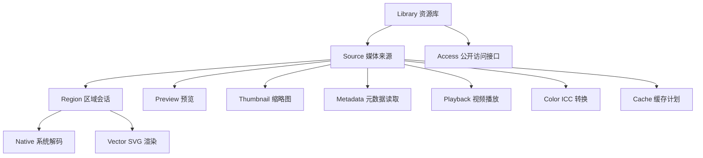
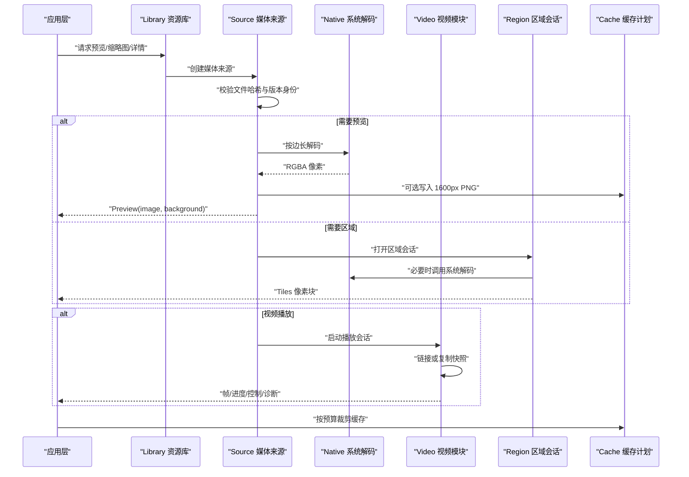
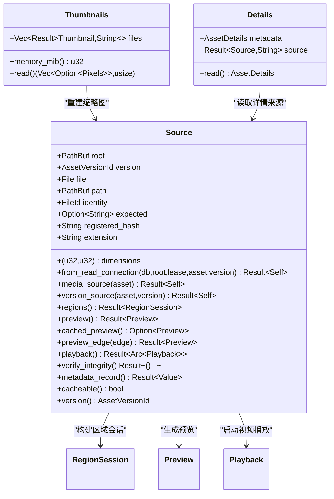
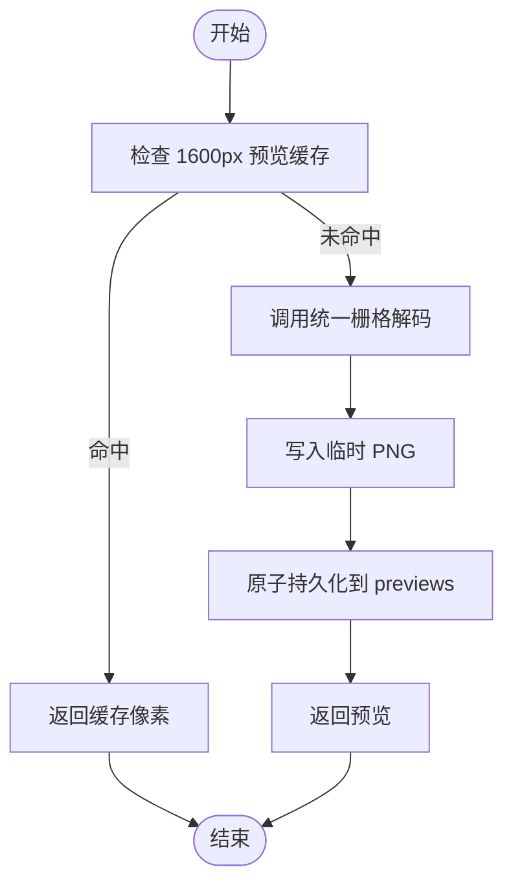
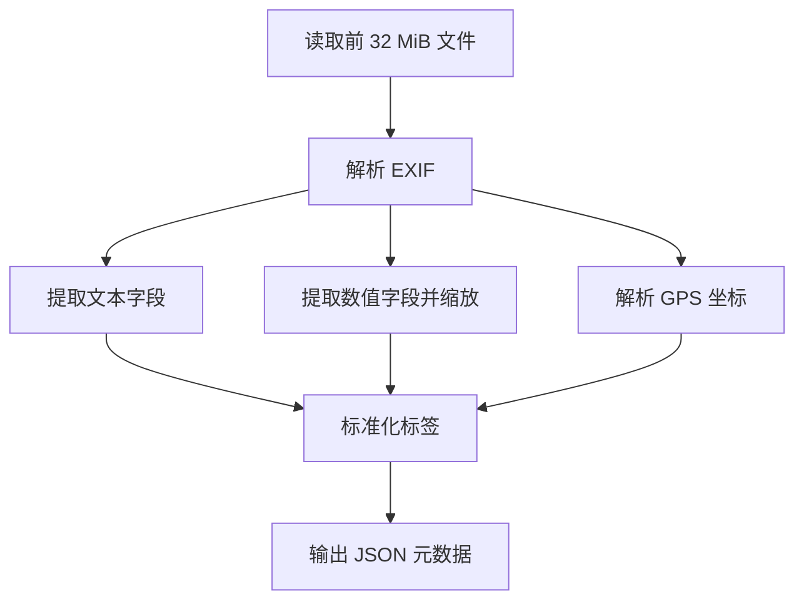
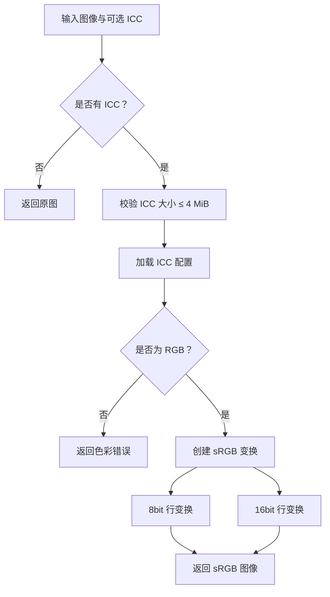
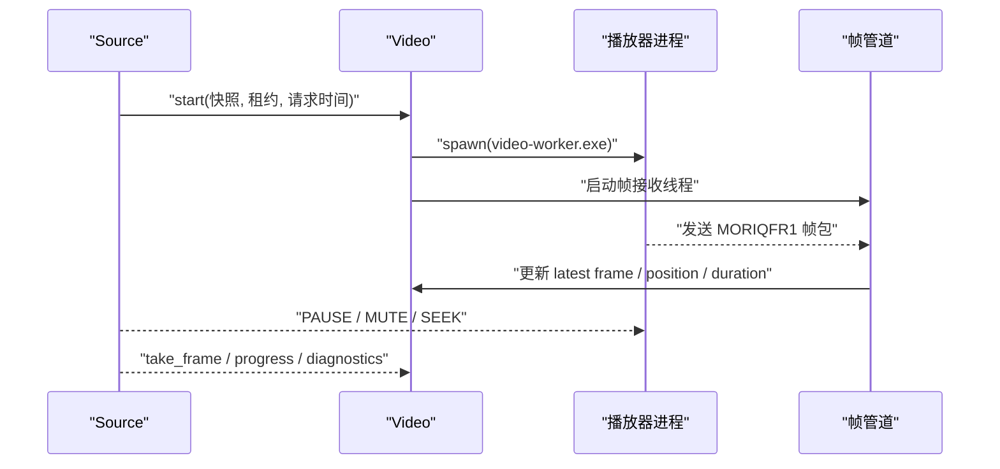
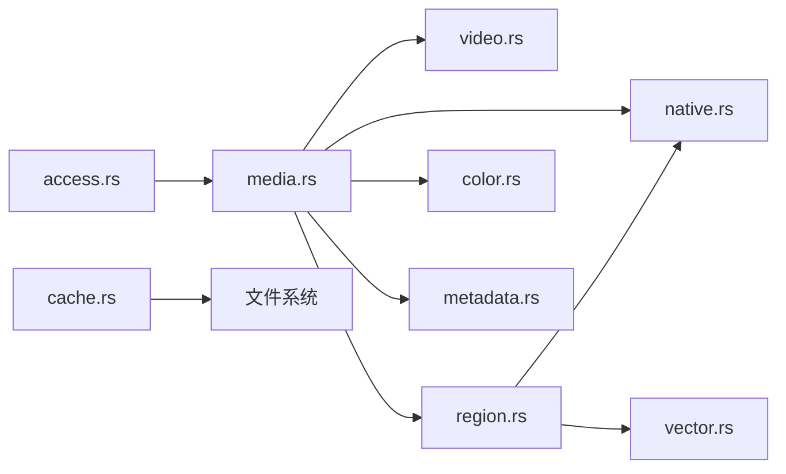

# 媒体处理子系统 (Media)

> Repo Wiki 节点 `media-processing`
> 导出自 Qoder 知识库快照 `8fbe02f6-57c2-4874-b725-1a8130851fd9`，代码基线 `7a7a8e75e18bd90294e09cd422dd7ed5a04813a0`（分支 main，zh-CN）。

<cite>
**本文引用的文件 **
- [lib.rs](../../../../crates/moriq-library/src/lib.rs)
- [media.rs](../../../../crates/moriq-library/src/media/media.rs)
- [cache.rs](../../../../crates/moriq-library/src/media/cache.rs)
- [metadata.rs](../../../../crates/moriq-library/src/media/metadata.rs)
- [color.rs](../../../../crates/moriq-library/src/media/color.rs)
- [video.rs](../../../../crates/moriq-library/src/media/video.rs)
- [region.rs](../../../../crates/moriq-library/src/media/region.rs)
- [vector.rs](../../../../crates/moriq-library/src/media/vector.rs)
- [access.rs](../../../../crates/moriq-library/src/media/access.rs)
- [native.rs](../../../../crates/moriq-library/src/media/native.rs)
- [media_probe.rs](../../../../crates/moriq-library/examples/media_probe.rs)
- [video_probe.rs](../../../../crates/moriq-library/examples/video_probe.rs)
</cite>

## 目录
1. [引言](#引言)
2. [项目结构](#项目结构)
3. [核心组件](#核心组件)
4. [架构总览](#架构总览)
5. [详细组件分析](#详细组件分析)
6. [依赖关系分析](#依赖关系分析)
7. [性能与内存特性](#性能与内存特性)
8. [故障排查指南](#故障排查指南)
9. [结论](#结论)
10. [附录：Rust API 使用示例与优化建议](#附录rust-api-使用示例与优化建议)

## 引言
本文件聚焦 Moriq Space 媒体处理子系统，说明其如何为图片、视频和 RAW 格式提供统一抽象层，并在此基础上实现缩略图缓存、预览生成、元数据处理、色彩管理、区域标注、向量特征渲染以及视频播放探测等能力。该子系统位于 `moriq-library` 的 `media` 模块中，通过冻结文件句柄、隔离解码进程、有界像素缓冲和可重建缓存策略，在保证原片安全的同时提供高性能查看、导入、导出和 AI 相关流程所需的媒体数据。

## 项目结构
媒体子系统的核心代码集中在 `crates/moriq-library/src/media` 目录下，并由库根模块集中注册。关键组织方式如下：
- `media.rs`：统一的媒体来源抽象、预览与缩略图管线、详情装配。
- `native.rs`：系统图像与 RAW 解码器隔离调用、预算控制、扩展名分类。
- `video.rs`：FFmpeg 工具调用、视频探测、播放会话。
- `region.rs`：区域标注会话、分块缓存、矢量 SVG 区域栅格化。
- `color.rs`：ICC 配置文件到 sRGB 的色彩空间转换。
- `metadata.rs`：EXIF 读取、GPS 解析、自定义标签存储与 SQL 查询编译。
- `vector.rs`：SVG 本地渲染与区域提取。
- `cache.rs`：预览与缩略图缓存清理策略。
- `access.rs`：对外暴露的缩略图和预览读取入口。

**图示来源**
- [lib.rs:1-120](../../../../crates/moriq-library/src/lib.rs#L1-L120)
- [media.rs:1-120](../../../../crates/moriq-library/src/media/media.rs#L1-L120)
- [native.rs:1-60](../../../../crates/moriq-library/src/media/native.rs#L1-L60)
- [video.rs:1-60](../../../../crates/moriq-library/src/media/video.rs#L1-L60)
- [region.rs:1-40](../../../../crates/moriq-library/src/media/region.rs#L1-L40)
- [vector.rs:1-30](../../../../crates/moriq-library/src/media/vector.rs#L1-L30)
- [color.rs:1-30](../../../../crates/moriq-library/src/media/color.rs#L1-L30)
- [cache.rs:1-30](../../../../crates/moriq-library/src/media/cache.rs#L1-L30)
- [access.rs:1-23](../../../../crates/moriq-library/src/media/access.rs#L1-L23)

**章节来源**
- [lib.rs:1-120](../../../../crates/moriq-library/src/lib.rs#L1-L120)

## 核心组件
- 媒体来源 `Source`：封装素材版本、路径、哈希、扩展名、尺寸及资源库租约，负责校验完整性、冻结文件、构建区域会话、预览、播放和元数据记录。
- 区域会话 `Session`：针对区域标注和分块查看，维护原始尺寸、缓存平面像素、临时文件和解码路径选择。
- 预览 `Preview`：包含目标预览像素和模糊背景像素，用于 UI 快速展示。
- 缩略图 `Thumbnails`：批量读取或重建缩略图，返回对应位置结果和警告计数。
- 视频播放 `Playback`：封装 FFmpeg 工作进程、帧管道、控制和诊断信息。
- 元数据读取：从 EXIF 中提取相机、镜头、拍摄时间、光圈、快门、ISO、焦距、经纬度及自定义标签。
- 色彩管理：将嵌入 ICC 配置转换为 sRGB，支持 8bit 和 16bit 像素，拒绝无效或非 RGB 配置。
- 向量特征：对 SVG 进行本地渲染，输出 RGBA 像素用于区域或全图预览。
- 缓存计划：按字节预算淘汰 `previews` 和 `thumbnails/256` 下的可重建缓存。
- 系统解码适配：通过 Windows WIC/LibRaw 或 macOS 便携路径调用隔离解码程序，限制输出尺寸和内存。

**章节来源**
- [media.rs:1-120](../../../../crates/moriq-library/src/media/media.rs#L1-L120)
- [region.rs:1-60](../../../../crates/moriq-library/src/media/region.rs#L1-L60)
- [video.rs:1-120](../../../../crates/moriq-library/src/media/video.rs#L1-L120)
- [metadata.rs:1-60](../../../../crates/moriq-library/src/media/metadata.rs#L1-L60)
- [color.rs:1-60](../../../../crates/moriq-library/src/media/color.rs#L1-L60)
- [vector.rs:1-60](../../../../crates/moriq-library/src/media/vector.rs#L1-L60)
- [cache.rs:1-87](../../../../crates/moriq-library/src/media/cache.rs#L1-L87)
- [native.rs:1-80](../../../../crates/moriq-library/src/media/native.rs#L1-L80)
- [access.rs:1-23](../../../../crates/moriq-library/src/media/access.rs#L1-L23)

## 架构总览
媒体子系统以“来源 → 解码 → 缓存 → 视图”为主线，同时通过“元数据 → 数据库 → 查询”和“视频 → 播放进程 → 帧管道”两条分支支撑多媒体能力。

**图示来源**
- [media.rs:120-300](../../../../crates/moriq-library/src/media/media.rs#L120-L300)
- [native.rs:200-320](../../../../crates/moriq-library/src/media/native.rs#L200-L320)
- [video.rs:200-420](../../../../crates/moriq-library/src/media/video.rs#L200-L420)
- [region.rs:180-370](../../../../crates/moriq-library/src/media/region.rs#L180-L370)
- [cache.rs:1-87](../../../../crates/moriq-library/src/media/cache.rs#L1-L87)

## 详细组件分析

### 统一媒体抽象层：Source、Thumbnails、Details
`Source` 是媒体处理的中心对象，它从数据库加载素材版本的哈希、格式、宽高和相对路径，并支持引用路径校验。它负责：
- 建立只读媒体来源。
- 校验源文件内容与登记哈希是否一致。
- 构建区域解码会话。
- 生成或读取预览。
- 启动视频播放。
- 读取规范化元数据记录。

`Thumbnails` 支持批量读取最多 128 个缩略图，若缺失则根据版本重建；每个缩略图解码都有限制最大宽高和分配大小，避免内存溢出。`Details` 将 EXIF、地点、AI 分类、OCR 和视频元数据合并为最终展示详情。

**图示来源**
- [media.rs:1-200](../../../../crates/moriq-library/src/media/media.rs#L1-L200)
- [media.rs:300-577](../../../../crates/moriq-library/src/media/media.rs#L300-L577)

**章节来源**
- [media.rs:1-200](../../../../crates/moriq-library/src/media/media.rs#L1-L200)
- [media.rs:300-577](../../../../crates/moriq-library/src/media/media.rs#L300-L577)

### 缓存机制：缩略图缓存、预览图生成与内存预算
缓存由两个层面组成：
1. 磁盘缓存：`thumbnails/256` 与 `previews` 目录中的 PNG 和平面 RGBA 缓存。
2. 内存预算：缩略图批量读取、预览边缘解码、区域 tile 解码均有明确上限。

`Plan::trim` 扫描 `previews` 和 `thumbnails/256`，仅删除 UUID 命名且符合后缀的文件，按修改时间和路径顺序淘汰，直到剩余字节数低于预算。它还会跳过符号链接和非文件条目，并在 Windows 上跳过隐藏属性文件。

预览生成遵循以下规则：
- 如果请求边长为 1600 且来源允许缓存，则优先读取 `preversions/{id}-srgb1-1600.png`。
- 否则调用统一栅格解码，并将结果以快速压缩 PNG 写回临时文件再原子持久化。
- 失败时记录警告但不阻塞主流程。

缩略图重建在批量读取中发现缺失时，会重新解码 256px 缩略图，并使用原子持久化保证一致性。

**图示来源**
- [media.rs:300-420](../../../../crates/moriq-library/src/media/media.rs#L300-L420)
- [cache.rs:1-87](../../../../crates/moriq-library/src/media/cache.rs#L1-L87)

**章节来源**
- [media.rs:300-420](../../../../crates/moriq-library/src/media/media.rs#L300-L420)
- [cache.rs:1-87](../../../../crates/moriq-library/src/media/cache.rs#L1-L87)
- [access.rs:1-23](../../../../crates/moriq-library/src/media/access.rs#L1-L23)

### 元数据处理：EXIF、GPS 与自定义标签
EXIF 读取限制最多读取前 32 MiB，防止超大容器耗尽内存。它提取相机型号、镜头、拍摄时间，并对数值型字段进行归一化：
- ISO：直接值。
- 光圈：乘以 100。
- 快门：转换为微秒。
- 焦距：乘以 100。

GPS 坐标通过 `location::exif_location` 解析后写入 `latitude_e6` 与 `longitude_e6`，单位为百万分之一度。所有字段最终汇总为 JSON，并附加 `tags` 字典，其中每个标签字符串最多保留 4096 字符。

元数据还用于 SQL 查询编译，支持最多 32 个条件，字段限定在白名单内，文字匹配长度不超过 1024，范围查询要求最小值不大于最大值。对于 `taken_at`，会将日期时间字符串标准化为整数以便比较。

**图示来源**
- [metadata.rs:1-153](../../../../crates/moriq-library/src/media/metadata.rs#L1-L153)

**章节来源**
- [metadata.rs:1-153](../../../../crates/moriq-library/src/media/metadata.rs#L1-L153)

### 色彩管理系统：ICC 配置、色彩空间转换与颜色分析
色彩模块使用 `moxcms` 将嵌入 ICC 配置的图像转换为 sRGB：
- 如果无 ICC，则直接返回原图。
- 如果 ICC 超过 4 MiB，返回错误。
- 如果色彩空间不是 RGB，返回错误，提示灰度或 CMYK 待适配。
- 对 16bit RGBA 和 8bit RGBA 分别创建原地变换，逐行处理像素。

测试覆盖 Adobe RGB 转 sRGB、预览与原图一致、导出一致性，以及无效 ICC 不被静默绕过。

**图示来源**
- [color.rs:1-120](../../../../crates/moriq-library/src/media/color.rs#L1-L120)

**章节来源**
- [color.rs:1-191](../../../../crates/moriq-library/src/media/color.rs#L1-L191)

### 视频处理：帧提取、时长计算与播放
视频模块使用内置 FFmpeg 工具，不通过 PATH 查找可执行文件，并通过 `runtime_root` 定位 `codecs` 目录，验证运行组件完整性。主要功能包括：
- `extension`：识别受支持的视频扩展名。
- `tool`：获取 `ffmpeg` 或 `ffprobe` 路径。
- `probe`：调用 `ffprobe` 提取宽度、高度、旋转、时长、编解码器、像素格式、帧率、色彩空间和音频轨道。
- `decode`：基于探测结果生成封面帧。
- `Playback`：启动隔离播放进程，接收固定协议帧，提供取帧、进度、控制、停止和诊断。

帧协议头以 `MORIQFR1` 开头，随后是宽高、播放时钟、总时长和 RGBA 像素；宽度与高度上限为 1920，旧帧会被新帧替换，避免长时间缓冲。

**图示来源**
- [video.rs:120-320](../../../../crates/moriq-library/src/media/video.rs#L120-L320)
- [video.rs:320-627](../../../../crates/moriq-library/src/media/video.rs#L320-L627)

**章节来源**
- [video.rs:1-200](../../../../crates/moriq-library/src/media/video.rs#L1-L200)
- [video.rs:200-627](../../../../crates/moriq-library/src/media/video.rs#L200-L627)

### 区域标注系统：矩形、多边形与向量数据存储
区域系统通过 `Session` 提供不可变的查看会话：
- 对 RAW 和普通栅格图像，优先尝试读取 `previews/{id}-raw-flat1.rgba` 或 `previews/{id}-raster-flat1.rgba` 平面缓存。
- 若缓存不存在或损坏，则调用原生解码器生成新的平面缓存，然后持久化。
- 对 SVG，走 `vector::svg_region` 按层级缩放渲染。
- 对 Windows 非 SVG，区域可直接调用系统解码器输出 512px 以内像素块。
- 对其他平台，先解码整图再裁剪并按 512px 边界重采样。

区域请求必须满足：
- 宽高大于 0。
- level 是 2 的幂且不超过 64。
- 宽高不超过 512 × level。
- 区域不能超出原图尺寸。

**图示来源**
- [region.rs:1-200](../../../../crates/moriq-library/src/media/region.rs#L1-L200)
- [region.rs:200-370](../../../../crates/moriq-library/src/media/region.rs#L200-L370)
- [vector.rs:60-136](../../../../crates/moriq-library/src/media/vector.rs#L60-L136)

**章节来源**
- [region.rs:1-370](../../../../crates/moriq-library/src/media/region.rs#L1-L370)
- [vector.rs:1-136](../../../../crates/moriq-library/src/media/vector.rs#L1-L136)

### 向量特征与 SVG 渲染
向量模块为 SVG 提供本地渲染树，限制外部图像解析并设置系统字体。它支持：
- `svg_region`：按 `ImageRegion` 的 x、y、width、height、level 缩放渲染。
- `svg`：按最长边缩放至目标 edge，输出与其他媒体一致的 `Decoded`。
- 预乘 alpha 到普通 RGBA 转换。

该模块不涉及 AI 向量检索，而是为区域查看和预览提供像素特征数据。

**章节来源**
- [vector.rs:1-136](../../../../crates/moriq-library/src/media/vector.rs#L1-L136)

### 系统解码适配与 RAW 支持
`native.rs` 定义了 RAW 扩展名列表、导入扩展名列表、最大输出边长和文件预算。它通过隔离进程调用 Windows WIC 或 LibRaw，并校验输出头 `MORIQIMG`、宽高、字节数和长度一致性。RAW 探测可估算解码内存预算，供准入控制使用。

关键点：
- RAW 扩展名统一由 `raw_extension` 和 `raw_sql` 管理。
- 文件预算按类型区分：视频 64 GiB，RAW 2 GiB，其他图片 256 MiB。
- 解码超时：RAW 120 秒，普通系统解码 45 秒。
- 输出回执长度必须在 24 字节头加像素数据范围内。

**章节来源**
- [native.rs:1-200](../../../../crates/moriq-library/src/media/native.rs#L1-L200)
- [native.rs:200-431](../../../../crates/moriq-library/src/media/native.rs#L200-L431)

## 依赖关系分析
媒体子系统内部模块耦合清晰，主要依赖方向如下：
- `media` 依赖 `native`、`video`、`region`、`vector`、`color`、`metadata`、`resize`。
- `region` 依赖 `native` 和 `vector`。
- `video` 依赖运行时组件和 FFmpeg。
- `native` 依赖操作系统特定解码器和 LibRaw。
- `cache` 依赖文件系统与数据库连接。
- `access` 暴露给上层 UI 和 catalog 模块。

**图示来源**
- [lib.rs:1-120](../../../../crates/moriq-library/src/lib.rs#L1-L120)
- [media.rs:1-120](../../../../crates/moriq-library/src/media/media.rs#L1-L120)
- [region.rs:1-60](../../../../crates/moriq-library/src/media/region.rs#L1-L60)
- [native.rs:1-60](../../../../crates/moriq-library/src/media/native.rs#L1-L60)
- [video.rs:1-60](../../../../crates/moriq-library/src/media/video.rs#L1-L60)

**章节来源**
- [lib.rs:1-120](../../../../crates/moriq-library/src/lib.rs#L1-L120)
- [media.rs:1-120](../../../../crates/moriq-library/src/media/media.rs#L1-L120)

## 性能与内存特性
- 缩略图批量读取：最多 128 项，单张解码限制宽高 512、分配 4 MiB；若存在重建任务，预估内存预算为 1024 MiB，否则为 128 MiB。
- 预览缓存：1600px PNG 最大 32 MiB，快速压缩写入，失败时降级为内存结果。
- 区域 tile：平面缓存命中时仅需 16 MiB 预算；未命中时预估 1024 MiB，但实际读取按偏移随机访问，避免整图常驻。
- 视频帧：仅保留最新帧，拒绝超大分辨率，避免队列堆积。
- 元数据：EXIF 读取限制 32 MiB，JSON 标签字符串限制 4096 字符。
- 色彩转换：ICC 限制 4 MiB，按行处理避免整图重复分配。
- 系统解码：输出边长上限 8192，RAW 最高 65535，回执长度严格校验。
- 缓存清理：按修改时间排序，删除最旧文件直至达到预算。

[本节为通用性能讨论，不直接分析具体文件]

## 故障排查指南
常见错误与处理建议：
- 缩略图读取失败：日志记录警告，返回空像素，不影响后续流程。
- 区域解码失败：返回“区域解码失败”，原片保留，可重试或重建缓存。
- 区域缓存损坏：自动重建平面缓存，即使文件被删除，已打开会话仍可使用缓存。
- 视频探测失败：返回“视频探测/解码超时或输出超出预算”，检查 FFmpeg 工具和输入文件。
- RAW 解码失败：返回 LibRaw 错误或系统解码错误，检查相机型号、压缩方式和系统编解码器。
- ICC 无效：返回色彩错误，不要静默忽略，确保 ICC 配置有效且为 RGB。
- 预览缓存写入失败：记录警告并继续返回内存预览，不影响查看。
- 外部引用变化：冻结外部引用时会校验哈希，变化则报错并要求重新定位原片。

**章节来源**
- [media.rs:300-577](../../../../crates/moriq-library/src/media/media.rs#L300-L577)
- [region.rs:180-370](../../../../crates/moriq-library/src/media/region.rs#L180-L370)
- [video.rs:420-627](../../../../crates/moriq-library/src/media/video.rs#L420-L627)
- [native.rs:200-431](../../../../crates/moriq-library/src/media/native.rs#L200-L431)
- [color.rs:120-191](../../../../crates/moriq-library/src/media/color.rs#L120-L191)

## 结论
Moriq Space 媒体处理子系统通过 `Source` 统一抽象图片、视频和 RAW 数据，结合隔离解码、ICC 色彩管理、EXIF/GPS 元数据处理、区域缓存和 SVG 向量渲染，形成稳定高效的媒体管线。其设计强调安全性（原片保护、哈希校验）、可控性（预算限制、超时取消）和可扩展性（统一接口、模块化职责）。在实际使用中，应优先利用缓存和区域读取降低内存压力，并结合视频探测与播放会话提升交互体验。

[本节为总结性内容，不直接分析具体文件]

## 附录：Rust API 使用示例与优化建议

### 基本使用路径
- 创建资源库并导入媒体：
  - 参考 [media_probe.rs:1-101](../../../../crates/moriq-library/examples/media_probe.rs#L1-L101)。
- 查询 RAW 媒体并生成预览：
  - 使用 `Query::default()` 和 `MediaKind::Raw`。
  - 调用 `Library::page`、`Library::preview`。
- 导出媒体：
  - 使用 `export::run` 与 `ExportOptions`。
- 视频探测与导入：
  - 参考 [video_probe.rs:1-90](../../../../crates/moriq-library/examples/video_probe.rs#L1-L90)。
  - 使用 `video::probe` 获取宽高、时长、编解码器等。

### 推荐实践
- 使用 `Library::thumbnail(version)` 读取已有缩略图，避免重复解码。
- 使用 `Library::preview(id)` 获取当前预览，如需更大尺寸则调用 `Source::preview_edge`。
- 使用 `Source::regions()` 构建区域会话，避免 UI 直接访问文件。
- 使用 `RegionSession::tile(region)` 获取小尺寸 tile，配合 `tile_memory_mib` 预估内存。
- 使用 `video::probe(path)` 在导入前判断视频有效性。
- 使用 `video::Playback` 控制播放、跳转和静音，并通过 `diagnostics` 收集问题报告。
- 使用 `cache_plan().trim(budget)` 定期清理预览和缩略图缓存。
- 对含 ICC 的图片，依赖 `color::to_srgb` 进行统一色彩空间处理。
- 对 EXIF 查询，使用 `metadata::compile` 生成安全 SQL 条件。

### 性能优化建议
- 批量操作：优先使用 `thumbnail_plan` 和 `read` 批量读取缩略图。
- 缓存优先：启用 `previews` 和 `thumbnails/256` 缓存，减少重复解码。
- 区域查看：使用 `level` 和 512px 边界限制 tile 大小。
- 视频预览：使用 `video::decode` 生成封面帧，避免全量解码。
- 色彩转换：避免频繁 ICC 转换，尽量复用已转换像素。
- 元数据查询：限制条件数量和内容长度，避免过大 JSON。
- 预算控制：合理设置 `edge`、`budget` 和 `max_alloc`，防止内存峰值过高。
- 原片保护：始终通过 `Source` 和 `Playback` 访问原片，避免直接读写用户文件。

[本节为示例与指导，不直接分析具体文件]