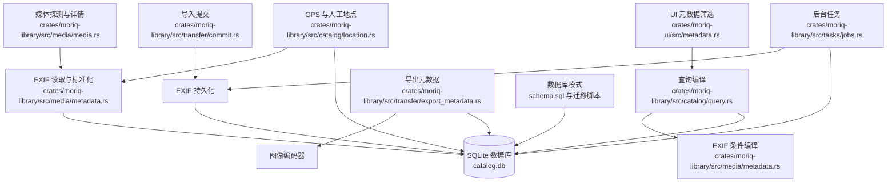
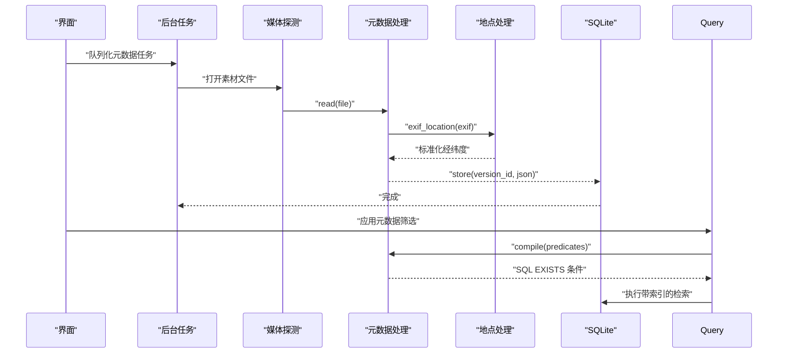
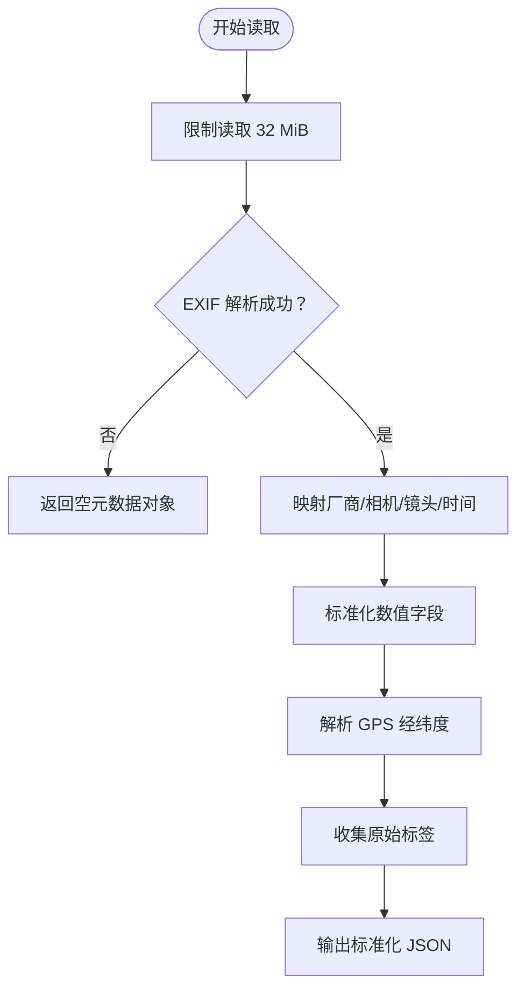
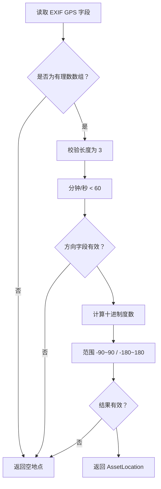
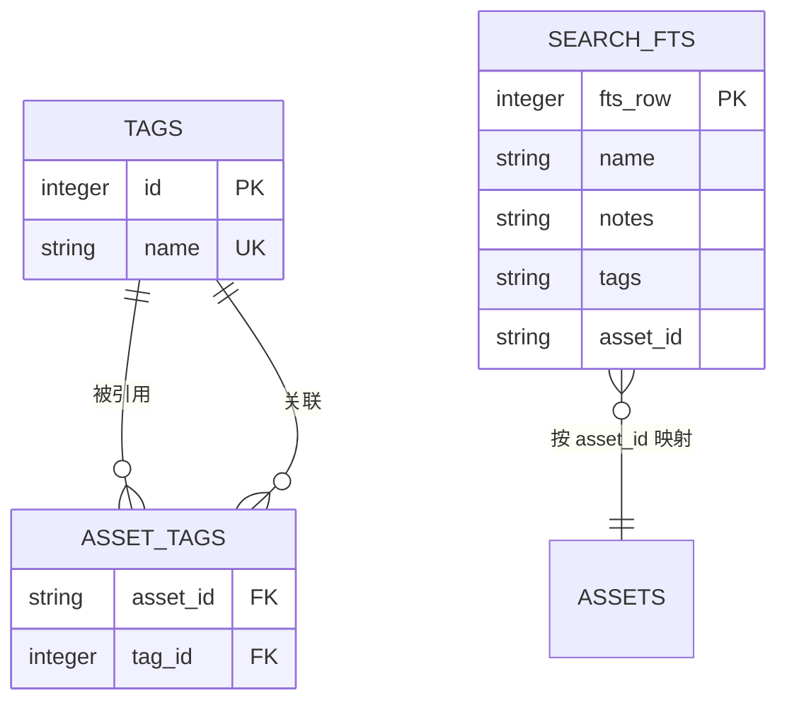
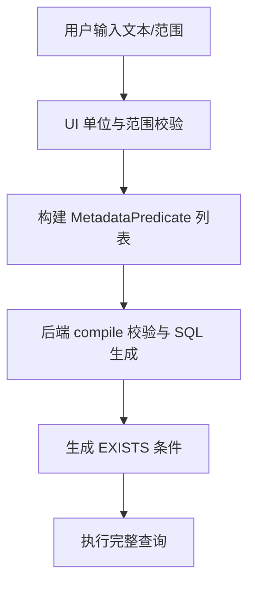
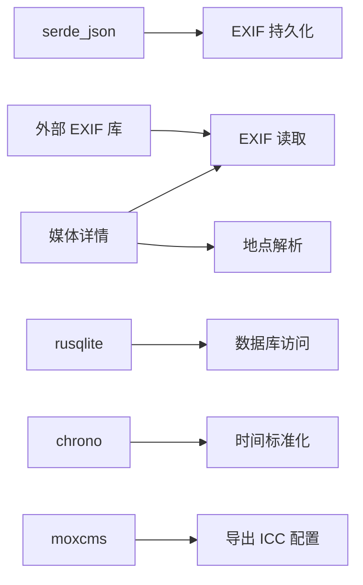

# 元数据处理 (Metadata)

> Repo Wiki 节点 `media-metadata`
> 导出自 Qoder 知识库快照 `8fbe02f6-57c2-4874-b725-1a8130851fd9`，代码基线 `7a7a8e75e18bd90294e09cd422dd7ed5a04813a0`（分支 main，zh-CN）。

<cite>
**本文引用的文件**   
- [metadata.rs](../../../../crates/moriq-library/src/media/metadata.rs)
- [location.rs](../../../../crates/moriq-library/src/catalog/location.rs)
- [schema.sql](../../../../crates/moriq-library/src/database/schema.sql)
- [migration_8.sql](../../../../crates/moriq-library/src/database/migrations/migration_8.sql)
- [migration_10.sql](../../../../crates/moriq-library/src/database/migrations/migration_10.sql)
- [migration_11.sql](../../../../crates/moriq-library/src/database/migrations/migration_11.sql)
- [migration_17.sql](../../../../crates/moriq-library/src/database/migrations/migration_17.sql)
- [migration_23.sql](../../../../crates/moriq-library/src/database/migrations/migration_23.sql)
- [media.rs](../../../../crates/moriq-library/src/media/media.rs)
- [commit.rs](../../../../crates/moriq-library/src/transfer/commit.rs)
- [export_metadata.rs](../../../../crates/moriq-library/src/transfer/export_metadata.rs)
- [core.rs](../../../../crates/moriq-library/src/library/core.rs)
- [jobs.rs](../../../../crates/moriq-library/src/tasks/jobs.rs)
- [query.rs](../../../../crates/moriq-library/src/catalog/query.rs)
- [metadata.rs](../../../../crates/moriq-ui/src/metadata.rs)
</cite>

## 目录
1. [引言](#引言)
2. [项目结构](#项目结构)
3. [核心组件](#核心组件)
4. [架构总览](#架构总览)
5. [详细组件分析](#详细组件分析)
6. [依赖关系分析](#依赖关系分析)
7. [性能与可扩展性](#性能与可扩展性)
8. [故障排查指南](#故障排查指南)
9. [结论](#结论)
10. [附录：查询与过滤示例](#附录查询与过滤示例)

## 引言
本文面向 Moriq Space 的“元数据处理”子系统，聚焦 EXIF、GPS、标签、持久化存储、版本关联以及导出阶段的元数据行为。该模块不是对图片原始字节进行通用 IPTC/XMP 编辑器，而是以“规范化 + 索引化 + 可筛选”的方式把常用元数据抽取到 SQLite 中，用于高效检索、界面展示和导出重建。

重点包括：
- EXIF 标准字段的解析与数值归一化。
- GPS 经纬度的有理数格式解析与地理信息系统链接生成。
- 人工地点与自动 EXIF 地点的分离设计。
- 标签系统的数据库模型与全文搜索集成。
- 元数据的持久化表结构、索引策略与迁移机制。
- 元数据查询编译、范围约束与 UI 交互流程。
- 导出时 EXIF 的重建、裁剪与安全限制。
- IPTC/XMP 在当前实现中的边界说明。

## 项目结构
元数据处理相关代码主要分布在以下位置：
- 媒体层：EXIF 读取、标准化、SQL 条件编译、EXIF 写入。
- 编目层：人工地点保存、GPS 解析、地图 URL 生成。
- 数据库层：基础表、EXIF 表、地点表、标签表及迁移脚本。
- 传输层：导入阶段持久化、导出阶段 EXIF 重建。
- 任务层：后台构建/更新元数据索引。
- UI 层：元数据筛选表单、单位转换与校验。



**图表来源**
- [metadata.rs:1-153](../../../../crates/moriq-library/src/media/metadata.rs#L1-L153)
- [location.rs:1-226](../../../../crates/moriq-library/src/catalog/location.rs#L1-L226)
- [media.rs:300-365](../../../../crates/moriq-library/src/media/media.rs#L300-L365)
- [commit.rs:245-261](../../../../crates/moriq-library/src/transfer/commit.rs#L245-L261)
- [export_metadata.rs:1-142](../../../../crates/moriq-library/src/transfer/export_metadata.rs#L1-L142)
- [jobs.rs:76-927](../../../../crates/moriq-library/src/tasks/jobs.rs#L76-L927)
- [query.rs:98-104](../../../../crates/moriq-library/src/catalog/query.rs#L98-L104)
- [schema.sql:1-42](../../../../crates/moriq-library/src/database/schema.sql#L1-L42)

**章节来源**
- [metadata.rs:1-153](../../../../crates/moriq-library/src/media/metadata.rs#L1-L153)
- [location.rs:1-226](../../../../crates/moriq-library/src/catalog/location.rs#L1-L226)
- [schema.sql:1-42](../../../../crates/moriq-library/src/database/schema.sql#L1-L42)

## 核心组件
- EXIF 读取与标准化：从最多 32 MiB 的输入中读取 EXIF，提取厂商、相机、镜头、拍摄时间、ISO、光圈、曝光时间、焦距、经纬度，并附加所有原始标签字符串。
- GPS 解析：从 EXIF GPSLatitude/GPSLongitude 及其方向字段解析为十进制度数，并做合理范围校验；同时支持人工地点保存。
- 元数据持久化：将规范化后的 JSON 存入 `version_exif`，并与 `asset_versions` 通过外键绑定，保证删除级联。
- 查询编译：把用户输入的文本包含、最小值、最大值转换为 SQL 条件，并对 `taken_at` 做统一整数比较。
- 标签系统：基于 `tags` 与 `asset_tags` 多对多关系，配合 FTS5 全文索引提供名称、备注、标签联合搜索。
- 导出 EXIF：重建 EXIF，移除敏感或尺寸相关字段，设置方向、色彩空间与像素维度，并注入 ICC 色彩配置文件。
- 后台任务：提供“为已有素材建立/更新 EXIF 索引”的任务入口，避免阻塞主流程。

**章节来源**
- [metadata.rs:1-153](../../../../crates/moriq-library/src/media/metadata.rs#L1-L153)
- [location.rs:1-226](../../../../crates/moriq-library/src/catalog/location.rs#L1-L226)
- [migration_17.sql:1-7](../../../../crates/moriq-library/src/database/migrations/migration_17.sql#L1-L7)
- [migration_8.sql:1-31](../../../../crates/moriq-library/src/database/migrations/migration_8.sql#L1-L31)
- [export_metadata.rs:1-142](../../../../crates/moriq-library/src/transfer/export_metadata.rs#L1-L142)
- [jobs.rs:76-927](../../../../crates/moriq-library/src/tasks/jobs.rs#L76-L927)

## 架构总览
元数据处理采用“轻量解析 + 结构化索引 + 界面驱动”的分层设计：



**图表来源**
- [jobs.rs:76-927](../../../../crates/moriq-library/src/tasks/jobs.rs#L76-L927)
- [media.rs:300-365](../../../../crates/moriq-library/src/media/media.rs#L300-L365)
- [metadata.rs:1-153](../../../../crates/moriq-library/src/media/metadata.rs#L1-L153)
- [location.rs:1-226](../../../../crates/moriq-library/src/catalog/location.rs#L1-L226)
- [query.rs:98-104](../../../../crates/moriq-library/src/catalog/query.rs#L98-L104)

## 详细组件分析

### EXIF 解析与标准化
EXIF 读取函数会：
- 限制最大读取大小为 32 MiB。
- 使用外部 EXIF 库解析容器。
- 若无法解析，返回空对象而非错误，使缺失元数据不影响整体流程。
- 映射厂商、相机型号、镜头、拍摄时间等标准字段。
- 对 ISO、光圈、曝光时间、焦距进行有理数转浮点、非负与有限值校验，并按固定缩放因子转为整数存储。
- 调用 GPS 解析函数补充经纬度。
- 收集前 1024 个标签，每个标签字符串截取至 4096 字符，放入 `tags` 字段。

关键行为：
- 时间戳不直接存储 Unix 秒，而是按 YYYYMMDDHHMMSS 形式的整数，便于后续 SQL 范围比较。
- 光圈、焦距按 ×100 存储；曝光时间、纬度、经度按 ×1000000 存储，减少浮点误差。
- 原始标签作为辅助诊断信息，不参与核心筛选。



**图表来源**
- [metadata.rs:1-153](../../../../crates/moriq-library/src/media/metadata.rs#L1-L153)
- [location.rs:1-226](../../../../crates/moriq-library/src/catalog/location.rs#L1-L226)

**章节来源**
- [metadata.rs:1-153](../../../../crates/moriq-library/src/media/metadata.rs#L1-L153)

### GPS 坐标解析与地理信息系统集成
GPS 解析函数：
- 要求 GPSLatitude/GPSLongitude 为长度为 3 的有理数数组，且分母不为零。
- 校验分钟和秒小于 60。
- 要求对应方向字段为 ASCII，且值为 N/S 或 E/W。
- 计算十进制度数，并限制在 [-90, 90] 和 [-180, 180]。
- 失败时返回空结果，不会抛出异常。

此外，人工地点由 `set_location` 保存，具备：
- 版本级隔离：记录与 `asset_versions.id` 关联。
- 值域校验：纬度、经度、标签长度。
- 存在性检查：确保当前资产与展示版本仍匹配。
- 事务性写入：插入、更新或删除地点在同一事务内。

测试还验证了 OpenStreetMap 地图链接生成逻辑，并在无效坐标时返回空链接。



**图表来源**
- [location.rs:1-226](../../../../crates/moriq-library/src/catalog/location.rs#L1-L226)

**章节来源**
- [location.rs:1-226](../../../../crates/moriq-library/src/catalog/location.rs#L1-L226)

### IPTC 与 XMP 元数据读写
在当前仓库实现中：
- 没有独立的 IPTC 或 XMP 解析器。
- EXIF 读取后会将全部原始标签以字符串形式存入 `tags`，供调试与展示。
- 导出阶段仅操作 EXIF，未涉及 IPTC/XMP 写入。
- 因此，IPTC/XMP 属于“当前未专门支持”的范围；若需要扩展，应新增专用解析器，并在导出时决定是否保留或转换。

建议扩展方式：
- 新增 IPTC/XMP 解析函数，返回结构化键值。
- 扩展 `MetadataPredicate` 支持的字段集合。
- 在 `version_exif.data` 中增加命名空间字段，如 `iptc`、`xmp`。
- 在导出时决定保留策略：丢弃、合并或原样拷贝。

**章节来源**
- [metadata.rs:1-153](../../../../crates/moriq-library/src/media/metadata.rs#L1-L153)
- [export_metadata.rs:1-142](../../../../crates/moriq-library/src/transfer/export_metadata.rs#L1-L142)

### 自定义标签系统
标签系统与元数据筛选是两个不同层次：
- 标签用于资产的分类归属，存储在 `tags` 与 `asset_tags`。
- 元数据筛选针对 EXIF 标准化字段，如相机、时间、ISO、GPS 等。

标签相关设计：
- `tags` 表维护唯一标签名。
- `asset_tags` 是多对多关联表，并提供反向索引。
- 通过 FTS5 虚拟表维护名称、备注、标签的三列联合搜索。
- 多个触发器在标签增删改时同步 FTS5。
- 活动日志在标签变更时记录操作。



**图表来源**
- [schema.sql:1-42](../../../../crates/moriq-library/src/database/schema.sql#L1-L42)
- [migration_8.sql:1-31](../../../../crates/moriq-library/src/database/migrations/migration_8.sql#L1-L31)
- [migration_10.sql:1-43](../../../../crates/moriq-library/src/database/migrations/migration_10.sql#L1-L43)

**章节来源**
- [schema.sql:1-42](../../../../crates/moriq-library/src/database/schema.sql#L1-L42)
- [migration_8.sql:1-31](../../../../crates/moriq-library/src/database/migrations/migration_8.sql#L1-L31)
- [migration_10.sql:1-43](../../../../crates/moriq-library/src/database/migrations/migration_10.sql#L1-L43)

### 元数据持久化与版本控制
元数据持久化的关键点：
- `version_exif.version_id` 是主键，外键指向 `asset_versions.id`，删除版本时级联删除 EXIF。
- `store` 使用 `INSERT ... ON CONFLICT DO UPDATE`，防止重复写入竞争。
- 写入前会序列化 JSON，失败时报错。
- 查询时使用 `EXISTS(SELECT 1 FROM version_exif em WHERE em.version_id=v.id AND ...)`，只判断是否存在匹配元数据，不返回整行。
- 版本控制体现在：元数据始终与具体版本绑定，而不是直接与资产绑定；展示版本变化时，人工地点和 AI 内容也会随之变化。

```mermaid
classDiagram
    class AssetVersions {
        +string id
        +string asset_id
        +string parent_version_id
        +string origin
        +string path
        +string sha256
        +string format
        +int width
        +int height
        +long bytes
    }

    class VersionExif {
        +string version_id PK
        +string data
    }

    class AssetLocation {
        +double latitude
        +double longitude
        +string label
    }

    class Tags {
        +int id PK
        +string name UK
    }

    class AssetTags {
        +string asset_id FK
        +int tag_id FK
    }

    AssetVersions ||--o{ VersionExif : "一对多"
    AssetVersions ||--o{ AssetLocation : "一对多"
    Assets ||--o{ AssetTags : "一对多"
    Tags ||--o{ AssetTags : "一对多"
```

**图表来源**
- [schema.sql:1-42](../../../../crates/moriq-library/src/database/schema.sql#L1-L42)
- [migration_11.sql:1-7](../../../../crates/moriq-library/src/database/migrations/migration_11.sql#L1-L7)
- [migration_17.sql:1-7](../../../../crates/moriq-library/src/database/migrations/migration_17.sql#L1-L7)

**章节来源**
- [metadata.rs:1-153](../../../../crates/moriq-library/src/media/metadata.rs#L1-L153)
- [commit.rs:245-261](../../../../crates/moriq-library/src/transfer/commit.rs#L245-L261)
- [schema.sql:1-42](../../../../crates/moriq-library/src/database/schema.sql#L1-L42)
- [migration_11.sql:1-7](../../../../crates/moriq-library/src/database/migrations/migration_11.sql#L1-L7)
- [migration_17.sql:1-7](../../../../crates/moriq-library/src/database/migrations/migration_17.sql#L1-L7)

### 元数据查询与过滤
查询流程：
- UI 层定义 10 个标准化字段，包括厂商、相机、镜头、拍摄日期、ISO、光圈、曝光时间、焦距、纬度、经度。
- 用户输入文本包含、最小值、最大值后，UI 进行单位转换与范围校验。
- 后端 `compile` 函数校验字段是否在允许集合中，限制条件数量不超过 32，文字长度不超过 1024，范围起点不得大于终点。
- `taken_at` 使用字符串替换和 CAST 转换为整数进行比较。
- 最终生成 `EXISTS(... version_exif ...)` 子句，结合其他查询条件执行。



**图表来源**
- [metadata.rs:1-271](../../../../crates/moriq-ui/src/metadata.rs#L1-L271)
- [metadata.rs:1-153](../../../../crates/moriq-library/src/media/metadata.rs#L1-L153)
- [query.rs:98-104](../../../../crates/moriq-library/src/catalog/query.rs#L98-L104)

**章节来源**
- [metadata.rs:1-271](../../../../crates/moriq-ui/src/metadata.rs#L1-L271)
- [metadata.rs:1-153](../../../../crates/moriq-library/src/media/metadata.rs#L1-L153)
- [query.rs:98-104](../../../../crates/moriq-library/src/catalog/query.rs#L98-L104)

### 导出阶段的元数据行为
导出 EXIF 的逻辑：
- 从源文件读取最多 32 MiB。
- 忽略 MakerNote、Orientation、ImageWidth、ImageLength、PixelXDimension、PixelYDimension、ColorSpace 等字段。
- 重新设置 Orientation、ColorSpace、像素宽高，以适配输出尺寸。
- 写入新的 EXIF，并限制导出大小不超过 4 MiB。
- 图像编码器会先设置 sRGB ICC 配置，再可选地附加 EXIF。

这保证了导出产物方向正确、色彩空间一致，同时避免把原始文件的尺寸或方向标记带入新图。

**章节来源**
- [export_metadata.rs:1-142](../../../../crates/moriq-library/src/transfer/export_metadata.rs#L1-L142)

## 依赖关系分析
- EXIF 解析依赖外部 `exif` 库。
- 元数据 JSON 依赖 `serde_json`。
- 数据库访问依赖 `rusqlite`。
- 时间与日期依赖 `chrono`。
- 颜色空间依赖 `moxcms`。
- 媒体探测与详情位于 `media.rs`，负责调用元数据读取、地点解析、视频元数据、人脸、OCR、AI 内容等，并把结果合并成 `AssetDetails`。



**图表来源**
- [metadata.rs:1-153](../../../../crates/moriq-library/src/media/metadata.rs#L1-L153)
- [media.rs:300-365](../../../../crates/moriq-library/src/media/media.rs#L300-L365)
- [export_metadata.rs:1-142](../../../../crates/moriq-library/src/transfer/export_metadata.rs#L1-L142)

**章节来源**
- [metadata.rs:1-153](../../../../crates/moriq-library/src/media/metadata.rs#L1-L153)
- [media.rs:300-365](../../../../crates/moriq-library/src/media/media.rs#L300-L365)
- [export_metadata.rs:1-142](../../../../crates/moriq-library/src/transfer/export_metadata.rs#L1-L142)

## 性能与可扩展性
- EXIF 读取限制 32 MiB，避免大文件或损坏文件导致内存压力。
- 标签字符串截取至 4096 字符，避免单条元数据过大。
- EXIF 导出限制 4 MiB，防止重建 EXIF 膨胀。
- 查询条件最多 32 个，防止 SQL 参数过多。
- 文本包含条件长度限制 1024，防止超长模糊匹配。
- `version_exif` 使用 JSON 字段，并为相机、拍摄时间、ISO、GPS 建立表达式索引，提升常见筛选路径。
- 标签搜索使用 FTS5 与 trigram tokenizer，适合中文和英文混合场景。
- 数据库使用 WAL 模式和 FULL 同步策略，提高并发写入安全与恢复能力。

优化建议：
- 如果未来扩展 IPTC/XMP，应避免把整个块存入 JSON，而应只索引必要字段。
- GPS 查询可考虑加入距离范围索引方案，例如 H3 或 geohash 预计算。
- 对大量历史 EXIF 重建任务，应结合 `tasks/jobs.rs` 的批量调度，避免一次性扫描全库。

**章节来源**
- [metadata.rs:1-153](../../../../crates/moriq-library/src/media/metadata.rs#L1-L153)
- [export_metadata.rs:1-142](../../../../crates/moriq-library/src/transfer/export_metadata.rs#L1-L142)
- [migration_17.sql:1-7](../../../../crates/moriq-library/src/database/migrations/migration_17.sql#L1-L7)
- [migration_8.sql:1-31](../../../../crates/moriq-library/src/database/migrations/migration_8.sql#L1-L31)
- [core.rs:201-400](../../../../crates/moriq-library/src/library/core.rs#L201-L400)

## 故障排查指南
常见问题与定位方式：
- EXIF 无法读取：媒体详情中可能显示“EXIF 无法读取”，表示底层解析失败，但不会中断导入。
- GPS 为空：检查 EXIF 是否包含有效的 GPSLatitude、GPSLongitude 及 N/S、E/W 方向字段。
- 导出 EXIF 失败：可能是重建过程中编码器报错，或 EXIF 超过 4 MiB。
- 元数据筛选无效：确认字段是否在允许集合中，范围是否合法，时间格式是否正确。
- 标签搜索不更新：检查 FTS5 触发器是否生效，标签名是否含非法字符。
- 资源库升级失败：查看迁移备份路径，根据提示恢复或重试。

错误传播路径：
- 元数据读取失败通常降级为空对象。
- 查询编译失败会返回无效参数错误。
- 数据库写入失败会包裹为通用无效错误。
- 迁移失败会保留迁移前备份，并给出明确提示。

**章节来源**
- [media.rs:514-565](../../../../crates/moriq-library/src/media/media.rs#L514-L565)
- [metadata.rs:1-153](../../../../crates/moriq-library/src/media/metadata.rs#L1-L153)
- [export_metadata.rs:1-142](../../../../crates/moriq-library/src/transfer/export_metadata.rs#L1-L142)
- [core.rs:201-400](../../../../crates/moriq-library/src/library/core.rs#L201-L400)

## 结论
Moriq Space 的元数据处理模块以 EXIF 为核心，围绕“可读、可存、可查、可导出”的目标，构建了稳定的数据流：
- 解析阶段尽量宽容，缺失元数据不阻断流程。
- 存储阶段以版本为单位，保证元数据与素材版本强绑定。
- 查询阶段通过严格校验与表达式索引提升性能。
- 导出阶段主动规范化 EXIF，确保输出一致性和安全性。
- 标签系统独立于 EXIF，提供分类与全文检索能力。
- GPS 解析兼顾准确性和容错，并支持人工地点覆盖。

对于 IPTC/XMP，当前实现未提供专用读写通道，如需扩展应在现有 EXIF 框架之外新增解析器与导出策略，并保持与现有版本控制、索引和查询机制一致。

## 附录：查询与过滤示例
以下为高级用法的概念性示例，实际实现由 UI 与后端共同完成：

- 按相机型号模糊匹配：
  - 在“相机型号”字段填写包含关键字，例如 Canon、Nikon。
  - 后端生成 `instr(lower(json_extract(data,'$.camera')),lower(?)) > 0`。

- 按拍摄时间范围筛选：
  - 开始日期填 `YYYY-MM-DD`，结束日期填同一天，表示全天。
  - 后端将时间统一为整数格式并比较。

- 按 ISO 范围筛选：
  - 最小值填 100，最大值填 3200。
  - 后端按 ×1 缩放后比较。

- 按光圈范围筛选：
  - 最小值填 280，最大值填 560，表示 f/2.8 到 f/5.6。
  - 后端按 ×100 缩放后比较。

- 按曝光时间筛选：
  - 输入可以是小数秒，也可以是分数形式，例如 1/1000。
  - 后端按 ×1000000 缩放后比较。

- 按焦距范围筛选：
  - 最小值填 2400，最大值填 7000，表示 24mm 到 70mm。
  - 后端按 ×100 缩放后比较。

- 按地理位置筛选：
  - 纬度填 -90～90，经度填 -180～180。
  - 后端按 ×1000000 缩放后比较，并可利用复合索引加速。

- 组合条件：
  - 多个字段同时满足，后端将所有条件用 AND 连接。
  - 条件总数上限为 32。

这些示例展示了从 UI 输入到 SQL 条件的完整链路，但不暴露具体代码内容。

**章节来源**
- [metadata.rs:1-271](../../../../crates/moriq-ui/src/metadata.rs#L1-L271)
- [metadata.rs:1-153](../../../../crates/moriq-library/src/media/metadata.rs#L1-L153)
- [query.rs:98-104](../../../../crates/moriq-library/src/catalog/query.rs#L98-L104)