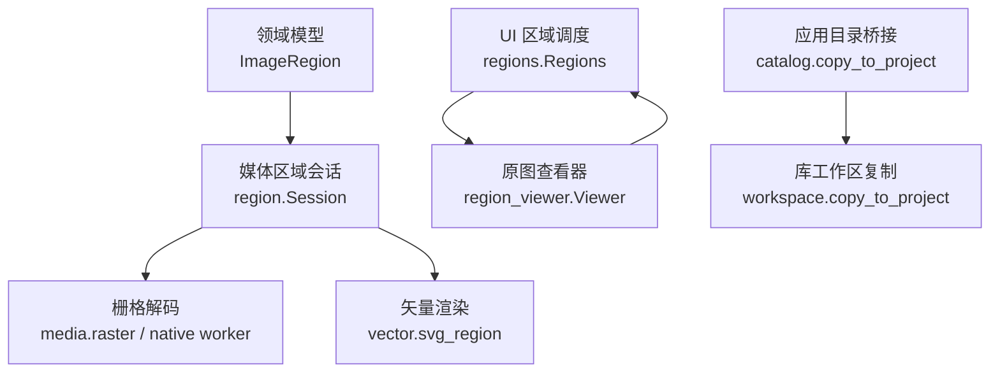
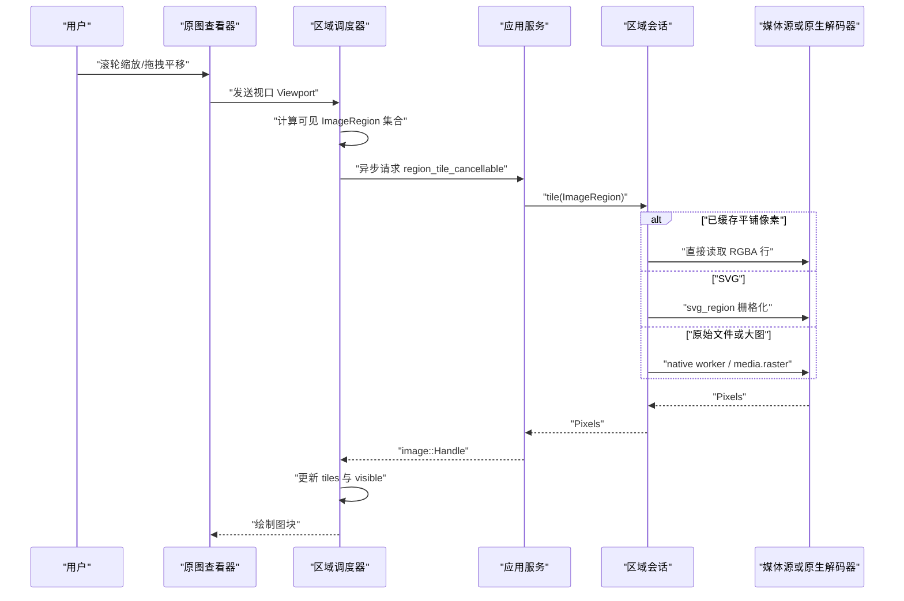
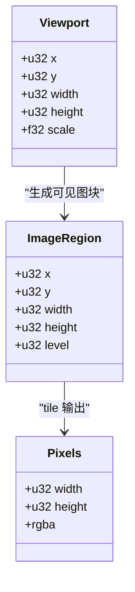
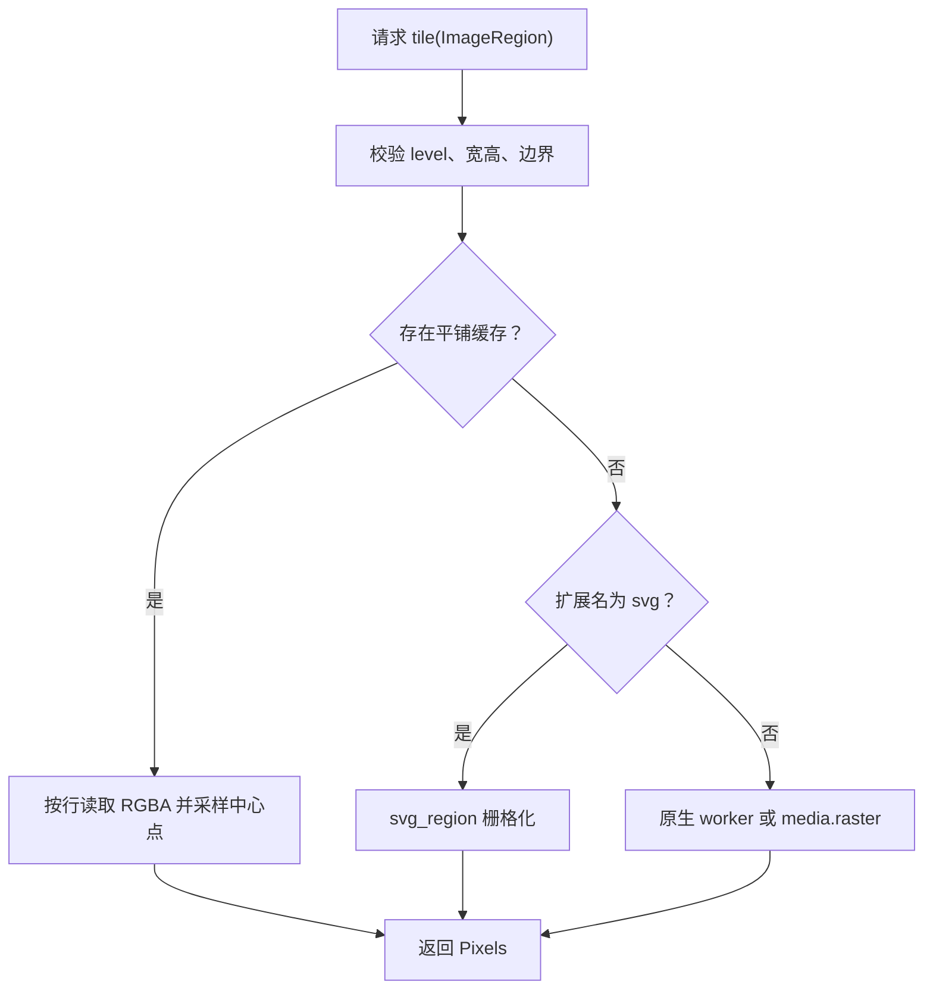
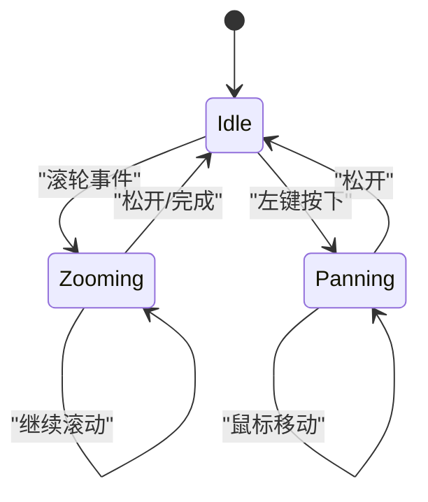
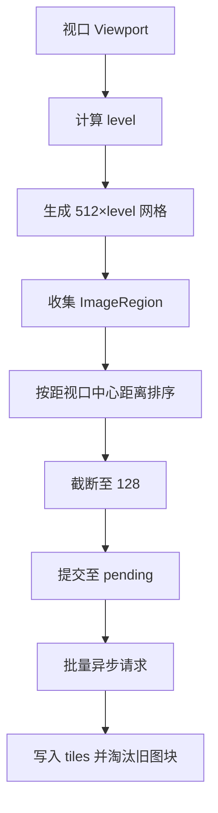
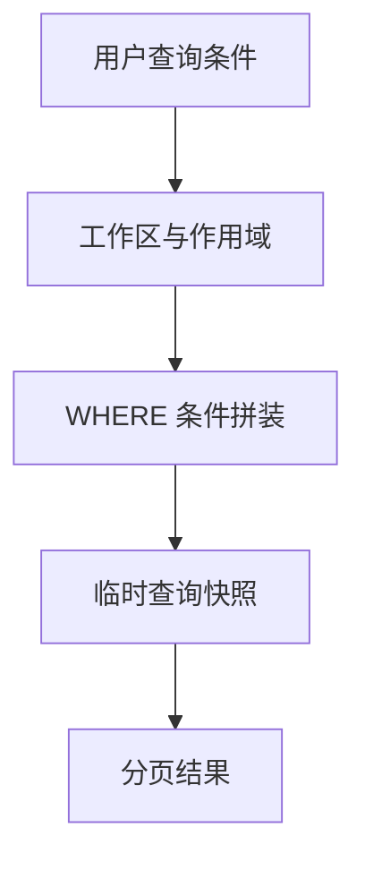
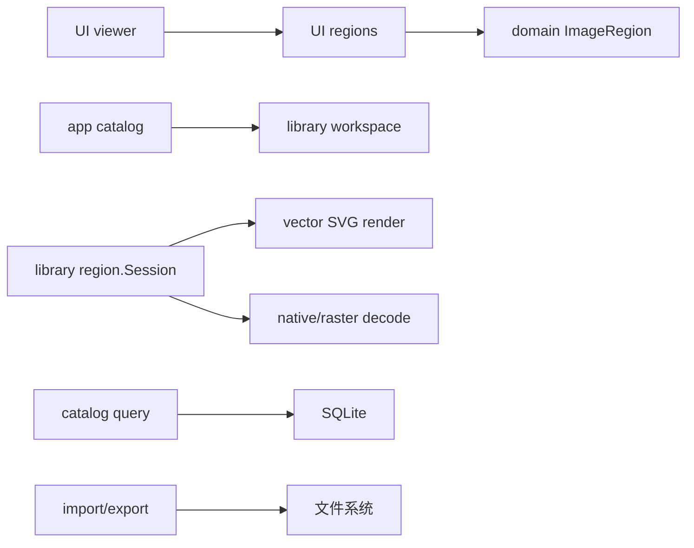

# 区域标注系统 (Region Annotation)

> Repo Wiki 节点 `media-region`
> 导出自 Qoder 知识库快照 `8fbe02f6-57c2-4874-b725-1a8130851fd9`，代码基线 `7a7a8e75e18bd90294e09cd422dd7ed5a04813a0`（分支 main，zh-CN）。

<cite>
**本文引用的文件**   
- [domain/lib.rs](../../../../crates/moriq-domain/src/lib.rs)
- [library/media/region.rs](../../../../crates/moriq-library/src/media/region.rs)
- [library/media/vector.rs](../../../../crates/moriq-library/src/media/vector.rs)
- [library/media/media.rs](../../../../crates/moriq-library/src/media/media.rs)
- [ui/regions.rs](../../../../crates/moriq-ui/src/regions.rs)
- [ui/region_viewer.rs](../../../../crates/moriq-ui/src/region_viewer.rs)
- [ui/manage.rs](../../../../crates/moriq-ui/src/manage.rs)
- [app/catalog.rs](../../../../crates/moriq-app/src/catalog.rs)
- [library/catalog/workspace.rs](../../../../crates/moriq-library/src/catalog/workspace.rs)
- [library/database/schema.sql](../../../../crates/moriq-library/src/database/schema.sql)
- [library/transfer/export_metadata.rs](../../../../crates/moriq-library/src/transfer/export_metadata.rs)
- [library/transfer/import.rs](../../../../crates/moriq-library/src/transfer/import.rs)
</cite>

## 目录
1. [简介](#简介)
2. [项目结构](#项目结构)
3. [核心组件](#核心组件)
4. [架构总览](#架构总览)
5. [详细组件分析](#详细组件分析)
6. [依赖关系分析](#依赖关系分析)
7. [性能考虑](#性能考虑)
8. [故障排查指南](#故障排查指南)
9. [结论](#结论)
10. [附录](#附录)

## 简介
本文件面向 Moriq Space 的区域标注与图像查看子系统，聚焦以下目标：
- 说明基于 `ImageRegion` 的坐标系统与分块读取机制。
- 解释矩形与矢量图形的栅格化、边界框表示与几何计算方式。
- 梳理区域会话、视图交互、图块调度、持久化与导入导出的完整链路。
- 说明当前代码库中“标注”概念的实际实现范围，并给出扩展建议。

需要特别指出：在当前仓库中，“区域”主要用于高分辨率图像的局部解码和图块渲染；尚未发现显式的“标注类型”“多边形顶点列表”“标注层级树”等数据结构。因此，本文对“标注”的描述以现有区域能力为基础，并在扩展部分提出可落地的设计建议。

## 项目结构
区域相关代码分布在领域模型、媒体库、UI 与桌面应用桥接层：
- 领域模型定义基础数据结构和常量。
- 媒体库负责区域会话创建、像素缓存、原始格式解码、SVG 矢量化渲染。
- UI 层负责视口变换、鼠标交互、图块请求调度与缓存管理。
- 桌面应用与库接口提供跨进程取消、复制资产与可选注解传播。

**图表来源**
- [domain/lib.rs:470-560](../../../../crates/moriq-domain/src/lib.rs#L470-L560)
- [library/media/region.rs:201-370](../../../../crates/moriq-library/src/media/region.rs#L201-L370)
- [library/media/vector.rs:1-136](../../../../crates/moriq-library/src/media/vector.rs#L1-L136)
- [ui/regions.rs:70-367](../../../../crates/moriq-ui/src/regions.rs#L70-L367)
- [ui/region_viewer.rs:1-257](../../../../crates/moriq-ui/src/region_viewer.rs#L1-L257)
- [app/catalog.rs:1-20](../../../../crates/moriq-app/src/catalog.rs#L1-L20)
- [library/catalog/workspace.rs:6-30](../../../../crates/moriq-library/src/catalog/workspace.rs#L6-L30)

**章节来源**
- [domain/lib.rs:470-560](../../../../crates/moriq-domain/src/lib.rs#L470-L560)
- [library/media/region.rs:201-370](../../../../crates/moriq-library/src/media/region.rs#L201-L370)
- [library/media/vector.rs:1-136](../../../../crates/moriq-library/src/media/vector.rs#L1-L136)
- [ui/regions.rs:70-367](../../../../crates/moriq-ui/src/regions.rs#L70-L367)
- [ui/region_viewer.rs:1-257](../../../../crates/moriq-ui/src/region_viewer.rs#L1-L257)
- [app/catalog.rs:1-20](../../../../crates/moriq-app/src/catalog.rs#L1-L20)
- [library/catalog/workspace.rs:6-30](../../../../crates/moriq-library/src/catalog/workspace.rs#L6-L30)

## 核心组件
- `ImageRegion`：不可变的二维区域描述符，包含左上角坐标、宽高和缩放等级，是区域分块、图块索引和几何计算的基础。
- `region.Session`：冻结后的区域读取会话，封装源路径、扩展名、尺寸、可选平铺像素缓存以及解码策略。
- `Regions`：UI 侧区域状态机，维护视口、可见图块、待请求集合、失败集合、任务句柄和取消标志。
- `Viewer`：Iced 控件，处理缩放、平移、窗口事件，并把视口转换为 `Viewport` 消息。
- 矢量渲染模块：按区域将 SVG 栅格化为 RGBA 像素块。
- 导入导出模块：负责 EXIF 清理、ICC 色彩配置、路径模板和受管文件布局。

**章节来源**
- [domain/lib.rs:470-560](../../../../crates/moriq-domain/src/lib.rs#L470-L560)
- [library/media/region.rs:201-370](../../../../crates/moriq-library/src/media/region.rs#L201-L370)
- [ui/regions.rs:70-367](../../../../crates/moriq-ui/src/regions.rs#L70-L367)
- [ui/region_viewer.rs:1-257](../../../../crates/moriq-ui/src/region_viewer.rs#L1-L257)
- [library/media/vector.rs:1-136](../../../../crates/moriq-library/src/media/vector.rs#L1-L136)

## 架构总览
区域标注（更准确说是区域渲染）流程从 UI 交互开始，经过应用层异步调用进入媒体库，最终返回像素图块供 GPU 纹理复用。

**图表来源**
- [ui/region_viewer.rs:80-257](../../../../crates/moriq-ui/src/region_viewer.rs#L80-L257)
- [ui/regions.rs:110-367](../../../../crates/moriq-ui/src/regions.rs#L110-L367)
- [library/media/region.rs:201-370](../../../../crates/moriq-library/src/media/region.rs#L201-L370)
- [library/media/vector.rs:40-136](../../../../crates/moriq-library/src/media/vector.rs#L40-L136)

## 详细组件分析

### 坐标系统与 `ImageRegion`
`ImageRegion` 使用屏幕空间整数坐标描述一个轴对齐矩形区域，并附带 `level` 表示采样等级。该结构被用于：
- 计算图块跨度 `span = 512 * level`。
- 校验区域边界是否超出素材宽度与高度。
- 限制最大边长和 `level` 幂次约束。
- 作为图块键参与 `HashMap` 去重与缓存管理。

**图表来源**
- [domain/lib.rs:470-560](../../../../crates/moriq-domain/src/lib.rs#L470-L560)
- [ui/regions.rs:70-120](../../../../crates/moriq-ui/src/regions.rs#L70-L120)
- [ui/region_viewer.rs:200-257](../../../../crates/moriq-ui/src/region_viewer.rs#L200-L257)

**章节来源**
- [domain/lib.rs:470-560](../../../../crates/moriq-domain/src/lib.rs#L470-L560)
- [ui/regions.rs:290-367](../../../../crates/moriq-ui/src/regions.rs#L290-L367)

### 区域会话与分块解码
`region.Session` 承担三个关键职责：
1. 打开媒体源并建立可复用的区域读取上下文。
2. 根据扩展名选择平铺像素缓存、原生 worker 或 Rust 栅格解码路径。
3. 对每个 `ImageRegion` 执行边界校验、行扫描或裁剪缩放，返回 `Pixels`。

**图表来源**
- [library/media/region.rs:201-370](../../../../crates/moriq-library/src/media/region.rs#L201-L370)
- [library/media/vector.rs:40-136](../../../../crates/moriq-library/src/media/vector.rs#L40-L136)

**章节来源**
- [library/media/region.rs:201-370](../../../../crates/moriq-library/src/media/region.rs#L201-L370)

### 矢量图形与多边形支持
矢量图形通过本地 SVG 解析与 tiny-skia 栅格化实现。其特性包括：
- 限制 SVG 文件大小为 16 MiB。
- 固定字体数据库，避免网络资源。
- 将 SVG 变换矩阵应用于指定 `ImageRegion`，输出统一 RGBA 像素。
- 支持按最长边限制的全尺寸渲染。

虽然当前未出现“自由形状选择”“多边形顶点数组”等用户交互数据结构，但矢量栅格化已经为后续多边形标注提供了底层像素生成能力。若引入多边形标注，可在不改变现有 `ImageRegion` 坐标系的前提下，在 UI 层将自由路径转换为边界框和矢量遮罩。

**章节来源**
- [library/media/vector.rs:1-136](../../../../crates/moriq-library/src/media/vector.rs#L1-L136)

### UI 交互：选择、移动、缩放
原图查看器继承 Iced 图像查看器的交互模式：
- 滚轮缩放：根据像素或行数增量调整相机目标缩放。
- 左键拖动平移：记录起始位置，连续更新相机偏移。
- 窗口失焦中断动画。
- 预加载目标缩放下的图块，中间帧仅移动已有 GPU 图像。

**图表来源**
- [ui/region_viewer.rs:60-257](../../../../crates/moriq-ui/src/region_viewer.rs#L60-L257)

**章节来源**
- [ui/region_viewer.rs:1-257](../../../../crates/moriq-ui/src/region_viewer.rs#L1-L257)

### 图块调度与可视区域排序
UI 根据物理缩放比例计算 `level`，并按 512×level 网格切分视口。图块生成顺序优先靠近视口中心，最多保留 128 个可见图块，同时限制并发待请求数量。图块缓存超过阈值时，优先淘汰不可见且较旧的图块。

**图表来源**
- [ui/regions.rs:290-367](../../../../crates/moriq-ui/src/regions.rs#L290-L367)

**章节来源**
- [ui/regions.rs:70-367](../../../../crates/moriq-ui/src/regions.rs#L70-L367)

### 标注的数据结构设计现状与建议
当前仓库未发现以下字段或结构：
- 标注类型枚举。
- 多边形顶点列表。
- 标注属性存储表。
- 标注层级树。
- 标注 ID、父级、可见性、标签等元数据。

现有与“标注”最接近的概念是“复制资产时可选择是否携带注解”，但该参数由 UI 控制并传入库接口，实际注解持久化逻辑未在公开片段中出现。因此，现阶段可将“区域标注”理解为：
- 以 `ImageRegion` 表示矩形区域。
- 以矢量栅格结果作为自由形状的基础渲染能力。
- 以外部元数据或未来新增表承载标注语义。

建议扩展方向：
- 新增 `Annotation` 结构，包含 `id`、`asset_version_id`、`type`、`bbox`、`points`、`properties`、`parent_annotation_id`。
- 新增 SQLite 表 `annotations`，并为 `asset_version_id`、`type`、`created_at` 建索引。
- 在 `ImageRegion` 之上增加 `to_rect()`、`intersects()`、`scale()` 等方法，便于与 UI 矩形选择和缩放对齐。
- 在导入导出中增加标注 JSON 或 XMP 兼容字段。

[本节为概念性设计建议，不直接分析具体文件，因此无“章节来源”]

### 标注的持久化存储与序列化
当前数据库 schema 主要覆盖资产、版本、项目、标签、AI 分类和工作区相关内容，未包含专门的标注表。导入导出模块重点处理：
- EXIF 字段过滤与 ICC 色彩配置。
- 导出目录模板变量替换。
- 受管路径生成与冲突处理。

若引入标注持久化，可沿用现有迁移模式，新增独立 SQL 迁移文件，并通过 `serde_json` 存储标注属性。序列化格式建议包含：
- 标注类型：矩形、椭圆、多边形、文本框。
- 坐标空间：相对于原图分辨率。
- 几何信息：边界框、顶点序列、旋转角度。
- 元数据：创建时间、编辑者、标签、备注。

**章节来源**
- [library/database/schema.sql:1-42](../../../../crates/moriq-library/src/database/schema.sql#L1-L42)
- [library/transfer/export_metadata.rs:1-142](../../../../crates/moriq-library/src/transfer/export_metadata.rs#L1-L142)
- [library/transfer/import.rs:1-200](../../../../crates/moriq-library/src/transfer/import.rs#L1-L200)

### 搜索与过滤功能
当前查询系统围绕资产名称、笔记、AI 文本、标签、颜色、大小、方向、文件夹、主题、人物和分类展开。它通过 FTS、JSON 函数、子查询和临时快照优化分页查询。

对于“基于位置的标注搜索”，当前实现并未暴露按 `ImageRegion` 或标注几何查询的 API。可在未来扩展中：
- 将标注边界框编码为数值列或 GIN/FTS 辅助列。
- 支持按资产、类型、创建时间、标签筛选。
- 支持按相对坐标区间或重叠度筛选。

**图表来源**
- [library/catalog/query.rs:1-200](../../../../crates/moriq-library/src/catalog/query.rs#L1-L200)

**章节来源**
- [library/catalog/query.rs:1-200](../../../../crates/moriq-library/src/catalog/query.rs#L1-L200)

### 导入导出与工具兼容性
导入过程：
- 解析项目归属。
- 生成安全路径。
- 防止同名覆盖。
- 记录项目文件关联。

导出过程：
- 标准化 EXIF。
- 注入 sRGB ICC 配置。
- 清理无效字符并构建目录。
- 控制 EXIF 体积上限。

兼容性建议：
- 导出标注时可输出 COCO、LabelMe、YOLO 或 XMP 等常见格式。
- 导入时支持将第三方标注映射到内部 `AnnotationType`。
- 对不支持标注的工具，保留纯媒体与通用元数据。

**章节来源**
- [library/transfer/import.rs:1-200](../../../../crates/moriq-library/src/transfer/import.rs#L1-L200)
- [library/transfer/export_metadata.rs:1-142](../../../../crates/moriq-library/src/transfer/export_metadata.rs#L1-L142)

### 编辑器集成与自定义扩展点
当前 UI 中的“注解复制开关”位于管理界面，允许在复制到项目时决定是否携带注解。这表明注解能力已预留跨组件传递通道，但具体注解对象仍由上层业务决定。

可扩展点：
- 在 `Regions` 中添加标注图层集合，与图块解耦。
- 在 `Viewer` 中扩展鼠标事件，支持点击拾取、拖拽调整边界框。
- 在 `media.rs` 中暴露 `regions_cancellable` 与 `regions` 方法，供异步任务调用。
- 在 `catalog.workspace` 中扩展 `copy_to_project(annotations)` 的具体注解拷贝逻辑。

**章节来源**
- [ui/manage.rs:70-330](../../../../crates/moriq-ui/src/manage.rs#L70-L330)
- [ui/manage.rs:1870-1890](../../../../crates/moriq-ui/src/manage.rs#L1870-L1890)
- [app/catalog.rs:1-20](../../../../crates/moriq-app/src/catalog.rs#L1-L20)
- [library/catalog/workspace.rs:6-30](../../../../crates/moriq-library/src/catalog/workspace.rs#L6-L30)
- [library/media/media.rs:230-270](../../../../crates/moriq-library/src/media/media.rs#L230-L270)

## 依赖关系分析
区域子系统的关键依赖如下：
- UI 依赖 `ImageRegion` 和 `moriq_app::RegionSession`。
- `region.Session` 依赖原生 worker、Rust 栅格解码和 SVG 渲染。
- 查询模块依赖 SQLite、FTS、JSON 函数和临时表。
- 导入导出依赖文件系统、EXIF、ICC 和路径安全校验。

**图表来源**
- [ui/regions.rs:70-367](../../../../crates/moriq-ui/src/regions.rs#L70-L367)
- [ui/region_viewer.rs:1-257](../../../../crates/moriq-ui/src/region_viewer.rs#L1-L257)
- [library/media/region.rs:201-370](../../../../crates/moriq-library/src/media/region.rs#L201-L370)
- [library/media/vector.rs:1-136](../../../../crates/moriq-library/src/media/vector.rs#L1-L136)
- [library/catalog/query.rs:1-200](../../../../crates/moriq-library/src/catalog/query.rs#L1-L200)
- [library/transfer/import.rs:1-200](../../../../crates/moriq-library/src/transfer/import.rs#L1-L200)
- [library/transfer/export_metadata.rs:1-142](../../../../crates/moriq-library/src/transfer/export_metadata.rs#L1-L142)

**章节来源**
- [ui/regions.rs:70-367](../../../../crates/moriq-ui/src/regions.rs#L70-L367)
- [ui/region_viewer.rs:1-257](../../../../crates/moriq-ui/src/region_viewer.rs#L1-L257)
- [library/media/region.rs:201-370](../../../../crates/moriq-library/src/media/region.rs#L201-L370)
- [library/media/vector.rs:1-136](../../../../crates/moriq-library/src/media/vector.rs#L1-L136)
- [library/catalog/query.rs:1-200](../../../../crates/moriq-library/src/catalog/query.rs#L1-L200)
- [library/transfer/import.rs:1-200](../../../../crates/moriq-library/src/transfer/import.rs#L1-L200)
- [library/transfer/export_metadata.rs:1-142](../../../../crates/moriq-library/src/transfer/export_metadata.rs#L1-L142)

## 性能考虑
- 分块渲染：图块按 `level` 划分，避免一次性加载整张高分辨率图片。
- 平铺缓存：对 RAW 和栅格图建立 `.rgba` 缓存，减少重复解码。
- 并发控制：限制待请求图块数量，避免过多异步任务。
- 内存预算：限制 SVG 输入大小、渲染像素总数和 EXIF 体积。
- 超时与取消：区域解码原生进程有 120 秒超时；会话支持取消作用域。
- 图块淘汰：缓存超过 128 项后淘汰不可见且较旧图块。

优化建议：
- 对频繁访问的标注区域，可建立轻量级区域缓存，避免重复 `tile` 调用。
- 对多边形标注，先计算包围盒，再按需栅格化矢量遮罩。
- 对大量标注的资产，采用延迟加载和按需显示策略。
- 对搜索类查询，利用现有临时快照机制，避免重复规划复杂 WHERE。

[本节为通用性能指导，不直接分析具体文件，因此无“章节来源”]

## 故障排查指南
常见问题与定位线索：
- 区域解码失败：检查原生 worker 返回值、进程退出码和错误消息。
- 区域缓存损坏：会话会重新重建缓存，但仍需确认文件名、尺寸和头部标识。
- 区域范围无效：检查 `level` 是否为 2 的幂、宽高是否超限、坐标是否越界。
- SVG 解析失败：检查文件大小、字体库、外部图片链接是否被拒绝。
- 视口未触发原图解码：当最大维度不超过阈值且缩放较低时，不会启动原图会话。
- 图块未更新：检查 `request` 世代号、`cancelled` 标志和任务句柄是否被中止。

**章节来源**
- [library/media/region.rs:30-120](../../../../crates/moriq-library/src/media/region.rs#L30-L120)
- [library/media/region.rs:220-370](../../../../crates/moriq-library/src/media/region.rs#L220-L370)
- [library/media/vector.rs:10-136](../../../../crates/moriq-library/src/media/vector.rs#L10-L136)
- [ui/regions.rs:110-200](../../../../crates/moriq-ui/src/regions.rs#L110-L200)
- [ui/regions.rs:290-367](../../../../crates/moriq-ui/src/regions.rs#L290-L367)

## 结论
Moriq Space 的区域子系统当前以高分辨率图像的分块渲染为核心，围绕 `ImageRegion`、`region.Session`、UI 视口和图块调度形成稳定闭环。矢量 SVG 栅格化为自由形状标注提供了底层能力，但仓库中尚未实现完整的标注类型、多边形交互、标注持久化和标注搜索。若要将“区域标注”扩展为完整标注编辑器，应在现有坐标系和图块机制上叠加标注模型、交互层、持久化层和导入导出适配层。

[本节为总结性内容，不直接分析具体文件，因此无“章节来源”]

## 附录
- 坐标系统约定：`x`、`y` 为左上角原点，`width`、`height` 为正整数，`level` 为采样等级。
- 图块大小：按 `512 × level` 网格切分。
- 最大图块边长：单个图块边长不超过 `512 × level`。
- 图块缓存上限：最多保留 128 个图块。
- 矢量输入限制：SVG 最大 16 MiB，渲染像素不超过 64 MiB 预算。
- EXIF 导出限制：EXIF 最大 4 MiB，强制设置 sRGB ICC。

[本节为补充说明，不直接分析具体文件，因此无“章节来源”]