# 向量特征提取

> Repo Wiki 节点 `media-vector`
> 导出自 Qoder 知识库快照 `8fbe02f6-57c2-4874-b725-1a8130851fd9`，代码基线 `7a7a8e75e18bd90294e09cd422dd7ed5a04813a0`（分支 main，zh-CN）。

<cite>
**本文引用的文件**   
- [crates/moriq-library/src/media/vector.rs](../../../../crates/moriq-library/src/media/vector.rs)
- [crates/moriq-library/src/ai/similarity.rs](../../../../crates/moriq-library/src/ai/similarity.rs)
- [crates/moriq-library/src/ai/analysis.rs](../../../../crates/moriq-library/src/ai/analysis.rs)
- [crates/moriq-library/src/ai/qwen_faces.rs](../../../../crates/moriq-library/src/ai/qwen_faces.rs)
- [crates/moriq-library/src/ai/portraits.rs](../../../../crates/moriq-library/src/ai/portraits.rs)
- [crates/moriq-library/src/retrieval/mod.rs](../../../../crates/moriq-library/src/retrieval/mod.rs)
- [crates/moriq-retrieval/src/lib.rs](../../../../crates/moriq-retrieval/src/lib.rs)
- [crates/moriq-app/src/inference.rs](../../../../crates/moriq-app/src/inference.rs)
- [crates/moriq-library/src/database/schema.sql](../../../../crates/moriq-library/src/database/schema.sql)
- [crates/moriq-library/src/database/migrations/migration_14.sql](../../../../crates/moriq-library/src/database/migrations/migration_14.sql)
- [crates/moriq-library/src/database/migrations/migration_15.sql](../../../../crates/moriq-library/src/database/migrations/migration_15.sql)
- [crates/moriq-library/src/database/migrations/migration_21.sql](../../../../crates/moriq-library/src/database/migrations/migration_21.sql)
</cite>

## 目录

1. [引言](#引言)
2. [项目结构](#项目结构)
3. [核心组件](#核心组件)
4. [架构总览](#架构总览)
5. [详细组件分析](#详细组件分析)
6. [依赖关系分析](#依赖关系分析)
7. [性能与优化](#性能与优化)
8. [故障排查](#故障排查)
9. [结论](#结论)

## 引言

本文件聚焦 Moriq Space 的向量特征提取模块，说明图像和语义特征的生成、归一化、存储、索引与检索流程。该模块不直接暴露深度学习推理细节，而是围绕以下职责组织代码：

- **图像感知指纹**：将图像缩放并计算 DCT 系数，生成可比较的二进制哈希和颜色、宽高比辅助特征，用于近似图像重复检测。
- **语义向量**：通过外部 AI 模型生成文本或图像的嵌入向量，并进行维度校验、有限值校验和单位向量归一化。
- **人脸与人物**：从已检测人脸中提取代表头像，保存人脸框、人物归属及可选的人脸向量；当前实现中人脸向量字段为空字节，实际匹配以真实头像图片为主。
- **检索与索引**：使用 SQLite 表存储二进制向量，并通过倒排式任务表和视图组织相似性检索、语义检索与推荐。
- **AI 集成**：应用层负责调用本地推理执行器、维护模型修订、控制取消信号和共享内存预算，然后将结构化结果交给资源库持久化。

该文档按“数学表示 → 算法实现 → 相似度计算 → 索引与检索 → 存储格式 → AI 集成 → 性能优化”的顺序展开，并提供流程图和时序图帮助理解端到端数据流。

## 项目结构

向量特征相关代码分布在多个 crate 中，形成清晰的层次：

| 层级 | 主要路径 | 职责 |
|---|---|---|
| 应用层 | `crates/moriq-app/src/inference.rs` | 绑定模型推理、构造请求、处理取消和内存预算，调用语义检索 |
| 资源库层 | `crates/moriq-library/src/ai/*.rs` | 准备输入图像、校验并归一化向量、存储 AI 结果和人脸 |
| 检索层 | `crates/moriq-library/src/retrieval/mod.rs` | 封装只读查询租约与查询范围 |
| 检索实现 | `crates/moriq-retrieval/src/lib.rs` | 基于 SQLite 的相似指纹、语义向量和推荐查询 |
| 数据库层 | `crates/moriq-library/src/database/*` | 定义基础表、迁移、工作项和 AI 向量表结构 |

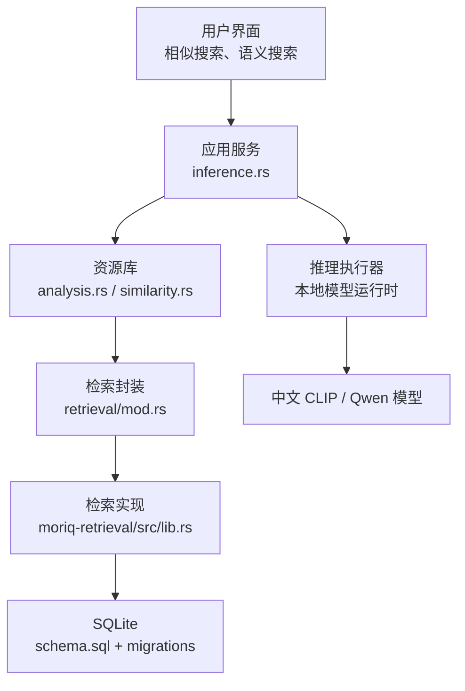

**图表来源**
- [crates/moriq-app/src/inference.rs:1-339](../../../../crates/moriq-app/src/inference.rs#L1-L339)
- [crates/moriq-library/src/ai/analysis.rs:1-200](../../../../crates/moriq-library/src/ai/analysis.rs#L1-L200)
- [crates/moriq-library/src/retrieval/mod.rs:1-58](../../../../crates/moriq-library/src/retrieval/mod.rs#L1-L58)
- [crates/moriq-retrieval/src/lib.rs:1-214](../../../../crates/moriq-retrieval/src/lib.rs#L1-L214)

**章节来源**
- [crates/moriq-app/src/inference.rs:1-339](../../../../crates/moriq-app/src/inference.rs#L1-L339)
- [crates/moriq-library/src/ai/analysis.rs:1-200](../../../../crates/moriq-library/src/ai/analysis.rs#L1-L200)
- [crates/moriq-library/src/retrieval/mod.rs:1-58](../../../../crates/moriq-library/src/retrieval/mod.rs#L1-L58)
- [crates/moriq-retrieval/src/lib.rs:1-214](../../../../crates/moriq-retrieval/src/lib.rs#L1-L214)

## 核心组件

### 图像感知指纹

图像感知指纹不是深度学习高维向量，而是一种轻量级视觉指纹，用于快速识别缩放、重压缩或尺寸变化的同一内容。其核心步骤包括：

1. 将输入图像缩放到 32×32。
2. 计算每个像素的预乘 RGB 平均值，并累计三色通道均值。
3. 计算灰度亮度矩阵。
4. 对亮度和频率基使用离散余弦变换（DCT）得到 8×8 频域系数。
5. 丢弃直流分量，对剩余系数排序后取中位数作为阈值。
6. 将超过阈值的系数位设为 1，形成 64 位哈希。
7. 同时记录平均颜色和原始宽高比。

该指纹适合判断“视觉上相近但可能经过压缩或缩放”的图片，不适合做跨模态语义检索。

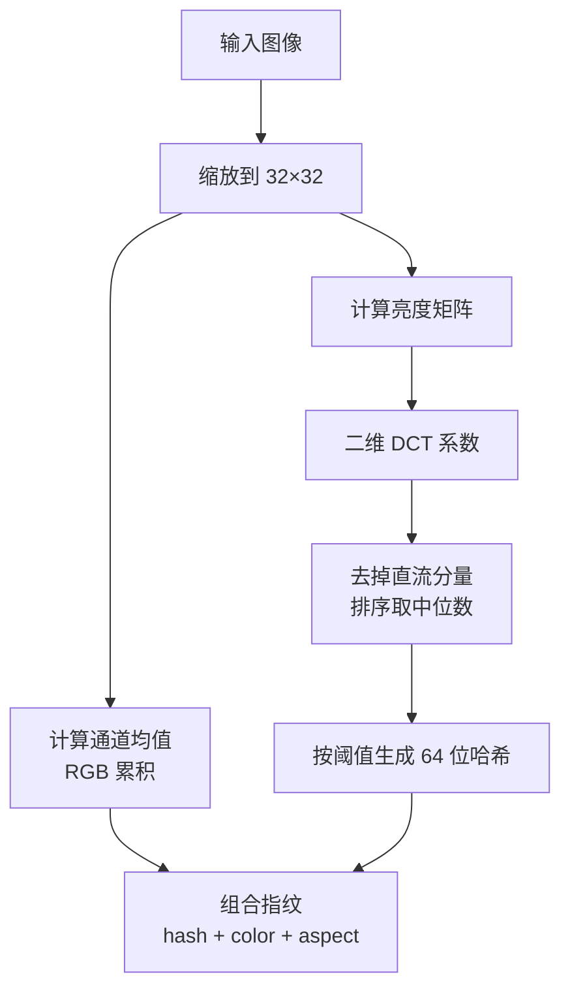

**图表来源**
- [crates/moriq-library/src/ai/similarity.rs:1-78](../../../../crates/moriq-library/src/ai/similarity.rs#L1-L78)

**章节来源**
- [crates/moriq-library/src/ai/similarity.rs:1-78](../../../../crates/moriq-library/src/ai/similarity.rs#L1-L78)

### 语义向量与归一化

语义向量来自中文 CLIP 模型，既可以是文本描述也可以是图像内容。资源库层对向量进行统一处理：

- 接受 JSON 数组形式的浮点向量。
- 检查非空、维度不超过 4096。
- 过滤非有限值。
- 计算欧几里得范数。
- 若范数为零或非有限则报错。
- 将所有分量除以范数，得到单位向量。

这一步是后续余弦相似度计算的基础。因为两个单位向量的点积等价于余弦相似度，所以检索阶段可以直接累加对应元素乘积。

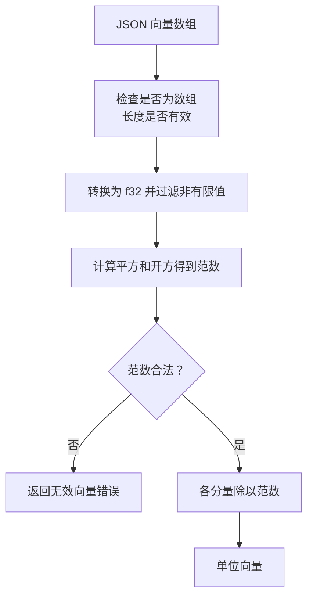

**图表来源**
- [crates/moriq-library/src/ai/analysis.rs:1-60](../../../../crates/moriq-library/src/ai/analysis.rs#L1-L60)

**章节来源**
- [crates/moriq-library/src/ai/analysis.rs:1-60](../../../../crates/moriq-library/src/ai/analysis.rs#L1-L60)

### 人脸与人物特征

Qwen 人脸任务当前策略是“用真实头像匹配”，而不是把人脸编码成固定长度的合成嵌入向量。系统会：

- 从当前展示版本读取已检测人脸。
- 根据人脸边界框裁剪预览图。
- 将裁剪后的头像写入临时目录，供人脸推理使用。
- 持久化人脸框、人物 ID、修订信息和模型结果。
- 人脸向量列在插入时显式写入空字节，删除无人脸关联的人物向量。

这保证了人物头像始终指向有效的素材版本，避免“幽灵向量”。

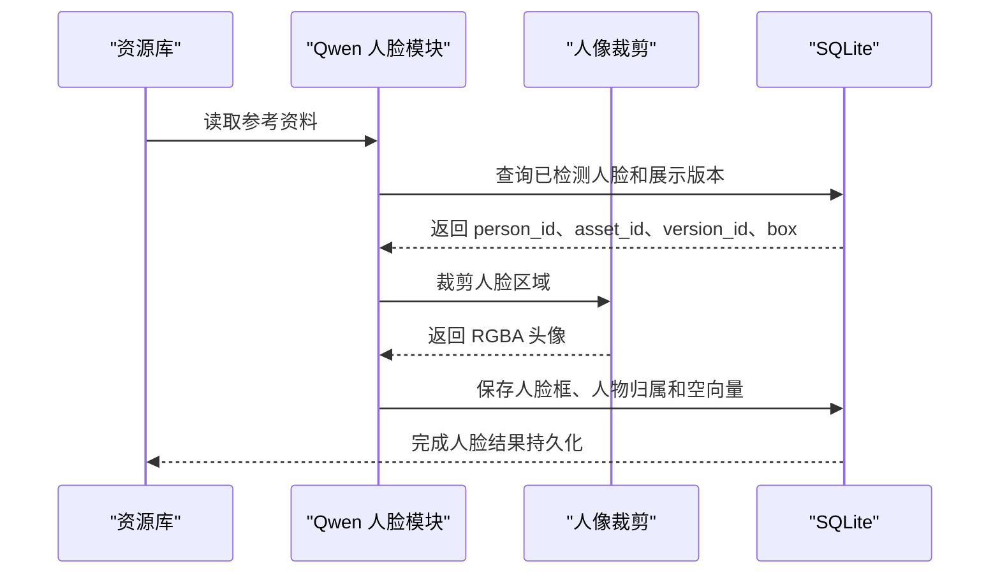

**图表来源**
- [crates/moriq-library/src/ai/qwen_faces.rs:1-200](../../../../crates/moriq-library/src/ai/qwen_faces.rs#L1-L200)
- [crates/moriq-library/src/ai/portraits.rs:1-166](../../../../crates/moriq-library/src/ai/portraits.rs#L1-L166)

**章节来源**
- [crates/moriq-library/src/ai/qwen_faces.rs:1-200](../../../../crates/moriq-library/src/ai/qwen_faces.rs#L1-L200)
- [crates/moriq-library/src/ai/portraits.rs:1-166](../../../../crates/moriq-library/src/ai/portraits.rs#L1-L166)

## 架构总览

向量特征系统的整体数据流如下：

1. 媒体导入或后台任务生成待分析素材。
2. 应用层调用推理执行器，传入图像路径或文本。
3. 本地模型返回结构化结果，包含文本向量、图像向量或人脸信息。
4. 资源库校验并归一化向量，写入 `ai_embeddings`、`ai_results`、`detected_faces` 等表。
5. 检索层使用只读连接和查询范围执行相似指纹、语义向量或推荐查询。
6. 应用层返回资产 ID 列表给界面展示。

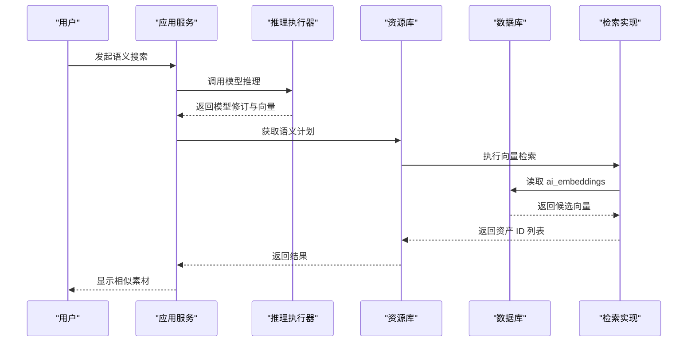

**图表来源**
- [crates/moriq-app/src/inference.rs:200-339](../../../../crates/moriq-app/src/inference.rs#L200-L339)
- [crates/moriq-library/src/ai/analysis.rs:490-520](../../../../crates/moriq-library/src/ai/analysis.rs#L490-L520)
- [crates/moriq-library/src/retrieval/mod.rs:1-58](../../../../crates/moriq-library/src/retrieval/mod.rs#L1-L58)
- [crates/moriq-retrieval/src/lib.rs:120-214](../../../../crates/moriq-retrieval/src/lib.rs#L120-L214)

## 详细组件分析

### 图像特征数学表示

#### 感知指纹

感知指纹属于低维、强鲁棒的视觉摘要，其数学过程可概括为：

- 空间降采样：32×32 网格。
- 颜色统计：R、G、B 三通道累加后量化。
- 亮度加权：使用标准亮度权重组合 RGB。
- DCT 变换：将空间亮度分布投影到低频频域。
- 阈值二值化：去掉直流分量，按中位数阈值生成哈希。

时间复杂度主要来自 DCT 和排序：

- DCT 在 32×32 网格上运行，可视为常数级开销。
- 排序发生在 63 个系数上，也是常数级。
- 空间占用为少量中间矩阵和最终 64 位哈希。

该指纹不适合表达语义类别，但对相同内容的缩放、压缩、轻微噪声具有鲁棒性。

#### 语义向量

语义向量是高维连续向量，典型维度可达数千。系统中关键约束是：

- 最大维度 4096。
- 所有分量必须为有限实数。
- 向量必须非零范数。
- 存储前归一化为单位向量。

这使得检索阶段的相似度计算简化为点积，且能稳定反映方向相似度。

#### 人脸向量

当前 Qwen 人脸流程中，人脸向量列被显式写入空字节。这意味着系统没有为每张人脸单独保存一个固定长度嵌入向量；人物匹配主要依赖真实头像图片和人脸框位置。未来如果扩展人脸嵌入，应遵循现有向量校验和序列化规范。

**章节来源**
- [crates/moriq-library/src/ai/similarity.rs:1-78](../../../../crates/moriq-library/src/ai/similarity.rs#L1-L78)
- [crates/moriq-library/src/ai/analysis.rs:1-60](../../../../crates/moriq-library/src/ai/analysis.rs#L1-L60)
- [crates/moriq-library/src/ai/qwen_faces.rs:1-200](../../../../crates/moriq-library/src/ai/qwen_faces.rs#L1-L200)

### 特征提取算法实现

#### 深度学习模型的特征编码

应用层通过 `InferenceRunner` 接口抽象模型后端，默认实现调用本地推理：

- 人脸任务：`qwen_faces`。
- 分类与描述任务：`qwen_infer`。
- 通用推理：`infer`。
- 模型修订查询：`revision`。
- 可用性检查：`ready`。

资源库层负责把推理结果包装成带模型身份和修订字段的 `InferenceResult`，并在持久化前拒绝不匹配的修订。

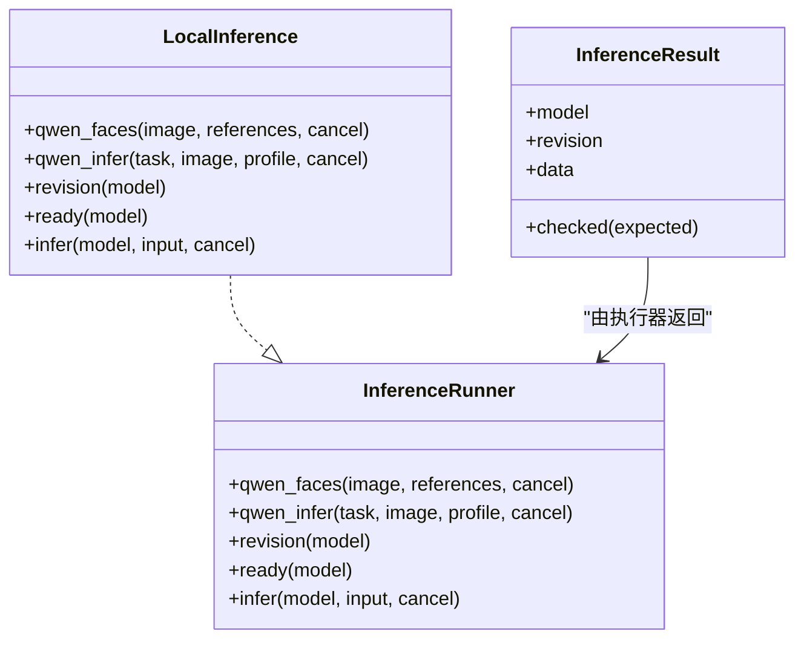

**图表来源**
- [crates/moriq-app/src/inference.rs:1-200](../../../../crates/moriq-app/src/inference.rs#L1-L200)

#### 本地特征提取

对于图像类任务，资源库会将冻结的媒体源转为 1024 边的预览 PNG，并写入临时文件供模型读取。这样做的好处是：

- 避免直接持有解码后的巨大图像。
- 统一输入格式。
- 明确输入边界。

对于文本类任务，应用层会先申请共享内存预算，再阻塞线程执行推理，最后校验模型修订并解析向量。

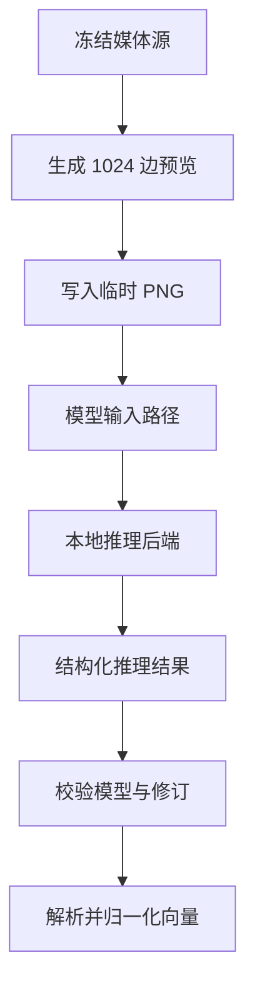

**图表来源**
- [crates/moriq-library/src/ai/analysis.rs:60-120](../../../../crates/moriq-library/src/ai/analysis.rs#L60-L120)
- [crates/moriq-app/src/inference.rs:200-339](../../../../crates/moriq-app/src/inference.rs#L200-L339)

**章节来源**
- [crates/moriq-app/src/inference.rs:1-200](../../../../crates/moriq-app/src/inference.rs#L1-L200)
- [crates/moriq-library/src/ai/analysis.rs:60-120](../../../../crates/moriq-library/src/ai/analysis.rs#L60-L120)

### 相似度计算方法

#### 余弦相似度

语义检索使用归一化向量的点积作为余弦相似度。检索流程：

1. 从 `ai_embeddings` 表中读取指定模型和修订的二进制向量。
2. 反序列化为 `f32` 数组。
3. 跳过维度不一致的条目。
4. 计算查询向量与候选向量的点积。
5. 保留得分最高的前若干结果。

由于向量已经归一化，点积等价于余弦相似度，数值越大越相似。

#### 汉明距离

图像感知指纹使用汉明距离衡量两个 64 位哈希的差异。实现逻辑：

1. 计算两个哈希的异或。
2. 统计异或结果中 1 的个数。
3. 要求汉明距离小于等于阈值。
4. 同时检查 R、G、B 三色绝对差之和是否低于阈值。
5. 结合宽高比范围过滤候选集。

#### 欧氏距离

当前仓库未直接使用欧氏距离作为检索主指标。不过它出现在两个地方：

- 向量范数计算：用于单位向量归一化。
- 向量合法性检查：范数必须为正且有限。

因此，欧氏距离在系统中主要用于向量预处理，而非最终相似度排序。

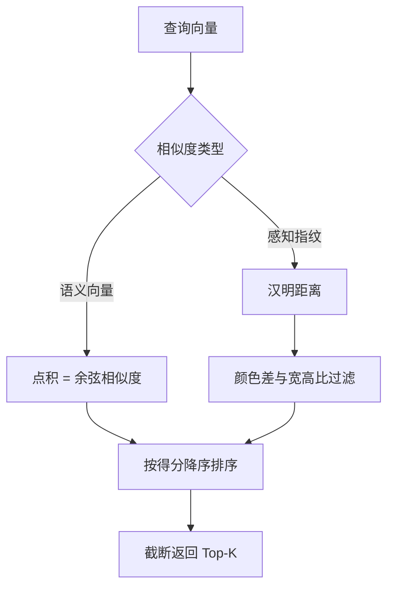

**图表来源**
- [crates/moriq-retrieval/src/lib.rs:80-214](../../../../crates/moriq-retrieval/src/lib.rs#L80-L214)
- [crates/moriq-library/src/ai/analysis.rs:1-60](../../../../crates/moriq-library/src/ai/analysis.rs#L1-L60)

**章节来源**
- [crates/moriq-retrieval/src/lib.rs:80-214](../../../../crates/moriq-retrieval/src/lib.rs#L80-L214)
- [crates/moriq-library/src/ai/analysis.rs:1-60](../../../../crates/moriq-library/src/ai/analysis.rs#L1-L60)

### 索引与检索优化

#### 倒排索引与任务表

系统使用 `background_jobs` 和 `background_job_items` 表组织可暂停、恢复的任务。虽然当前相似性检索是直接扫描指纹表，但任务表体现了批量处理的工程模式：

- 任务状态包括排队、运行、暂停、取消、完成。
- 支持优先级、检查点、并发计数。
- 工作项按序列号关联素材版本。

这种设计适合将来扩展到大规模指纹构建或批量向量写入。

#### 近似最近邻搜索

当前实现不是严格意义上的近似最近邻 ANN 引擎，而是基于 SQLite 的直接扫描：

- 相似指纹：按宽高比范围过滤后扫描哈希，并用汉明距离阈值筛选。
- 语义向量：扫描 `ai_embeddings` 表，计算点积并保留 Top-K。
- 推荐：基于已有向量再次执行语义检索，限制返回数量。

这种实现的优点是简单、可验证、易于审计；缺点是当向量规模很大时，全表扫描会成为瓶颈。

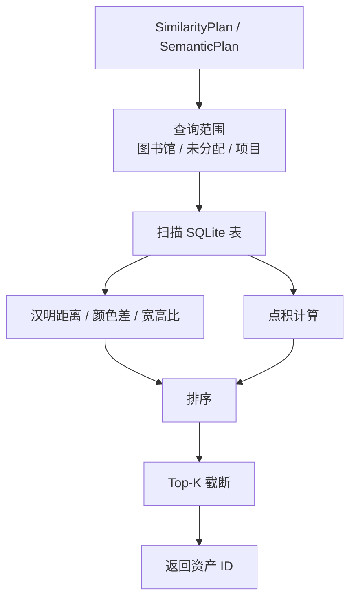

**图表来源**
- [crates/moriq-library/src/retrieval/mod.rs:1-58](../../../../crates/moriq-library/src/retrieval/mod.rs#L1-L58)
- [crates/moriq-retrieval/src/lib.rs:80-214](../../../../crates/moriq-retrieval/src/lib.rs#L80-L214)

**章节来源**
- [crates/moriq-library/src/database/migrations/migration_14.sql:1-12](../../../../crates/moriq-library/src/database/migrations/migration_14.sql#L1-L12)
- [crates/moriq-library/src/retrieval/mod.rs:1-58](../../../../crates/moriq-library/src/retrieval/mod.rs#L1-L58)
- [crates/moriq-retrieval/src/lib.rs:80-214](../../../../crates/moriq-retrieval/src/lib.rs#L80-L214)

### 特征向量存储格式

#### 二进制序列化

向量在数据库中存储为小端序的 `f32` 字节序列。序列化和反序列化规则如下：

- 每个 `f32` 占 4 字节。
- 字节顺序为小端。
- 向量长度必须是 4 的倍数。
- 最大长度为 16384 字节。
- 不允许 NaN 或无穷大。

这种格式紧凑、可移植，便于跨语言或跨进程传输。

#### 数据库存储策略

| 数据类型 | 主要表 | 关键字段 | 用途 |
|---|---|---|---|
| 图像感知指纹 | `image_fingerprints` | `version_id`、`hash`、`red`、`green`、`blue`、`aspect`、`algorithm` | 近似图像重复检测 |
| 语义向量 | `ai_embeddings` | `version_id`、`model_id`、`revision`、`vector` | 文本或图像语义检索 |
| 人脸向量 | `detected_faces` | `id`、`version_id`、`revision`、`ordinal`、`box`、`vector`、`person_id` | 人脸检测结果与人物归属 |
| 人物代表向量 | `person_vectors` | `person_id`、`revision`、`vector`、`samples` | 按人物和模型修订维护代表向量 |

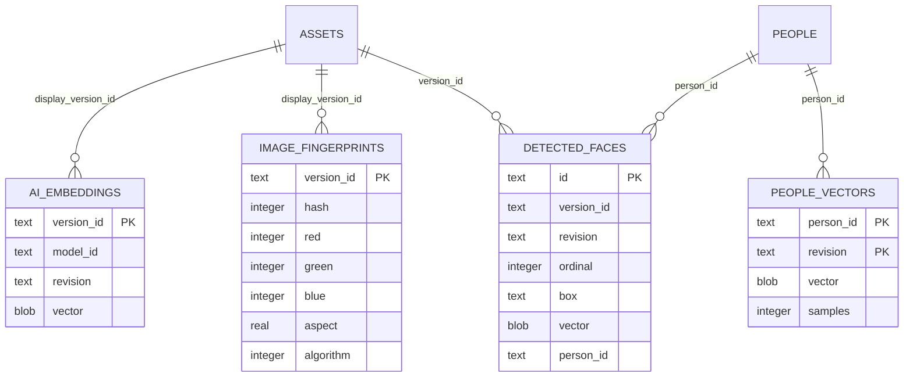

**图表来源**
- [crates/moriq-library/src/database/migrations/migration_14.sql:1-12](../../../../crates/moriq-library/src/database/migrations/migration_14.sql#L1-L12)
- [crates/moriq-library/src/database/migrations/migration_15.sql:1-30](../../../../crates/moriq-library/src/database/migrations/migration_15.sql#L1-L30)
- [crates/moriq-library/src/database/migrations/migration_21.sql:1-6](../../../../crates/moriq-library/src/database/migrations/migration_21.sql#L1-L6)

**章节来源**
- [crates/moriq-retrieval/src/lib.rs:200-214](../../../../crates/moriq-retrieval/src/lib.rs#L200-L214)
- [crates/moriq-library/src/database/migrations/migration_14.sql:1-12](../../../../crates/moriq-library/src/database/migrations/migration_14.sql#L1-L12)
- [crates/moriq-library/src/database/migrations/migration_15.sql:1-30](../../../../crates/moriq-library/src/database/migrations/migration_15.sql#L1-L30)
- [crates/moriq-library/src/database/migrations/migration_21.sql:1-6](../../../../crates/moriq-library/src/database/migration_21.sql#L1-L6)

### AI 相似性搜索集成

#### 批量特征提取

批量提取主要通过后台任务和任务项表组织。当前仓库中的批量模式体现在：

- 指纹任务使用 `background_jobs` 和 `background_job_items`。
- 扫描入口采用深度优先遍历和有界输出。
- 任务可暂停、恢复、取消。

虽然语义向量通常由交互搜索触发，但其基础设施同样可以复用任务调度模式进行离线批量嵌入生成。

#### 增量更新

增量更新的关键约束是“版本绑定”：

- AI 结果和向量都绑定到 `asset_versions.id`。
- 语义检索要求模型修订一致。
- 人脸结果会清理空向量，并删除无人脸关联的未命名人物。
- 人物代表向量按 `person_id` 和 `revision` 维护。

这意味着新增或修改素材时，系统可以只重新计算受影响版本对应的向量，而不必重建整个库。

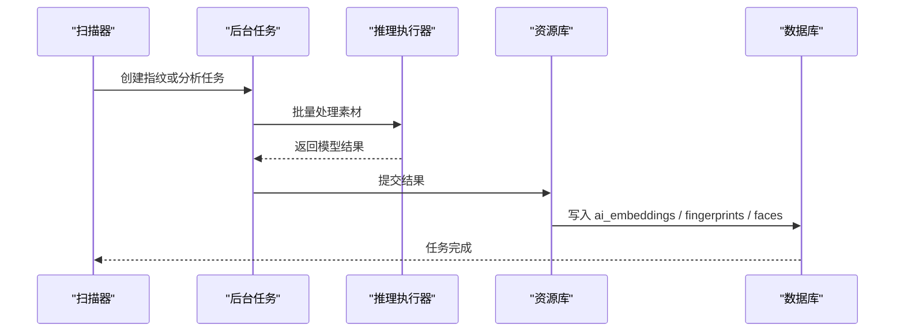

**图表来源**
- [crates/moriq-library/src/database/migrations/migration_14.sql:1-12](../../../../crates/moriq-library/src/database/migrations/migration_14.sql#L1-L12)
- [crates/moriq-library/src/database/migrations/migration_15.sql:1-30](../../../../crates/moriq-library/src/database/migrations/migration_15.sql#L1-L30)
- [crates/moriq-app/src/inference.rs:200-339](../../../../crates/moriq-app/src/inference.rs#L200-L339)

**章节来源**
- [crates/moriq-library/src/database/migrations/migration_14.sql:1-12](../../../../crates/moriq-library/src/database/migrations/migration_14.sql#L1-L12)
- [crates/moriq-library/src/database/migrations/migration_15.sql:1-30](../../../../crates/moriq-library/src/database/migrations/migration_15.sql#L1-L30)
- [crates/moriq-app/src/inference.rs:200-339](../../../../crates/moriq-app/src/inference.rs#L200-L339)

## 依赖关系分析

向量特征模块的依赖关系呈现分层解耦：

- 应用层依赖资源库和推理执行器。
- 资源库依赖检索封装和领域模型。
- 检索封装只持有只读连接和查询范围。
- 检索实现直接操作 SQLite，但不访问 Library、UI 或模型运行时。
- 数据库迁移独立定义表结构和索引。

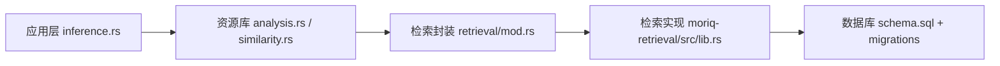

**图表来源**
- [crates/moriq-app/src/inference.rs:1-339](../../../../crates/moriq-app/src/inference.rs#L1-L339)
- [crates/moriq-library/src/ai/analysis.rs:1-200](../../../../crates/moriq-library/src/ai/analysis.rs#L1-L200)
- [crates/moriq-library/src/retrieval/mod.rs:1-58](../../../../crates/moriq-library/src/retrieval/mod.rs#L1-L58)
- [crates/moriq-retrieval/src/lib.rs:1-214](../../../../crates/moriq-retrieval/src/lib.rs#L1-L214)

**章节来源**
- [crates/moriq-app/src/inference.rs:1-339](../../../../crates/moriq-app/src/inference.rs#L1-L339)
- [crates/moriq-library/src/retrieval/mod.rs:1-58](../../../../crates/moriq-library/src/retrieval/mod.rs#L1-L58)
- [crates/moriq-retrieval/src/lib.rs:1-214](../../../../crates/moriq-retrieval/src/lib.rs#L1-L214)

## 性能与优化

### 批处理

建议将批量特征提取放入后台任务：

- 使用 `background_jobs` 管理任务生命周期。
- 使用 `background_job_items` 分片素材版本。
- 支持检查点，避免失败后从头重来。
- 控制并发数，防止模型运行时过载。

### 并行计算

- 推理执行应在阻塞线程中进行，避免阻塞 UI 线程。
- 不同素材的向量计算可并行，但需限制 GPU/CPU 资源。
- 向量写入数据库时应合并事务，减少磁盘同步次数。

### 内存管理

应用层已通过共享内存预算控制语义搜索的模型加载：

- 文本向量推理申请较小内存预算。
- 图像向量推理申请较大内存预算。
- 任务完成后释放内存。

资源库层也通过预览缩放、临时文件和边界检查控制图像处理内存：

- 图像缩放到固定尺寸后再传给模型。
- SVG 渲染有大小上限。
- 人脸裁剪避免整图复制。

### 索引优化建议

当前语义检索是全表扫描点积。若向量规模增长，可考虑：

- 为 `ai_embeddings.vector` 建立更高效的存储布局。
- 引入专用向量索引或近似最近邻库。
- 对常用模型修订建立分区或缓存。
- 限制单次检索返回数量，避免 UI 卡顿。

[本节为通用性能指导，不直接分析具体代码行]

## 故障排查

### 向量无效

常见原因：

- 向量为空。
- 向量维度超过 4096。
- 向量包含非有限值。
- 向量范数为零。
- 存储向量长度不是 4 的倍数。
- 存储向量超过 16384 字节。

排查方法：

- 检查 JSON 向量来源。
- 检查模型输出是否包含 NaN 或无穷大。
- 检查反序列化逻辑是否保持小端序。
- 检查模型修订是否与检索计划一致。

**章节来源**
- [crates/moriq-library/src/ai/analysis.rs:1-60](../../../../crates/moriq-library/src/ai/analysis.rs#L1-L60)
- [crates/moriq-retrieval/src/lib.rs:200-214](../../../../crates/moriq-retrieval/src/lib.rs#L200-L214)

### 相似指纹无结果

常见原因：

- 尚未运行指纹构建任务。
- 所选素材没有 `image_fingerprints` 记录。
- 宽高比超出阈值范围。
- 汉明距离过大。
- 颜色差异过大。

排查方法：

- 确认后台任务已生成指纹。
- 检查 `image_fingerprints` 是否存在。
- 检查参考图和候选图的宽高比是否接近。
- 调整汉明距离和颜色差阈值。

**章节来源**
- [crates/moriq-library/src/ai/similarity.rs:1-78](../../../../crates/moriq-library/src/ai/similarity.rs#L1-L78)
- [crates/moriq-retrieval/src/lib.rs:80-140](../../../../crates/moriq-retrieval/src/lib.rs#L80-L140)

### 语义检索失败

常见原因：

- 输入文本为空或过长。
- 模型未安装或未就绪。
- 模型修订不一致。
- 向量维度与存储向量不一致。
- 所选素材不在当前查询范围。

排查方法：

- 检查文本长度和有效性。
- 检查模型安装清单。
- 检查 `SemanticPlan` 使用的修订。
- 检查 `ai_embeddings` 中对应版本的向量。
- 检查资产是否属于当前项目或全局范围。

**章节来源**
- [crates/moriq-app/src/inference.rs:200-339](../../../../crates/moriq-app/src/inference.rs#L200-L339)
- [crates/moriq-retrieval/src/lib.rs:140-214](../../../../crates/moriq-retrieval/src/lib.rs#L140-L214)

### 人脸结果异常

常见原因：

- 人脸框坐标无效。
- 人脸框超出 `[0,1]` 范围。
- 人脸框宽度或高度为零。
- 预览像素不完整。
- 人脸向量列为空。

排查方法：

- 检查 `detected_faces.box` 字段。
- 检查预览图尺寸和像素完整性。
- 确认 Qwen 人脸任务返回的框符合协议。
- 理解当前人脸向量列可能为空字节。

**章节来源**
- [crates/moriq-library/src/ai/qwen_faces.rs:1-200](../../../../crates/moriq-library/src/ai/qwen_faces.rs#L1-L200)
- [crates/moriq-library/src/ai/portraits.rs:1-166](../../../../crates/moriq-library/src/ai/portraits.rs#L1-L166)

## 结论

Moriq Space 的向量特征提取模块以 SQLite 为核心持久化载体，将三类特征统一纳入资源库体系：

- 图像感知指纹提供轻量、抗压缩和缩放的视觉相似性。
- 语义向量提供跨文本和图像的深层语义检索能力。
- 人脸与人物特征以真实头像和人脸框为主，保证人物头像始终指向有效素材。

系统在工程上强调安全性、可审计性和可恢复性：向量维度、范数、有限值、模型修订、查询范围和任务状态均有显式校验。未来若需要更大规模的近似最近邻检索，可在现有只读检索封装之上扩展索引层，同时保持向量序列化、归一化和版本绑定的既有契约。