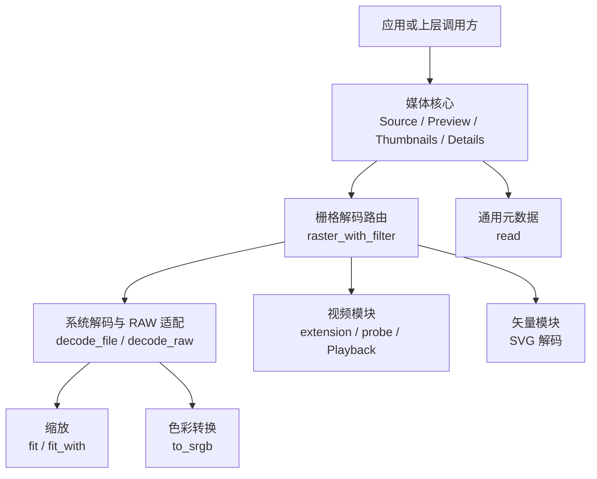
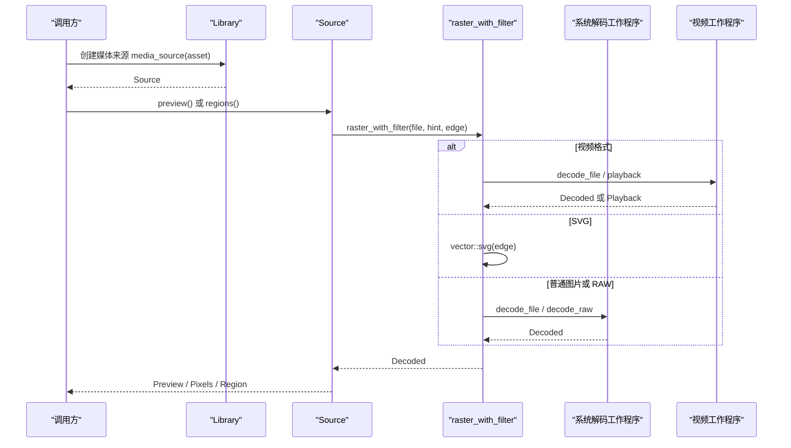
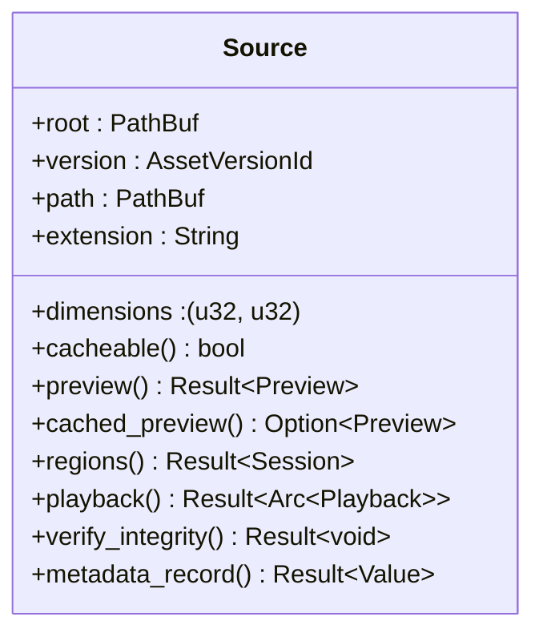
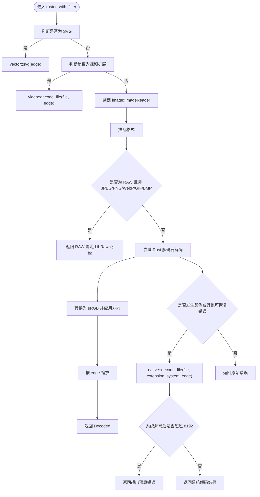
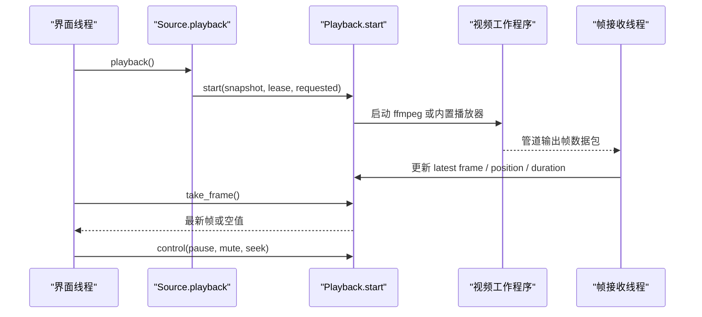
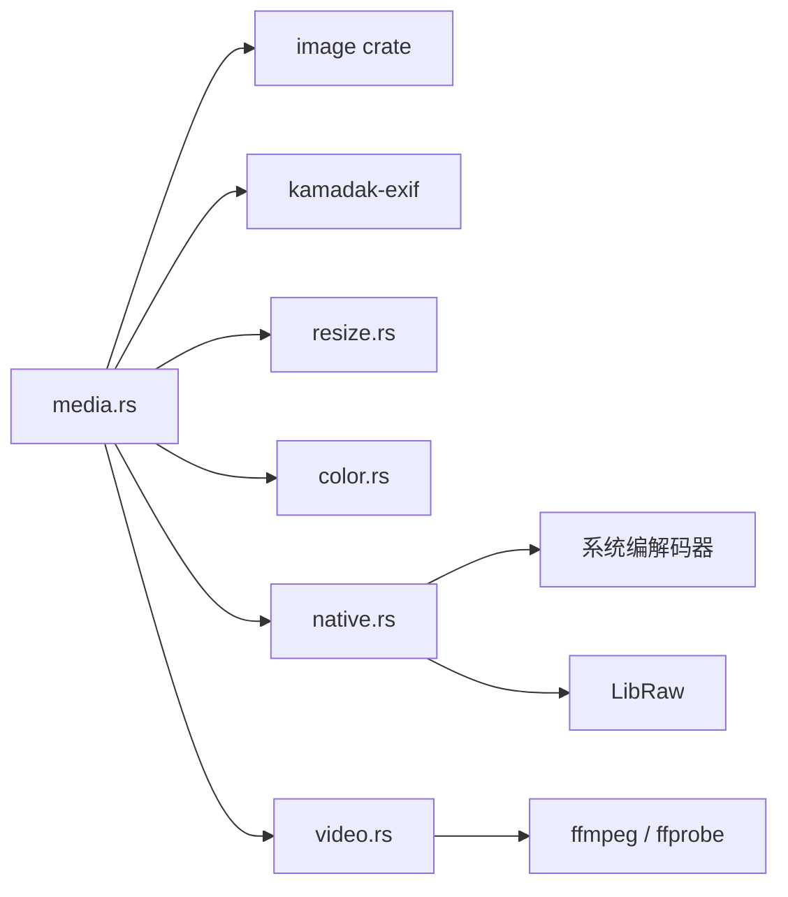

# 媒体核心抽象（Media Core）

> Repo Wiki 节点 `media-core`
> 导出自 Qoder 知识库快照 `8fbe02f6-57c2-4874-b725-1a8130851fd9`，代码基线 `7a7a8e75e18bd90294e09cd422dd7ed5a04813a0`（分支 main，zh-CN）。

<cite>
**本文引用的文件 **
- [lib.rs](../../../../crates/moriq-library/src/lib.rs)
- [media.rs](../../../../crates/moriq-library/src/media/media.rs)
- [native.rs](../../../../crates/moriq-library/src/media/native.rs)
- [video.rs](../../../../crates/moriq-library/src/media/video.rs)
- [vector.rs](../../../../crates/moriq-library/src/media/vector.rs)
- [resize.rs](../../../../crates/moriq-library/src/media/resize.rs)
- [color.rs](../../../../crates/moriq-library/src/media/color.rs)
- [metadata.rs](../../../../crates/moriq-library/src/media/metadata.rs)
- [raw_portable.rs](../../../../crates/moriq-library/src/media/raw_portable.rs)
- [cancel.rs](../../../../crates/moriq-library/src/tasks/cancel.rs)
- [Cargo.toml](../../../../crates/moriq-library/Cargo.toml)
</cite>

## 目录
1. [引言](#引言)
2. [项目结构](#项目结构)
3. [核心组件](#核心组件)
4. [架构总览](#架构总览)
5. [详细组件分析](#详细组件分析)
6. [依赖关系分析](#依赖关系分析)
7. [性能与资源管理](#性能与资源管理)
8. [异步解码与取消模式](#异步解码与取消模式)
9. [Rust API 使用示例](#rust-api-使用示例)
10. [常见问题与排错](#常见问题与排错)
11. [结论](#结论)

## 引言
本文件面向 Moriq Space 的媒体核心抽象层，目标是说明如何以统一接口访问图片、视频和 RAW 格式媒体。该抽象层位于 `moriq-library` 中，主要职责包括：

- 提供统一的媒体来源抽象，屏蔽原片路径、数据库版本、外部引用、临时快照等差异。
- 通过枚举和扩展名识别机制区分图片、视频和 RAW 类型。
- 统一打开、读取、解码流程，并在 Rust 进程与原生工作程序之间传递有界像素数据。
- 暴露尺寸、分辨率、帧率、色彩空间、时长等基础属性。
- 提供预览、缩略图、分块区域解码、视频播放等高级能力。
- 在解码、探测、拷贝、子进程等待等环节实现错误处理、超时控制和资源释放。

需要特别说明的是：当前仓库并未定义名为 `ImageFormat` 或 `VideoFormat` 的独立枚举；媒体类型识别主要通过扩展名列表、内部函数判断以及上层数据库字段完成。文档会明确区分“业务枚举”与“运行时识别逻辑”。

## 项目结构
媒体核心相关代码集中在 `crates/moriq-library/src/media` 下，并由顶层库模块导出关键子模块。整体组织方式以“职责分层 + 平台适配”为主：

- `media.rs`：统一的媒体来源、预览、缩略图、详情和栅格解码入口。
- `native.rs`：系统图像解码、RAW 扩展识别、隔离解码工作程序和文件大小预算。
- `video.rs`：视频扩展识别、FFmpeg 工具定位、元数据探测、播放会话。
- `vector.rs`：SVG 矢量解码分支。
- `resize.rs`：缩放策略和滤镜。
- `color.rs`：ICC 色彩转换到 sRGB。
- `metadata.rs`：通用媒体元数据读取。
- `raw_portable.rs`：非 Windows 平台的便携 RAW 解码适配。
- 顶层 `lib.rs`：注册并公开 `media`、`native`、`video`、`metadata` 等模块。

**图示来源**
- [media.rs:1-753](../../../../crates/moriq-library/src/media/media.rs#L1-L753)
- [native.rs:1-431](../../../../crates/moriq-library/src/media/native.rs#L1-L431)
- [video.rs:1-676](../../../../crates/moriq-library/src/media/video.rs#L1-L676)

**章节来源**
- [lib.rs:1-120](../../../../crates/moriq-library/src/lib.rs#L1-L120)

## 核心组件
媒体核心抽象由以下关键对象和函数构成：

| 名称 | 位置 | 职责 |
|---|---|---|
| `Source` | `media.rs` | 冻结后的媒体来源，绑定素材版本、路径、哈希、扩展名和尺寸，并提供预览、分块、回放、完整性校验等能力。 |
| `Thumbnails` | `media.rs` | 批量缩略图计划，支持缓存命中与重建，返回内存预算和结果数组。 |
| `Details` | `media.rs` | 冻结后的媒体详情计划，合并数据库字段、AI 分类、EXIF 和位置信息。 |
| `Preview` | `media.rs` | 预览像素及背景模糊像素，用于界面占位和快速展示。 |
| `Decoded` | `native.rs` | 系统解码输出结构，包含真实宽高、可选像素缓冲和边界控制。 |
| `Playback` | `video.rs` | 视频播放会话，封装子进程、帧管道、控制通道、诊断信息和生命周期。 |
| `Metadata` | `video.rs` | 视频探测结果，包含宽高、时长、编码、像素格式、帧率、色彩空间和音频存在性。 |
| `raster_with_filter` | `media.rs` | 统一的栅格解码路由，按扩展名选择 SVG、视频或系统解码。 |

这些组件共同实现“从同一 `Source` 出发，按需得到预览、缩略图、原始像素或视频帧”的一致性体验。

**章节来源**
- [media.rs:1-120](../../../../crates/moriq-library/src/media/media.rs#L1-L120)
- [native.rs:1-40](../../../../crates/moriq-library/src/media/native.rs#L1-L40)
- [video.rs:1-120](../../../../crates/moriq-library/src/media/video.rs#L1-L120)

## 架构总览
媒体核心采用“Rust 高层协调 + 原生工作程序执行重解码”的混合架构。Rust 侧负责安全、预算、取消、缓存和 UI 交互；原生侧负责平台编解码器、LibRaw、FFmpeg 和解码输出验证。

**图示来源**
- [media.rs:578-753](../../../../crates/moriq-library/src/media/media.rs#L578-L753)
- [native.rs:201-431](../../../../crates/moriq-library/src/media/native.rs#L201-L431)
- [video.rs:201-676](../../../../crates/moriq-library/src/media/video.rs#L201-L676)

## 详细组件分析

### 统一媒体来源 `Source`
`Source` 是媒体核心最重要的抽象。它不是简单的文件句柄，而是“已冻结的媒体上下文”，包含：

- 资源库根路径。
- 绑定的资产版本 ID。
- 数据库中的宽和高。
- 已打开的文件句柄。
- 原片路径。
- 文件身份标识。
- 是否预期为外部引用。
- 登记哈希。
- 扩展名。
- 资源库租约，确保在解码期间不会因资源库切换而失效。

典型用途包括：

- `version_source`：为指定素材和版本建立来源，不修改当前展示版本。
- `preview`：生成带背景的 1600px 预览。
- `cached_preview`：只读取已有预览缓存。
- `regions`：建立分块解码会话，适合大图或视频封面。
- `playback`：为视频建立受保护的播放快照。
- `verify_integrity`：扫描源文件并与登记哈希比较，防止原片被替换。
- `metadata_record`：读取规范化媒体元数据。

**图示来源**
- [media.rs:1-120](../../../../crates/moriq-library/src/media/media.rs#L1-L120)
- [media.rs:201-577](../../../../crates/moriq-library/src/media/media.rs#L201-L577)

**章节来源**
- [media.rs:1-120](../../../../crates/moriq-library/src/media/media.rs#L1-L120)
- [media.rs:201-577](../../../../crates/moriq-library/src/media/media.rs#L201-L577)

### 媒体类型识别与枚举
仓库中没有名为 `ImageFormat` 或 `VideoFormat` 的统一枚举类型。媒体类型识别主要由以下机制组成：

| 类型 | 识别方式 | 关键常量或函数 |
|---|---|---|
| 视频 | 扩展名匹配固定列表 | `video::EXTENSIONS`、`video::extension(path)` |
| RAW | 扩展名匹配厂商原始格式列表 | `native::RAW_EXTENSIONS`、`native::raw_extension(path)` |
| 普通图片 | 非视频、非 RAW 的常见容器格式 | `native::IMPORT_EXTENSIONS`、`image::ImageReader` 推断 |
| 矢量图 | 扩展名为 SVG | `media.rs` 中显式判断 SVG 扩展 |
| 数据库中的格式 | 资产版本表的 `format` 字段 | `media.rs` 查询 `asset_versions.format` |

这意味着上层不应依赖一个名为 `ImageFormat` 的枚举做全部决策，而应结合扩展名、数据库字段和具体解码器行为。

**章节来源**
- [native.rs:1-40](../../../../crates/moriq-library/src/media/native.rs#L1-L40)
- [native.rs:380-431](../../../../crates/moriq-library/src/media/native.rs#L380-L431)
- [video.rs:1-40](../../../../crates/moriq-library/src/media/video.rs#L1-L40)
- [media.rs:578-640](../../../../crates/moriq-library/src/media/media.rs#L578-L640)

### 打开、读取与解码流程
统一解码入口是 `media.rs` 中的 `raster` 和 `raster_with_filter`。其流程如下：

**图示来源**
- [media.rs:578-753](../../../../crates/moriq-library/src/media/media.rs#L578-L753)

关键点：

- SVG 直接交给矢量模块。
- 视频扩展交给视频模块。
- 普通图片先尝试 Rust 标准解码器。
- RAW 格式不走普通 Rust 解码器，而是走 LibRaw 或系统 RAW 路径。
- 如果 Rust 解码失败但属于颜色问题，优先回退到系统解码器。
- 系统解码器输出经过严格长度、宽高和协议头校验。

**章节来源**
- [media.rs:578-753](../../../../crates/moriq-library/src/media/media.rs#L578-L753)
- [native.rs:201-431](../../../../crates/moriq-library/src/media/native.rs#L201-L431)

### 基础属性获取
媒体基础属性来自不同层次：

| 属性 | 获取方式 | 说明 |
|---|---|---|
| 宽高 | `Source.dimensions`、`Decoded.width/height`、`video::Metadata` | 图片和 RAW 来自 Source 或解码结果；视频来自 ffprobe 探测。 |
| 分辨率 | 同宽高 | 对于视频，通常使用 `width × height`。 |
| 帧率 | `video::Metadata.frame_rate` | 来自 ffprobe 的 `avg_frame_rate`。 |
| 时长 | `video::Metadata.duration_ms` | 来自 ffprobe 的 format 或流级 duration。 |
| 编码 | `video::Metadata.codec` | 例如 H.264、HEVC 等。 |
| 像素格式 | `video::Metadata.pixel_format` | 例如 YUV、RGB 等。 |
| 色彩空间 | `video::Metadata.color_space` | 来自 ffprobe 流信息。 |
| 是否有音频 | `video::Metadata.has_audio` | 基于是否存在音频流。 |
| EXIF | `media.rs` 中的 EXIF 解析 | 相机型号、镜头、光圈、快门、ISO、焦距、GPS 等。 |

视频属性读取由 `video::probe` 完成，它调用 ffprobe，限制输出大小和超时，并对宽高、旋转、时长做合法性检查。

**章节来源**
- [media.rs:201-240](../../../../crates/moriq-library/src/media/media.rs#L201-L240)
- [video.rs:520-676](../../../../crates/moriq-library/src/media/video.rs#L520-L676)

### 异步解码、进度回调与取消支持
媒体核心的异步模型分为两类：

1. **Rust 侧取消**：通过 `crate::cancel::Scope` 和原子布尔值，让长时间 I/O、复制、哈希计算可以响应取消。
2. **原生子进程监控**：对系统解码、RAW 探测、视频播放和 FFmpeg 命令设置超时、输出大小限制和进程回收。

视频播放是典型的异步流：

**图示来源**
- [media.rs:300-360](../../../../crates/moriq-library/src/media/media.rs#L300-L360)
- [video.rs:201-520](../../../../crates/moriq-library/src/media/video.rs#L201-L520)

取消支持体现在：

- `Source.regions_cancellable`：包装取消作用域后再建立分块会话。
- `native::decode_worker`：轮询 `crate::cancel::stopped()`，超时后杀死子进程。
- `native::raw_memory_mib`：RAW 探测时检测取消并终止子进程。
- `video::run`：探测或解码命令超时、日志过大或输出过大时中断。
- `video::Playback.stop`：显式停止播放并回收资源。

注意：当前实现没有通用的“逐行进度回调”API。进度信息主要通过以下方式体现：

- 视频：`Playback.progress()` 返回当前位置和总时长。
- 批量缩略图：`Thumbnails.memory_mib()` 提供内存预算估计。
- 解码错误：统一返回 `Error::Invalid` 或底层 IO/系统错误。

**章节来源**
- [media.rs:240-360](../../../../crates/moriq-library/src/media/media.rs#L240-L360)
- [native.rs:40-200](../../../../crates/moriq-library/src/media/native.rs#L40-L200)
- [native.rs:201-320](../../../../crates/moriq-library/src/media/native.rs#L201-L320)
- [video.rs:201-520](../../../../crates/moriq-library/src/media/video.rs#L201-L520)

### 错误处理与资源管理
错误类型集中在 `lib.rs` 中，主要包括：

- IO 错误：文件读写失败。
- 数据库错误：资源库操作失败。
- 图片错误：图片无法解码。
- 色彩配置错误：ICC 转换失败。
- 无效参数：文件格式、尺寸、哈希、协议头等校验失败。
- 资源库锁定：资源库正被其他窗口或进程使用。

资源管理要点：

- `Source._lease`：在解码和预览期间持有资源库锁，避免 UI 线程切换导致的路径或版本变更。
- 临时文件：解码输出、快照、诊断日志均使用临时文件或硬链接快照，并在 Drop 中清理。
- 子进程：所有系统解码、RAW 探测、视频播放都通过超时和 kill+wait 保证退出。
- 输入限制：文件复制、视频复制、解码输出、元数据输出均有字节数限制。
- 外部引用保护：外部引用原片会先校验哈希，必要时复制到临时文件，避免原片被替换。

**章节来源**
- [lib.rs:120-200](../../../../crates/moriq-library/src/lib.rs#L120-L200)
- [media.rs:240-577](../../../../crates/moriq-library/src/media/media.rs#L240-L577)
- [native.rs:201-431](../../../../crates/moriq-library/src/media/native.rs#L201-L431)
- [video.rs:201-520](../../../../crates/moriq-library/src/media/video.rs#L201-L520)

## 依赖关系分析
媒体核心依赖多个外部库和本机工具：

| 依赖 | 用途 |
|---|---|
| `image` | 通用图片解码、编码、尺寸限制、ICC 处理。 |
| `kamadak-exif` | 读取 EXIF 和 GPS。 |
| `fast_image_resize` | 高质量缩放。 |
| `moxcms` | ICC 色彩空间转换。 |
| `rusqlite` | 读取资产版本、路径、哈希、分类等信息。 |
| `file-id` | 文件身份标识，用于硬链接快照和完整性校验。 |
| `tempfile` | 临时文件、临时路径和快照。 |
| `fs2` | 可用磁盘空间检查。 |
| `ffprobe / ffmpeg` | 视频元数据和解码。 |
| LibRaw | RAW 传感器数据解码。 |
| 原生工作程序 | WIC、codec-runner、video-worker、raw-worker。 |

**图示来源**
- [Cargo.toml:1-35](../../../../crates/moriq-library/Cargo.toml#L1-L35)
- [media.rs:578-753](../../../../crates/moriq-library/src/media/media.rs#L578-L753)
- [native.rs:1-200](../../../../crates/moriq-library/src/media/native.rs#L1-L200)
- [video.rs:1-200](../../../../crates/moriq-library/src/media/video.rs#L1-L200)

**章节来源**
- [Cargo.toml:1-35](../../../../crates/moriq-library/Cargo.toml#L1-L35)
- [media.rs:578-753](../../../../crates/moriq-library/src/media/media.rs#L578-L753)
- [native.rs:1-200](../../../../crates/moriq-library/src/media/native.rs#L1-L200)
- [video.rs:1-200](../../../../crates/moriq-library/src/media/video.rs#L1-L200)

## 性能与资源管理
媒体核心的性能设计围绕“预算 + 缓存 + 隔离”展开：

1. **解码预算**
   - 普通图片最大输入字节数由 `MAX_BYTES` 控制。
   - RAW 输入上限更大，但仍受 `file_limit` 约束。
   - 视频输入上限可达 64 GiB，但实际解码和输出仍有限制。
   - 系统解码输出最长边默认不超过 8192。

2. **预览缓存**
   - `cached_preview` 直接读取 `previews/{version}-srgb1-1600.png`。
   - 新建预览写入临时文件再持久化，避免部分写入。
   - 超大预览会被拒绝。

3. **缩略图批处理**
   - 一次最多处理 128 张缩略图。
   - 缓存命中使用较小内存预算。
   - 需要重建时使用更高内存预算。

4. **大文件保护**
   - 外部引用原片若无法原地冻结，会复制到临时文件。
   - 临时磁盘不足时直接报错，不静默降级。
   - 原片内容通过 SHA-256 校验。

5. **子进程隔离**
   - 系统解码、RAW 探测、视频播放均在独立进程中运行。
   - 输出格式有固定头部和长度校验。
   - 超时会杀死进程并返回明确错误。

优化建议：

- 预览场景优先使用 `cached_preview`，避免重复解码。
- 大图或高分辨率媒体尽量传入目标 `edge`，不要请求完整像素。
- 批量缩略图使用 `thumbnail_plan` 而非逐个解码。
- 视频播放使用 `Playback.control` 进行跳转和暂停，避免重新解码。
- 对未知或损坏媒体，尽早捕获 `Error::Invalid`，避免浪费解码资源。

[本节为通用性能指导，不直接分析具体代码片段]

## 异步解码与取消模式
异步模型的核心思想是：**Rust 层负责任务生命周期，原生层负责解码执行**。

| 阶段 | 取消或超时机制 | 行为 |
|---|---|---|
| 复制文件 | `crate::cancel::copy` | 读取过程中检查取消，未完成时及时释放。 |
| 哈希计算 | `crate::cancel::check` | 校验源文件哈希时定期检查取消。 |
| 系统解码 | 子进程轮询 | 检测到取消或超时后杀死子进程。 |
| RAW 探测 | 子进程轮询 | 探测超时或失败时终止并报错。 |
| 视频播放 | 帧管道 + 控制通道 | 丢弃旧帧，保留最新帧；停止时回收进程。 |
| FFmpeg 命令 | `run` 函数 | 日志、输出大小、超时三者任一触发即中断。 |

不建议自行在 `File::read` 上实现进度回调，因为核心已经通过“任务级取消 + 子进程超时”的方式控制长耗时操作。如果需要进度反馈，应在调用方根据任务状态估算，而不是依赖底层字节级回调。

**章节来源**
- [media.rs:240-360](../../../../crates/moriq-library/src/media/media.rs#L240-L360)
- [native.rs:40-200](../../../../crates/moriq-library/src/media/native.rs#L40-L200)
- [video.rs:201-520](../../../../crates/moriq-library/src/media/video.rs#L201-L520)

## Rust API 使用示例
以下为典型使用模式，不包含具体代码内容，仅描述调用顺序和返回值含义。

### 加载图片并生成预览
1. 从资源库获取 `Source`。
2. 调用 `preview()` 或 `cached_preview()`。
3. 从 `Preview.image` 中读取 RGBA 像素和尺寸。
4. 如需缩略图，使用 `Thumbnails.read()`。

适用场景：缩略图、网格浏览、占位图。

### 加载视频并播放
1. 调用 `Source.playback()` 获得 `Playback`。
2. 循环调用 `take_frame()` 获取最新帧。
3. 使用 `progress()` 显示播放位置和时长。
4. 使用 `control()` 控制暂停、静音、跳转。
5. 播放结束或用户离开时调用 `stop()`。

适用场景：视频预览、播放器界面。

### 读取 RAW 图片
1. 调用 `native::supported_path` 判断是否支持导入。
2. 使用 `native::raw_extension` 判断是否为 RAW。
3. 通过 `raster` 或 `raster_with_filter` 解码。
4. 若需要内存预算，可使用 `native::raw_memory_mib`。

注意：RAW 不使用普通 Rust 图片解码器，而是走 LibRaw 或系统 RAW 路径。

### 读取视频元数据
1. 调用 `video::probe(path)`。
2. 从返回的 `Metadata` 中读取宽高、时长、编码、帧率、色彩空间等。
3. 如需封面帧，调用 `video::decode(path, edge)`。

**章节来源**
- [media.rs:240-577](../../../../crates/moriq-library/src/media/media.rs#L240-L577)
- [native.rs:1-200](../../../../crates/moriq-library/src/media/native.rs#L1-L200)
- [video.rs:201-676](../../../../crates/moriq-library/src/media/video.rs#L201-L676)

## 常见问题与排错
| 现象 | 可能原因 | 处理建议 |
|---|---|---|
| 图片解码失败 | 文件损坏、ICC 配置异常、格式不受支持 | 查看 `Error::Image` 或 `Error::Color`；尝试系统解码回退路径。 |
| RAW 解码失败 | 机型不支持、压缩方式不支持、资源超限 | 检查是否使用含 LibRaw 的发行包；确认文件未损坏。 |
| 视频无法播放 | 缺少 codecs 目录、ffmpeg 不可用、原片被替换 | 检查 `codecs` 目录和运行组件校验；确认硬链接快照未失败。 |
| 解码超时 | 文件过大、系统解码器慢、硬件受限 | 降低 `edge`；避免请求完整像素；检查磁盘空间和 CPU 负载。 |
| 临时文件空间不足 | 外部引用原片太大或临时盘空间不足 | 释放临时目录空间；不要移动或删除正在播放的原片。 |
| 原片内容变化 | 外部引用路径指向的文件被替换 | `verify_integrity` 或快照校验会拒绝此类文件。 |
| 批量缩略图失败 | 单张缩略图损坏或解码异常 | 忽略失败项；检查日志中的警告信息。 |

排查步骤建议：

1. 确认媒体扩展名是否在支持列表中。
2. 确认资源库未被其他进程占用。
3. 检查临时目录是否有足够空间。
4. 确认 `codecs` 目录存在且运行组件校验通过。
5. 对视频调用 `probe` 前先确认文件可读。
6. 对 RAW 文件确认构建包含 LibRaw。
7. 将失败信息记录到诊断日志，尤其是原生工作程序返回码。

**章节来源**
- [lib.rs:120-200](../../../../crates/moriq-library/src/lib.rs#L120-L200)
- [native.rs:201-431](../../../../crates/moriq-library/src/media/native.rs#L201-L431)
- [video.rs:201-676](../../../../crates/moriq-library/src/media/video.rs#L201-L676)

## 结论
Moriq Space 的媒体核心抽象层通过 `Source` 统一了图片、视频和 RAW 的访问方式，同时保留了每种类型的最佳实现：

- 图片使用 Rust 标准解码器为主，系统解码器为辅。
- RAW 使用 LibRaw 或系统 RAW 解码器。
- 视频使用 ffprobe 和内置播放器工作程序。
- 所有重解码操作都在隔离进程中执行，并受到字节数、时间、尺寸和输出协议的多重保护。

对使用者而言，最安全的实践是：

- 始终通过 `Source` 访问媒体，而不是直接操作原片路径。
- 优先使用缓存预览和带 `edge` 的解码。
- 对视频使用 `Playback` 的生命周期方法。
- 将长耗时操作放入专用工作线程，并通过取消信号配合框架的超时机制。
- 将解码失败视为用户可见错误，但不要认为原片一定损坏——很多失败是资源、权限、平台或预算问题。

这套设计使 Moriq Space 能在高并发、多格式、跨平台的媒体场景中保持一致的可靠性、安全性和用户体验。