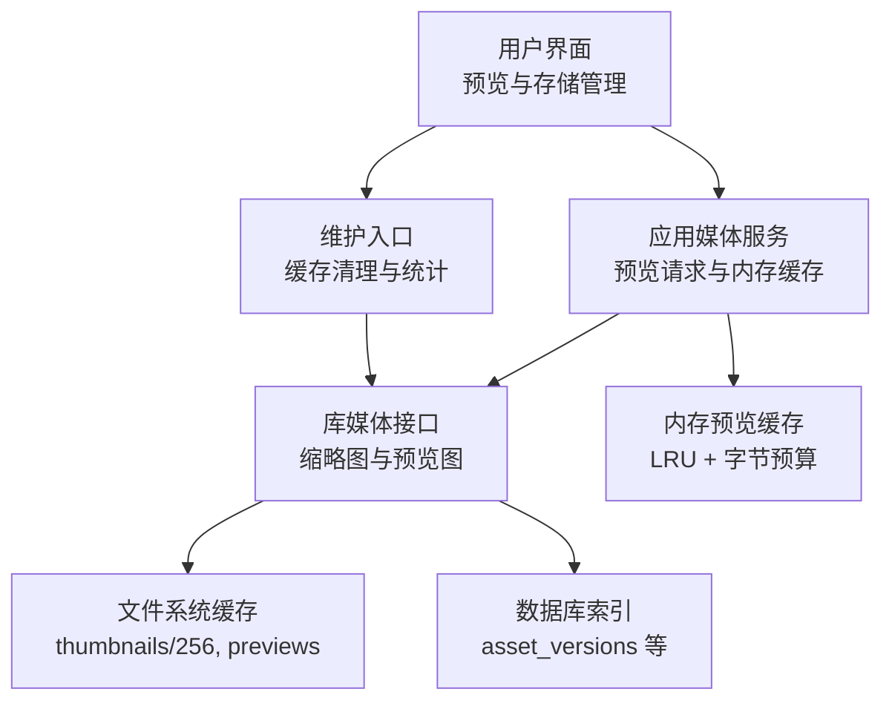
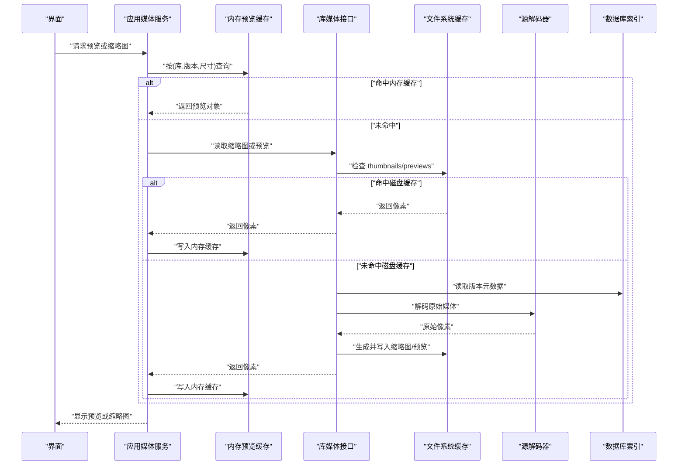
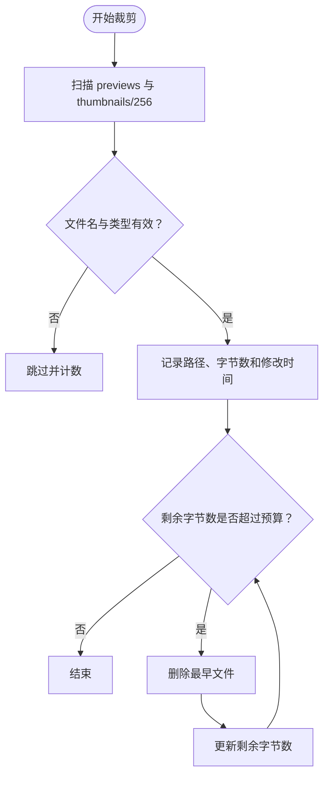
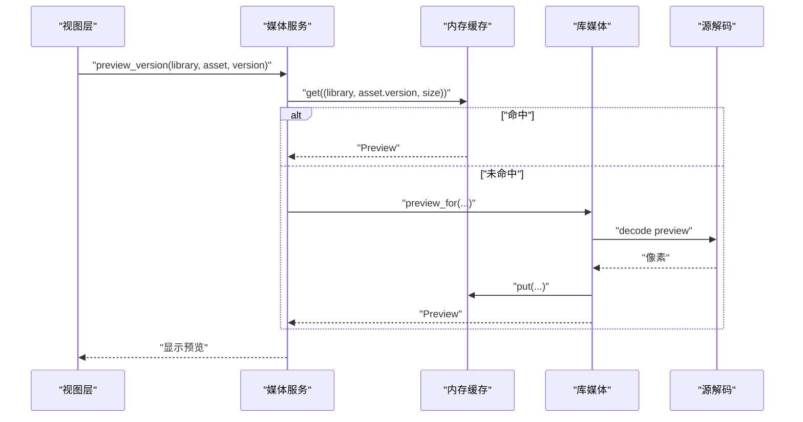
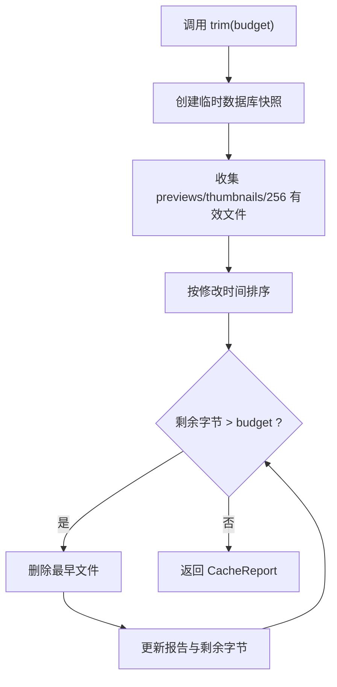
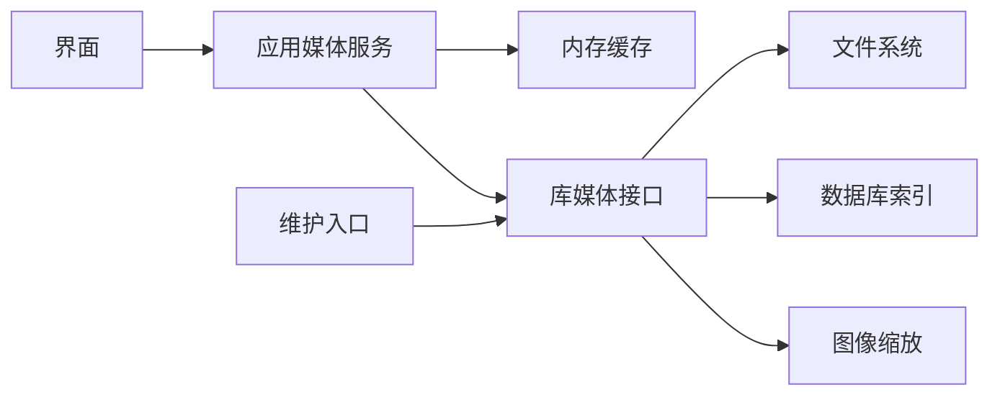

# 媒体缓存系统 (Media Cache)

> Repo Wiki 节点 `media-cache`
> 导出自 Qoder 知识库快照 `8fbe02f6-57c2-4874-b725-1a8130851fd9`，代码基线 `7a7a8e75e18bd90294e09cd422dd7ed5a04813a0`（分支 main，zh-CN）。

<cite>
**本文引用的文件**   
- [crates/moriq-library/src/media/cache.rs](../../../../crates/moriq-library/src/media/cache.rs)
- [crates/moriq-app/src/cache.rs](../../../../crates/moriq-app/src/cache.rs)
- [crates/moriq-library/src/media/resize.rs](../../../../crates/moriq-library/src/media/resize.rs)
- [crates/moriq-library/src/media/access.rs](../../../../crates/moriq-library/src/media/access.rs)
- [crates/moriq-library/src/media/media.rs](../../../../crates/moriq-library/src/media/media.rs)
- [crates/moriq-app/src/media.rs](../../../../crates/moriq-app/src/media.rs)
- [crates/moriq-app/src/maintenance.rs](../../../../crates/moriq-app/src/maintenance.rs)
- [crates/moriq-ui/src/storage.rs](../../../../crates/moriq-ui/src/storage.rs)
- [crates/moriq-library/src/database/schema.sql](../../../../crates/moriq-library/src/database/schema.sql)
- [crates/moriq-library/src/library/settings.rs](../../../../crates/moriq-library/src/library/settings.rs)
- [crates/moriq-library/src/maintenance/purge.rs](../../../../crates/moriq-library/src/maintenance/purge.rs)
- [crates/moriq-library/src/maintenance/storage.rs](../../../../crates/moriq-library/src/maintenance/storage.rs)
- [crates/moriq-ui/src/view.rs](../../../../crates/moriq-ui/src/view.rs)
</cite>

## 目录
1. [简介](#简介)
2. [项目结构](#项目结构)
3. [核心组件](#核心组件)
4. [架构总览](#架构总览)
5. [详细组件分析](#详细组件分析)
6. [依赖关系分析](#依赖关系分析)
7. [性能与容量规划](#性能与容量规划)
8. [故障排除指南](#故障排除指南)
9. [结论](#结论)

## 简介
本文件系统性说明 Moriq Space 的媒体缓存系统，覆盖多级缓存（内存、文件系统、数据库索引）协作机制、缩略图与预览图的生成与访问流程、懒加载与预加载策略、命中率统计、空间限制与淘汰策略、一致性保障以及配置与调优建议。读者无需深入源码即可理解系统如何以较低延迟和可控资源消耗提供高质量图片浏览体验。

## 项目结构
媒体缓存相关代码主要分布在以下模块：
- 库层媒体能力：负责磁盘上的可重建缓存路径、缩略图读取、预览图生成与尺寸适配。
- 应用层服务：封装预览获取、内存预览缓存、定时清理入口和界面状态。
- 用户界面：展示存储与缓存清理任务、统计结果和交互行为。
- 数据库模式：定义资产版本元数据，用于判断哪些文件属于“可重建缓存”。



**图示来源**
- [crates/moriq-app/src/media.rs:87-185](../../../../crates/moriq-app/src/media.rs#L87-L185)
- [crates/moriq-library/src/media/access.rs:1-23](../../../../crates/moriq-library/src/media/access.rs#L1-L23)
- [crates/moriq-library/src/media/media.rs:130-440](../../../../crates/moriq-library/src/media/media.rs#L130-L440)
- [crates/moriq-app/src/cache.rs:1-65](../../../../crates/moriq-app/src/cache.rs#L1-L65)
- [crates/moriq-library/src/database/schema.sql:1-42](../../../../crates/moriq-library/src/database/schema.sql#L1-L42)

**章节来源**
- [crates/moriq-app/src/media.rs:87-185](../../../../crates/moriq-app/src/media.rs#L87-L185)
- [crates/moriq-library/src/media/access.rs:1-23](../../../../crates/moriq-library/src/media/access.rs#L1-L23)
- [crates/moriq-library/src/media/media.rs:130-440](../../../../crates/moriq-library/src/media/media.rs#L130-L440)
- [crates/moriq-library/src/database/schema.sql:1-42](../../../../crates/moriq-library/src/database/schema.sql#L1-L42)

## 核心组件
- 内存预览缓存：按库标识、素材版本和尺寸作为键，维护最多约 256 MiB 或 48 个条目的最近使用顺序缓存；单条预览超过 128 MiB 直接丢弃。
- 文件系统缓存：包含两类可重建缓存目录 `previews` 与 `thumbnails/256`；通过文件名中的版本标识与扩展名识别有效条目。
- 数据库索引：记录资产版本、哈希、宽高、大小等元数据，供清理与一致性校验使用。
- 缩略图与预览图生成：基于最长边等比缩放，支持多种重采样算法，保留比例与透明度。
- 维护与清理：提供预算上限、按修改时间淘汰、跳过无效文件并返回清理报告。
- 界面与监控：展示清理运行状态、删除数量、剩余字节和跳过项数。

**章节来源**
- [crates/moriq-app/src/cache.rs:1-65](../../../../crates/moriq-app/src/cache.rs#L1-L65)
- [crates/moriq-library/src/media/cache.rs:1-87](../../../../crates/moriq-library/src/media/cache.rs#L1-L87)
- [crates/moriq-library/src/database/schema.sql:1-42](../../../../crates/moriq-library/src/database/schema.sql#L1-L42)
- [crates/moriq-library/src/media/resize.rs:1-72](../../../../crates/moriq-library/src/media/resize.rs#L1-L72)
- [crates/moriq-ui/src/storage.rs:56-72](../../../../crates/moriq-ui/src/storage.rs#L56-L72)

## 架构总览
媒体读取路径采用“内存 → 文件系统 → 源解码”的多级缓存；缩略图与预览图均基于统一媒体来源按需生成，并在磁盘上持久化以便后续快速复用。数据库索引不直接保存图像像素，而是提供版本身份、哈希和尺寸信息，帮助系统区分“可重建缓存”与“不可重建原片”。



**图示来源**
- [crates/moriq-app/src/media.rs:116-185](../../../../crates/moriq-app/src/media.rs#L116-L185)
- [crates/moriq-library/src/media/access.rs:1-23](../../../../crates/moriq-library/src/media/access.rs#L1-L23)
- [crates/moriq-library/src/media/media.rs:360-440](../../../../crates/moriq-library/src/media/media.rs#L360-L440)
- [crates/moriq-library/src/database/schema.sql:1-42](../../../../crates/moriq-library/src/database/schema.sql#L1-L42)

## 详细组件分析

### 内存预览缓存
内存缓存使用一个带互斥锁的状态结构，内部维护三个关键指标：
- 条目映射：键为 `(LibraryId, AssetVersionId, u32)`，值为预览对象与其使用时间戳。
- 当前字节数：跟踪所有条目中图像与背景像素的总字节数。
- 全局时钟：用于实现近似最近使用顺序。

核心行为包括：
- `get`：命中则更新时间戳并克隆预览对象。
- `put`：若单条预览过大则丢弃；否则在不超过 256 MiB 且不超过 48 个条目前提下插入，并按使用时间戳淘汰最旧项。
- `clear`：切换库时清空，避免旧素材像素残留。

复杂度方面，插入和查找接近平均 O(1)，淘汰最旧项需要遍历当前条目集合，因此单次淘汰代价约为 O(n)。该设计适合预览数量有限的桌面端场景。

```mermaid
classDiagram
    class MediaCache {
        -Mutex state
        +get(key) Option<Preview>
        +put(key, value) void
        +clear() void
    }
    class State {
        -HashMap<Key,(Preview,u64)> entries
        -u64 clock
        -usize bytes
    }
    MediaCache --> State : "持有"
```

**图示来源**
- [crates/moriq-app/src/cache.rs:1-65](../../../../crates/moriq-app/src/cache.rs#L1-L65)

**章节来源**
- [crates/moriq-app/src/cache.rs:1-65](../../../../crates/moriq-app/src/cache.rs#L1-L65)

### 文件系统缓存与缩略图策略
文件系统缓存仅处理“可重建”内容，主要包括两个目录：
- `previews`：存放按版本生成的预览图，例如 `previews/{version}-srgb1-{edge}.png`。
- `thumbnails/256`：存放固定 256 像素最长边的 PNG 缩略图，例如 `thumbnails/256/{version}.png`。

缩略图生成规则：
- 最长边等比缩小，不放大已有小图。
- 保留图像比例、像素类型及预乘透明度。
- 默认使用面积滤波；也可选择 Lanczos3、双三次、最近邻等重采样算法。

缓存键生成：
- 缩略图键由版本标识和固定目录构成。
- 预览图键由版本标识、色彩空间后缀与目标边缘长度共同构成。

过期策略：
- 不依赖绝对时间过期，而是基于修改时间和字节预算进行 LRU 式淘汰。
- 扫描 `previews` 与 `thumbnails/256` 下符合命名规范的文件，跳过符号链接、非 PNG 或非 UUID 前缀文件。
- 按修改时间升序删除，直到剩余字节数低于预算。



**图示来源**
- [crates/moriq-library/src/media/cache.rs:18-87](../../../../crates/moriq-library/src/media/cache.rs#L18-L87)

**章节来源**
- [crates/moriq-library/src/media/cache.rs:1-87](../../../../crates/moriq-library/src/media/cache.rs#L1-L87)
- [crates/moriq-library/src/media/access.rs:1-23](../../../../crates/moriq-library/src/media/access.rs#L1-L23)
- [crates/moriq-library/src/media/media.rs:130-440](../../../../crates/moriq-library/src/media/media.rs#L130-L440)
- [crates/moriq-library/src/media/resize.rs:1-72](../../../../crates/moriq-library/src/media/resize.rs#L1-L72)

### 预览图懒加载与预加载优化
预览图采用懒加载策略：
- 当界面请求预览时，先查内存缓存，再查磁盘缓存，最后从源解码。
- 首次解码后生成对应尺寸的预览图并写入磁盘，后续访问走缓存。
- 对比模式下会顺序解码左侧与右侧预览，控制峰值分配，避免同时占用过多内存。

预加载优化体现在：
- 缩略图与预览图按实际被访问的尺寸和版本生成，避免不必要的完整尺寸解码。
- 区域查看器等场景中，先在较小尺寸下完成展示，仅在放大到超出预览分辨率时才考虑更高精度瓦片。



**图示来源**
- [crates/moriq-app/src/media.rs:116-185](../../../../crates/moriq-app/src/media.rs#L116-L185)
- [crates/moriq-library/src/media/media.rs:360-440](../../../../crates/moriq-library/src/media/media.rs#L360-L440)

**章节来源**
- [crates/moriq-app/src/media.rs:116-185](../../../../crates/moriq-app/src/media.rs#L116-L185)
- [crates/moriq-library/src/media/media.rs:360-440](../../../../crates/moriq-library/src/media/media.rs#L360-L440)

### 缓存命中率监控与统计
当前实现并未暴露细粒度的“命中率计数器”，但提供了可观测的运行指标：
- 内存缓存：通过 `memory_mib()` 可估算缩略图预览占用的内存量，界面据此提示。
- 文件系统缓存清理：返回 `CacheReport`，包含已删除文件数、已删除字节数、剩余字节数和跳过的无效项数。
- 存储统计：扫描资源库根目录，分类统计托管原片、追加版本、可重建图片缓存、索引、交接副本、恢复与暂存数据、备份等类别，并检测硬链接与卷可用空间。

界面层会在清理完成后展示删除数量、剩余字节和跳过项数，帮助用户判断清理效果。

**章节来源**
- [crates/moriq-app/src/cache.rs:1-65](../../../../crates/moriq-app/src/cache.rs#L1-L65)
- [crates/moriq-library/src/media/cache.rs:18-87](../../../../crates/moriq-library/src/media/cache.rs#L18-L87)
- [crates/moriq-library/src/maintenance/storage.rs:1-200](../../../../crates/moriq-library/src/maintenance/storage.rs#L1-L200)
- [crates/moriq-ui/src/storage.rs:56-72](../../../../crates/moriq-ui/src/storage.rs#L56-L72)

### 缓存清理策略：空间限制、LRU 与脏数据清理
清理策略围绕“预算 + 修改时间 + 有效性校验”展开：
- 空间限制：清理目标是将 `previews` 与 `thumbnails/256` 的剩余字节数降至指定预算以下。
- 淘汰顺序：按修改时间升序删除，实现近似 LRU 效果。
- 脏数据清理：跳过非文件、符号链接、非 PNG、UUID 前缀无效的文件；在 Windows 上还会跳过特定属性标记的文件。
- 原子性与租约：清理过程通过临时数据库快照和库租约保证不会误删正在使用的资源库数据。

此外，删除操作还受权限和范围约束，仅允许删除受管目录下的文件，防止越权删除外部引用或重要数据。



**图示来源**
- [crates/moriq-library/src/media/cache.rs:18-87](../../../../crates/moriq-library/src/media/cache.rs#L18-L87)

**章节来源**
- [crates/moriq-library/src/media/cache.rs:18-87](../../../../crates/moriq-library/src/media/cache.rs#L18-L87)
- [crates/moriq-library/src/maintenance/purge.rs:1-200](../../../../crates/moriq-library/src/maintenance/purge.rs#L1-L200)

### 缓存一致性保证
一致性主要体现在以下几方面：
- 并发访问控制：内存缓存通过互斥锁保护；文件系统清理通过库租约确保资源库未被其他线程更改。
- 数据同步：预览与缩略图生成基于统一媒体来源，确保像素与源版本一致；数据库索引提供版本身份、哈希和尺寸信息，便于校验。
- 安全边界：删除路径必须位于受管目录，禁止跟随符号链接；对外部引用的替换需重新校验哈希、长度、修改时间与文件身份。
- 两阶段删除：先移动待删除文件到暂存位置，提交数据库事务后再清理，失败时尝试恢复。

这些机制共同保证在频繁读写、库切换和批量删除过程中，缓存不会污染原片，也不会错误删除重要数据。

**章节来源**
- [crates/moriq-library/src/media/cache.rs:1-87](../../../../crates/moriq-library/src/media/cache.rs#L1-L87)
- [crates/moriq-library/src/maintenance/purge.rs:1-200](../../../../crates/moriq-library/src/maintenance/purge.rs#L1-L200)
- [crates/moriq-library/src/library/lifecycle.rs:1-177](../../../../crates/moriq-library/src/library/lifecycle.rs#L1-L177)
- [crates/moriq-library/src/database/schema.sql:1-42](../../../../crates/moriq-library/src/database/schema.sql#L1-L42)

## 依赖关系分析
媒体缓存系统的依赖关系如下：
- 界面层依赖应用媒体服务与存储维护入口。
- 应用媒体服务依赖内存缓存与库媒体接口。
- 库媒体接口依赖文件系统、数据库索引和图像缩放工具。
- 维护入口依赖库媒体接口，间接影响文件系统缓存。



**图示来源**
- [crates/moriq-ui/src/storage.rs:56-72](../../../../crates/moriq-ui/src/storage.rs#L56-L72)
- [crates/moriq-app/src/media.rs:87-185](../../../../crates/moriq-app/src/media.rs#L87-L185)
- [crates/moriq-library/src/media/access.rs:1-23](../../../../crates/moriq-library/src/media/access.rs#L1-L23)
- [crates/moriq-library/src/media/resize.rs:1-72](../../../../crates/moriq-library/src/media/resize.rs#L1-L72)

**章节来源**
- [crates/moriq-ui/src/storage.rs:56-72](../../../../crates/moriq-ui/src/storage.rs#L56-L72)
- [crates/moriq-app/src/media.rs:87-185](../../../../crates/moriq-app/src/media.rs#L87-L185)
- [crates/moriq-library/src/media/access.rs:1-23](../../../../crates/moriq-library/src/media/access.rs#L1-L23)
- [crates/moriq-library/src/media/resize.rs:1-72](../../../../crates/moriq-library/src/media/resize.rs#L1-L72)

## 性能与容量规划
- 内存缓存预算：建议保持 256 MiB 以内，条目上限约 48；单条预览超过 128 MiB 直接丢弃，避免大图像阻塞缓存。
- 磁盘缓存预算：默认每 5 分钟将预览缓存回收至 4 GiB 预算；可根据磁盘空间与浏览习惯调整。
- 缩略图尺寸：256 像素缩略图适合列表与画廊卡片；预览图根据视口与缩放级别按需生成，避免全尺寸解码。
- 重采样算法：默认面积滤波平衡速度与质量；对高质量输出可选择 Lanczos3 或双三次。
- 数据库索引：利用 `asset_versions` 表的哈希、宽高、大小字段进行去重与一致性校验，减少重复解码与误删风险。
- 存储统计：通过分类统计可识别“可重建图片缓存”与“托管原片”的比例，辅助容量规划。

[本节为通用指导，不直接分析具体文件]

## 故障排除指南
常见问题与处理方法：
- 预览卡顿或内存飙升：检查内存缓存是否被大预览填满；必要时手动触发清理并切换库以清空旧像素。
- 缩略图缺失：确认 `thumbnails/256` 中存在对应版本的 PNG 文件；若缺失，重新访问素材以触发重建。
- 清理无效：确认被清理文件是否为有效 PNG 且 UUID 前缀正确；Windows 平台注意特殊文件属性标记。
- 删除报错：检查删除路径是否在受管目录内，是否存在符号链接或外部引用；遵循两阶段删除流程并检查恢复日志。
- 缓存不一致：核对数据库中的版本哈希与文件大小，确保预览与缩略图基于相同版本生成。

定位方法：
- 使用界面存储页面查看缓存清理状态、删除数量和剩余字节。
- 检查资源库根目录下 `previews` 与 `thumbnails/256` 的内容与命名是否符合预期。
- 查看数据库 `asset_versions` 表，确认版本哈希、宽高与大小是否与源文件一致。

**章节来源**
- [crates/moriq-ui/src/storage.rs:56-72](../../../../crates/moriq-ui/src/storage.rs#L56-L72)
- [crates/moriq-library/src/media/cache.rs:18-87](../../../../crates/moriq-library/src/media/cache.rs#L18-L87)
- [crates/moriq-library/src/maintenance/purge.rs:1-200](../../../../crates/moriq-library/src/maintenance/purge.rs#L1-L200)
- [crates/moriq-library/src/database/schema.sql:1-42](../../../../crates/moriq-library/src/database/schema.sql#L1-L42)

## 结论
Moriq Space 的媒体缓存系统通过内存、文件系统和数据库索引的协同工作，实现了低延迟、可控资源的媒体浏览体验。缩略图与预览图按实际使用场景生成，缓存清理以预算和时间顺序为基础，兼顾性能与安全。虽然当前未暴露细粒度命中率指标，但通过内存占用估算、清理报告和存储统计，用户仍可掌握缓存健康状态。结合合理的预算设置与算法选择，可在大规模媒体库中保持稳定的响应速度和较低的内存压力。

[本节为总结性内容，不直接分析具体文件]