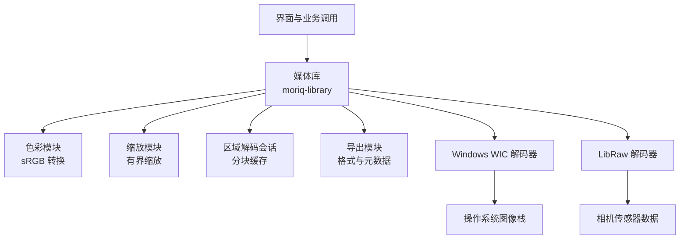
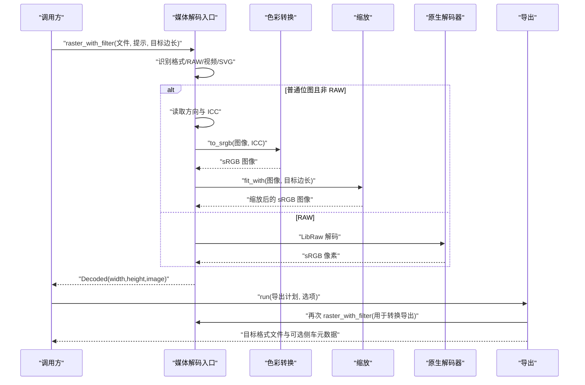
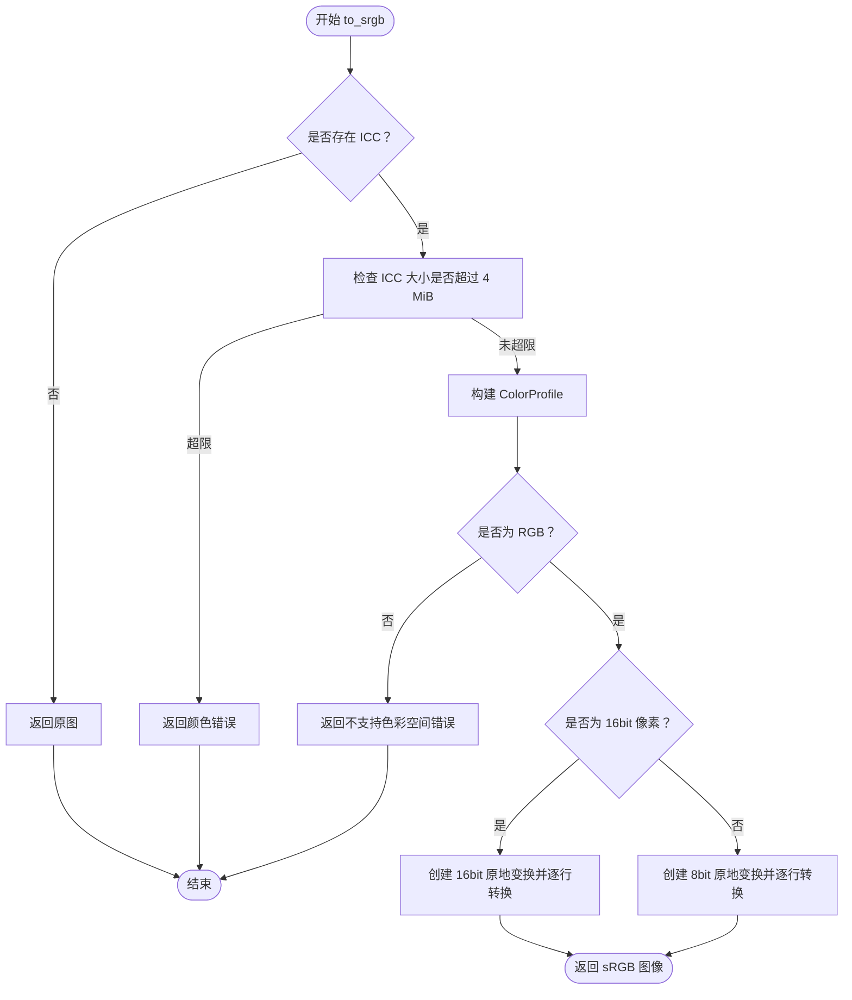
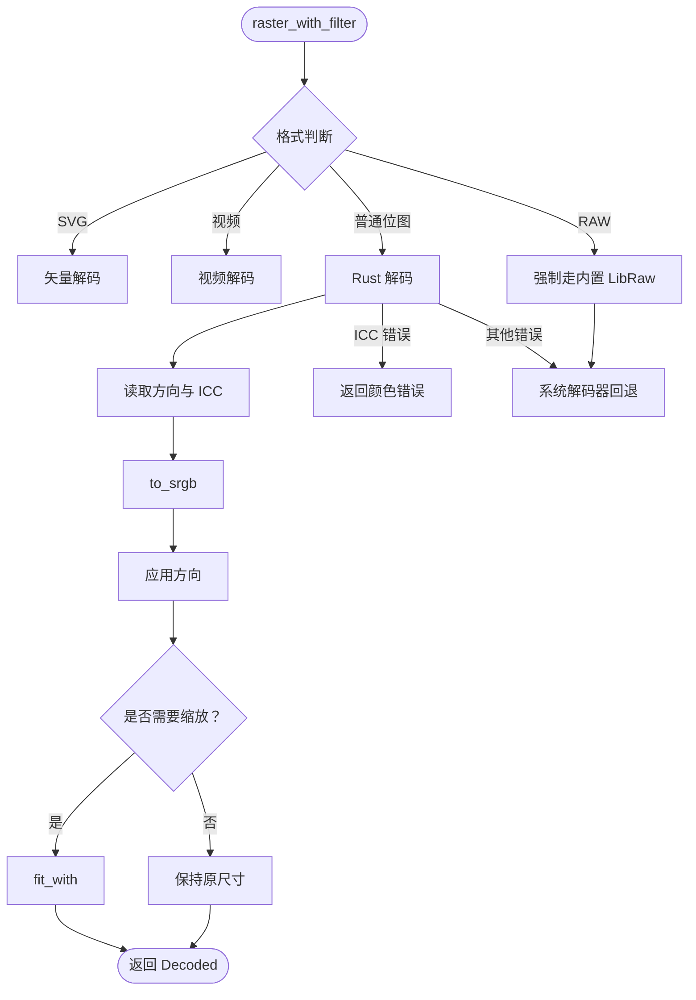
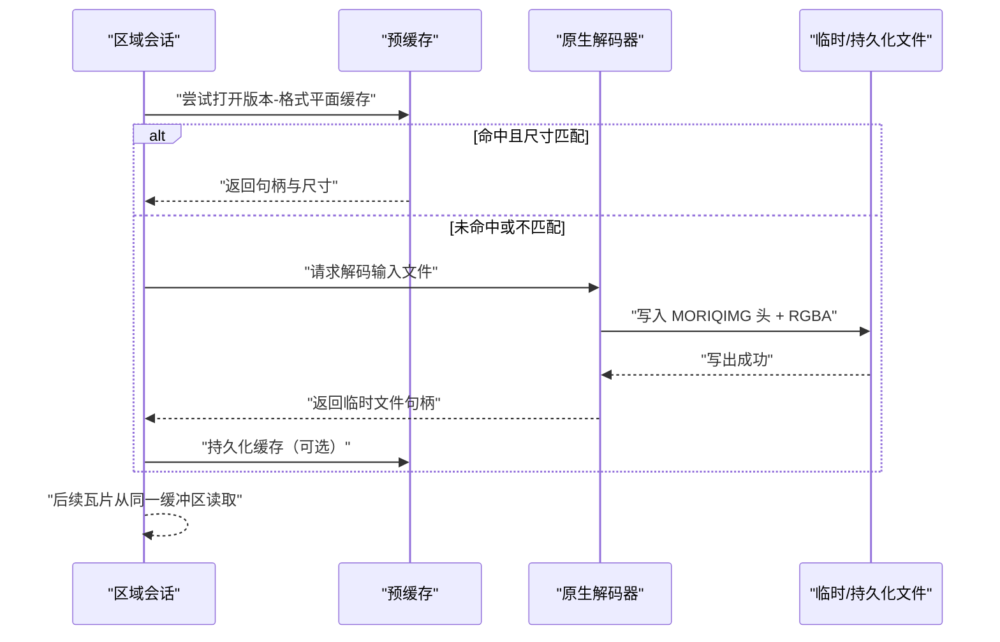
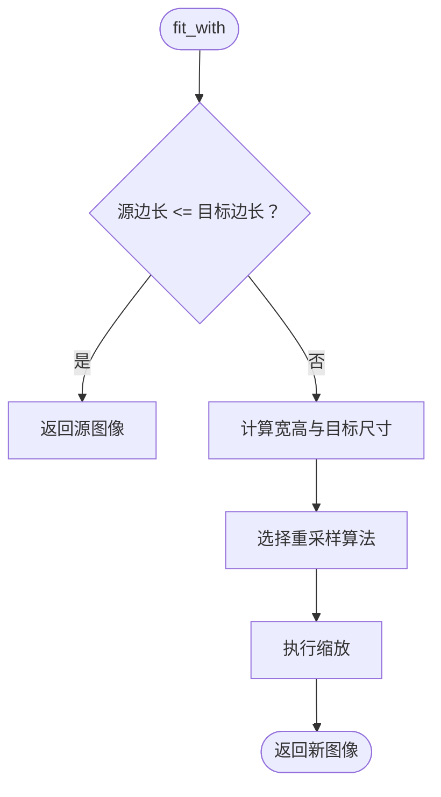
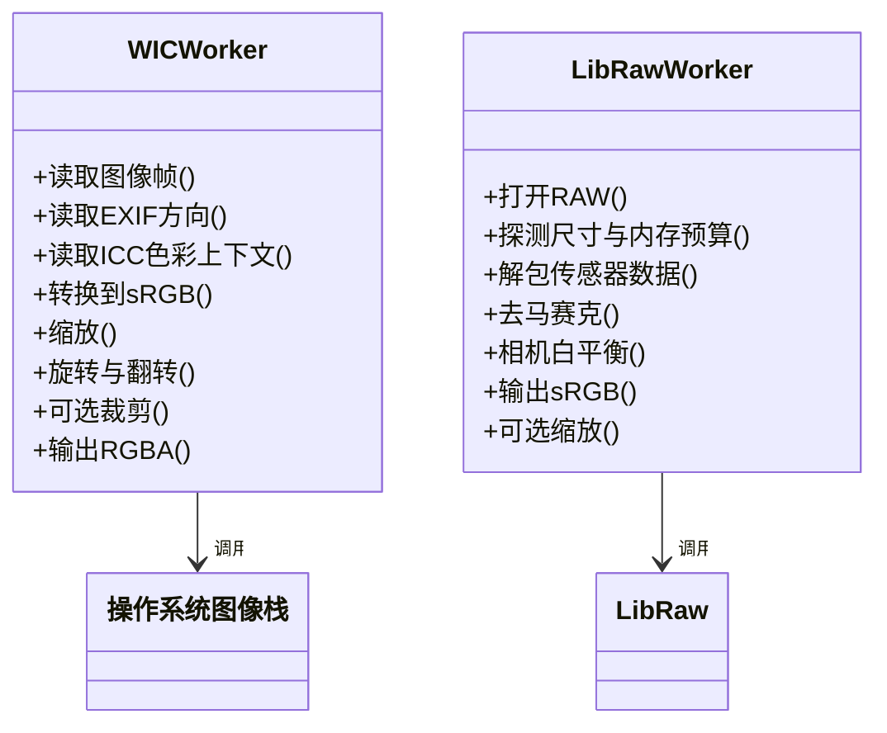
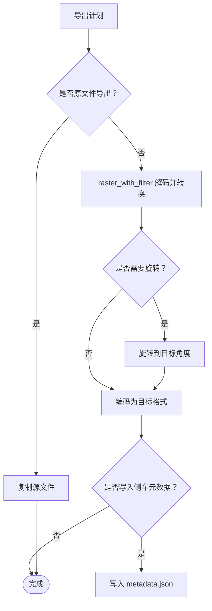
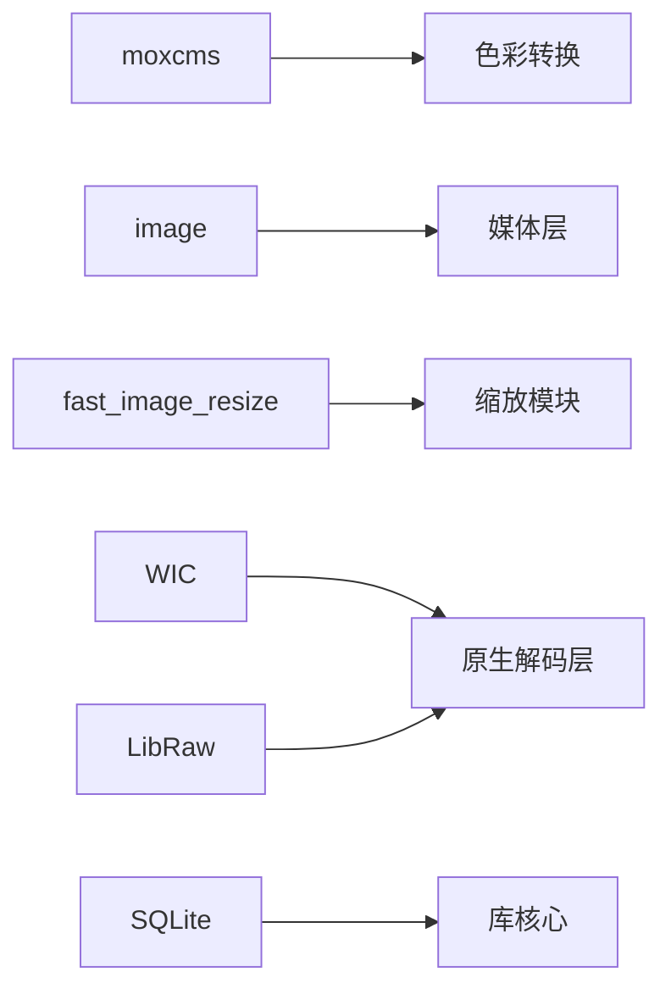

# 色彩管理系统（Color Management）

> Repo Wiki 节点 `media-color`
> 导出自 Qoder 知识库快照 `8fbe02f6-57c2-4874-b725-1a8130851fd9`，代码基线 `7a7a8e75e18bd90294e09cd422dd7ed5a04813a0`（分支 main，zh-CN）。

<cite>
**本文引用的文件**   
- [color.rs](../../../../crates/moriq-library/src/media/color.rs)
- [media.rs](../../../../crates/moriq-library/src/media/media.rs)
- [region.rs](../../../../crates/moriq-library/src/media/region.rs)
- [resize.rs](../../../../crates/moriq-library/src/media/resize.rs)
- [raw_portable.rs](../../../../crates/moriq-library/src/media/raw_portable.rs)
- [access.rs](../../../../crates/moriq-library/src/media/access.rs)
- [export.rs](../../../../crates/moriq-library/src/transfer/export.rs)
- [import.rs](../../../../crates/moriq-library/src/transfer/import.rs)
- [Cargo.toml](../../../../crates/moriq-library/Cargo.toml)
- [wic-worker.cpp](../../../../crates/moriq-library/native/wic-worker.cpp)
- [raw-worker.cpp](../../../../crates/moriq-library/native/raw-worker.cpp)
- [raw-worker-portable.cpp](../../../../crates/moriq-library/native/raw-worker-portable.cpp)
</cite>

## 目录
1. [简介](#简介)
2. [项目结构](#项目结构)
3. [核心组件](#核心组件)
4. [架构总览](#架构总览)
5. [详细组件分析](#详细组件分析)
6. [依赖关系分析](#依赖关系分析)
7. [性能与优化](#性能与优化)
8. [故障排查](#故障排查)
9. [结论](#结论)
10. [附录：实践指南与示例](#附录实践指南与示例)

## 简介
本文件系统性地梳理 Moriq Space 的色彩管理实现，重点覆盖以下方面：
- ICC 配置文件的加载、校验与 sRGB 转换流程；
- 标准色彩空间处理路径，包括 sRGB、Adobe RGB、ProPhoto RGB 等；
- 线性空间与感知空间的差异及在预览、缩放、导出中的体现；
- 颜色分析能力现状，包括主色调、直方图、色温检测的边界；
- 色彩校正工具现状，包括白平衡、饱和度、对比度的支持情况；
- 与专业软件的一致性保证策略；
- 性能优化手段，包括进程隔离、预算控制、缓存和并行限制；
- 最佳实践与常见问题。

该文档既面向工程读者，也尽量用通俗语言解释色彩管线中的关键决策。

## 项目结构
色彩管理相关代码集中在 `moriq-library` 媒体层，并通过原生解码器扩展平台能力：
- Rust 媒体库负责元数据读取、ICC 解析、色彩空间转换、缩放、缓存与导出；
- Windows 使用 WIC 和 LibRaw 原生工作进程完成系统级解码、方向修正、区域裁剪和内存保护；
- 跨平台便携 RAW 解码通过独立二进制提供传感器解码能力；
- 导入与导出流程围绕统一像素格式进行，确保从采集到输出的色彩一致性。

**图表来源**
- [media.rs:574-680](../../../../crates/moriq-library/src/media/media.rs#L574-L680)
- [color.rs:1-60](../../../../crates/moriq-library/src/media/color.rs#L1-L60)
- [region.rs:1-120](../../../../crates/moriq-library/src/media/region.rs#L1-L120)
- [export.rs:1-120](../../../../crates/moriq-library/src/transfer/export.rs#L1-L120)
- [wic-worker.cpp:1-113](../../../../crates/moriq-library/native/wic-worker.cpp#L1-L113)
- [raw-worker.cpp:1-102](../../../../crates/moriq-library/native/raw-worker.cpp#L1-L102)

**章节来源**
- [media.rs:574-680](../../../../crates/moriq-library/src/media/media.rs#L574-L680)
- [Cargo.toml:1-35](../../../../crates/moriq-library/Cargo.toml#L1-L35)

## 核心组件
- 色彩转换模块：负责将带 ICC 的图像转换为 sRGB，拒绝无效或不受支持的 ICC，并区分 8bit 与 16bit 像素路径。
- 媒体解码入口：统一处理 SVG、视频、位图、RAW，应用方向与色彩转换，并在失败时回退到系统解码器。
- 区域解码与会话：为视口分块渲染生成可重建的 RGBA 平面缓冲，避免重复解码大图。
- 缩放模块：按最长边等比缩小，保留比例、透明通道与预乘 Alpha。
- 原生解码器：Windows 下通过 WIC 完成方向、色彩上下文和裁剪；LibRaw 负责 RAW 解码。
- 导出模块：将已转换到 sRGB 的像素编码为目标格式，必要时进行 alpha 合成和 EXIF 写入。

**章节来源**
- [color.rs:1-60](../../../../crates/moriq-library/src/media/color.rs#L1-L60)
- [media.rs:574-680](../../../../crates/moriq-library/src/media/media.rs#L574-L680)
- [region.rs:1-120](../../../../crates/moriq-library/src/media/region.rs#L1-L120)
- [resize.rs:1-72](../../../../crates/moriq-library/src/media/resize.rs#L1-L72)
- [wic-worker.cpp:1-113](../../../../crates/moriq-library/native/wic-worker.cpp#L1-L113)
- [raw-worker.cpp:1-102](../../../../crates/moriq-library/native/raw-worker.cpp#L1-L102)
- [export.rs:1-120](../../../../crates/moriq-library/src/transfer/export.rs#L1-L120)

## 架构总览
下图展示一次典型导入、预览与导出的色彩路径：

**图表来源**
- [media.rs:574-680](../../../../crates/moriq-library/src/media/media.rs#L574-L680)
- [color.rs:1-60](../../../../crates/moriq-library/src/media/color.rs#L1-L60)
- [export.rs:120-250](../../../../crates/moriq-library/src/transfer/export.rs#L120-L250)

## 详细组件分析

### 色彩转换与 ICC 管理
色彩模块的职责是把带有 ICC 配置图的像素值映射到 sRGB。它执行以下关键步骤：
- 若不存在 ICC，则直接返回原图；
- 对 ICC 大小设置 4 MiB 上限；
- 使用 moxcms 构建源 ICC 配置文件；
- 仅支持 RGB 色彩空间，灰度或 CMYK 会报错但不静默降级；
- 根据像素类型选择 8bit 或 16bit 原地变换；
- 逐行应用变换，遇到错误立即返回颜色错误。

**图表来源**
- [color.rs:1-60](../../../../crates/moriq-library/src/media/color.rs#L1-L60)

该实现与 moxcms 提供的 ICC 转换能力配合，把 Adobe RGB、ProPhoto RGB 等标准色彩空间正确映射到 sRGB。测试用例中显式构造了 Adobe RGB 的 ICC，并验证预览、区域输出与导出后像素一致，同时原始文件未被修改。

**章节来源**
- [color.rs:1-60](../../../../crates/moriq-library/src/media/color.rs#L1-L60)
- [color.rs:61-191](../../../../crates/moriq-library/src/media/color.rs#L61-L191)
- [Cargo.toml:1-35](../../../../crates/moriq-library/Cargo.toml#L1-L35)

### 媒体解码入口与回退机制
媒体解码入口统一协调格式识别、方向修正、ICC 转换与缩放，并提供稳健的回退策略：
- 优先尝试 Rust 解码；
- 若 ICC 转换出错，不会交给系统解码器“静默绕过”，而是向上返回颜色错误；
- 其他解码错误会尝试系统解码器，以兼容平台特有格式；
- 对于超大图的原尺寸转换，限制最长边不超过 8192，否则要求调用方指定边界；
- RAW 始终走内置 LibRaw 路径。

**图表来源**
- [media.rs:574-680](../../../../crates/moriq-library/src/media/media.rs#L574-L680)

**章节来源**
- [media.rs:574-680](../../../../crates/moriq-library/src/media/media.rs#L574-L680)

### 区域解码与会话缓存
区域解码为视口渲染提供稳定的像素流：
- 先尝试查找已生成的 RGBA 平面缓存；
- 若缓存缺失或尺寸不匹配，调用原生解码器生成临时文件；
- 原生解码器输出固定头部与像素数据，便于快速校验；
- 所有视口瓦片从该缓冲区读取，避免重复解码；
- 超时、取消和文件大小被严格限制，防止解码进程占用过多资源。

**图表来源**
- [region.rs:1-120](../../../../crates/moriq-library/src/media/region.rs#L1-L120)
- [region.rs:120-200](../../../../crates/moriq-library/src/media/region.rs#L120-L200)

**章节来源**
- [region.rs:1-120](../../../../crates/moriq-library/src/media/region.rs#L1-L120)
- [region.rs:120-200](../../../../crates/moriq-library/src/media/region.rs#L120-L200)

### 缩放算法与透明度处理
缩放模块只缩小不放大，保持纵横比和像素类型，并保留预乘 Alpha：
- 当源边长小于等于目标边长时直接返回原图；
- 根据用户选择的重采样滤镜选择 fast_image_resize 算法；
- 测试结果验证了比例、透明通道与相邻像素混合的正确性。

**图表来源**
- [resize.rs:1-72](../../../../crates/moriq-library/src/media/resize.rs#L1-L72)

**章节来源**
- [resize.rs:1-72](../../../../crates/moriq-library/src/media/resize.rs#L1-L72)

### 原生解码器：Windows WIC 与 LibRaw
- WIC 工作进程负责：
  - 读取 EXIF 方向；
  - 获取 ICC 色彩上下文并转换为 sRGB；
  - 缩放、旋转、翻转；
  - 可选的区域裁剪；
  - 输出固定协议的二进制帧。
- LibRaw 工作进程负责：
  - 传感器解码；
  - 相机白平衡；
  - 输出 sRGB 8bit 图像；
  - 针对预览场景进行半尺寸信息探测与内存预算调整；
  - 在 Windows 上使用 WIC 做最终缩放与 RGBA 转换。

**图表来源**
- [wic-worker.cpp:1-113](../../../../crates/moriq-library/native/wic-worker.cpp#L1-L113)
- [raw-worker.cpp:1-102](../../../../crates/moriq-library/native/raw-worker.cpp#L1-L102)
- [raw-worker-portable.cpp:1-59](../../../../crates/moriq-library/native/raw-worker-portable.cpp#L1-L59)

**章节来源**
- [wic-worker.cpp:1-113](../../../../crates/moriq-library/native/wic-worker.cpp#L1-L113)
- [raw-worker.cpp:1-102](../../../../crates/moriq-library/native/raw-worker.cpp#L1-L102)
- [raw-worker-portable.cpp:1-59](../../../../crates/moriq-library/native/raw-worker-portable.cpp#L1-L59)
- [raw_portable.rs:1-120](../../../../crates/moriq-library/src/media/raw_portable.rs#L1-L120)

### 导入与导出中的色彩一致性
- 导入阶段主要管理文件位置、版本、哈希与元数据，不改变原始像素；
- 导出阶段对需要转换的图像再次经过 `raster_with_filter`，从而保证预览、全尺寸解码与导出采用相同的色彩空间转换与缩放路径；
- JPEG 导出时对 alpha 进行预乘合成，PNG/WebP/TIFF 则保留 RGBA；
- 可选择写入侧车元数据，记录资产 ID、版本、标签、AI 描述、EXIF 等，提升与外部工具协作的可追溯性。

**图表来源**
- [export.rs:120-250](../../../../crates/moriq-library/src/transfer/export.rs#L120-L250)
- [import.rs:1-120](../../../../crates/moriq-library/src/transfer/import.rs#L1-L120)

**章节来源**
- [export.rs:120-250](../../../../crates/moriq-library/src/transfer/export.rs#L120-L250)
- [import.rs:1-120](../../../../crates/moriq-library/src/transfer/import.rs#L1-L120)

## 依赖关系分析
色彩管理的核心依赖如下：
- moxcms：提供 ICC 配置文件构建与像素级转换；
- image：通用图像读写、编码器与基础像素操作；
- fast_image_resize：高性能缩放；
- Windows WIC：系统级色彩上下文、方向、缩放、裁剪；
- LibRaw：RAW 传感器解码；
- SQLite：版本、元数据与导出计划的持久化。

**图表来源**
- [Cargo.toml:1-35](../../../../crates/moriq-library/Cargo.toml#L1-L35)
- [media.rs:574-680](../../../../crates/moriq-library/src/media/media.rs#L574-L680)
- [resize.rs:1-72](../../../../crates/moriq-library/src/media/resize.rs#L1-L72)
- [wic-worker.cpp:1-113](../../../../crates/moriq-library/native/wic-worker.cpp#L1-L113)
- [raw-worker.cpp:1-102](../../../../crates/moriq-library/native/raw-worker.cpp#L1-L102)

**章节来源**
- [Cargo.toml:1-35](../../../../crates/moriq-library/Cargo.toml#L1-L35)

## 性能与优化
- 进程隔离与资源限制：
  - WIC 与 LibRaw 工作进程通过作业对象或 rlimit 限制 CPU 与内存，父进程退出时自动终止子进程；
  - OMP_NUM_THREADS 设为 1，避免解码器内部多线程竞争导致不可预测的资源占用。
- 解码预算与回退：
  - 大文件优先使用系统解码器控制内存；
  - 原尺寸转换最大边限制为 8192，超出则要求调用方指定边界；
  - 区域解码与 RAW 解码均有 120 秒超时保护。
- 缓存策略：
  - 缩略图与预览平面缓存在磁盘，避免重复解码；
  - 区域解码产物以固定协议存储，便于快速校验与重建。
- 像素深度优化：
  - 16bit 图像使用原地 16bit 变换，减少精度损失；
  - 8bit 图像直接逐行转换，降低分配开销。
- 并行处理：
  - 当前色彩转换与解码串行执行，避免在同一线程池内并发造成抖动；
  - 批量任务如缩略图计划限制单次最多 128 张，防止 I/O 与内存峰值过高。

[本节为通用性能建议，不涉及具体代码片段]

## 故障排查
- ICC 无效或过大：
  - 现象：预览或导入时报颜色错误；
  - 原因：ICC 超过 4 MiB 或无法被 moxcms 解析；
  - 处理：修复 ICC 或使用系统解码器回退路径。
- 非 RGB ICC：
  - 现象：灰度或 CMYK 配置被拒绝；
  - 原因：当前仅支持 RGB ICC；
  - 处理：转换为 RGB ICC 或等待适配。
- 系统解码器失败：
  - 现象：Rust 解码失败后系统解码器仍失败；
  - 原因：文件格式损坏或平台解码器不支持；
  - 处理：检查文件完整性，确认平台环境。
- RAW 解码失败：
  - 现象：RAW 解码错误或超时；
  - 原因：机型/压缩不支持、文件损坏、超出内存预算；
  - 处理：更新 LibRaw 或更换 RAW 文件。
- 区域解码失败：
  - 现象：视口瓦片无法加载；
  - 原因：原生解码器进程异常或输出尺寸非法；
  - 处理：检查临时文件、权限与输出协议。

**章节来源**
- [color.rs:1-60](../../../../crates/moriq-library/src/media/color.rs#L1-L60)
- [media.rs:574-680](../../../../crates/moriq-library/src/media/media.rs#L574-L680)
- [raw_portable.rs:1-120](../../../../crates/moriq-library/src/media/raw_portable.rs#L1-L120)
- [region.rs:1-120](../../../../crates/moriq-library/src/media/region.rs#L1-L120)

## 结论
Moriq Space 的色彩管理以 sRGB 为中心，通过 moxcms 对 ICC 进行严格校验与转换，结合系统解码器的健壮回退机制，确保预览、区域渲染与导出的一致性。RAW 与系统图像栈分别在各自领域提供高性能解码与平台兼容性。当前实现尚未内置高级色彩分析（如主色调提取、直方图、色温检测）和用户可控的色彩校正工具（白平衡、饱和度、对比度），但这些能力可在现有 sRGB 像素基础上扩展。

[本节为总结性内容，不涉及具体代码片段]

## 附录：实践指南与示例

### 标准色彩空间处理要点
- sRGB：默认显示与导出目标，适合大多数屏幕与网络用途；
- Adobe RGB：广色域扫描与摄影后期常用，导入时应转换为 sRGB 以保证预览一致；
- ProPhoto RGB：更宽色域的后期空间，同样应在预览与导出前转换为 sRGB。

实践中应确保：
- 所有含 ICC 的图像导入时都经过 sRGB 转换；
- 预览、区域渲染与导出共享同一路径，避免视觉不一致；
- 对 16bit 图像保留更高精度，但最终输出按需量化。

**章节来源**
- [color.rs:1-60](../../../../crates/moriq-library/src/media/color.rs#L1-L60)
- [color.rs:61-191](../../../../crates/moriq-library/src/media/color.rs#L61-L191)

### 颜色分析能力现状与建议
- 当前仓库未发现专门的主色调提取、色彩直方图生成或色温检测实现；
- 建议在获得 sRGB 像素后进行统计：
  - 主色调：对 R、G、B 分量做加权直方图或聚类；
  - 色彩直方图：统计三通道分布，用于质量评估与调试；
  - 色温估算：基于白点估计与通道均值比值近似计算相关色温。

[本节为概念性建议，不涉及具体代码片段]

### 色彩校正工具现状与建议
- 当前未实现白平衡、饱和度增强、对比度优化等用户可调工具；
- 可在 sRGB 像素上增加图像处理管线：
  - 白平衡：按通道增益校正白点；
  - 饱和度：在 HSL 或 Lab 空间调整饱和度；
  - 对比度：使用曲线或 Gamma 调整动态范围。

[本节为概念性建议，不涉及具体代码片段]

### 与专业软件的一致性保证
- 使用 moxcms 进行 ICC 转换，而非简单 gamma 校正；
- 统一目标色彩空间为 sRGB，确保与浏览器、设计软件与打印流程的基线一致；
- 导出时保留侧车元数据，便于第三方工具溯源；
- 对 JPEG 导出进行 alpha 预乘合成，避免透明背景出现黑边。

**章节来源**
- [export.rs:120-250](../../../../crates/moriq-library/src/transfer/export.rs#L120-L250)

### 图像处理示例与视觉效果对比
- Adobe RGB 到 sRGB：
  - 预期效果：红绿色域变窄，红色可能略暗，整体色彩更接近显示器表现；
  - 验证方式：比较导入前后同一像素的 R、G、B 值，并确保原始 PNG 未被修改。
- 区域渲染与全屏预览：
  - 预期效果：局部瓦片与全屏解码结果一致；
  - 验证方式：对比 region 输出与原尺寸解码像素。
- 导出转换：
  - 预期效果：转换导出与预览像素一致，JPEG 无透明黑边；
  - 验证方式：对比导出图像与内存预览，检查侧车元数据是否存在。

**章节来源**
- [color.rs:61-191](../../../../crates/moriq-library/src/media/color.rs#L61-L191)
- [region.rs:120-200](../../../../crates/moriq-library/src/media/region.rs#L120-L200)
- [export.rs:120-250](../../../../crates/moriq-library/src/transfer/export.rs#L120-L250)