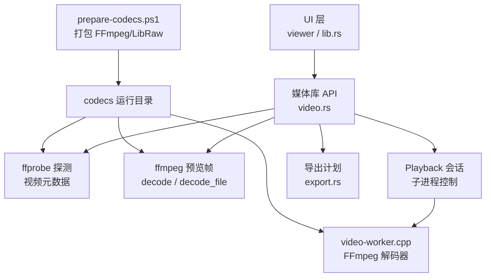
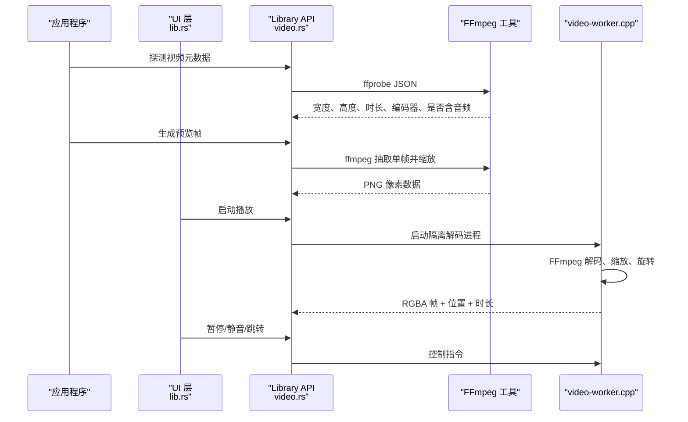
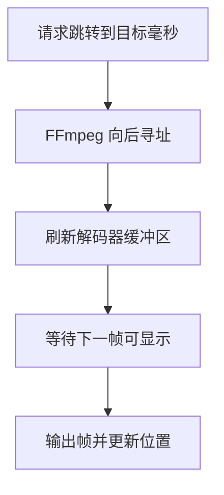
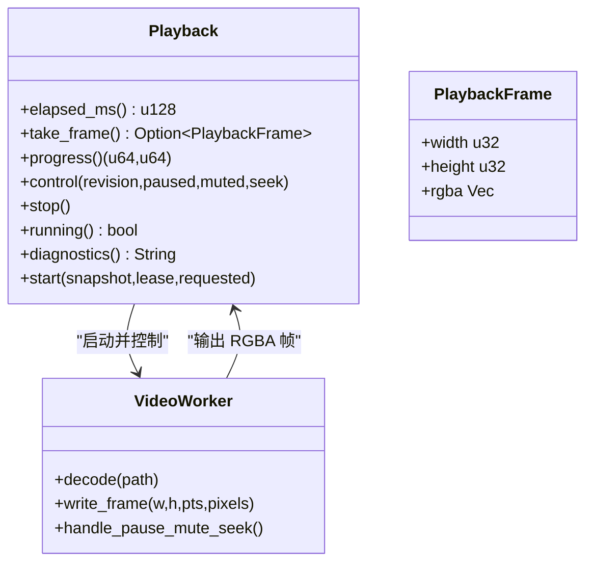
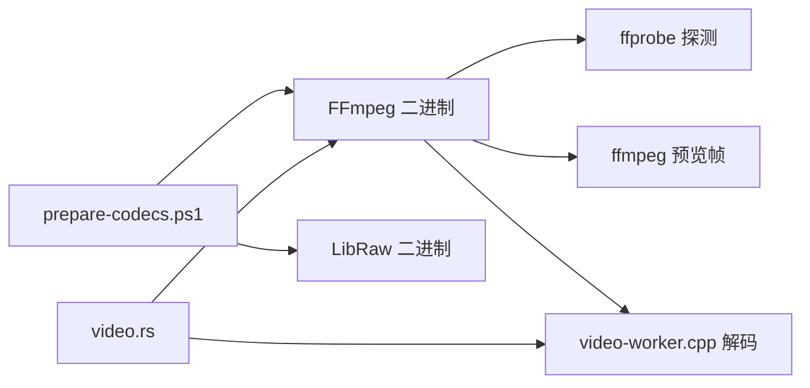
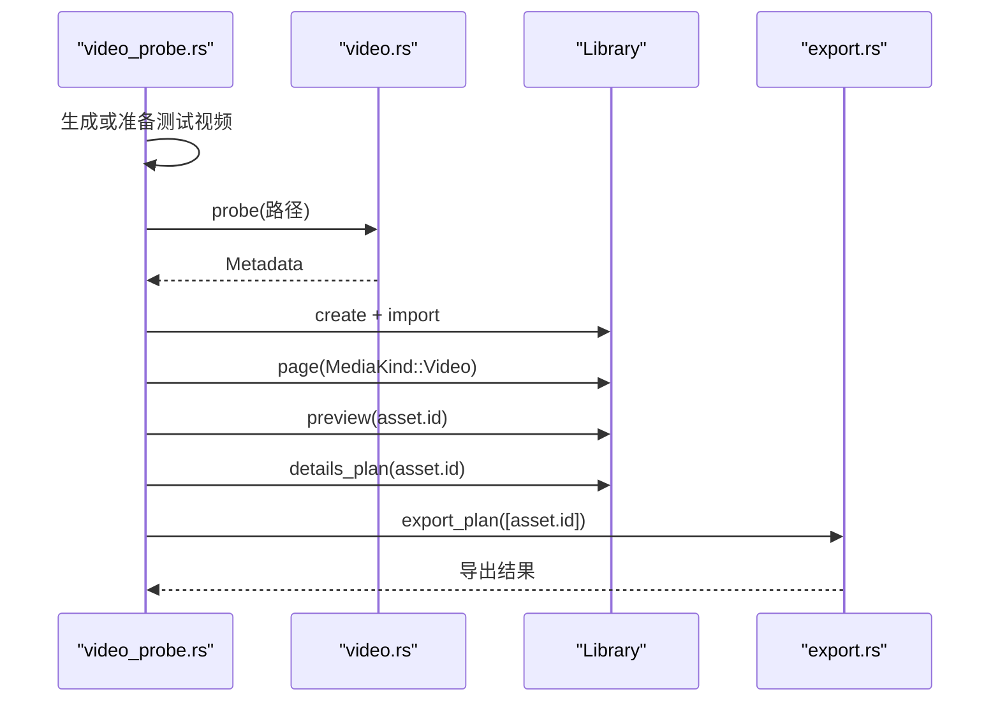

# 视频处理引擎（Video Processing）

> Repo Wiki 节点 `media-video`
> 导出自 Qoder 知识库快照 `8fbe02f6-57c2-4874-b725-1a8130851fd9`，代码基线 `7a7a8e75e18bd90294e09cd422dd7ed5a04813a0`（分支 main，zh-CN）。

<cite>
**本文引用的文件**   
- [video.rs](../../../../crates/moriq-library/src/media/video.rs)
- [video-worker.cpp](../../../../crates/moriq-library/native/video-worker.cpp)
- [video_probe.rs](../../../../crates/moriq-library/examples/video_probe.rs)
- [prepare-codecs.ps1](../../../../scripts/prepare-codecs.ps1)
- [export.rs](../../../../crates/moriq-library/src/transfer/export.rs)
- [ARCHITECTURE.md](../../../../ARCHITECTURE.md)
- [lib.rs](../../../../crates/moriq-ui/src/lib.rs)
</cite>

## 目录
1. [简介](#简介)
2. [项目结构与职责边界](#项目结构与职责边界)
3. [核心组件](#核心组件)
4. [架构总览](#架构总览)
5. [详细组件分析](#详细组件分析)
6. [依赖关系分析](#依赖关系分析)
7. [性能与硬件加速](#性能与硬件加速)
8. [使用示例](#使用示例)
9. [故障排除指南](#故障排除指南)
10. [结论](#结论)

## 简介
本文件面向 Moriq Space 的视频处理子系统，聚焦以下能力：
- 多媒体容器支持：MP4、MOV、AVI、MKV、WebM、MTS、M2TS 等格式的探测、解析和基础解码。
- 视频流提取与分析：轨道检测、编码格式识别、时长计算、分辨率检测、音频存在性判断。
- 预览帧生成：在指定时间点抽取一帧并输出为图片。
- 实时播放集成：通过隔离的 FFmpeg 工作进程实现暂停、静音、跳转、进度读取和逐帧渲染。
- 导出与原始内容保护：导出计划中区分“原片”与“图像导出”，对视频默认保持原片不转码。
- 工程化保障：固定版本的 FFmpeg/LibRaw 二进制、运行时校验、预算限制、超时控制和诊断日志。

需要特别说明的是：当前仓库中的视频能力以“探测、预览帧、播放器集成、导出计划”为主；并未发现通用“视频转码管道”或用户可控质量参数的完整实现。视频导出在 `moriq-library` 中主要面向图像类资产；当目标格式为“原片”时，视频资产会被直接复制而不重新编码。

**章节来源**
- [ARCHITECTURE.md:1-40](../../../../ARCHITECTURE.md#L1-L40)

## 项目结构与职责边界
视频相关代码分布在 Rust 层、原生 C++ 播放器和脚本构建层：

**图表来源**
- [video.rs:1-200](../../../../crates/moriq-library/src/media/video.rs#L1-L200)
- [video-worker.cpp:1-60](../../../../crates/moriq-library/native/video-worker.cpp#L1-L60)
- [export.rs:1-120](../../../../crates/moriq-library/src/transfer/export.rs#L1-L120)
- [prepare-codecs.ps1:1-60](../../../../scripts/prepare-codecs.ps1#L1-L60)

职责说明：
- `moriq-library/src/media/video.rs`：视频扩展名识别、工具路径定位、ffprobe 探测、预览帧解码、播放会话管理、命令执行预算控制。
- `moriq-library/native/video-worker.cpp`：Windows 上独立 FFmpeg 解码进程，负责音视频解码、时钟同步、旋转处理和 RGBA 帧输出。
- `crates/moriq-library/examples/video_probe.rs`：端到端验证导入、探测、预览、导入去重、导出和重新打开。
- `scripts/prepare-codecs.ps1`：下载并校验固定版本 FFmpeg/LibRaw，裁剪出允许的二进制和动态库，生成运行时清单。
- `crates/moriq-library/src/transfer/export.rs`：导出计划构建，区分原片与图像导出。
- `crates/moriq-ui/src/lib.rs`：播放器生命周期、消息分发、UI 状态与播放诊断收集。

**章节来源**
- [video.rs:1-200](../../../../crates/moriq-library/src/media/video.rs#L1-L200)
- [video-worker.cpp:1-60](../../../../crates/moriq-library/native/video-worker.cpp#L1-L60)
- [video_probe.rs:1-90](../../../../crates/moriq-library/examples/video_probe.rs#L1-L90)
- [prepare-codecs.ps1:1-60](../../../../scripts/prepare-codecs.ps1#L1-L60)
- [export.rs:1-120](../../../../crates/moriq-library/src/transfer/export.rs#L1-L120)
- [ARCHITECTURE.md:1-40](../../../../ARCHITECTURE.md#L1-L40)

## 核心组件
- 视频扩展名与工具定位
  - 支持的扩展名包括 MP4、MOV、M4V、MKV、WebM、AVI、MTS、M2TS。
  - 工具名称限定为 `ffmpeg` 和 `ffprobe`，并通过受控路径查找 `codecs` 目录。
  - Windows 调试构建可使用环境变量指向开发编解码目录。
- 元数据探测
  - 使用 ffprobe 输出 JSON，提取宽高、时长、编码器名称、像素格式、平均帧率、色彩空间、色彩传递、是否有音轨。
  - 自动处理 90 度旋转导致的宽高交换。
- 预览帧解码
  - 调用 ffmpeg 抽取指定时间点的单帧，缩放至最大边长上限，保存 PNG 并读回。
  - 提供路径版 `decode` 和已打开文件版 `decode_file`。
- 播放会话
  - `Playback` 结构封装子进程、输入管道、输出帧缓冲、临时源文件和诊断文件。
  - 支持暂停、静音、跳转、进度查询、取帧、停止和诊断信息读取。
- 导出计划
  - 若导出格式为“原片”，视频资产不会转码，而是保留原文件。
  - 其他类型资产走图像编码流程。

**章节来源**
- [video.rs:1-120](../../../../crates/moriq-library/src/media/video.rs#L1-L120)
- [video.rs:520-676](../../../../crates/moriq-library/src/media/video.rs#L520-L676)
- [export.rs:80-110](../../../../crates/moriq-library/src/transfer/export.rs#L80-L110)

## 架构总览
视频处理由 Rust 应用层驱动底层 FFmpeg 工具，并在需要实时播放时使用隔离的 C++ 工作进程。整体流程如下：

**图表来源**
- [video.rs:520-676](../../../../crates/moriq-library/src/media/video.rs#L520-L676)
- [video-worker.cpp:60-192](../../../../crates/moriq-library/native/video-worker.cpp#L60-L192)
- [lib.rs:1700-2100](../../../../crates/moriq-ui/src/lib.rs#L1700-L2100)

## 详细组件分析

### 多媒体容器与格式支持
- 扩展名白名单用于统一导入与播放判断，包含 MP4、MOV、M4V、MKV、WebM、AVI、MTS、M2TS。
- ffprobe 与 video-worker 均设置 `format_whitelist`，明确允许 `mov, matroska, webm, avi, mpegts`。
- 这些限制是安全边界的一部分：避免把未经验证的容器作为媒体输入。

| 格式 | 扩展名或容器 | 支持方式 | 备注 |
|---|---|---|---|
| MP4 | `.mp4` | ffprobe 探测、预览帧、播放 | 通常来自 MOV/MP4 sample tables |
| MOV | `.mov` | ffprobe 探测、预览帧、播放 | 代码中对 MOV 有额外参数探测优化 |
| MKV | `.mkv` | ffprobe 探测、预览帧、播放 | 对应 Matroska 容器 |
| AVI | `.avi` | ffprobe 探测、预览帧、播放 | 常见旧容器 |
| WebM | `.webm` | ffprobe 探测、预览帧、播放 | 常用于网络视频 |
| MTS/M2TS | `.mts`, `.m2ts` | 扩展名识别 | 主要用于导入识别，实际解码仍依赖 FFmpeg |

**章节来源**
- [video.rs:1-40](../../../../crates/moriq-library/src/media/video.rs#L1-L40)
- [video.rs:560-620](../../../../crates/moriq-library/src/media/video.rs#L560-L620)
- [video-worker.cpp:120-140](../../../../crates/moriq-library/native/video-worker.cpp#L120-L140)

### 视频流提取与分析
- 轨道检测：ffprobe 返回所有流，Rust 层选择第一个非附加图片的视频流。
- 编码格式识别：从 `codec_name` 提取编码器名称，同时记录像素格式、色彩空间和色彩传递。
- 音频存在性：检查是否存在类型为 audio 的流。
- 时长计算：优先使用 format 层的 duration，再回退到视频流 duration，最终转换为毫秒。
- 分辨率检测：使用 width 和 height，并对 90 度旋转进行宽高交换。
- 帧率：返回 `avg_frame_rate` 字符串，不做数值归一化。

**图表来源**
- [video.rs:560-620](../../../../crates/moriq-library/src/media/video.rs#L560-L620)

**章节来源**
- [video.rs:560-620](../../../../crates/moriq-library/src/media/video.rs#L560-L620)

### 关键帧检测与定位机制
当前公开 API 中未发现显式的“关键帧扫描”或“关键帧索引生成”函数。关键帧行为主要体现在：
- ffprobe 探测只返回元数据和流信息，不专门列出关键帧列表。
- 预览帧解码通过 `-ss` 跳转到指定时间后抽取一帧，具体是否命中关键帧由 FFmpeg 内部决定。
- 播放器在跳转时使用 `AVSEEK_FLAG_BACKWARD`，即向后寻找最近的寻址点，这通常接近但不一定等于严格意义上的关键帧。
- 因此，本项目更偏向“基于时间的随机访问”而非“按关键帧索引的精确定位”。

**图表来源**
- [video-worker.cpp:140-180](../../../../crates/moriq-library/native/video-worker.cpp#L140-L180)

**章节来源**
- [video-worker.cpp:140-180](../../../../crates/moriq-library/native/video-worker.cpp#L140-L180)

### 帧提取功能
- 指定时间点帧获取：`decode(path, edge)` 使用 ffmpeg 在 `duration_ms / 10000` 秒处最多取 3 秒的位置抽取一帧。
- 批量帧导出：仓库中没有通用的“批量导出视频帧序列”API。现有导出逻辑主要针对图像资产；视频资产在未选择“原片导出”时不会进入图像编码路径。
- 帧质量控制：预览帧会缩放到最大边长不超过 16384 像素，并按比例缩放，同时设置 SAR=1。

**图表来源**
- [video.rs:620-676](../../../../crates/moriq-library/src/media/video.rs#L620-L676)

**章节来源**
- [video.rs:620-676](../../../../crates/moriq-library/src/media/video.rs#L620-L676)

### 视频时长、比特率分析与分辨率检测
- 时长：来自 ffprobe 的 format 或视频流 duration，单位换算为毫秒。
- 分辨率：width 和 height，并根据侧数据中的旋转调整。
- 比特率：公开的 `Metadata` 结构不包含比特率字段；当前实现仅提取编码器名称、像素格式、帧率字符串、色彩信息和音频存在性。
- 如需比特率，应基于文件大小除以时长估算，或在 ffprobe JSON 中自行解析 `bit_rate` 字段，但这不是当前公开 API 的直接返回值。

**章节来源**
- [video.rs:560-620](../../../../crates/moriq-library/src/media/video.rs#L560-L620)

### 视频转码功能
当前仓库没有暴露通用的“视频转码”API。重点事实如下：
- `video.rs` 中的 `decode` 是“预览帧解码”，不是视频转码。
- `export.rs` 中，若导出格式为“原片”，视频资产不会被重新编码。
- 导出计划中针对图像资产进行缩放、旋转和编码；视频资产默认不走该路径。
- 因此，“格式转换、质量调整、压缩优化”在视频领域应视为受限能力：可用于预览帧或图像导出，但不能理解为完整的视频转码管线。

**图表来源**
- [export.rs:80-110](../../../../crates/moriq-library/src/transfer/export.rs#L80-L110)

**章节来源**
- [export.rs:80-110](../../../../crates/moriq-library/src/transfer/export.rs#L80-L110)

### 视频播放集成
播放由 Rust 层 `Playback` 和 C++ 层 `video-worker.cpp` 共同实现：

- Rust 层负责：
  - 启动隔离播放器进程。
  - 将受保护的视频快照传给工作进程。
  - 接收 RGBA 帧、位置和时长。
  - 发送暂停、静音、跳转控制。
  - 读取诊断信息。
- C++ 层负责：
  - 使用 FFmpeg 打开容器、选择最佳视频和音频流。
  - 解码视频帧、缩放为最大边 1920 像素以内。
  - 根据显示矩阵处理旋转。
  - 使用 Windows WAVEOUT 播放音频。
  - 通过 stdout 发送固定协议帧头。

**图表来源**
- [video.rs:120-520](../../../../crates/moriq-library/src/media/video.rs#L120-L520)
- [video-worker.cpp:1-192](../../../../crates/moriq-library/native/video-worker.cpp#L1-L192)

**章节来源**
- [video.rs:120-520](../../../../crates/moriq-library/src/media/video.rs#L120-L520)
- [video-worker.cpp:1-192](../../../../crates/moriq-library/native/video-worker.cpp#L1-L192)
- [lib.rs:1700-2100](../../../../crates/moriq-ui/src/lib.rs#L1700-L2100)

## 依赖关系分析
- 外部依赖：FFmpeg（libavformat、libavcodec、libswscale、libswresample）和 LibRaw。
- 构建依赖：`prepare-codecs.ps1` 下载固定版本 FFmpeg 和 LibRaw，校验 SHA256，裁剪允许的二进制，生成运行时 checksum 清单。
- Rust 依赖：`image` 用于 PNG 解码，`tempfile` 用于临时文件，`sha2` 用于校验，`rusqlite` 用于数据库，`serde_json` 用于 ffprobe JSON。
- 平台依赖：播放工作程序当前主要在 Windows 上构建和使用，C++ 代码中使用 Windows API 做音频输出和进程作业对象限制。

**图表来源**
- [prepare-codecs.ps1:1-60](../../../../scripts/prepare-codecs.ps1#L1-L60)
- [video.rs:1-120](../../../../crates/moriq-library/src/media/video.rs#L1-L120)

**章节来源**
- [prepare-codecs.ps1:1-60](../../../../scripts/prepare-codecs.ps1#L1-L60)
- [video.rs:1-120](../../../../crates/moriq-library/src/media/video.rs#L1-L120)

## 性能与硬件加速
当前实现强调“预算和隔离”，而不是开放硬件加速配置开关：

- 解码线程数：
  - video-worker 中视频解码线程数为活动处理器核心数的一半，但限制在 2 到 8 之间。
  - 预览帧 ffmpeg 命令显式设置线程数为 2。
- 内存与输出预算：
  - ffprobe 输出 JSON 限制为 2 MiB。
  - 预览帧 PNG 输出限制为 512 MiB。
  - 播放过程限制帧尺寸，最大边不超过 1920，并拒绝超大帧。
  - 视频快照复制上限为 64 GiB。
- 播放帧速率控制：
  - 播放器限制每秒最多上传约 30 帧，避免界面被高帧率视频拖垮。
  - 跳过已经过晚的参考帧，减少无意义缩放。
- 进程隔离：
  - 播放工作进程使用 Job Object 限制内存。
  - Rust 层使用超时、日志大小和输出大小三重保护。

关于硬件加速：
- 代码中没有启用特定硬件解码后端的选择逻辑。
- 是否能使用硬件加速取决于打包的 FFmpeg 是否编译了相应后端以及系统环境，但应用层未暴露相关配置。
- 因此，建议将硬件加速视为“可能由 FFmpeg 自动利用”的外部因素，而不是当前 API 的可配置项。

**章节来源**
- [video-worker.cpp:60-100](../../../../crates/moriq-library/native/video-worker.cpp#L60-L100)
- [video-worker.cpp:140-192](../../../../crates/moriq-library/native/video-worker.cpp#L140-L192)
- [video.rs:300-420](../../../../crates/moriq-library/src/media/video.rs#L300-L420)
- [video.rs:560-676](../../../../crates/moriq-library/src/media/video.rs#L560-L676)

## 使用示例
仓库提供了一个端到端视频验证示例：

- 示例路径：[video_probe.rs](../../../../crates/moriq-library/examples/video_probe.rs)
- 主要流程：
  1. 创建测试输出目录。
  2. 如果没有提供外部视频，则用 ffmpeg 生成一个 320x180、24fps、带 AAC 音频的 4 秒测试视频。
  3. 调用 `video::probe` 获取元数据。
  4. 创建 Library 并导入视频。
  5. 查询视频资产页。
  6. 再次导入同一文件，预期跳过重复。
  7. 生成预览帧并检查宽高。
  8. 查看详情计划，确认包含时长信息。
  9. 调用导出计划导出资产。
  10. 重新打开 Library，验证资产仍然存在。

**图表来源**
- [video_probe.rs:1-90](../../../../crates/moriq-library/examples/video_probe.rs#L1-L90)
- [video.rs:560-676](../../../../crates/moriq-library/src/media/video.rs#L560-L676)
- [export.rs:1-120](../../../../crates/moriq-library/src/transfer/export.rs#L1-L120)

**章节来源**
- [video_probe.rs:1-90](../../../../crates/moriq-library/examples/video_probe.rs#L1-L90)

## 故障排除指南
常见问题及对应定位方式：

| 问题 | 可能原因 | 排查方法 |
|---|---|---|
| 内置视频工具缺失 | codecs 目录不存在或构建不完整 | 检查 `tool("ffmpeg")` 和 `tool("ffprobe")` 的路径；运行 `prepare-codecs.ps1` |
| 视频播放组件校验失败 | 工作程序哈希不匹配或被篡改 | 检查 `playback_worker()` 和运行时 checksum |
| 视频画面通道关闭 | FFmpeg 解码进程崩溃或管道中断 | 调用 `playback.diagnostics()` 读取 C++ 诊断 |
| 视频探测超时 | ffprobe 卡住或输出过大 | 检查 30 秒超时和 2 MiB JSON 预算 |
| 预览帧解码失败 | ffmpeg 输出超过 512 MiB 或解码失败 | 检查 90 秒超时和输出大小限制 |
| 播放进程无法启动 | Windows 平台缺少依赖或权限不足 | 检查 SystemRoot、PATH、临时目录和 codec-runner 校验 |
| 原片路径变化 | 播放前硬链接快照校验失败 | 检查文件 ID 是否变化，避免外部移动原片 |
| 磁盘空间不足 | 临时目录空间不够 | 释放临时目录空间后重试 |

诊断信息优先级：
1. Rust 层错误消息，例如“内置视频解码失败”“视频元数据超出预算”。
2. `Playback::diagnostics()` 输出的 Rust 侧统计。
3. video-worker 的诊断日志，包含“started audio”“first_frame_ms”“frame position_ms elapsed_ms”等信息。

**章节来源**
- [video.rs:200-520](../../../../crates/moriq-library/src/media/video.rs#L200-L520)
- [video.rs:560-676](../../../../crates/moriq-library/src/media/video.rs#L560-L676)
- [video-worker.cpp:100-192](../../../../crates/moriq-library/native/video-worker.cpp#L100-L192)
- [lib.rs:1700-1770](../../../../crates/moriq-ui/src/lib.rs#L1700-L1770)

## 结论
Moriq Space 的视频处理引擎以 FFmpeg 为核心，采用 Rust 层协调、C++ 层隔离解码的方式，重点保障了：
- 安全的容器白名单和工具白名单。
- 明确的元数据探测接口。
- 受预算限制的预览帧生成。
- 具备暂停、静音、跳转、进度读取和诊断能力的播放会话。
- 原片保护和导出计划分离。

它适合用于媒体库的探测、预览和播放集成，但不应被理解为通用视频转码管线。若未来需要视频转码、关键帧索引、比特率导出或硬件加速配置，应在当前预算和隔离设计基础上扩展，而不是绕过现有的安全检查。