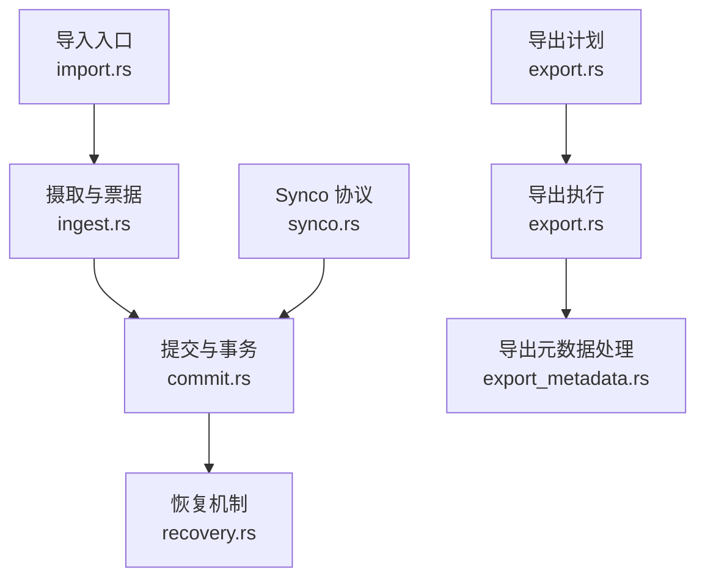
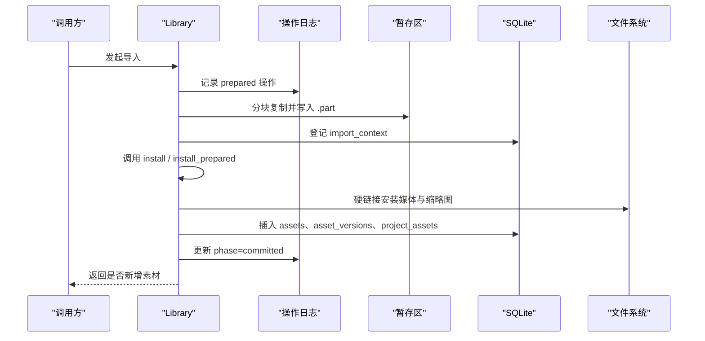
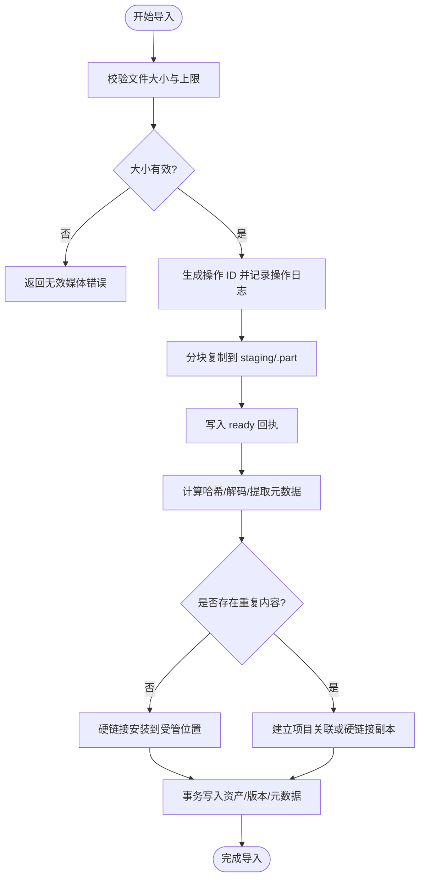
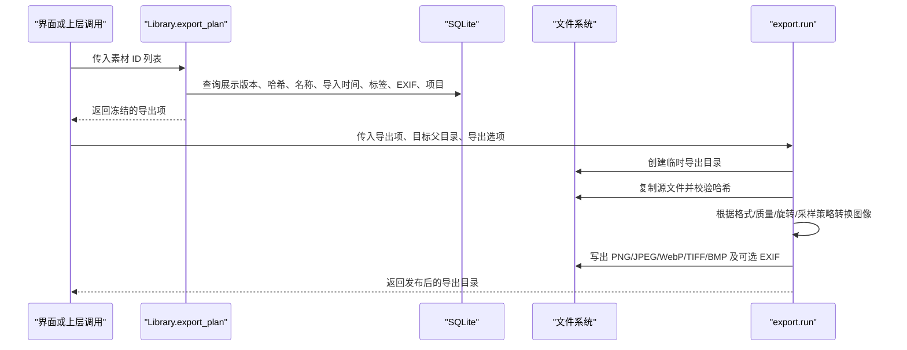
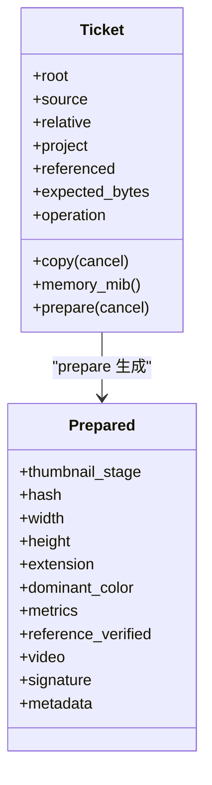
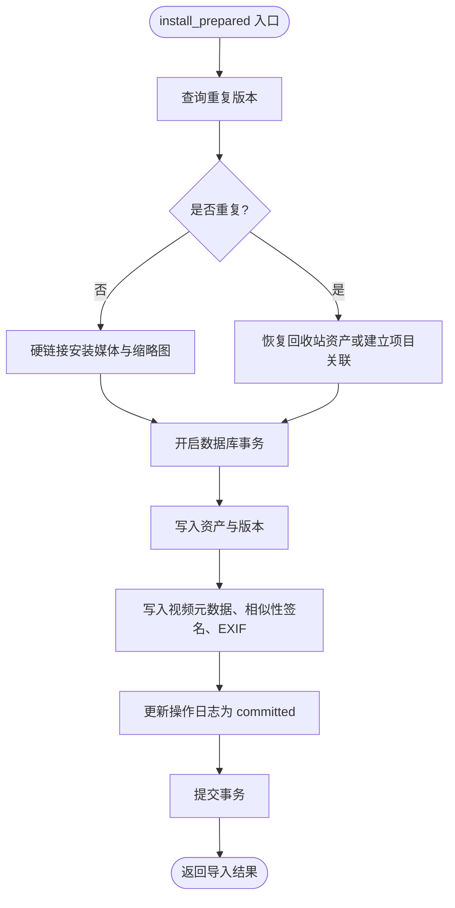
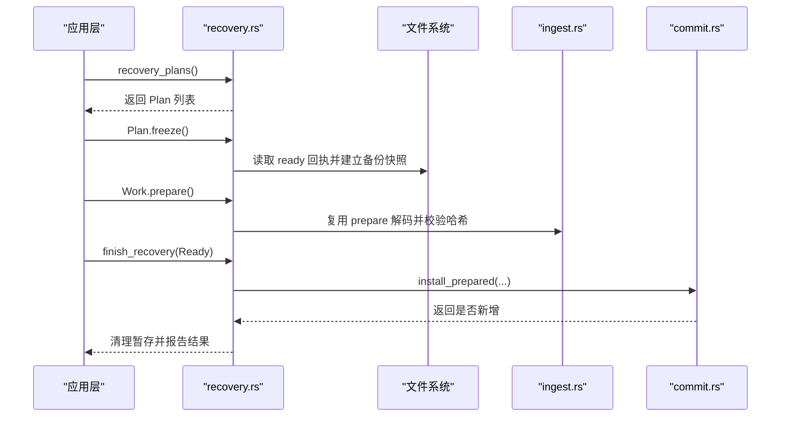
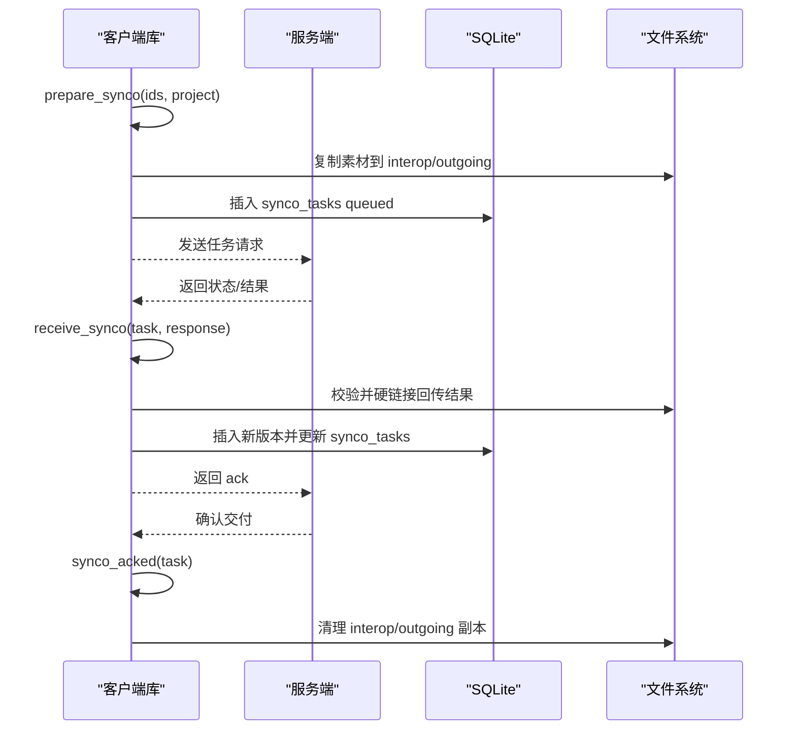
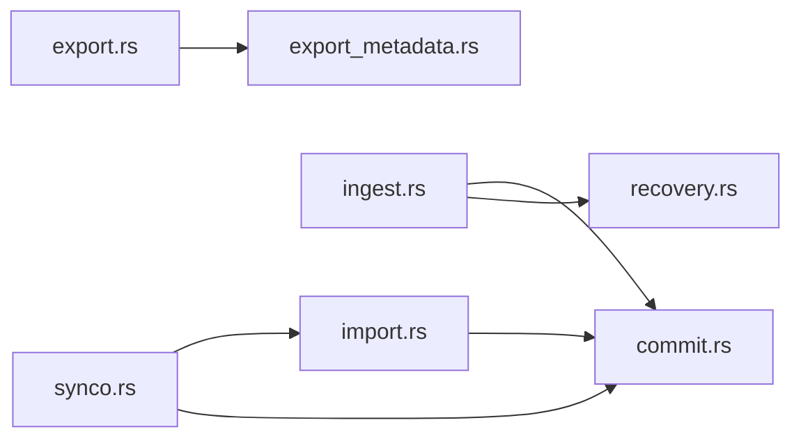

# 数据传输子系统 (Transfer)

> Repo Wiki 节点 `transfer-system`
> 导出自 Qoder 知识库快照 `8fbe02f6-57c2-4874-b725-1a8130851fd9`，代码基线 `7a7a8e75e18bd90294e09cd422dd7ed5a04813a0`（分支 main，zh-CN）。

<cite>
**本文引用的文件**
- [import.rs](../../../../crates/moriq-library/src/transfer/import.rs)
- [ingest.rs](../../../../crates/moriq-library/src/transfer/ingest.rs)
- [commit.rs](../../../../crates/moriq-library/src/transfer/commit.rs)
- [recovery.rs](../../../../crates/moriq-library/src/transfer/recovery.rs)
- [export.rs](../../../../crates/moriq-library/src/transfer/export.rs)
- [export_metadata.rs](../../../../crates/moriq-library/src/transfer/export_metadata.rs)
- [synco.rs](../../../../crates/moriq-library/src/transfer/synco.rs)
- [recovery_tests.rs](../../../../crates/moriq-library/src/transfer/recovery_tests.rs)
</cite>

## 目录
1. [引言](#引言)
2. [项目结构](#项目结构)
3. [核心组件](#核心组件)
4. [架构总览](#架构总览)
5. [详细组件分析](#详细组件分析)
6. [依赖关系分析](#依赖关系分析)
7. [性能与容量限制](#性能与容量限制)
8. [故障排查指南](#故障排查指南)
9. [结论](#结论)

## 引言
本文件系统性说明 Moriq Space 的“传输”子系统的实现，覆盖导入、导出、摄取、提交、恢复以及 Synco 集成协议。其目标是帮助开发者理解：
- 如何安全地将外部媒体纳入资源库并建立版本历史；
- 如何批量导出素材并控制格式、质量、旋转和元数据；
- 如何在后台工作线程中执行解码、去重和安装；
- 如何在进程崩溃或取消后安全恢复未完成的操作；
- 如何与服务端协作完成任务同步、状态同步与结果回传。

## 项目结构
传输子系统位于 `crates/moriq-library/src/transfer`，按职责划分为以下模块：
- `import.rs`：受管布局、目标路径生成、重复名称处理与相对路径校验。
- `ingest.rs`：票据化摄取、分块复制、缩略图与哈希计算、内存预算估算。
- `commit.rs`：导入入口、去重检查、硬链接安装与数据库事务提交。
- `recovery.rs`：中断操作恢复计划、副本冻结、重新准备与最终提交。
- `export.rs`：导出计划构建、批量复制/转换、输出目录组织与进度相关错误处理。
- `export_metadata.rs`：EXIF 规范化、ICC 色彩配置、目录模板解析。
- `synco.rs`：Synco 任务队列、发送、重试、接收回执与版本创建。

**图示来源**
- [import.rs:1-200](../../../../crates/moriq-library/src/transfer/import.rs#L1-L200)
- [ingest.rs:1-200](../../../../crates/moriq-library/src/transfer/ingest.rs#L1-L200)
- [commit.rs:1-200](../../../../crates/moriq-library/src/transfer/commit.rs#L1-L200)
- [recovery.rs:1-200](../../../../crates/moriq-library/src/transfer/recovery.rs#L1-L200)
- [export.rs:1-200](../../../../crates/moriq-library/src/transfer/export.rs#L1-L200)
- [export_metadata.rs:1-142](../../../../crates/moriq-library/src/transfer/export_metadata.rs#L1-L142)
- [synco.rs:1-200](../../../../crates/moriq-library/src/transfer/synco.rs#L1-L200)

**章节来源**
- [import.rs:1-352](../../../../crates/moriq-library/src/transfer/import.rs#L1-L352)
- [ingest.rs:1-442](../../../../crates/moriq-library/src/transfer/ingest.rs#L1-L442)
- [commit.rs:1-293](../../../../crates/moriq-library/src/transfer/commit.rs#L1-L293)
- [recovery.rs:1-229](../../../../crates/moriq-library/src/transfer/recovery.rs#L1-L229)
- [export.rs:1-422](../../../../crates/moriq-library/src/transfer/export.rs#L1-L422)
- [export_metadata.rs:1-142](../../../../crates/moriq-library/src/transfer/export_metadata.rs#L1-L142)
- [synco.rs:1-595](../../../../crates/moriq-library/src/transfer/synco.rs#L1-L595)

## 核心组件
- 导入管线：以“操作日志 + 暂存文件 + 数据库事务”为核心，保证原子性与可恢复性。
- 摄取引擎：通过票据 (`Ticket`) 在写线程与工作线程之间传递上下文，支持取消、尺寸预算和引用源校验。
- 提交阶段：先进行去重判断，再硬链接安装媒体与缩略图，最后写入资产、版本、视频元数据和相似度签名。
- 恢复引擎：从操作日志重建不可变输入副本，在工作线程中重新准备，再回到提交流程。
- 导出引擎：冻结待导出素材的有效版本与元数据，在临时目录中进行复制或格式转换，最后发布为独立导出目录。
- Synco 协议：将本地素材转换为出站交接任务，接收服务端回执并创建新的版本，同时维护幂等确认。

**章节来源**
- [ingest.rs:1-200](../../../../crates/moriq-library/src/transfer/ingest.rs#L1-L200)
- [commit.rs:1-200](../../../../crates/moriq-library/src/transfer/commit.rs#L1-L200)
- [recovery.rs:1-200](../../../../crates/moriq-library/src/transfer/recovery.rs#L1-L200)
- [export.rs:1-200](../../../../crates/moriq-library/src/transfer/export.rs#L1-L200)
- [synco.rs:1-200](../../../../crates/moriq-library/src/transfer/synco.rs#L1-L200)

## 架构总览
传输子系统围绕 `Library` 对象组织，所有持久化变更均通过 SQLite 事务完成，所有磁盘写入均通过安全路径与暂存机制保护。

**图示来源**
- [commit.rs:1-200](../../../../crates/moriq-library/src/transfer/commit.rs#L1-L200)
- [ingest.rs:1-200](../../../../crates/moriq-library/src/transfer/ingest.rs#L1-L200)
- [import.rs:1-200](../../../../crates/moriq-library/src/transfer/import.rs#L1-L200)

**章节来源**
- [commit.rs:1-200](../../../../crates/moriq-library/src/transfer/commit.rs#L1-L200)
- [import.rs:1-200](../../../../crates/moriq-library/src/transfer/import.rs#L1-L200)

## 详细组件分析

### 导入流程：文件验证、去重算法、版本控制与元数据提取
导入流程分为三个阶段：
1. **准备与摄取**：打开源文件，校验长度、平台编码路径、项目归属，并写入 `staging/{operation}.part`，同时写入 `staging/{operation}.ready` 回执。
2. **准备结果**：计算哈希、解码缩略图、提取媒体宽高、颜色、扩展名、视频元数据、相似性签名与通用元数据。
3. **提交安装**：检测重复内容，必要时建立项目内独立关联；否则硬链接到受管位置，并在事务中写入资产、版本、视频元数据、相似性签名和 EXIF。

#### 关键行为
- 空文件或超过大小预算的文件立即失败。
- 平台路径被编码存储，避免跨平台路径语义问题。
- 引用模式会拒绝网络参考路径，并在后续阶段再次校验原文件哈希。
- 去重依据哈希与字节数，并结合项目可见性判断是否为“重复内容”。
- 重复内容可通过硬链接在项目间共享，而不会创建冗余版本。

**图示来源**
- [commit.rs:1-200](../../../../crates/moriq-library/src/transfer/commit.rs#L1-L200)
- [commit.rs:201-293](../../../../crates/moriq-library/src/transfer/commit.rs#L201-L293)
- [ingest.rs:201-442](../../../../crates/moriq-library/src/transfer/ingest.rs#L201-L442)

#### 文件命名与受管布局
- 受管路径基于项目存储目录与相对路径拼接。
- 同名冲突通过递增序号解决，最多尝试固定次数，超出则报错。
- 危险路径成分、保留名称和非法字符会被拒绝。
- 若文件夹本身作为项目导入，会避免重复前缀。

**章节来源**
- [import.rs:1-200](../../../../crates/moriq-library/src/transfer/import.rs#L1-L200)
- [import.rs:201-352](../../../../crates/moriq-library/src/transfer/import.rs#L201-L352)
- [commit.rs:1-293](../../../../crates/moriq-library/src/transfer/commit.rs#L1-L293)
- [ingest.rs:1-442](../../../../crates/moriq-library/src/transfer/ingest.rs#L1-L442)

### 导出功能：批量导出、格式转换、质量设置与进度跟踪
导出流程包括两个阶段：
1. **构建导出计划**：查询当前展示版本的 ID、哈希、文件名、导入时间、备注、标签、AI 标签、描述、媒介类型、主题、EXIF 和项目信息。
2. **执行导出**：在临时目录中复制源文件并校验哈希，然后选择原样导出或进行图像转换，最后发布一个带 UUID 的独立导出目录。

#### 关键约束
- 单次导出数量限制为 1～10000。
- 最大边长、质量、旋转角度必须满足约定范围。
- 导出目标不能位于 `.moriq` 资源库目录内部。
- 视频仅支持原文件导出，不支持图片转换选项。
- 支持原始复制、JPEG、PNG、WebP、TIFF、BMP 等格式。
- JPEG 透明通道会进行预乘混合；其他格式可选择附加 EXIF 或侧车元数据。
- 目录布局支持扁平、按格式分组、按导入日期分组，或通过模板变量组合。

**图示来源**
- [export.rs:1-200](../../../../crates/moriq-library/src/transfer/export.rs#L1-L200)
- [export.rs:201-422](../../../../crates/moriq-library/src/transfer/export.rs#L201-L422)
- [export_metadata.rs:1-142](../../../../crates/moriq-library/src/transfer/export_metadata.rs#L1-L142)

#### 进度与批处理说明
当前代码未提供细粒度的异步进度回调；进度由调用方通过批次大小、返回值和错误信息进行推断。批量导出的主要边界是：
- 导入计划构建阶段对 ID 数量进行校验。
- 单个文件处理失败会中止整个导出目录发布。
- 临时目录会在成功时重命名为最终导出目录。

**章节来源**
- [export.rs:1-422](../../../../crates/moriq-library/src/transfer/export.rs#L1-L422)
- [export_metadata.rs:1-142](../../../../crates/moriq-library/src/transfer/export_metadata.rs#L1-L142)

### 摄取机制：增量同步、冲突解决与一致性保证
摄取子系统通过 `Ticket` 和 `Prepared` 分离“文件搬运”和“媒体解码”两类工作：
- `Ticket.copy`：分块复制、响应取消标志、校验最终字节数、写入 `staging/{operation}.ready`。
- `Ticket.memory_mib`：估算解码所需的内存预算，用于应用层调度准入。
- `Ticket.prepare`：计算哈希、解码缩略图、识别扩展名、提取视频元数据与通用元数据。
- `finish_import`：校验票据归属后进入提交流程，成功后清理暂存文件并更新日志。

#### 一致性设计
- 工作线程持有 `_lease`，保持库锁，防止其他进程同时修改库。
- 取消会导致部分复制被删除，不会成为可恢复媒体。
- 引用模式在准备阶段再次校验原文件哈希，确保外部源未被替换。
- 视频与普通图像的内存预算不同，超大像素或 RAW/视频会回退到保守预算。

**图示来源**
- [ingest.rs:1-200](../../../../crates/moriq-library/src/transfer/ingest.rs#L1-L200)
- [ingest.rs:201-442](../../../../crates/moriq-library/src/transfer/ingest.rs#L201-L442)

**章节来源**
- [ingest.rs:1-442](../../../../crates/moriq-library/src/transfer/ingest.rs#L1-L442)

### 提交系统：事务处理、原子操作、回滚与状态恢复
提交阶段负责把已准备好的媒体与元数据变成资源库中的正式资产：
- 先去重：如果存在相同哈希与字节数的已有版本，则可能复用资产并建立项目关联。
- 再安装：非引用模式下使用硬链接安装媒体与缩略图。
- 最后提交事务：写入 `assets`、`asset_versions`、`video_metadata`、相似性签名、EXIF、项目关联，并将操作日志标记为 `committed`。

**图示来源**
- [commit.rs:201-293](../../../../crates/moriq-library/src/transfer/commit.rs#L201-L293)

**章节来源**
- [commit.rs:1-293](../../../../crates/moriq-library/src/transfer/commit.rs#L1-L293)

### 恢复功能：崩溃恢复、数据修复与完整性检查
恢复子系统读取 `phase=interrupted` 的操作日志，重建可恢复工作：
- `recovery_plans`：列出最多 100 条中断记录。
- `Plan.freeze`：读取 `staging/{operation}.ready` 回执，校验预期字节数，并在备份目录中建立硬链接输入。
- `Work.prepare`：复用摄取引擎重新解码、计算哈希与缩略图。
- `finish_recovery`：校验记录未变化，调用提交逻辑，最后清理暂存文件并刷新快照。

**图示来源**
- [recovery.rs:1-229](../../../../crates/moriq-library/src/transfer/recovery.rs#L1-L229)
- [recovery_tests.rs:1-70](../../../../crates/moriq-library/src/transfer/recovery_tests.rs#L1-L70)

**章节来源**
- [recovery.rs:1-229](../../../../crates/moriq-library/src/transfer/recovery.rs#L1-L229)
- [recovery_tests.rs:1-70](../../../../crates/moriq-library/src/transfer/recovery_tests.rs#L1-L70)

### Synco 集成协议：与服务端通信、任务同步与状态同步
Synco 模块将本地素材封装为出站任务，并处理服务端的回执：
- `prepare_synco`：校验素材格式、复制出站到 `interop/outgoing`，写入 `synco_tasks` 并标记 `queued`。
- `synco_pending` / `synco_tasks`：查询待处理或当前项目可见的任务。
- `retry_synco`：基于失败或取消任务重建请求，生成新任务 ID 和新副本。
- `receive_synco`：校验回执字段、状态、结果路径、哈希、尺寸、魔数，并创建新版本。
- `synco_acked`：登记远端确认并清理出站副本。

**图示来源**
- [synco.rs:1-200](../../../../crates/moriq-library/src/transfer/synco.rs#L1-L200)
- [synco.rs:201-595](../../../../crates/moriq-library/src/transfer/synco.rs#L201-L595)

**章节来源**
- [synco.rs:1-595](../../../../crates/moriq-library/src/transfer/synco.rs#L1-L595)

## 依赖关系分析
传输模块内部依赖如下：
- `import.rs` 提供路径校验、项目解析与受管布局。
- `ingest.rs` 提供票据化摄取、解码、哈希与内存预算。
- `commit.rs` 串联导入入口、去重、安装与事务提交。
- `recovery.rs` 复用 `ingest::prepare` 与 `install_prepared`，专注日志与副本恢复。
- `export.rs` 依赖 `export_metadata.rs` 进行 EXIF 处理与目录模板解析。
- `synco.rs` 复用 `import::validate_component`、`organize`、`media`、`resize` 等底层能力。

**图示来源**
- [import.rs:1-352](../../../../crates/moriq-library/src/transfer/import.rs#L1-L352)
- [ingest.rs:1-442](../../../../crates/moriq-library/src/transfer/ingest.rs#L1-L442)
- [commit.rs:1-293](../../../../crates/moriq-library/src/transfer/commit.rs#L1-L293)
- [recovery.rs:1-229](../../../../crates/moriq-library/src/transfer/recovery.rs#L1-L229)
- [export.rs:1-422](../../../../crates/moriq-library/src/transfer/export.rs#L1-L422)
- [export_metadata.rs:1-142](../../../../crates/moriq-library/src/transfer/export_metadata.rs#L1-L142)
- [synco.rs:1-595](../../../../crates/moriq-library/src/transfer/synco.rs#L1-L595)

**章节来源**
- [import.rs:1-352](../../../../crates/moriq-library/src/transfer/import.rs#L1-L352)
- [ingest.rs:1-442](../../../../crates/moriq-library/src/transfer/ingest.rs#L1-L442)
- [commit.rs:1-293](../../../../crates/moriq-library/src/transfer/commit.rs#L1-L293)
- [recovery.rs:1-229](../../../../crates/moriq-library/src/transfer/recovery.rs#L1-L229)
- [export.rs:1-422](../../../../crates/moriq-library/src/transfer/export.rs#L1-L422)
- [export_metadata.rs:1-142](../../../../crates/moriq-library/src/transfer/export_metadata.rs#L1-L142)
- [synco.rs:1-595](../../../../crates/moriq-library/src/transfer/synco.rs#L1-L595)

## 性能与容量限制
- 文件大小预算：导入和摄取阶段都会根据平台限制拒绝过大或空文件。
- 解码预算：视频默认回退到固定内存预算；RAW、超大像素或非标准图像会采用保守估计。
- 导出尺寸：最大边长需小于等于平台允许的最大输出边长，且不允许放大来源。
- 导出质量：JPEG 质量必须在 1～100。
- 导出旋转：仅允许 0、90、180、270 度。
- 导出批次：导入计划最多 10000 张，Synco 每次最多 100 张。
- EXIF 大小：导出时规范化 EXIF 不得超过 4 MiB。
- 目录模板：最多 8 层，单段不超过 120 字符，禁止未知变量。

[本节为通用性能指导，不直接分析具体代码行]

## 故障排查指南
- 导入期间源文件长度改变：检查 `staging/{operation}.part` 与 `staging/{operation}.ready` 是否完整，重新导入。
- 恢复副本不完整：确认 `staging/{operation}.ready` 中的预期字节数与实际文件大小一致。
- 引用源发生变化：引用导入会在准备阶段再次校验原文件哈希，失败后应保留原片并重新导入。
- 导出期间源文件变化：导出流程会复制源文件到临时目录并校验哈希，不一致时会停止发布导出目录。
- Synco 回执身份不匹配：检查任务 ID、客户端 ID、源项目 ID、源图片 ID 是否与请求一致。
- Synco 成图路径越界：回传路径必须来自 `interop/returns`，不得指向资源库根或网络路径。
- 恢复所属资源库切换：恢复准备和完成阶段会校验 `owner` 和 `root`，库切换会拒绝恢复。

**章节来源**
- [ingest.rs:1-200](../../../../crates/moriq-library/src/transfer/ingest.rs#L1-L200)
- [recovery.rs:1-229](../../../../crates/moriq-library/src/transfer/recovery.rs#L1-L229)
- [export.rs:1-200](../../../../crates/moriq-library/src/transfer/export.rs#L1-L200)
- [synco.rs:201-595](../../../../crates/moriq-library/src/transfer/synco.rs#L201-L595)

## 结论
Moriq Space 的传输子系统以“日志 + 暂存 + 事务 + 硬链接”的方式实现了高可靠的数据导入、导出与同步：
- 导入通过操作日志和就绪回执保障中断后可恢复；
- 摄取通过票据化设计把工作线程与写线程解耦；
- 提交通过去重与事务保证版本一致性和项目隔离；
- 导出通过冻结计划与安全路径保证输出稳定；
- 恢复通过备份快照和重新准备避免破坏用户原片；
- Synco 通过严格回执校验与幂等确认完成跨库协作。

该设计适合需要强一致性、可恢复性和可控性能的媒体资产管理场景。