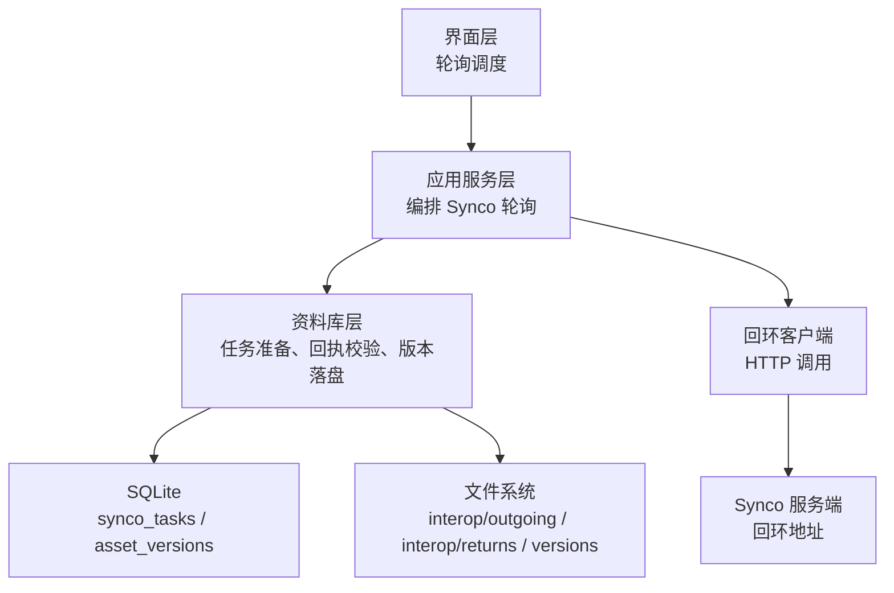
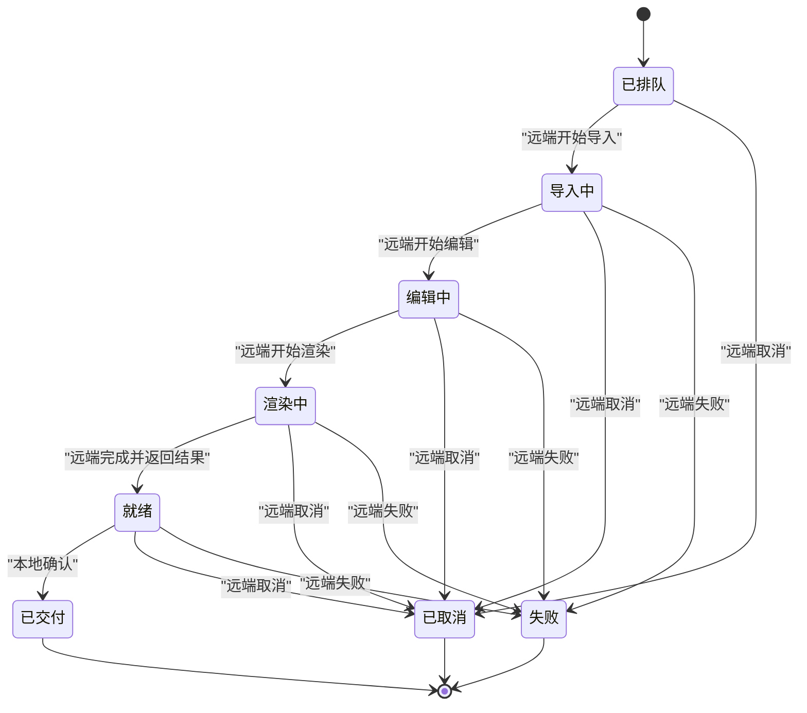
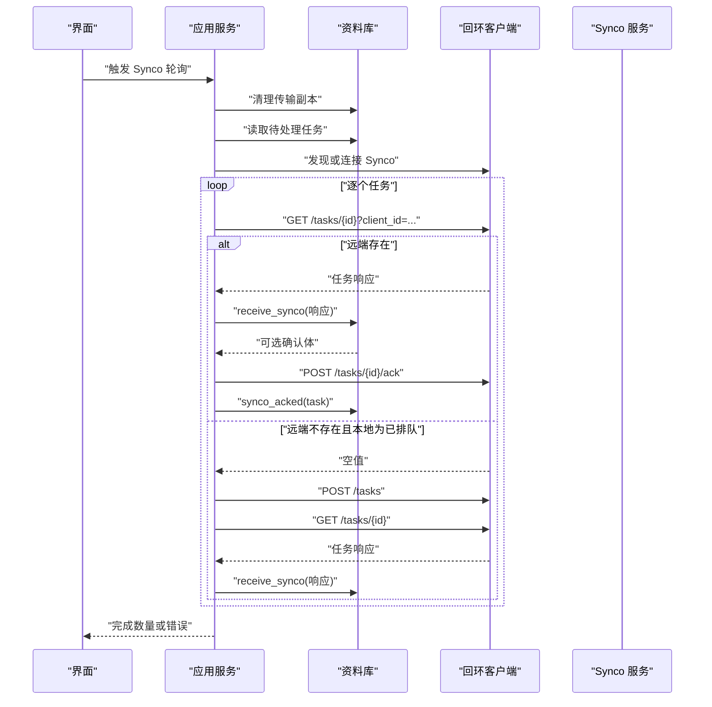
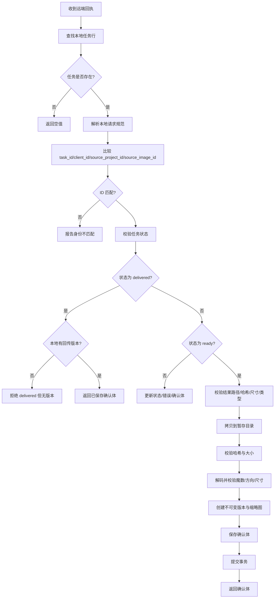
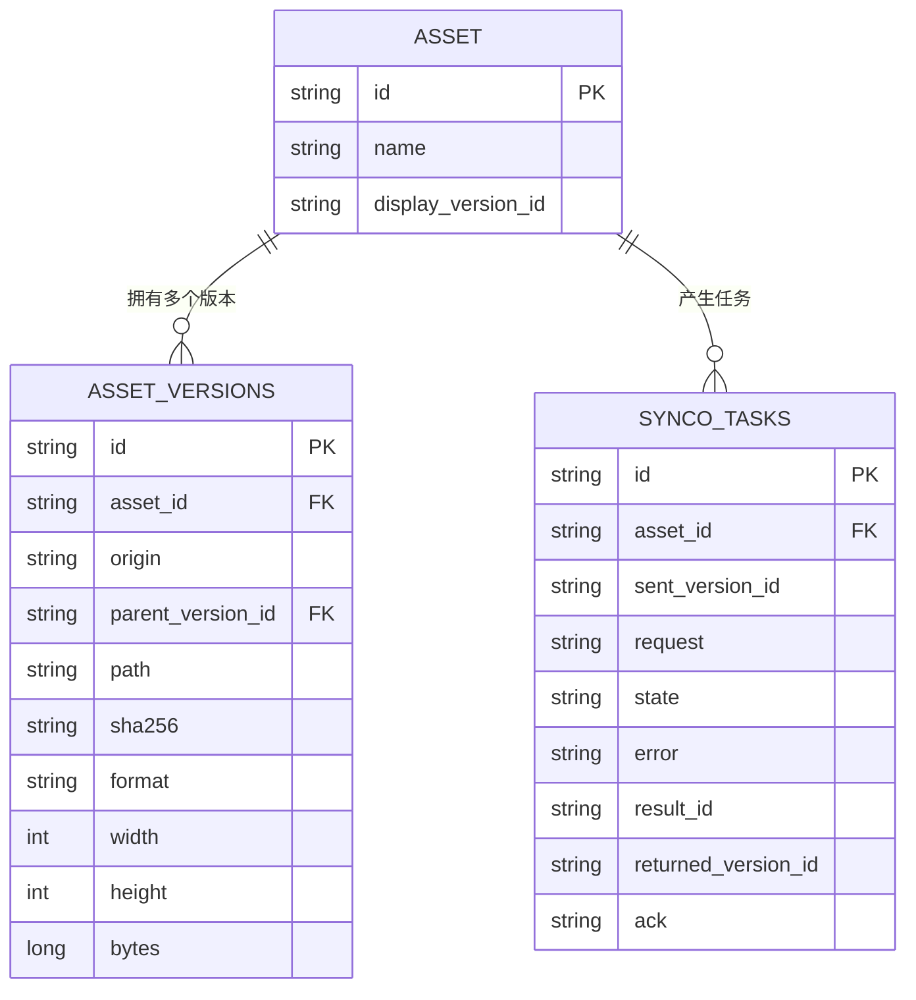
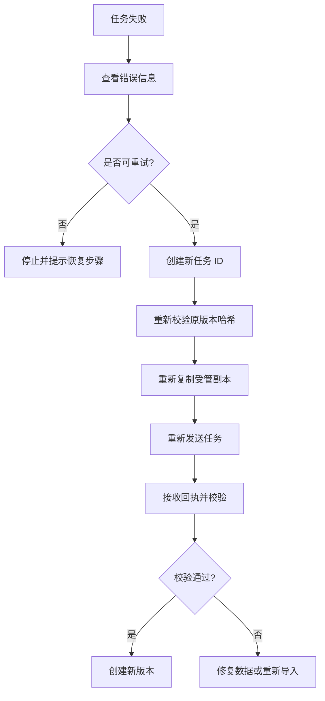

# Synco 集成 (Synco Integration)

> Repo Wiki 节点 `synco-integration`
> 导出自 Qoder 知识库快照 `8fbe02f6-57c2-4874-b725-1a8130851fd9`，代码基线 `7a7a8e75e18bd90294e09cd422dd7ed5a04813a0`（分支 main，zh-CN）。

<cite>
**本文引用的文件**   
- [ARCHITECTURE.md](../../../../ARCHITECTURE.md)
- [crates/moriq-synco/src/lib.rs](../../../../crates/moriq-synco/src/lib.rs)
- [crates/moriq-synco/Cargo.toml](../../../../crates/moriq-synco/Cargo.toml)
- [crates/moriq-library/src/transfer/synco.rs](../../../../crates/moriq-library/src/transfer/synco.rs)
- [crates/moriq-domain/src/lib.rs](../../../../crates/moriq-domain/src/lib.rs)
- [crates/moriq-app/src/interop.rs](../../../../crates/moriq-app/src/interop.rs)
- [crates/moriq-ui/src/polling.rs](../../../../crates/moriq-ui/src/polling.rs)
</cite>

## 目录
1. [简介](#简介)
2. [项目结构与职责边界](#项目结构与职责边界)
3. [通信协议与认证机制](#通信协议与认证机制)
4. [任务生命周期](#任务生命周期)
5. [状态同步策略](#状态同步策略)
6. [连接管理与可靠性](#连接管理与可靠性)
7. [配置与环境参数](#配置与环境参数)
8. [数据序列化与版本模型](#数据序列化与版本模型)
9. [性能与资源约束](#性能与资源约束)
10. [故障处理与恢复](#故障处理与恢复)
11. [最佳实践](#最佳实践)
12. [结论](#结论)

## 简介
本文件面向 Moriq Space 的 Synco 集成功能，说明本地应用如何发现、启动并与同用户的 Synco 服务建立安全回环通信；描述任务从准备、发送、轮询、回执校验到结果入库和确认清理的完整流程；解释本地库中的任务状态、素材版本、传输副本与远端状态之间的合并规则、冲突检测及幂等保证；并给出连接限制、超时、重试、错误恢复和网络安全的实现要点。

Synco 在架构中承担“同用户回环传输”角色：它不拥有资料库，也不直接管理目录所有权，而是通过 HTTP API 把受管素材冻结为受控版本，交给 Synco 服务处理，再把结果以不可变版本形式落盘。

**章节来源**
- [ARCHITECTURE.md:10-20](../../../../ARCHITECTURE.md#L10-L20)

## 项目结构与职责边界
Synco 相关代码横跨四个主要层次：

| 模块 | 职责 | 关键行为 |
|---|---|---|
| `moriq-synco` | 同用户回环 HTTP 客户端 | 发现、启动、校验实例身份、发送查询/发送/确认/取消请求 |
| `moriq-library` | 本地持久化与数据校验 | 准备任务、冻结素材版本、接收回执、创建不可变版本、清理传输副本 |
| `moriq-app` | 编排与协调 | 调用 Library、自动或手动启动 Synco、轮询任务、记录失败 |
| `moriq-ui` | 用户交互与轮询调度 | 根据任务状态决定是否触发 Synco 轮询 |

**图表来源**
- [crates/moriq-ui/src/polling.rs:40-60](../../../../crates/moriq-ui/src/polling.rs#L40-L60)
- [crates/moriq-app/src/interop.rs:30-120](../../../../crates/moriq-app/src/interop.rs#L30-L120)
- [crates/moriq-library/src/transfer/synco.rs:13-145](../../../../crates/moriq-library/src/transfer/synco.rs#L13-L145)
- [crates/moriq-synco/src/lib.rs:12-196](../../../../crates/moriq-synco/src/lib.rs#L12-L196)

**章节来源**
- [ARCHITECTURE.md:10-20](../../../../ARCHITECTURE.md#L10-L20)
- [crates/moriq-ui/src/polling.rs:40-60](../../../../crates/moriq-ui/src/polling.rs#L40-L60)
- [crates/moriq-app/src/interop.rs:30-120](../../../../crates/moriq-app/src/interop.rs#L30-L120)
- [crates/moriq-library/src/transfer/synco.rs:13-145](../../../../crates/moriq-library/src/transfer/synco.rs#L13-L145)
- [crates/moriq-synco/src/lib.rs:12-196](../../../../crates/moriq-synco/src/lib.rs#L12-L196)

## 通信协议与认证机制
### 协议版本与安全边界
- 协议版本固定为 `1`。
- 仅允许 `http` 方案。
- 目标主机必须为 `127.0.0.1`。
- URL 不允许携带用户名、密码、查询参数、片段，路径必须为根路径。
- 禁用代理与重定向。
- 连接超时为 2 秒，默认请求超时为 90 秒，信息接口探测超时为 3 秒。
- 响应体被限制为 1 MiB，超过即报错。

这些限制使 Synco 集成只与本机回环进程通信，避免把凭据、媒体路径或任务内容发送到任意网络地址。

### 服务发现
客户端优先读取环境变量 `SYNCO_INTEROP_DISCOVERY`，否则读取 `%LOCALAPPDATA%\Synco\interop.json`。发现文件包含协议版本、基础地址和实例标识。客户端会检查文件大小上限，解析 JSON，并用返回的实例标识与服务端 `/api/interop/v1/info` 进行比对。

### 自动启动
如果未发现服务，且启用自动启动，客户端会按以下顺序寻找可执行文件：
1. 显式传入的可执行路径。
2. 环境变量 `SYNCO_EXECUTABLE`。
3. `%LOCALAPPDATA%\Programs\Synco\Synco.exe`。
4. `%ProgramFiles%\Synco\Synco.exe`。

找到后以非继承窗口模式启动，并在最多 30 秒内轮询服务发现，直到可用或超时。

### HTTP API
| 方法 | 路径 | 输入 | 输出 | 语义 |
|---|---|---|---|---|
| GET | `/api/interop/v1/info` | 无 | 协议版本与实例标识 | 连接握手与身份校验 |
| POST | `/api/interop/v1/tasks` | 任务规范 JSON | 任务响应 JSON | 提交或重新提交任务 |
| GET | `/api/interop/v1/tasks/{task}` | `client_id` 查询参数 | 任务对象或空值 | 查询任务状态 |
| POST | `/api/interop/v1/tasks/{task}/ack` | 已解析的确认体 | 空响应 | 确认结果，供远端清理 |
| POST | `/api/interop/v1/tasks/{task}/cancel` | `{ client_id }` | 空响应 | 请求取消任务 |

### 认证机制
当前实现没有使用 HTTP 头部认证。安全性由以下措施提供：
- 仅允许本机回环地址。
- 仅允许协议 v1。
- 禁止 URL 凭据、查询参数和片段。
- 严格校验服务端返回的实例标识是否与发现文件一致。
- 响应体大小限制与 JSON 格式校验。
- 本地应用负责拒绝网络路径、越界路径和资源库路径。

因此，认证的本质是“本机 + 协议版本 + 实例标识 + 路径白名单”，而不是令牌或用户名密码。

**章节来源**
- [crates/moriq-synco/src/lib.rs:12-196](../../../../crates/moriq-synco/src/lib.rs#L12-L196)
- [crates/moriq-synco/src/lib.rs:201-219](../../../../crates/moriq-synco/src/lib.rs#L201-L219)

## 任务生命周期
Synco 任务的生命周期分为本地准备、远端处理、本地接收和确认清理四个阶段。

**图表来源**
- [crates/moriq-library/src/transfer/synco.rs:250-360](../../../../crates/moriq-library/src/transfer/synco.rs#L250-L360)
- [crates/moriq-app/src/interop.rs:60-120](../../../../crates/moriq-app/src/interop.rs#L60-L120)

### 阶段说明
1. **已排队**：本地冻结素材版本，复制受管副本到 `interop/outgoing`，写入 `synco_tasks` 状态为 `queued`。
2. **导入中 / 编辑中 / 渲染中**：远端任务进行中，本地记录状态但不修改资产版本。
3. **就绪**：远端返回结果 ID、输出格式、路径、哈希、字节数和尺寸；本地验证并创建不可变版本。
4. **已交付**：本地发送确认，远端清理返回数据，本地清理传输副本。
5. **失败 / 已取消**：记录错误或取消状态；失败任务可通过重试逻辑生成新任务。

### 任务准备
本地准备过程：
- 每批限制 1～100 个素材。
- 仅支持 JPEG、PNG、WebP、BMP。
- 读取展示版本的 `id`、格式和 SHA-256。
- 复制到 `interop/outgoing/{task}.{format}`。
- 再次校验副本哈希，防止源文件变化。
- 构建任务规范，包含任务 ID、客户端 ID、来源项目 ID、项目名称、来源图像 ID、输入路径与哈希、输出格式和质量、以及是否在编辑器中打开。
- 写入 `synco_tasks`，状态为 `queued`。

### 任务轮询
轮询流程：
1. 先尝试清理已结束任务的传输副本。
2. 读取待处理任务列表。
3. 若未启用自动启动，则只读取发现信息；若启用自动启动，则自动发现或启动服务。
4. 对每个任务：
   - 若有本地缓存的确认体，直接发送确认并标记已完成。
   - 若无确认体，查询远端任务；若远端不存在且本地为 `queued`，则重新发送任务后再查询。
   - 将远端响应交给本地回执校验。
   - 若返回确认体，发送确认并清理本地传输副本。
5. 单个任务失败不会立即中断整个批次，但会记录错误；若仍有任务失败，轮询整体返回错误。

**图表来源**
- [crates/moriq-ui/src/polling.rs:40-60](../../../../crates/moriq-ui/src/polling.rs#L40-L60)
- [crates/moriq-app/src/interop.rs:30-120](../../../../crates/moriq-app/src/interop.rs#L30-L120)

**章节来源**
- [crates/moriq-library/src/transfer/synco.rs:80-145](../../../../crates/moriq-library/src/transfer/synco.rs#L80-L145)
- [crates/moriq-app/src/interop.rs:30-120](../../../../crates/moriq-app/src/interop.rs#L30-L120)

## 状态同步策略
### 本地状态与远程状态的合并
本地并不把远端状态视为权威覆盖源，而是对每个回执做增量合并：
- 如果本地已有结果 ID，则后续相同任务只能返回相同结果 ID，否则视为冲突。
- 如果本地已有结果，会返回之前保存的确认体，供上层再次发送确认。
- 如果本地没有结果，才进入新的结果接收流程。
- 如果远端返回 `delivered` 但本地缺少回传版本，直接拒绝，因为这意味着本地库不完整。
- 如果远端返回 `failed` 或 `cancelled`，本地更新状态和错误，并可生成确认体让远端清理。

### 冲突检测
冲突发生在以下情况：
- 同一任务返回不同结果 ID。
- 回执缺失必要字段。
- 未知任务状态。
- `delivered` 状态缺少本地回传版本。
- 重复 ACK 后继续处理已结束任务。

### 版本管理
- 每次成功接收结果都会创建新的 `asset_versions` 记录，来源标记为 `synco`。
- 新版本父版本指向原素材的展示版本。
- 主色从缩略图计算并写入版本。
- 缩略图写入 `thumbnails/256/{version}.png`。
- 切换展示版本时只更新 `assets.display_version_id`，原始媒体不受影响。
- 旧版本仍保留，便于撤销、比较或重新显示。

**图表来源**
- [crates/moriq-library/src/transfer/synco.rs:250-480](../../../../crates/moriq-library/src/transfer/synco.rs#L250-L480)

**章节来源**
- [crates/moriq-library/src/transfer/synco.rs:250-480](../../../../crates/moriq-library/src/transfer/synco.rs#L250-L480)
- [crates/moriq-domain/src/lib.rs:217-224](../../../../crates/moriq-domain/src/lib.rs#L217-L224)

## 连接管理与可靠性
### 连接池
当前实现没有连接池。每个 `Client` 持有自己的 `reqwest::Client`，并通过共享的 Tokio 运行时异步发起请求。由于目标是本机回环，开销较低，因此未引入复杂连接复用。

### 重试策略
重试由上层编排控制：
- 如果远端任务不存在且本地状态为 `queued`，轮询会重新发送任务。
- 任务级错误会被记录到 `synco_tasks.error`，并返回给上层。
- 如果任务已从数据库删除，错误不会被记录，轮询跳过该任务。
- 重试失败的任务不会复用原任务 ID；`retry_synco` 会创建全新任务 ID，并重新复制受管副本。

### 超时处理
- 连接超时：2 秒。
- 默认请求超时：90 秒。
- 信息接口探测：3 秒。
- 自动启动等待：30 秒。
- 响应体限制：1 MiB。

### 错误恢复
- 本地记录错误，不影响其他任务。
- 传输副本延迟清理通过维护任务定期重试。
- 已交付或失败任务如果没有清除副本，维护逻辑会继续清理。
- 重复 ACK 后，本地不再重新处理该任务。
- 重试前重新校验原版本哈希，确保可重试的数据未被替换。

**章节来源**
- [crates/moriq-synco/src/lib.rs:38-150](../../../../crates/moriq-synco/src/lib.rs#L38-L150)
- [crates/moriq-app/src/interop.rs:30-120](../../../../crates/moriq-app/src/interop.rs#L30-L120)
- [crates/moriq-library/src/transfer/synco.rs:201-245](../../../../crates/moriq-library/src/transfer/synco.rs#L201-L245)

## 配置与环境参数
### 服务器地址设置
服务器地址不由用户自由填写，而是由 Synco 的发现文件提供。客户端强制要求：
- 协议版本为 `1`。
- 基础地址为 `http://127.0.0.1`。
- 无 URL 凭据、查询参数和片段。

如果发现文件无效或服务端实例标识不一致，连接会失败。

### 凭据配置
当前实现不使用用户名、密码或令牌。安全依赖：
- 本机回环地址。
- 协议版本。
- 实例标识一致性。
- 本地路径白名单。

### 网络参数调优
| 参数 | 当前行为 | 建议 |
|---|---|---|
| 连接超时 | 2 秒 | 本机通常无需调整 |
| 请求超时 | 90 秒 | 适合大图渲染，但长任务应配合远端进度 |
| 响应体限制 | 1 MiB | 适用于任务元数据；大媒体通过路径引用而非响应体传输 |
| 代理 | 禁用 | 不应绕过本机回环 |
| 重定向 | 禁用 | 防止跳转到任意地址 |

### 运行参数
| 环境变量 | 用途 |
|---|---|
| `SYNCO_INTEROP_DISCOVERY` | 指定发现文件路径 |
| `SYNCO_EXECUTABLE` | 指定 Synco 可执行文件路径 |
| `LOCALAPPDATA` | 默认查找 `Programs/Synco/Synco.exe` 和 `interop.json` |
| `ProgramFiles` | 默认查找 `Synco/Synco.exe` |

**章节来源**
- [crates/moriq-synco/src/lib.rs:38-150](../../../../crates/moriq-synco/src/lib.rs#L38-L150)
- [crates/moriq-app/src/interop.rs:30-50](../../../../crates/moriq-app/src/interop.rs#L30-L50)

## 数据序列化与版本模型
### 任务模型
本地任务对象包含：
- 任务 ID。
- 素材名称。
- 状态。
- 错误信息。
- 请求规范字符串。
- 可选确认体字符串。

### 任务规范
发送给远端的任务规范包含：
- `task_id`：UUID 字符串。
- `client_id`：格式为 `moriq-{library_id}`。
- `source_project_id`：格式为 `{library_id}:{project_name_or_library}`。
- `project_name`：最长 60 个字符。
- `source_image_id`：格式为 `{library_id}:{asset_id}`。
- `input.path`：受管输出文件绝对路径。
- `input.sha256`：SHA-256。
- `output.format`：固定为 `jpeg`。
- `output.quality`：固定为 95。
- `open_in_editor`：布尔值，表示是否打开编辑器。

### 结果模型
远端返回的结果包含：
- `state`：任务状态。
- `result_id`：结果标识。
- `output.format`：`jpeg`、`jpg` 或 `png`。
- `output.sha256`：64 位十六进制哈希。
- `output.path`：绝对路径，必须位于远端 `interop/returns/{result_id}.{extension}`。
- `output.bytes`：文件大小。
- `output.width`：宽度。
- `output.height`：高度。
- `last_error`：失败时的错误信息。

### 版本模型
本地素材版本包含：
- 版本 ID。
- 来源。
- 父版本 ID。

Synco 生成的版本来源为 `synco`，用于区分导入、本地编辑和外部交接。

**图表来源**
- [crates/moriq-domain/src/lib.rs:217-224](../../../../crates/moriq-domain/src/lib.rs#L217-L224)
- [crates/moriq-library/src/transfer/synco.rs:25-70](../../../../crates/moriq-library/src/transfer/synco.rs#L25-L70)
- [crates/moriq-library/src/transfer/synco.rs:250-480](../../../../crates/moriq-library/src/transfer/synco.rs#L250-L480)

**章节来源**
- [crates/moriq-domain/src/lib.rs:217-224](../../../../crates/moriq-domain/src/lib.rs#L217-L224)
- [crates/moriq-library/src/transfer/synco.rs:80-145](../../../../crates/moriq-library/src/transfer/synco.rs#L80-L145)
- [crates/moriq-library/src/transfer/synco.rs:250-480](../../../../crates/moriq-library/src/transfer/synco.rs#L250-L480)

## 性能与资源约束
- 批量准备上限为 100 个素材，避免一次性冻结过多版本。
- 待处理任务查询限制为 50 条，任务列表查询限制为 100 条。
- 副本清理维护批量处理 100 条任务。
- 响应体限制为 1 MiB，防止恶意或异常大响应占用内存。
- 结果大小受 `MAX_BYTES` 限制，解码前会校验文件大小。
- 缩略图固定为 256 像素宽高的适配尺寸。
- 图片解码使用受限解码器，避免超大或未预期图像耗尽内存。
- 本地写操作集中在 SQLite 单写入者上，减少并发写入竞争。

优化建议：
- 避免频繁轮询静止任务。
- 只在任务处于活跃状态时触发 UI 刷新。
- 合理使用批量准备，不要一次选择过多素材。
- 避免重复重试已损坏或无法恢复的任务。

**章节来源**
- [crates/moriq-library/src/transfer/synco.rs:13-20](../../../../crates/moriq-library/src/transfer/synco.rs#L13-L20)
- [crates/moriq-library/src/transfer/synco.rs:61-70](../../../../crates/moriq-library/src/transfer/synco.rs#L61-L70)
- [crates/moriq-library/src/transfer/synco.rs:201-245](../../../../crates/moriq-library/src/transfer/synco.rs#L201-L245)
- [crates/moriq-synco/src/lib.rs:201-219](../../../../crates/moriq-synco/src/lib.rs#L201-L219)

## 故障处理与恢复
### 常见错误
| 场景 | 表现 | 处理方式 |
|---|---|---|
| 未发现服务 | 找不到发现文件或实例 | 检查 Synco 是否安装并运行 |
| 协议不匹配 | 协议版本不是 `1` | 升级或更换 Synco 版本 |
| 地址非法 | 非 `127.0.0.1`、含凭据或查询参数 | 修正发现文件或环境配置 |
| 实例不一致 | 返回实例标识与发现文件不同 | 重启 Synco |
| 素材格式不支持 | 非 JPEG/PNG/WebP/BMP | 转换素材或改用支持的格式 |
| 源文件变化 | 准备或重试时哈希不一致 | 重新准备任务 |
| 结果路径越界 | 路径不在远端结果目录或指向资源库 | 拒绝接收并报错 |
| 结果哈希不一致 | 文件大小或哈希不匹配 | 不创建版本，保持任务错误 |
| 重复结果 | 同一任务返回不同结果 ID | 报告冲突 |
| 已确认任务 | ACK 后继续处理 | 忽略任务 |

### 恢复流程
1. 失败任务可查看错误信息。
2. 使用重试功能生成新任务 ID。
3. 重试前重新校验原版本哈希。
4. 成功接收后创建新版本，不覆盖原始媒体。
5. 确认成功后清理远端返回数据和本地传输副本。
6. 若副本未及时清理，维护逻辑会周期性重试。

**图表来源**
- [crates/moriq-library/src/transfer/synco.rs:201-245](../../../../crates/moriq-library/src/transfer/synco.rs#L201-L245)
- [crates/moriq-app/src/interop.rs:90-120](../../../../crates/moriq-app/src/interop.rs#L90-L120)

**章节来源**
- [crates/moriq-library/src/transfer/synco.rs:139-245](../../../../crates/moriq-library/src/transfer/synco.rs#L139-L245)
- [crates/moriq-app/src/interop.rs:90-120](../../../../crates/moriq-app/src/interop.rs#L90-L120)

## 最佳实践
### 网络与连接
- 始终使用本机回环地址。
- 不要手动修改发现文件以指向远程地址。
- 不要启用代理或重定向绕过安全检查。
- 如遇连接失败，优先检查 Synco 是否启动且实例标识一致。

### 数据安全
- 不要把原媒体路径暴露给公共日志或问题追踪系统。
- 不要接受来自网络路径、资源库路径或非 `interop/returns` 目录的结果。
- 不要跳过哈希、尺寸、魔数和格式校验。
- 不要在未完成确认的情况下信任远端已交付状态。

### 同步与一致性
- 使用任务 ID 作为幂等键，避免重复处理。
- 同一任务只允许返回相同结果 ID。
- 切换展示版本前先确认版本属于该素材。
- 完成后发送确认，让远端清理返回数据。
- 定期检查并清理已结束任务的传输副本。

### 性能
- 分批准备任务，每批不超过 100 个素材。
- 仅在任务处于活跃状态时触发轮询。
- 避免频繁重试已确认或已结束任务。
- 使用缩略图和受限解码器降低内存压力。

### 排障
- 检查发现文件是否存在且可读。
- 检查 Synco 可执行文件路径是否正确。
- 检查任务状态是否为有效状态。
- 检查错误信息是否指示路径、哈希或格式问题。
- 使用重试功能时确认原版本未被替换。

**章节来源**
- [crates/moriq-synco/src/lib.rs:38-150](../../../../crates/moriq-synco/src/lib.rs#L38-L150)
- [crates/moriq-library/src/transfer/synco.rs:80-245](../../../../crates/moriq-library/src/transfer/synco.rs#L80-L245)
- [crates/moriq-library/src/transfer/synco.rs:250-480](../../../../crates/moriq-library/src/transfer/synco.rs#L250-L480)
- [crates/moriq-app/src/interop.rs:30-120](../../../../crates/moriq-app/src/interop.rs#L30-L120)

## 结论
Moriq Space 的 Synco 集成采用严格的本地回环安全模型，通过协议版本、实例标识和路径白名单保障通信安全；通过本地持久化、哈希校验、不可变版本和幂等确认保障数据一致性；通过批量限制、响应体限制、受限解码和维护清理保障性能与健壮性。

对于使用者而言，核心要点是：
- 使用内置联动面板准备任务，不要手动构造网络地址。
- 关注任务状态、错误信息和结果版本。
- 在失败时使用重试功能，而不是重复选择相同素材。
- 完成后等待轮询完成，确保结果入库和副本清理。
- 遇到网络或实例问题时，优先重启 Synco 并检查发现文件。