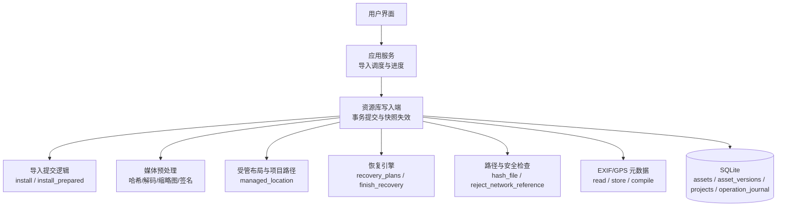
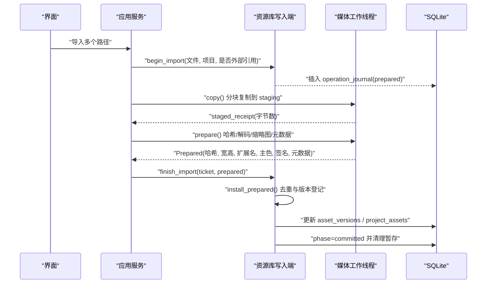
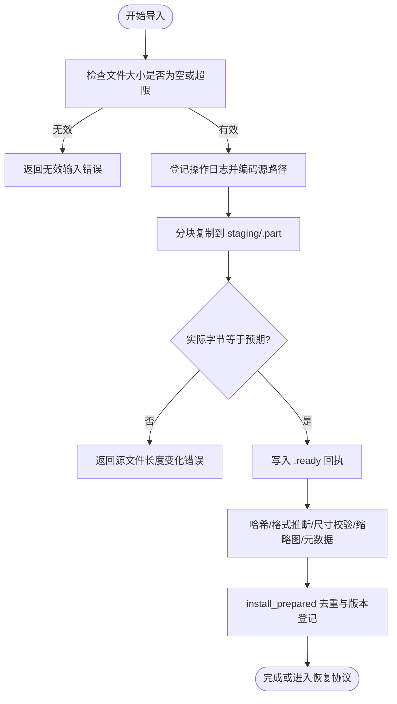
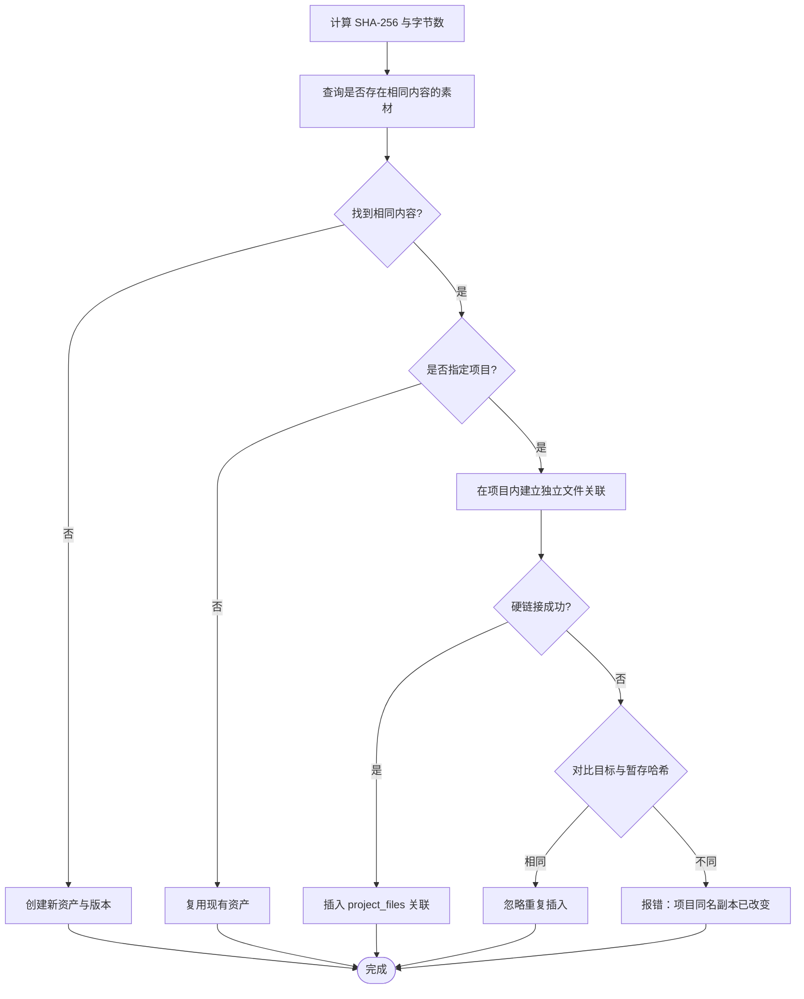
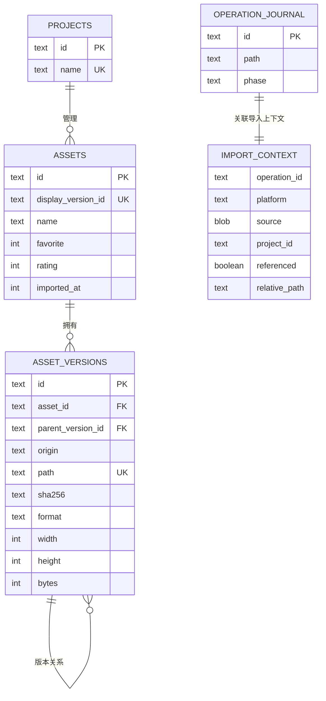
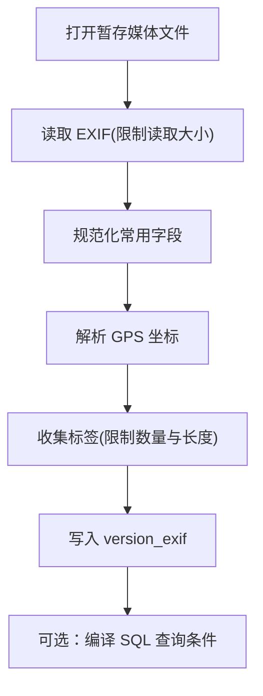
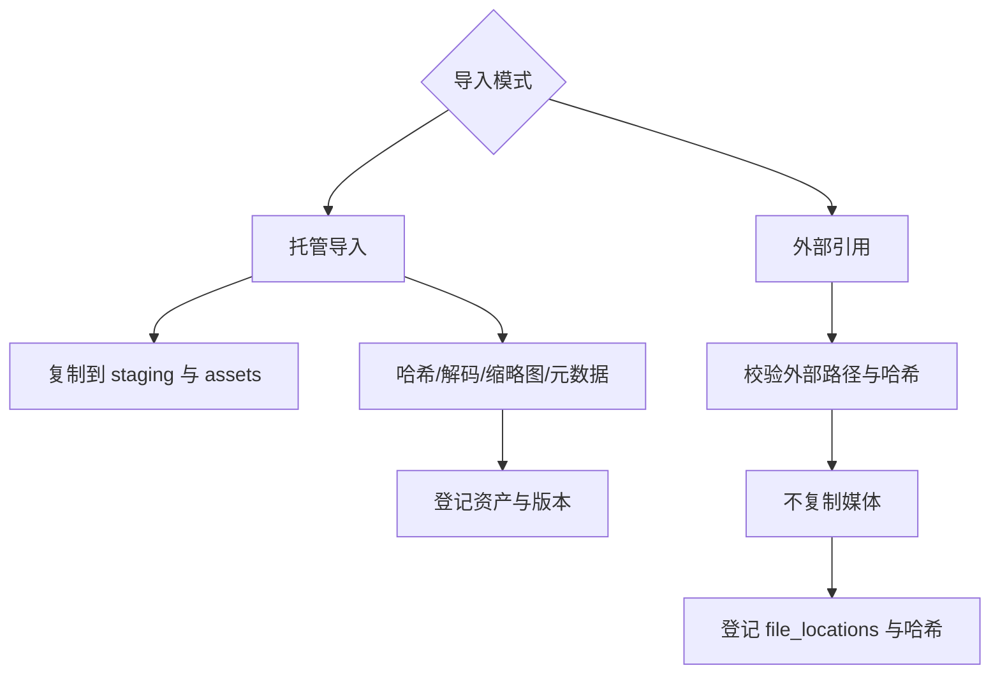
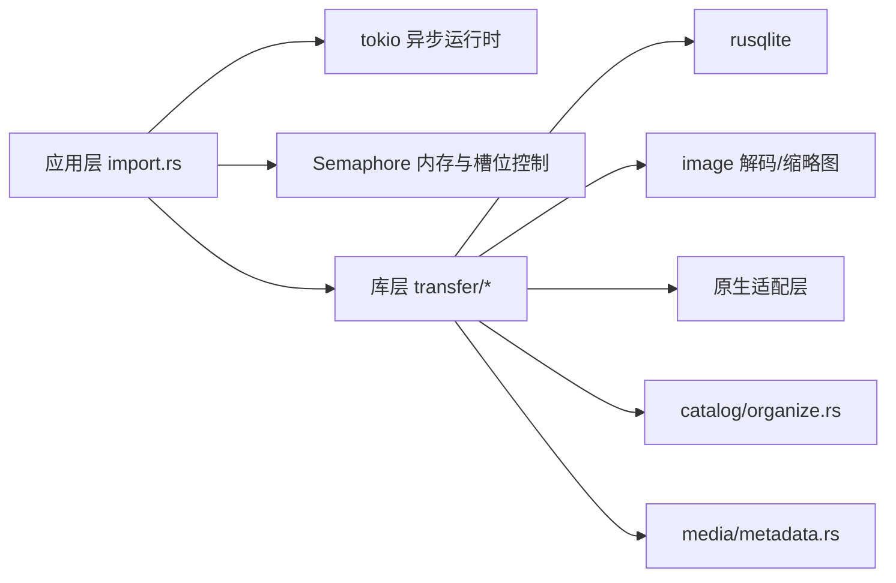
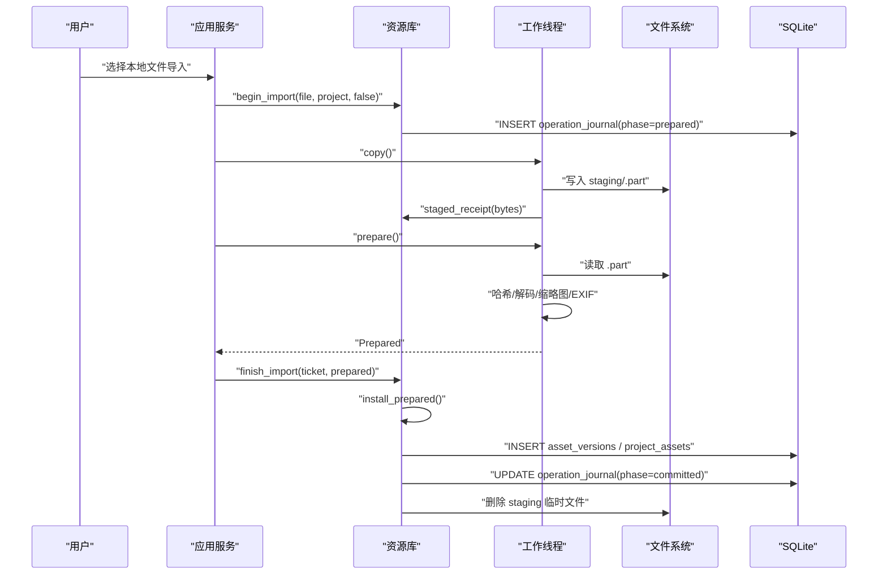
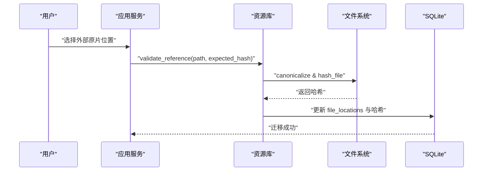

# 导入管道 (Import Pipeline)

> Repo Wiki 节点 `import-pipeline`
> 导出自 Qoder 知识库快照 `8fbe02f6-57c2-4874-b725-1a8130851fd9`，代码基线 `7a7a8e75e18bd90294e09cd422dd7ed5a04813a0`（分支 main，zh-CN）。

<cite>
**本文引用的文件**   
- [ARCHITECTURE.md](../../../../ARCHITECTURE.md)
- [crates/moriq-app/src/import.rs](../../../../crates/moriq-app/src/import.rs)
- [crates/moriq-library/src/transfer/import.rs](../../../../crates/moriq-library/src/transfer/import.rs)
- [crates/moriq-library/src/transfer/ingest.rs](../../../../crates/moriq-library/src/transfer/ingest.rs)
- [crates/moriq-library/src/transfer/commit.rs](../../../../crates/moriq-library/src/transfer/commit.rs)
- [crates/moriq-library/src/transfer/recovery.rs](../../../../crates/moriq-library/src/transfer/recovery.rs)
- [crates/moriq-library/src/catalog/organize.rs](../../../../crates/moriq-library/src/catalog/organize.rs)
- [crates/moriq-library/src/catalog/catalog.rs](../../../../crates/moriq-library/src/catalog/catalog.rs)
- [crates/moriq-library/src/media/metadata.rs](../../../../crates/moriq-library/src/media/metadata.rs)
- [crates/moriq-library/src/media/media.rs](../../../../crates/moriq-library/src/media/media.rs)
- [crates/moriq-library/src/database/schema.sql](../../../../crates/moriq-library/src/database/schema.sql)
</cite>

## 目录
1. [引言](#引言)
2. [项目结构](#项目结构)
3. [核心组件](#核心组件)
4. [架构总览](#架构总览)
5. [详细组件分析](#详细组件分析)
6. [依赖关系分析](#依赖关系分析)
7. [性能考虑](#性能考虑)
8. [故障排查指南](#故障排查指南)
9. [结论](#结论)
10. [附录：导入工作流示例](#附录导入工作流示例)

## 引言
本文面向 Moriq Space 的导入管道，系统性说明从文件扫描、验证、去重、版本创建到元数据提取与恢复回滚的全过程。文档同时覆盖托管导入和外部引用两种模式的区别、错误处理策略、进度反馈机制以及版本控制实现细节。读者无需具备底层 Rust 或 SQLite 经验即可理解整体流程。

## 项目结构
导入相关代码主要分布在以下模块：
- 应用层协调器：负责 UI 交互、并发调度、内存预算、取消信号、导入报告汇总。
- 库层转移模块：负责受管文件布局、项目路径解析、暂存复制、内容哈希、缩略图生成、版本登记和项目关联。
- 恢复模块：基于操作日志重建中断导入，安全冻结原片并复用媒体准备逻辑。
- 组织与安全校验：负责网络引用拒绝、平台保留名称检测、路径规范化与哈希计算。
- 媒体元数据：负责 EXIF/GPS 读取、字段归一化、SQL 条件编译与持久化。
- 数据库模式：定义素材、版本、项目、操作日志等表结构与约束。

**图表来源**
- [crates/moriq-app/src/import.rs:201-478](../../../../crates/moriq-app/src/import.rs#L201-L478)
- [crates/moriq-library/src/transfer/commit.rs:11-200](../../../../crates/moriq-library/src/transfer/commit.rs#L11-L200)
- [crates/moriq-library/src/transfer/ingest.rs:1-200](../../../../crates/moriq-library/src/transfer/ingest.rs#L1-L200)
- [crates/moriq-library/src/transfer/import.rs:1-200](../../../../crates/moriq-library/src/transfer/import.rs#L1-L200)
- [crates/moriq-library/src/transfer/recovery.rs:1-200](../../../../crates/moriq-library/src/transfer/recovery.rs#L1-L200)
- [crates/moriq-library/src/catalog/organize.rs:1-200](../../../../crates/moriq-library/src/catalog/organize.rs#L1-L200)
- [crates/moriq-library/src/media/metadata.rs:1-153](../../../../crates/moriq-library/src/media/metadata.rs#L1-L153)
- [crates/moriq-library/src/database/schema.sql:1-42](../../../../crates/moriq-library/src/database/schema.sql#L1-L42)

**章节来源**
- [ARCHITECTURE.md:1-155](../../../../ARCHITECTURE.md#L1-L155)

## 核心组件
- 应用层导入入口：提供批量扫描、流式导入、恢复执行、外部引用迁移等 API；维护导入槽位、内存预算、并发数和进度统计。
- 库层导入核心：负责单个文件的导入、项目归属解析、受管目标路径选择、重复内容识别与项目级副本建立。
- 媒体预处理单元：负责分块拷贝、大小限制、内容哈希、格式推断、尺寸校验、缩略图生成、主色提取、相似度签名及元数据读取。
- 恢复子系统：查询中断的操作日志，重新链接原片，再次准备媒体，最终在 writer 上提交不变化的 journal 条目。
- 组织与安全工具：拒绝网络引用、编码/解码源路径、计算 SHA-256、校验文件名和目录组件合法性。
- 元数据子系统：读取 EXIF 常用字段与 GPS，存储为 JSON，支持 SQL 过滤。

**章节来源**
- [crates/moriq-app/src/import.rs:1-200](../../../../crates/moriq-app/src/import.rs#L1-L200)
- [crates/moriq-library/src/transfer/import.rs:1-200](../../../../crates/moriq-library/src/transfer/import.rs#L1-L200)
- [crates/moriq-library/src/transfer/ingest.rs:1-200](../../../../crates/moriq-library/src/transfer/ingest.rs#L1-L200)
- [crates/moriq-library/src/transfer/recovery.rs:1-200](../../../../crates/moriq-library/src/transfer/recovery.rs#L1-L200)
- [crates/moriq-library/src/catalog/organize.rs:1-200](../../../../crates/moriq-library/src/catalog/organize.rs#L1-L200)
- [crates/moriq-library/src/media/metadata.rs:1-153](../../../../crates/moriq-library/src/media/metadata.rs#L1-L153)

## 架构总览
导入管道采用“应用层并发调度 + 库层单写者 + 工作线程媒体处理”的分层架构：
- 应用层使用有界通道和任务池并行扫描与导入，按内存预算限制解码并发。
- 库层通过 SQLite 单一写入端保证事务一致性与快照一致性。
- 媒体预处理（解码、缩略图、签名）运行在工作线程，完成后将轻量 Prepared 结果返回给 writer 提交。
- 所有破坏性变更都通过 `operation_journal` 记录阶段，支持中断恢复。

**图表来源**
- [crates/moriq-app/src/import.rs:201-478](../../../../crates/moriq-app/src/import.rs#L201-L478)
- [crates/moriq-library/src/transfer/ingest.rs:1-200](../../../../crates/moriq-library/src/transfer/ingest.rs#L1-L200)
- [crates/moriq-library/src/transfer/commit.rs:11-200](../../../../crates/moriq-library/src/transfer/commit.rs#L11-L200)

## 详细组件分析

### 文件验证流程：格式检测、权限检查与路径解析
文件验证贯穿三个阶段：
1. 输入阶段：应用层扫描路径并去重排序；库层 `begin_import` 校验文件大小为空或超出预算即失败。
2. 暂存阶段：分块复制，逐块响应取消标志，核对实际字节数与预期长度，写入 `.ready` 回执。
3. 安装阶段：`install_prepared` 根据哈希与字节数进行去重判断，再决定新增素材或建立项目关联。

关键规则包括：
- 禁止空文件和超大文件；具体上限由原生适配层的 `file_limit` 决定。
- 引用导入会拒绝网络路径，避免自动访问远程位置。
- 相对路径必须可无损表示为 ASCII 兼容路径，且不能包含平台保留字符、控制字符、非法后缀或危险组件。
- 目标路径通过 `managed_location` 生成，确保不覆盖现有文件，并在同名冲突时追加序号。

**图表来源**
- [crates/moriq-library/src/transfer/commit.rs:11-120](../../../../crates/moriq-library/src/transfer/commit.rs#L11-L120)
- [crates/moriq-library/src/transfer/ingest.rs:1-200](../../../../crates/moriq-library/src/transfer/ingest.rs#L1-L200)
- [crates/moriq-library/src/transfer/import.rs:1-200](../../../../crates/moriq-library/src/transfer/import.rs#L1-L200)

**章节来源**
- [crates/moriq-library/src/transfer/commit.rs:11-120](../../../../crates/moriq-library/src/transfer/commit.rs#L11-L120)
- [crates/moriq-library/src/transfer/ingest.rs:1-200](../../../../crates/moriq-library/src/transfer/ingest.rs#L1-L200)
- [crates/moriq-library/src/transfer/import.rs:1-200](../../../../crates/moriq-library/src/transfer/import.rs#L1-L200)
- [crates/moriq-library/src/catalog/organize.rs:1-200](../../../../crates/moriq-library/src/catalog/organize.rs#L1-L200)

### 去重算法：内容哈希、文件名冲突与重复素材识别
去重以“内容指纹 + 字节数”为核心，结合项目范围进行判定：
- 内容指纹：对暂存文件计算 SHA-256。
- 字节数：用于区分不同压缩程度但内容相同的变体。
- 项目范围：若指定项目，则优先查找该项目内已存在的相同内容素材；未指定项目时查找全局资产。
- 重复行为：
  - 非引用导入：如果目标项目已有同内容素材，则通过硬链接或命名冲突处理在项目中建立独立关联，而不是复制完整媒体。
  - 引用导入：仅登记外部原片身份，不复制媒体。
- 文件名冲突：`managed_location` 在同一父目录下循环尝试原名，随后使用“文件名 (序号).扩展名”策略，最多尝试固定次数以避免极端场景下的无限循环。

**图表来源**
- [crates/moriq-library/src/transfer/commit.rs:137-200](../../../../crates/moriq-library/src/transfer/commit.rs#L137-L200)
- [crates/moriq-library/src/transfer/import.rs:1-200](../../../../crates/moriq-library/src/transfer/import.rs#L1-L200)
- [crates/moriq-library/src/catalog/organize.rs:748-753](../../../../crates/moriq-library/src/catalog/organize.rs#L748-L753)

**章节来源**
- [crates/moriq-library/src/transfer/commit.rs:137-200](../../../../crates/moriq-library/src/transfer/commit.rs#L137-L200)
- [crates/moriq-library/src/transfer/import.rs:1-200](../../../../crates/moriq-library/src/transfer/import.rs#L1-L200)
- [crates/moriq-library/src/catalog/organize.rs:748-753](../../../../crates/moriq-library/src/catalog/organize.rs#L748-L753)

### 版本控制系统：新版本创建、版本关系管理与历史追踪
版本模型围绕 `asset_versions` 表构建，关键字段包括：
- `sha256`：内容哈希。
- `format`：媒体扩展名。
- `width` / `height`：像素尺寸。
- `bytes`：文件大小。
- `parent_version_id`：版本关系链，支持继承或演进。
- `origin`：来源类型，如 `original`、`import`、`export`、`synco`。

新版本的创建规则：
- 每次成功导入都会生成新的 `asset_versions` 记录，并将当前展示版本指向最新可用版本。
- 重复内容可能复用同一 `asset_id`，但会在项目中建立独立关联。
- 版本关系通过 `parent_version_id` 表达，便于后续编辑、导出或同步。

历史追踪通过 `operation_journal` 与 `import_context` 实现：
- 每个导入操作拥有唯一 ID。
- 阶段包括 `prepared`、`interrupted`、`committed`。
- 恢复流程只接受未变化的 journal 记录，防止旧结果覆盖新状态。

**图表来源**
- [crates/moriq-library/src/database/schema.sql:1-42](../../../../crates/moriq-library/src/database/schema.sql#L1-L42)
- [crates/moriq-library/src/transfer/ingest.rs:1-200](../../../../crates/moriq-library/src/transfer/ingest.rs#L1-L200)
- [crates/moriq-library/src/transfer/commit.rs:11-120](../../../../crates/moriq-library/src/transfer/commit.rs#L11-L120)

**章节来源**
- [crates/moriq-library/src/database/schema.sql:1-42](../../../../crates/moriq-library/src/database/schema.sql#L1-L42)
- [crates/moriq-library/src/transfer/commit.rs:11-120](../../../../crates/moriq-library/src/transfer/commit.rs#L11-L120)
- [crates/moriq-library/src/transfer/ingest.rs:1-200](../../../../crates/moriq-library/src/transfer/ingest.rs#L1-L200)

### 元数据提取：EXIF/GPS、媒体属性分析与自定义字段
元数据提取发生在媒体预处理阶段：
- EXIF 字段：相机品牌、型号、镜头、拍摄时间、ISO、光圈、曝光时间、焦距等被规范化后存入 JSON。
- GPS 信息：纬度、经度以微度整数形式保存。
- 通用标签：最多取前 1024 个标签，每个标签值截断至 4096 字符。
- 视频媒体：跳过图片 EXIF，返回空对象。
- 存储与查询：
  - 通过 `store` 将 EXIF 写入 `version_exif`。
  - 通过 `compile` 将字段谓词编译为 SQL EXISTS 条件，限制最多 32 个条件，并对文本匹配与数值范围进行边界校验。

**图表来源**
- [crates/moriq-library/src/media/metadata.rs:1-153](../../../../crates/moriq-library/src/media/metadata.rs#L1-L153)
- [crates/moriq-library/src/transfer/ingest.rs:201-442](../../../../crates/moriq-library/src/transfer/ingest.rs#L201-L442)

**章节来源**
- [crates/moriq-library/src/media/metadata.rs:1-153](../../../../crates/moriq-library/src/media/metadata.rs#L1-L153)
- [crates/moriq-library/src/transfer/ingest.rs:201-442](../../../../crates/moriq-library/src/transfer/ingest.rs#L201-L442)

### 托管导入与外部引用：两种模式的区别与配置
- 托管导入：
  - 媒体文件被复制到库根下的 `staging` 与 `assets` 目录。
  - 内容指纹、路径、尺寸、扩展名、主色、缩略图等全部入库。
  - 适用于本地文件或明确希望纳入库管理的来源。
- 外部引用：
  - 不复制媒体，而是登记外部原片的平台与路径，并校验其哈希。
  - 默认拒绝网络路径，要求用户先将素材复制到本地磁盘。
  - 适用于大型外部素材库，避免重复存储。

**图表来源**
- [crates/moriq-library/src/catalog/organize.rs:1-200](../../../../crates/moriq-library/src/catalog/organize.rs#L1-L200)
- [crates/moriq-library/src/catalog/catalog.rs:218-223](../../../../crates/moriq-library/src/catalog/catalog.rs#L218-L223)
- [crates/moriq-app/src/import.rs:1-200](../../../../crates/moriq-app/src/import.rs#L1-L200)

**章节来源**
- [crates/moriq-library/src/catalog/organize.rs:1-200](../../../../crates/moriq-library/src/catalog/organize.rs#L1-L200)
- [crates/moriq-library/src/catalog/catalog.rs:218-223](../../../../crates/moriq-library/src/catalog/catalog.rs#L218-L223)
- [crates/moriq-app/src/import.rs:1-200](../../../../crates/moriq-app/src/import.rs#L1-L200)

## 依赖关系分析
导入管道依赖以下内部模块与外部系统：
- 应用层依赖 tokio 异步运行时、Semaphore 并发控制、跨线程任务调度。
- 库层依赖 rusqlite 作为唯一写入端，依赖 image crate 进行图像解码与缩略图生成。
- 原生适配层提供 RAW 扩展检测、RAW 内存预算估算与文件大小上限。
- 组织模块提供路径编码、网络引用拒绝、SHA-256 计算。
- 媒体模块提供栅格解码、视频探测、EXIF 读取、GPS 解析。

**图表来源**
- [crates/moriq-app/src/import.rs:201-478](../../../../crates/moriq-app/src/import.rs#L201-L478)
- [crates/moriq-library/src/transfer/ingest.rs:1-200](../../../../crates/moriq-library/src/transfer/ingest.rs#L1-L200)
- [crates/moriq-library/src/catalog/organize.rs:1-200](../../../../crates/moriq-library/src/catalog/organize.rs#L1-L200)
- [crates/moriq-library/src/media/metadata.rs:1-153](../../../../crates/moriq-library/src/media/metadata.rs#L1-L153)

**章节来源**
- [crates/moriq-app/src/import.rs:201-478](../../../../crates/moriq-app/src/import.rs#L201-L478)
- [crates/moriq-library/src/transfer/ingest.rs:1-200](../../../../crates/moriq-library/src/transfer/ingest.rs#L1-L200)
- [crates/moriq-library/src/catalog/organize.rs:1-200](../../../../crates/moriq-library/src/catalog/organize.rs#L1-L200)
- [crates/moriq-library/src/media/metadata.rs:1-153](../../../../crates/moriq-library/src/media/metadata.rs#L1-L153)

## 性能考虑
- 分块复制：每块 64 KiB，避免一次性加载大文件。
- 内存预算：
  - 应用层使用两个 Semaphore：一个控制导入槽位，一个控制解码内存。
  - 预估解码内存基于图像宽高、颜色通道、原始输入大小与工作区开销；超过阈值时回退到保守预算。
  - RAW 与视频走专用估算路径。
- 并发控制：
  - 扫描与导入通过有界通道与 `buffer_unordered` 限制并发任务数。
  - 恢复过程同样受内存与槽位限制，避免长时间占用。
- I/O 优化：
  - 缩略图与哈希计算在工作线程执行，writer 仅提交轻量 Prepared。
  - 已完成导入的暂存文件会被清理，避免长期占用磁盘。

[本节为通用性能讨论，不直接分析具体文件]

## 故障排查指南
常见错误与处理策略：
- 空文件或超大小：在 `begin_import` 或 `import_inner` 阶段立即失败。
- 源文件长度变化：分块复制完成后比对预期字节数，不一致时报错。
- 引用源变化：引用模式下 prepare 阶段重新计算哈希，与登记值不一致时报错。
- 解码无像素或尺寸无效：prepare 阶段拒绝零宽高或无法解码的文件。
- 项目同名副本被修改：硬链接失败后比较目标与暂存哈希，不同则报错。
- 恢复副本不完整：恢复流程读取 `.ready` 回执，字节数为 0、超预算或不匹配则失败。
- 资源库切换：ticket 或 recovery plan 所属 root 与当前库不一致时拒绝提交。
- 网络引用：导入或恢复阶段拒绝 Windows UNC、Linux `//` 等网络路径。
- 取消与中断：
  - 应用层设置取消标志，worker 周期性检查。
  - 失败时标记 `operation_journal.phase='interrupted'`，保留 staging 以便恢复。
  - 成功或重复跳过时标记 `committed` 并清理暂存。

建议排查步骤：
1. 确认导入来源是否被扫描并去重。
2. 检查 staging 目录是否存在 `.part`、`.thumb`、`.ready`。
3. 查看 `operation_journal` 的 phase 是否为 `prepared`、`interrupted` 或 `committed`。
4. 若是外部引用，确认外部路径本地可达且哈希与登记一致。
5. 调整内存预算与并发数，观察是否因解码预算不足导致放弃。

**章节来源**
- [crates/moriq-library/src/transfer/ingest.rs:1-200](../../../../crates/moriq-library/src/transfer/ingest.rs#L1-L200)
- [crates/moriq-library/src/transfer/commit.rs:11-120](../../../../crates/moriq-library/src/transfer/commit.rs#L11-L120)
- [crates/moriq-library/src/transfer/recovery.rs:1-200](../../../../crates/moriq-library/src/transfer/recovery.rs#L1-L200)
- [crates/moriq-library/src/catalog/organize.rs:1-200](../../../../crates/moriq-library/src/catalog/organize.rs#L1-L200)

## 结论
Moriq Space 的导入管道以“安全优先、可恢复、可观测”为核心设计原则：
- 文件验证严格限制大小、格式、路径与权限。
- 去重以内容哈希为基础，兼顾项目维度与文件名冲突。
- 版本模型清晰，支持历史追踪与关系管理。
- 元数据提取标准化，便于检索与分析。
- 恢复机制保证中断导入不会丢失用户源文件，并可安全重试。
- 应用层提供清晰的进度、并发与内存控制，适合大规模导入场景。

[本节为总结性内容，不直接分析具体文件]

## 附录：导入工作流示例

### 托管导入流程
适用场景：将本地图片、视频或 RAW 文件纳入库管理，自动生成缩略图、哈希与元数据。

步骤概览：
1. 调用应用层 `scan` 或 `import_sources` 扫描路径。
2. 应用层为每个文件调用 `begin_import`，登记操作日志。
3. 工作线程分块复制文件到 `staging/{operation}.part`。
4. 工作线程调用 `prepare` 计算哈希、解码、生成缩略图与元数据。
5. 应用层调用 `finish_import`，库层执行 `install_prepared` 去重并登记版本。
6. 成功时标记 `committed` 并清理暂存；失败时标记 `interrupted` 保留恢复能力。

**图表来源**
- [crates/moriq-app/src/import.rs:201-478](../../../../crates/moriq-app/src/import.rs#L201-L478)
- [crates/moriq-library/src/transfer/ingest.rs:1-200](../../../../crates/moriq-library/src/transfer/ingest.rs#L1-L200)
- [crates/moriq-library/src/transfer/commit.rs:11-200](../../../../crates/moriq-library/src/transfer/commit.rs#L11-L200)

**章节来源**
- [crates/moriq-app/src/import.rs:201-478](../../../../crates/moriq-app/src/import.rs#L201-L478)
- [crates/moriq-library/src/transfer/commit.rs:11-200](../../../../crates/moriq-library/src/transfer/commit.rs#L11-L200)

### 外部引用流程
适用场景：外部素材库体积较大，不希望复制媒体，只需登记原片位置与哈希。

步骤概览：
1. 调用应用层 `relocate_reference` 或库层 `import_referenced`。
2. 库层拒绝网络路径，规范本地路径。
3. 计算外部文件哈希并与登记值比对。
4. 成功后更新 `file_locations`，不复制媒体。
5. 若哈希不一致，提示用户重新选择完整副本。

**图表来源**
- [crates/moriq-library/src/catalog/catalog.rs:218-223](../../../../crates/moriq-library/src/catalog/catalog.rs#L218-L223)
- [crates/moriq-library/src/catalog/organize.rs:1-200](../../../../crates/moriq-library/src/catalog/organize.rs#L1-L200)
- [crates/moriq-app/src/import.rs:1-200](../../../../crates/moriq-app/src/import.rs#L1-L200)

**章节来源**
- [crates/moriq-library/src/catalog/catalog.rs:218-223](../../../../crates/moriq-library/src/catalog/catalog.rs#L218-L223)
- [crates/moriq-library/src/catalog/organize.rs:1-200](../../../../crates/moriq-library/src/catalog/organize.rs#L1-L200)
- [crates/moriq-app/src/import.rs:1-200](../../../../crates/moriq-app/src/import.rs#L1-L200)