# 导出系统（Export System）

> Repo Wiki 节点 `export-system`
> 导出自 Qoder 知识库快照 `8fbe02f6-57c2-4874-b725-1a8130851fd9`，代码基线 `7a7a8e75e18bd90294e09cd422dd7ed5a04813a0`（分支 main，zh-CN）。

<cite>
**本文引用的文件**   
- [crates/moriq-library/src/transfer/export.rs](../../../../crates/moriq-library/src/transfer/export.rs)
- [crates/moriq-library/src/transfer/export_metadata.rs](../../../../crates/moriq-library/src/transfer/export_metadata.rs)
- [crates/moriq-ui/src/export.rs](../../../../crates/moriq-ui/src/export.rs)
- [crates/moriq-domain/src/lib.rs](../../../../crates/moriq-domain/src/lib.rs)
- [crates/moriq-app/src/catalog.rs](../../../../crates/moriq-app/src/catalog.rs)
- [crates/moriq-app/src/export_budget_tests.rs](../../../../crates/moriq-app/src/export_budget_tests.rs)
- [crates/moriq-library/src/tasks/jobs.rs](../../../../crates/moriq-library/src/tasks/jobs.rs)
- [crates/moriq-library/src/tasks/cancel.rs](../../../../crates/moriq-library/src/tasks/cancel.rs)
</cite>

## 目录
1. [引言](#引言)
2. [项目结构](#项目结构)
3. [核心组件](#核心组件)
4. [架构总览](#架构总览)
5. [详细组件分析](#详细组件分析)
6. [依赖关系分析](#依赖关系分析)
7. [性能与并发特性](#性能与并发特性)
8. [错误处理与恢复](#错误处理与恢复)
9. [最佳实践](#最佳实践)
10. [结论](#结论)

## 引言
本文件系统性梳理 Moriq Space 的导出子系统，重点覆盖以下能力：
- 批量导出的素材选择策略、批量大小限制与任务冻结机制。
- 图像格式转换、色彩空间、重采样、旋转与质量参数。
- 导出选项配置：分辨率控制、压缩级别、元数据保留、目录模板与整理信息侧写。
- 进度跟踪、取消支持与任务状态模型。
- 大文件处理、内存预算、磁盘安全与断点式恢复思路。
- 错误恢复、失败重试与数据完整性校验路径。

## 项目结构
导出相关代码横跨领域模型、应用服务、库实现、用户界面和后台任务模块：
- 领域模型定义导出枚举、布局、重采样算法和导出选项结构体。
- UI 层维护用户选择的导出选项，并生成类型化变更事件。
- 应用层提供导出入口，协调库导出逻辑。
- 库层负责冻结资产版本、计算导出计划、执行格式转换、写入输出目录。
- 任务系统提供可取消的执行框架、任务持久化与失败项重试能力。

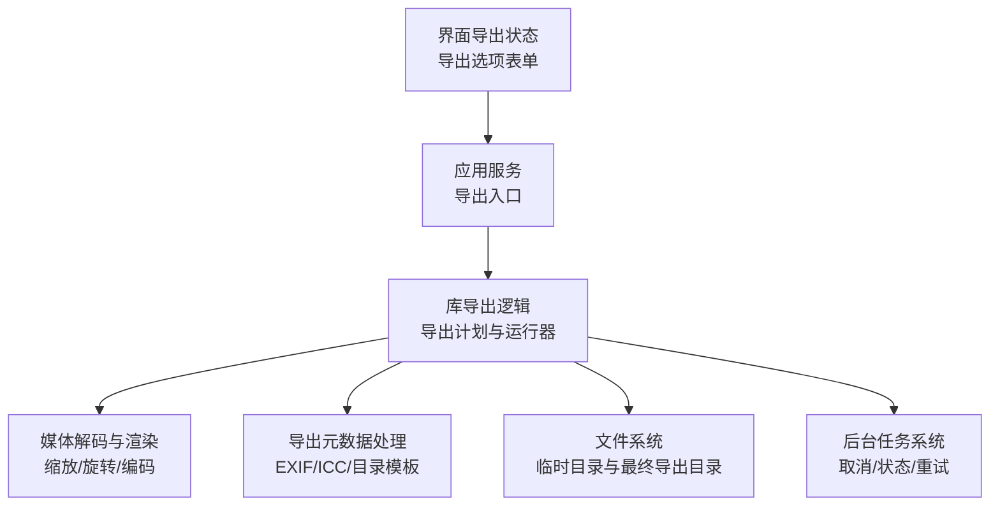

**图表来源**
- [crates/moriq-ui/src/export.rs:1-125](../../../../crates/moriq-ui/src/export.rs#L1-L125)
- [crates/moriq-app/src/catalog.rs:404-413](../../../../crates/moriq-app/src/catalog.rs#L404-L413)
- [crates/moriq-library/src/transfer/export.rs:3-200](../../../../crates/moriq-library/src/transfer/export.rs#L3-L200)
- [crates/moriq-library/src/transfer/export_metadata.rs:1-142](../../../../crates/moriq-library/src/transfer/export_metadata.rs#L1-L142)
- [crates/moriq-library/src/tasks/jobs.rs:1-200](../../../../crates/moriq-library/src/tasks/jobs.rs#L1-L200)

**章节来源**
- [crates/moriq-ui/src/export.rs:1-125](../../../../crates/moriq-ui/src/export.rs#L1-L125)
- [crates/moriq-app/src/catalog.rs:404-413](../../../../crates/moriq-app/src/catalog.rs#L404-L413)
- [crates/moriq-library/src/transfer/export.rs:3-200](../../../../crates/moriq-library/src/transfer/export.rs#L3-L200)
- [crates/moriq-library/src/transfer/export_metadata.rs:1-142](../../../../crates/moriq-library/src/transfer/export_metadata.rs#L1-L142)
- [crates/moriq-library/src/tasks/jobs.rs:1-200](../../../../crates/moriq-library/src/tasks/jobs.rs#L1-L200)

## 核心组件
- 导出选项与格式模型：在领域层定义导出格式、重采样策略、布局以及完整导出选项结构体。
- 导出状态与表单映射：UI 层将用户交互转换为类型化导出选项变更。
- 导出计划构建：库层根据资产标识查询有效版本、哈希、名称、导入时间、标签、AI 摘要、EXIF 和项目归属，并冻结待导出清单。
- 导出运行器：按选项复制原文件或解码并重采样、旋转、编码为目标格式，同时处理目录布局、命名冲突、侧写元数据和 EXIF。
- 元数据处理：规范化 EXIF、附加 ICC 色彩配置文件、限制 EXIF 体积，并在不支持内嵌的目标格式时写出独立 EXIF 侧文件。
- 任务与取消：后台任务支持取消作用域、分块读取中断、任务失败记录与重试。

**章节来源**
- [crates/moriq-domain/src/lib.rs:560-711](../../../../crates/moriq-domain/src/lib.rs#L560-L711)
- [crates/moriq-ui/src/export.rs:1-125](../../../../crates/moriq-ui/src/export.rs#L1-L125)
- [crates/moriq-library/src/transfer/export.rs:3-200](../../../../crates/moriq-library/src/transfer/export.rs#L3-L200)
- [crates/moriq-library/src/transfer/export.rs:201-422](../../../../crates/moriq-library/src/transfer/export.rs#L201-L422)
- [crates/moriq-library/src/transfer/export_metadata.rs:1-142](../../../../crates/moriq-library/src/transfer/export_metadata.rs#L1-L142)
- [crates/moriq-library/src/tasks/cancel.rs:1-85](../../../../crates/moriq-library/src/tasks/cancel.rs#L1-L85)

## 架构总览
导出调用链从 UI 到应用层再到库层，核心流程如下：

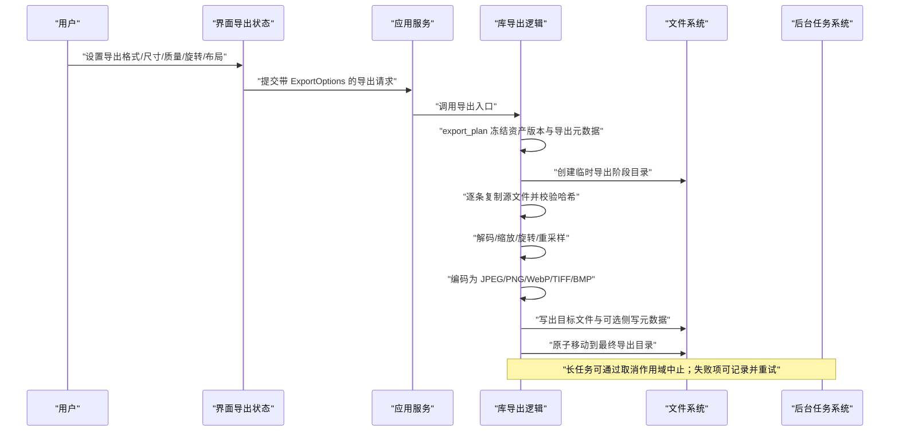

**图表来源**
- [crates/moriq-ui/src/export.rs:1-125](../../../../crates/moriq-ui/src/export.rs#L1-L125)
- [crates/moriq-app/src/catalog.rs:404-413](../../../../crates/moriq-app/src/catalog.rs#L404-L413)
- [crates/moriq-library/src/transfer/export.rs:3-200](../../../../crates/moriq-library/src/transfer/export.rs#L3-L200)
- [crates/moriq-library/src/transfer/export.rs:201-422](../../../../crates/moriq-library/src/transfer/export.rs#L201-L422)
- [crates/moriq-library/src/tasks/cancel.rs:1-85](../../../../crates/moriq-library/src/tasks/cancel.rs#L1-L85)

## 详细组件分析

### 导出选项与 UI 状态
- 支持的导出格式包括原始文件、JPEG、PNG、WebP、TIFF、BMP。
- 最长边像素值由 UI 提供，默认包含常用分辨率档位。
- JPEG 质量采用预设档位，便于快速权衡体积与画质。
- 旋转仅允许 0、90、180、270 度。
- 重采样策略支持面积平均、Lanczos3、双三次、最近邻。
- 目录布局支持平铺、按格式分组、按导入日期分组。
- 是否附带整理信息 JSON 可由用户开关。

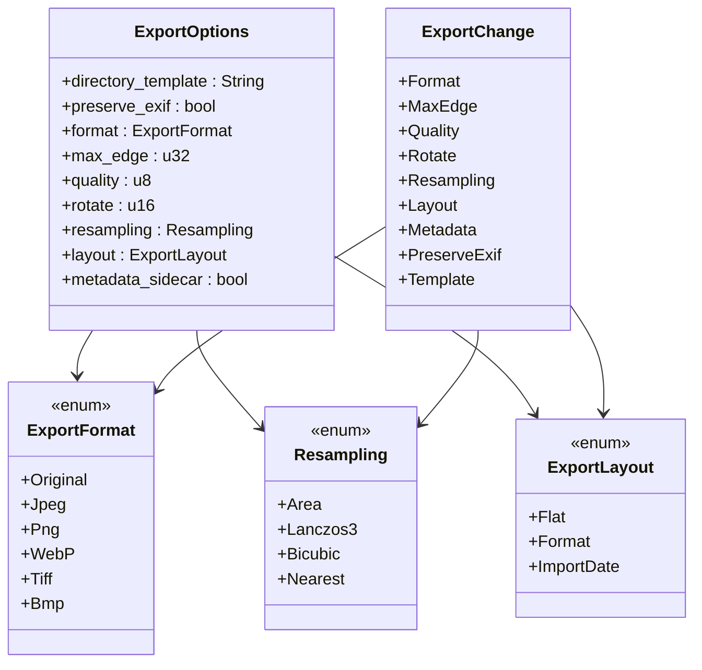

**图表来源**
- [crates/moriq-domain/src/lib.rs:560-711](../../../../crates/moriq-domain/src/lib.rs#L560-L711)
- [crates/moriq-ui/src/export.rs:1-125](../../../../crates/moriq-ui/src/export.rs#L1-L125)

**章节来源**
- [crates/moriq-domain/src/lib.rs:560-711](../../../../crates/moriq-domain/src/lib.rs#L560-L711)
- [crates/moriq-ui/src/export.rs:1-125](../../../../crates/moriq-ui/src/export.rs#L1-L125)

### 素材选择与导出计划
导出计划是“不可变”的导出快照，避免工作线程与数据库之间出现竞态：
- 限制单次导出资产数量在 1～10000 张。
- 对每个资产查询显示版本 ID、SHA256、文件名、导入时间、备注、有效标签、EXIF、AI 标签、AI 描述、媒介类型、主题、所属项目等。
- 使用 `AssetDetails` 补充人工或 AI 生成的分类与描述信息。
- 将上述信息序列化为 JSON 作为导出元数据，并缓存版本路径、哈希、名称、导入时间与元数据对象。

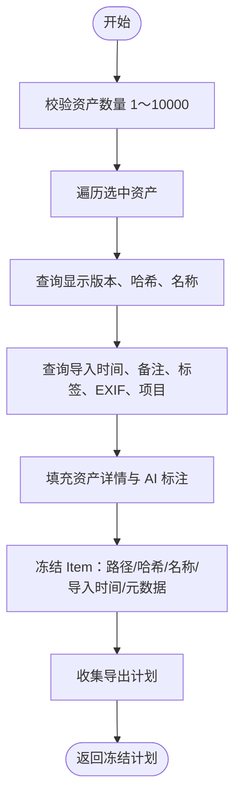

**图表来源**
- [crates/moriq-library/src/transfer/export.rs:3-63](../../../../crates/moriq-library/src/transfer/export.rs#L3-L63)

**章节来源**
- [crates/moriq-library/src/transfer/export.rs:3-63](../../../../crates/moriq-library/src/transfer/export.rs#L3-L63)

### 批量导出运行器
`run` 函数负责把冻结计划转化为实际输出目录：
- 校验最长边、质量、旋转角度，并拒绝导出到资源库内部。
- 使用临时目录存放中间产物，最后原子移动到以 UUID 命名的最终导出目录。
- 对每个条目先复制源文件，再校验 SHA256，防止导出期间源文件被修改。
- 视频仅在“原文件导出”且无图片转换选项时才允许；否则报错。
- 根据格式决定扩展名与编码路径；原始模式可保持原格式。
- 清理不安全文件名字符，处理同名冲突，必要时添加序号后缀。
- 可选择输出整理信息 JSON 侧文件。
- 非原图路径走解码→缩放→旋转→编码流水线。
- 最终将临时目录重命名为最终导出目录。

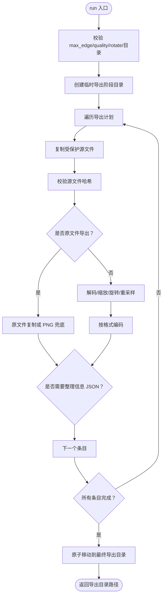

**图表来源**
- [crates/moriq-library/src/transfer/export.rs:64-200](../../../../crates/moriq-library/src/transfer/export.rs#L64-L200)
- [crates/moriq-library/src/transfer/export.rs:201-422](../../../../crates/moriq-library/src/transfer/export.rs#L201-L422)

**章节来源**
- [crates/moriq-library/src/transfer/export.rs:64-200](../../../../crates/moriq-library/src/transfer/export.rs#L64-L200)
- [crates/moriq-library/src/transfer/export.rs:201-422](../../../../crates/moriq-library/src/transfer/export.rs#L201-L422)

### 格式转换与色彩空间
- JPEG：将图像转为 RGB；若含透明度则进行 Alpha 合成；使用指定质量参数编码。
- PNG：直接写出 RGBA 或解码后的颜色类型，并附加 ICC 配置文件。
- WebP：当前实现使用无损编码器写出 RGBA 图像。
- TIFF：写出解码后的像素缓冲与颜色类型。
- BMP：通过通用保存路径处理。
- 色彩空间：在编码前注入 sRGB ICC 配置文件，确保跨平台一致性。
- EXIF：可选保留，并对方向、尺寸、色彩空间字段做规范化；超出预算时拒绝。

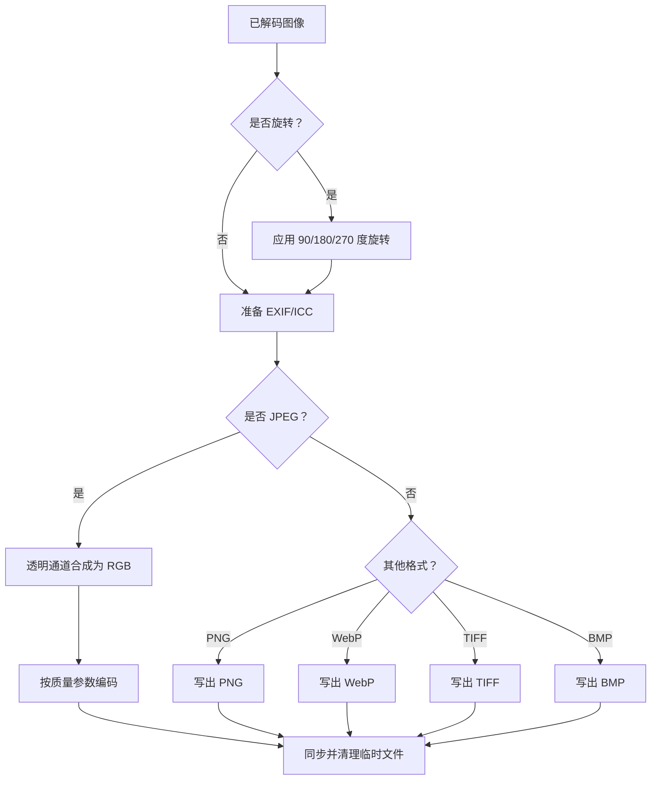

**图表来源**
- [crates/moriq-library/src/transfer/export.rs:201-422](../../../../crates/moriq-library/src/transfer/export.rs#L201-L422)
- [crates/moriq-library/src/transfer/export_metadata.rs:1-60](../../../../crates/moriq-library/src/transfer/export_metadata.rs#L1-L60)

**章节来源**
- [crates/moriq-library/src/transfer/export.rs:201-422](../../../../crates/moriq-library/src/transfer/export.rs#L201-L422)
- [crates/moriq-library/src/transfer/export_metadata.rs:1-60](../../../../crates/moriq-library/src/transfer/export_metadata.rs#L1-L60)

### 元数据保留与目录模板
- EXIF 规范化：移除或重置不需要的方向、尺寸、色彩空间字段，避免导出后显示异常。
- EXIF 预算：重建后的 EXIF 不能超过 4 MiB，否则拒绝导出。
- ICC 配置：为输出图像注入 sRGB 配置文件。
- 侧写 EXIF：当目标格式不支持内嵌 EXIF 时，输出 `.exif` 侧文件。
- 目录模板：支持 `{date}`、`{year}`、`{month}`、`{day}`、`{format}`、`{camera}`、`{project}` 等变量，最多 8 层相对目录，长度不超过 1024。
- 整理信息 JSON：可按开关为每个输出写出独立的 JSON 侧文件，包含资产 ID、版本、项目名称、标签、AI 摘要等信息。

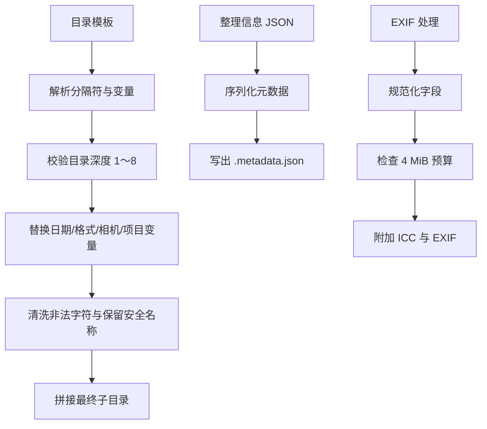

**图表来源**
- [crates/moriq-library/src/transfer/export_metadata.rs:1-142](../../../../crates/moriq-library/src/transfer/export_metadata.rs#L1-L142)
- [crates/moriq-library/src/transfer/export.rs:120-180](../../../../crates/moriq-library/src/transfer/export.rs#L120-L180)

**章节来源**
- [crates/moriq-library/src/transfer/export_metadata.rs:1-142](../../../../crates/moriq-library/src/transfer/export_metadata.rs#L1-L142)
- [crates/moriq-library/src/transfer/export.rs:120-180](../../../../crates/moriq-library/src/transfer/export.rs#L120-L180)

### 进度跟踪、取消与任务状态
导出本身在当前实现中是一个集中式批处理过程；但系统整体具备后台任务体系，用于分析、完整性检查和批量任务的持久化调度：
- 任务具有身份、世代号、状态、优先级、检查点、总数、失败数和错误信息。
- 支持暂停、恢复、取消、失败重试和优先级调整。
- 取消作用域基于线程本地标志，可在分块读取或长时间 I/O 中及时中断。
- 失败项记录资产关联、名称与消息，供界面展示与重试。
- 对于导出场景，可将导出视为一个大型作业：若未来拆分为后台任务，应复用该取消与作用域机制。

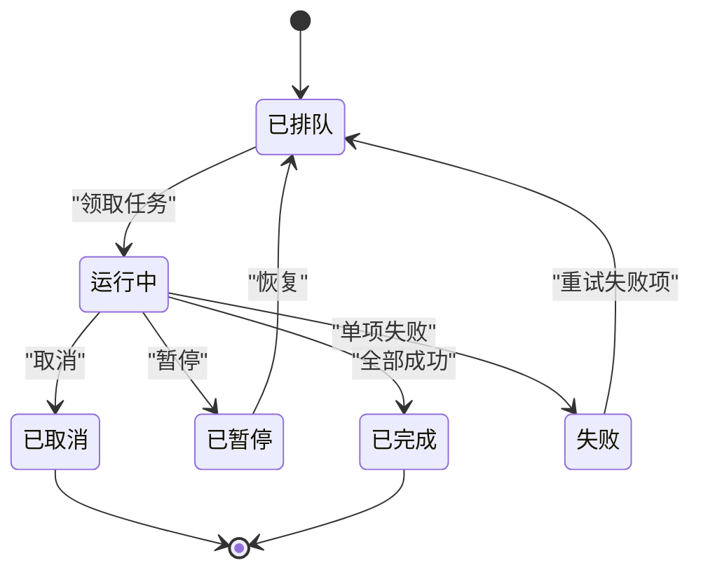

**图表来源**
- [crates/moriq-library/src/tasks/jobs.rs:1-200](../../../../crates/moriq-library/src/tasks/jobs.rs#L1-L200)
- [crates/moriq-library/src/tasks/cancel.rs:1-85](../../../../crates/moriq-library/src/tasks/cancel.rs#L1-L85)

**章节来源**
- [crates/moriq-library/src/tasks/jobs.rs:1-200](../../../../crates/moriq-library/src/tasks/jobs.rs#L1-L200)
- [crates/moriq-library/src/tasks/cancel.rs:1-85](../../../../crates/moriq-library/src/tasks/cancel.rs#L1-L85)

## 依赖关系分析
- 领域层提供导出枚举、布局和选项结构体，不包含 I/O。
- UI 层只持有用户可见的状态与翻译标签，不直接操作文件系统。
- 应用层暴露异步导出入口，组合库导出逻辑。
- 库层依赖数据库查询、文件系统、图像解码与编码、EXIF 与 ICC 处理。
- 任务系统与取消机制提供可中断的长任务语义，适用于后续导出任务化扩展。

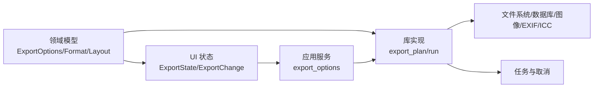

**图表来源**
- [crates/moriq-domain/src/lib.rs:560-711](../../../../crates/moriq-domain/src/lib.rs#L560-L711)
- [crates/moriq-ui/src/export.rs:1-125](../../../../crates/moriq-ui/src/export.rs#L1-L125)
- [crates/moriq-app/src/catalog.rs:404-413](../../../../crates/moriq-app/src/catalog.rs#L404-L413)
- [crates/moriq-library/src/transfer/export.rs:3-200](../../../../crates/moriq-library/src/transfer/export.rs#L3-L200)
- [crates/moriq-library/src/tasks/jobs.rs:1-200](../../../../crates/moriq-library/src/tasks/jobs.rs#L1-L200)

**章节来源**
- [crates/moriq-domain/src/lib.rs:560-711](../../../../crates/moriq-domain/src/lib.rs#L560-L711)
- [crates/moriq-ui/src/export.rs:1-125](../../../../crates/moriq-ui/src/export.rs#L1-L125)
- [crates/moriq-app/src/catalog.rs:404-413](../../../../crates/moriq-app/src/catalog.rs#L404-L413)
- [crates/moriq-library/src/transfer/export.rs:3-200](../../../../crates/moriq-library/src/transfer/export.rs#L3-L200)
- [crates/moriq-library/src/tasks/jobs.rs:1-200](../../../../crates/moriq-library/src/tasks/jobs.rs#L1-L200)

## 性能与并发特性
- 批量上限：单次导出最多 10000 张素材，避免过大查询和内存压力。
- 解码前缩放：测试表明导出会先限定解码尺寸，再处理旋转，避免放大来源。
- 临时目录：所有中间产物放在临时目录，成功后原子移动至最终目录，降低部分写入风险。
- 共享内存预算：测试验证转换导出在等待共享内存预算时不会阻塞写入端的其他请求。
- 重采样策略：不同算法影响小图缩放与透明像素合成质量，可根据需求选择。
- 编码路径：JPEG 单独处理透明度合成；WebP 当前为无损编码；PNG/TIFF 直接写出解码结果。
- 元数据开销：EXIF 重建有 4 MiB 上限，防止超大元数据拖慢编码。

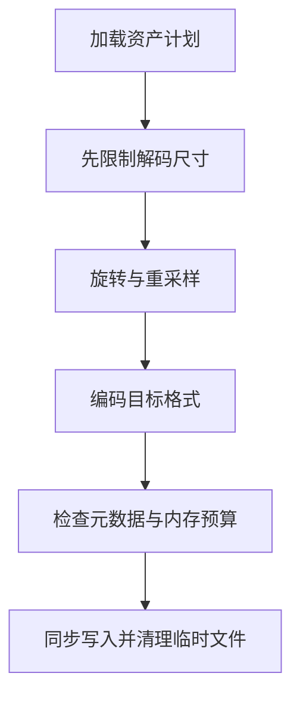

**图表来源**
- [crates/moriq-library/src/transfer/export.rs:201-422](../../../../crates/moriq-library/src/transfer/export.rs#L201-L422)
- [crates/moriq-app/src/export_budget_tests.rs:1-67](../../../../crates/moriq-app/src/export_budget_tests.rs#L1-L67)

**章节来源**
- [crates/moriq-library/src/transfer/export.rs:201-422](../../../../crates/moriq-library/src/transfer/export.rs#L201-L422)
- [crates/moriq-app/src/export_budget_tests.rs:1-67](../../../../crates/moriq-app/src/export_budget_tests.rs#L1-L67)

## 错误处理与恢复
- 参数校验：最长边、质量、旋转角度无效时会立即拒绝。
- 目录安全：拒绝导出到资源库内部；目录模板过长、层级过多、包含未知变量或非法路径时拒绝。
- 源文件一致性：导出前复制并校验 SHA256，若源文件变化则停止发布。
- 视频限制：视频当前仅支持原文件导出，不能与图片转换选项混用。
- 解码失败：若无像素数据则报告错误。
- EXIF 错误：EXIF 读取、重建或体积超限均会报错。
- 任务级恢复：后台任务支持失败项记录、重试、暂停、恢复、取消和优先级调整；可用于分析类任务，也可作为导出任务化的参考。
- 断点续传思路：当前导出以临时目录+原子移动为主；若要实现断点续传，可在任务层面引入检查点、分片写入和已输出清单，结合现有 `checkpoint` 语义扩展。

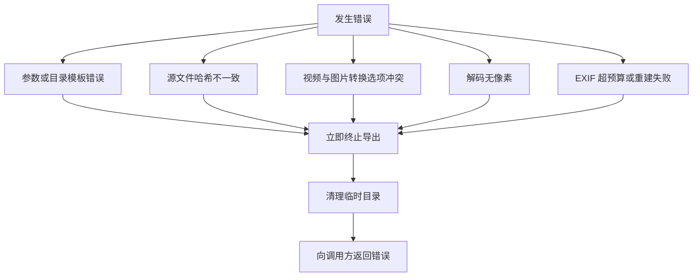

**图表来源**
- [crates/moriq-library/src/transfer/export.rs:64-200](../../../../crates/moriq-library/src/transfer/export.rs#L64-L200)
- [crates/moriq-library/src/transfer/export.rs:201-422](../../../../crates/moriq-library/src/transfer/export.rs#L201-L422)
- [crates/moriq-library/src/transfer/export_metadata.rs:1-60](../../../../crates/moriq-library/src/transfer/export_metadata.rs#L1-L60)
- [crates/moriq-library/src/tasks/jobs.rs:201-500](../../../../crates/moriq-library/src/tasks/jobs.rs#L201-L500)

**章节来源**
- [crates/moriq-library/src/transfer/export.rs:64-200](../../../../crates/moriq-library/src/transfer/export.rs#L64-L200)
- [crates/moriq-library/src/transfer/export.rs:201-422](../../../../crates/moriq-library/src/transfer/export.rs#L201-L422)
- [crates/moriq-library/src/transfer/export_metadata.rs:1-60](../../../../crates/moriq-library/src/transfer/export_metadata.rs#L1-L60)
- [crates/moriq-library/src/tasks/jobs.rs:201-500](../../../../crates/moriq-library/src/tasks/jobs.rs#L201-L500)

## 最佳实践
- 大文件处理
  - 优先设置合理的 `max_edge`，让解码前缩放生效，避免加载超大图像。
  - 对大量素材分批导出，尽量控制在 10000 张以内。
  - 使用临时目录与原子移动，减少部分写入导致的不一致。
- 内存管理
  - 关注共享内存预算，避免同时占用过多内存影响写入端与其他请求。
  - 谨慎开启 EXIF 保留，尤其对元数据较大的 RAW 文件。
- 磁盘空间检查
  - 导出前确认目标盘有足够空间容纳所有输出文件和可选侧写文件。
  - 避免导出到资源库目录，防止误写或破坏库结构。
- 格式与质量
  - JPEG 适合照片分享，注意透明度需合成背景。
  - PNG 适合透明背景与无损要求。
  - WebP 当前为无损编码，体积可能较大。
  - TIFF 适合高质量归档，但不一定需要 EXIF 内嵌。
- 元数据与水印
  - 如需保留相机信息，开启 `preserve_exif`；否则关闭以减少体积。
  - 如需附带整理信息，开启 `metadata_sidecar` 获取 JSON 侧文件。
  - 当前未实现自定义水印；如需水印，可在导出后增加后处理步骤或使用更高层封装。
- 进度与取消
  - 若导出任务化，建议复用任务系统的取消作用域和失败重试机制。
  - 对长时间导出，建议在 UI 层提供取消按钮，并通过后台任务状态反馈。

[本节为通用指导，不直接分析具体代码文件]

## 结论
Moriq Space 的导出系统以冻结计划为核心，结合严格的参数校验、安全的临时目录、明确的格式编码路径和可选的元数据侧写，实现了稳定可靠的批量导出。UI 层提供清晰的选项映射，领域层定义类型化配置，库层承担实际 I/O 与图像处理，任务系统提供取消与失败重试的基础能力。对于更大规模导出，建议在现有取消与检查点机制基础上进一步任务化，并结合内存预算、磁盘空间检查和分片写入实现更完善的断点续传与进度监控。