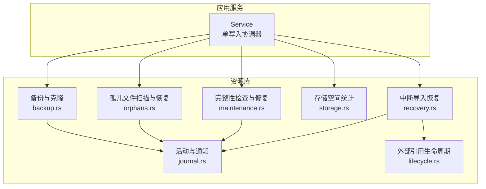
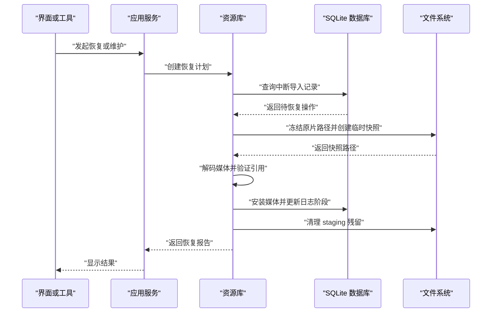
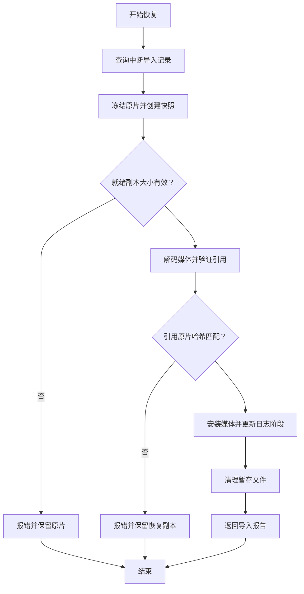
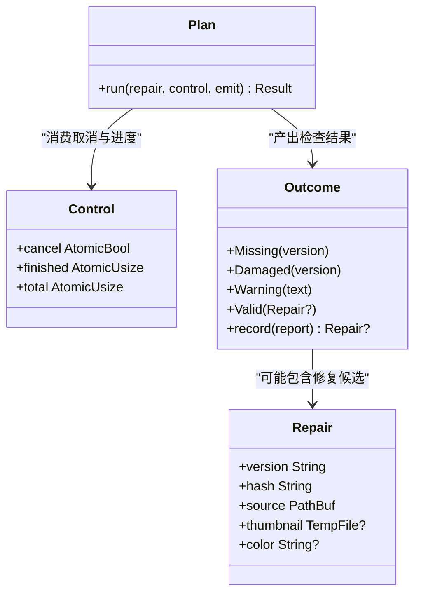
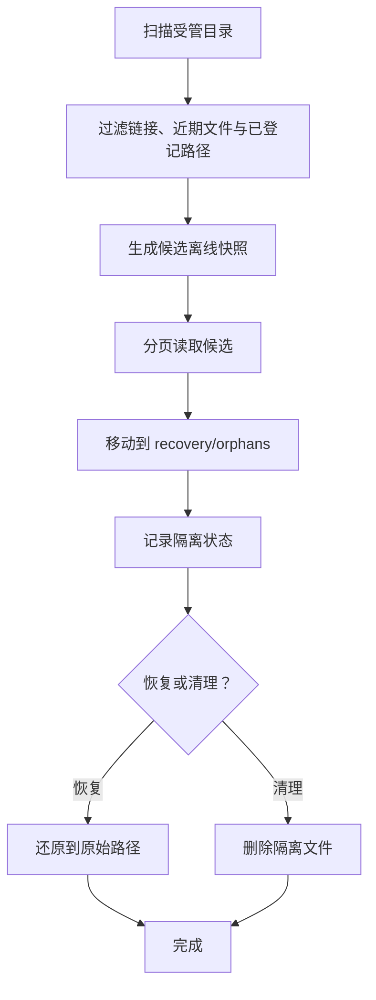
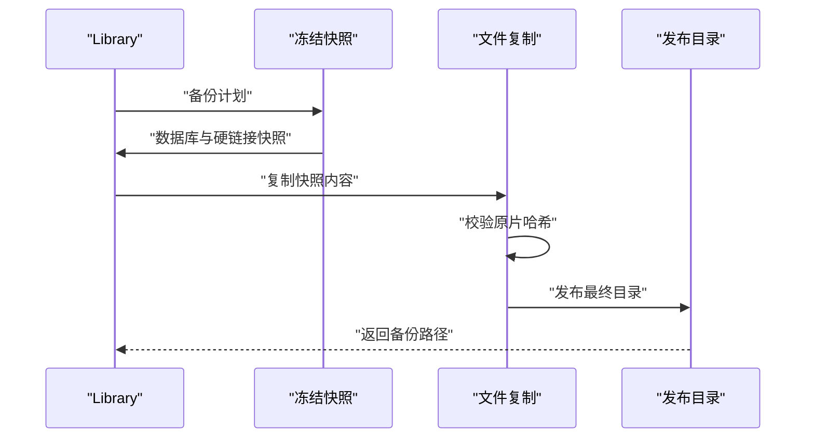
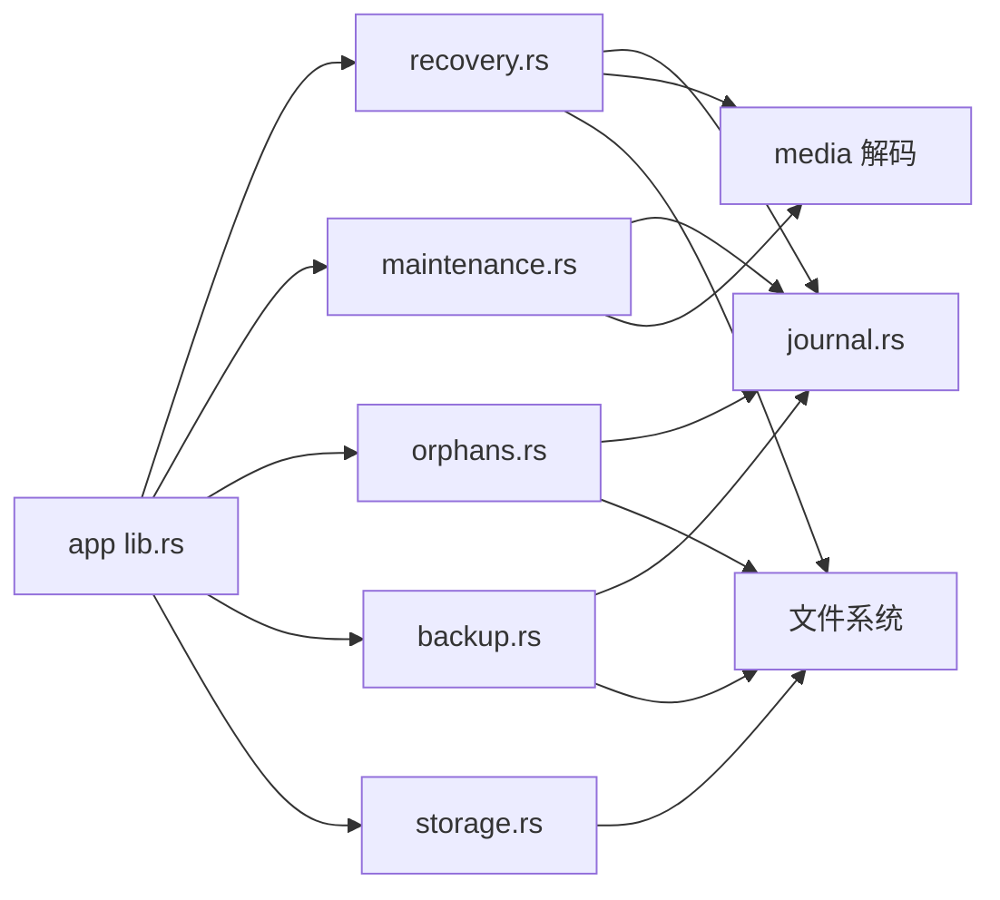

# 恢复系统（Recovery System）

> Repo Wiki 节点 `recovery-system`
> 导出自 Qoder 知识库快照 `8fbe02f6-57c2-4874-b725-1a8130851fd9`，代码基线 `7a7a8e75e18bd90294e09cd422dd7ed5a04813a0`（分支 main，zh-CN）。

<cite>
**本文引用的文件**   
- [recovery.rs](../../../../crates/moriq-library/src/transfer/recovery.rs)
- [recovery_tests.rs](../../../../crates/moriq-library/src/transfer/recovery_tests.rs)
- [app_recovery_tests.rs](../../../../crates/moriq-app/src/recovery_tests.rs)
- [journal.rs](../../../../crates/moriq-library/src/database/journal.rs)
- [maintenance.rs](../../../../crates/moriq-library/src/maintenance/maintenance.rs)
- [orphans.rs](../../../../crates/moriq-library/src/maintenance/orphans.rs)
- [storage.rs](../../../../crates/moriq-library/src/maintenance/storage.rs)
- [backup.rs](../../../../crates/moriq-library/src/maintenance/backup.rs)
- [lib.rs](../../../../crates/moriq-app/src/lib.rs)
- [lifecycle.rs](../../../../crates/moriq-library/src/library/lifecycle.rs)
</cite>

## 目录
1. [简介](#简介)
2. [项目结构](#项目结构)
3. [核心组件](#核心组件)
4. [架构总览](#架构总览)
5. [详细组件分析](#详细组件分析)
6. [依赖关系分析](#依赖关系分析)
7. [性能与资源特征](#性能与资源特征)
8. [故障排查指南](#故障排查指南)
9. [结论](#结论)
10. [附录：配置与实践建议](#附录配置与实践建议)

## 简介
本文件系统化说明 Moriq Space 的恢复系统。它围绕“中断导入的日志化恢复”“数据库与缓存一致性检查”“孤立文件检测与隔离恢复”“备份快照与克隆”以及“存储空间统计”展开，目标是保证在崩溃、取消、外部文件变化或磁盘异常后，仍能安全重建状态、最小化数据损失并保留人工干预入口。

关键设计要点包括：
- 以 `operation_journal` 为中心的中断导入恢复：只读取已冻结的不可变媒体，最后提交不变日志条目。
- 维护性检查与修复分离：检查在读取端执行，修复候选由写入端复核后再落盘。
- 孤儿文件扫描与可恢复隔离区：支持迁移、恢复或删除，且具备幂等与重试能力。
- 备份采用硬链接快照加校验发布，确保拷贝期间编辑不污染快照，损坏内容不会发布半成品。
- 通过服务层并发控制、内存预算和取消信号，使恢复过程对前台写入保持响应。

[本节未直接分析具体代码行]

## 项目结构
恢复相关能力主要分布在以下模块：
- `crates/moriq-library/src/transfer/recovery.rs`：中断导入的恢复计划、冻结副本、准备与最终安装。
- `crates/moriq-library/src/maintenance/*`：完整性检查、缓存修复、孤儿文件、空间统计与备份。
- `crates/moriq-library/src/database/journal.rs`：库级事件与通知写入，提供恢复操作的可观测性。
- `crates/moriq-app/src/lib.rs`：单写入协调器、恢复任务调度、资源预算与取消控制。
- `crates/moriq-library/src/library/lifecycle.rs`：外部引用重连与身份验证。

**图表来源**
- [lib.rs:1-260](../../../../crates/moriq-app/src/lib.rs#L1-L260)
- [recovery.rs:1-229](../../../../crates/moriq-library/src/transfer/recovery.rs#L1-L229)
- [maintenance.rs:1-399](../../../../crates/moriq-library/src/maintenance/maintenance.rs#L1-L399)
- [orphans.rs:1-355](../../../../crates/moriq-library/src/maintenance/orphans.rs#L1-L355)
- [storage.rs:1-261](../../../../crates/moriq-library/src/maintenance/storage.rs#L1-L261)
- [backup.rs:1-399](../../../../crates/moriq-library/src/maintenance/backup.rs#L1-L399)
- [journal.rs:1-200](../../../../crates/moriq-library/src/database/journal.rs#L1-L200)
- [lifecycle.rs:1-177](../../../../crates/moriq-library/src/library/lifecycle.rs#L1-L177)

**章节来源**
- [lib.rs:1-260](../../../../crates/moriq-app/src/lib.rs#L1-L260)
- [recovery.rs:1-229](../../../../crates/moriq-library/src/transfer/recovery.rs#L1-L229)

## 核心组件
- 中断导入恢复引擎：从数据库查询处于中断状态的导入记录，构建恢复计划，冻结原片路径、生成临时快照、预检文件大小与就绪标记，再解码媒体元数据并安装到现有资产中。
- 维护性检查与缓存修复：先做数据库完整性检查，再建立只读快照遍历版本与缓存，必要时冻结源文件计算哈希、重建缩略图或主色，返回修复候选供写入端应用。
- 孤儿文件扫描与隔离恢复：扫描未登记受管文件，生成离线候选快照；将候选移入 `recovery/orphans` 隔离区，支持分页恢复或删除。
- 备份与克隆：冻结数据库与不可变文件硬链接，排除未完成导入暂存；复制完成后校验原片哈希并发布最终目录；独立克隆会分配新库身份。
- 存储空间统计：按目录分类统计分配空间，去重硬链接，区分托管原片与外部引用，支持取消与警告计数。
- 外部引用重连：根据旧根目录查找可重连的外部文件，校验内容、大小、修改时间和文件身份后更新路径。

**章节来源**
- [recovery.rs:1-229](../../../../crates/moriq-library/src/transfer/recovery.rs#L1-L229)
- [maintenance.rs:1-399](../../../../crates/moriq-library/src/maintenance/maintenance.rs#L1-L399)
- [orphans.rs:1-355](../../../../crates/moriq-library/src/maintenance/orphans.rs#L1-L355)
- [backup.rs:1-399](../../../../crates/moriq-library/src/maintenance/backup.rs#L1-L399)
- [storage.rs:1-261](../../../../crates/moriq-library/src/maintenance/storage.rs#L1-L261)
- [lifecycle.rs:1-177](../../../../crates/moriq-library/src/library/lifecycle.rs#L1-L177)

## 架构总览
恢复流程贯穿“发现中断记录 → 冻结输入 → 预检与解码 → 安装并提交 → 清理暂存”。应用层负责并发调度、取消传播与资源预算；库层负责持久化一致性与文件安全性。

**图表来源**
- [recovery.rs:1-229](../../../../crates/moriq-library/src/transfer/recovery.rs#L1-L229)
- [app_recovery_tests.rs:1-154](../../../../crates/moriq-app/src/recovery_tests.rs#L1-L154)

**章节来源**
- [recovery.rs:1-229](../../../../crates/moriq-library/src/transfer/recovery.rs#L1-L229)
- [app_recovery_tests.rs:1-154](../../../../crates/moriq-app/src/recovery_tests.rs#L1-L154)

## 详细组件分析

### 中断导入恢复
恢复目标不是重新完整导入，而是把已经成功落盘的不可变媒体安装为现有资产，并仅提交不变的日志条目。这避免重复 I/O，也降低破坏风险。

核心行为：
- 查询 `operation_journal` 中阶段为中断的记录，限制数量，绑定资源库租约。
- `freeze` 阶段解析平台路径、拒绝网络引用、定位已就绪的副本，校验就绪文件大小与预期值，并在 `backups/.recovery-*` 下创建硬链接快照。
- `prepare` 阶段解码媒体、对引用原片进行哈希比对，防止外部编辑器替换导致不一致。
- `finish_recovery` 再次核对记录是否变更，调用内部安装逻辑，将日志阶段更新为已提交，并清理 `staging` 下的 `.part/.thumb/.ready` 文件。
- 同步辅助方法批量尝试所有恢复计划，汇总导入数、重复数和失败信息。

**图表来源**
- [recovery.rs:1-229](../../../../crates/moriq-library/src/transfer/recovery.rs#L1-L229)

**章节来源**
- [recovery.rs:1-229](../../../../crates/moriq-library/src/transfer/recovery.rs#L1-L229)
- [recovery_tests.rs:1-70](../../../../crates/moriq-library/src/transfer/recovery_tests.rs#L1-L70)

### 维护性检查与缓存修复
维护检查在读取连接池上运行，使用只读事务和临时表快照，避免阻塞写入线程。它首先执行 SQLite 完整性检查和外键检查，然后逐项验证版本与缩略图。

关键点：
- 使用 `PRAGMA integrity_check` 与 `foreign_key_check` 快速判断数据库健康。
- 将版本、路径、哈希、主色与外部引用信息复制到临时表，随后分页遍历。
- 若缩略图损坏或缺失主色，则冻结源文件、流式计算 SHA-256，限制最大处理字节数，解码图像并生成新的缩略图与主色。
- 修复以 `Repair` 对象返回，写入端通过 `apply_cache_repair` 再次校验版本哈希与来源路径后才真正落盘。
- 取消时丢弃待提交修复并释放读取租约，保证幂等与安全。

**图表来源**
- [maintenance.rs:1-399](../../../../crates/moriq-library/src/maintenance/maintenance.rs#L1-L399)

**章节来源**
- [maintenance.rs:1-399](../../../../crates/moriq-library/src/maintenance/maintenance.rs#L1-L399)

### 孤儿文件检测与隔离恢复
孤儿扫描识别未登记但位于受管目录中的旧文件，过滤符号链接、Windows 重解析点、近期修改文件和无法读取项，并将候选写入离线临时数据库。

关键流程：
- `orphan_scan` 冻结资源库身份与读取租约，建立注册路径集合，扫描 `assets` 与 `versions`。
- `Plan.page` 基于快照分页返回候选，避免重复全量扫描。
- `quarantine_orphans` 将候选移动到 `recovery/orphans/<uuid>.bin`，记录状态为隔离前、隔离中和隔离完成。
- `recover_orphans` 重启后继续未完成隔离或删除；`restore_orphans_page` 分页恢复或删除，拒绝覆盖已有文件或已被登记的路径。

**图表来源**
- [orphans.rs:1-355](../../../../crates/moriq-library/src/maintenance/orphans.rs#L1-L355)

**章节来源**
- [orphans.rs:1-355](../../../../crates/moriq-library/src/maintenance/orphans.rs#L1-L355)

### 备份与克隆
备份采用“冻结目录与数据库 → 硬链接不可变文件 → 异步复制 → 校验发布”的流程。它排除进行中导入的暂存，但保留中断导入以便后续恢复。

重要特性：
- 冻结数据库快照并切换 journal 模式，避免 WAL 未提交变更进入备份。
- 删除未完成导入上下文与已完成日志，保留 `interrupted` 记录。
- 独立克隆会清空同步任务、导入上下文、操作日志，并分配新库身份。
- 复制过程限制目录深度、跳过符号链接、统计文件总数并按进度回调。
- 发布前校验未被引用的原片哈希，任何不一致都不会发布半成品。
- 测试覆盖：源库删除不影响快照、编辑不混入备份、取消不发布半成品、克隆身份不同、活跃导入被排除而中断导入可恢复。

**图表来源**
- [backup.rs:1-399](../../../../crates/moriq-library/src/maintenance/backup.rs#L1-L399)

**章节来源**
- [backup.rs:1-399](../../../../crates/moriq-library/src/maintenance/backup.rs#L1-L399)

### 存储空间统计
存储统计区分“托管原片及项目归档”“追加版本”“可重建图片缓存”“索引”“Synco 交接副本”“恢复与暂存数据”“数据库升级备份”“数据库与元数据”，并通过文件身份去重硬链接，同时单独统计外部引用大小。

特点：
- 从读取连接获取元数据，再释放连接以避免长时间持有 WAL 读事务。
- 使用本地临时数据库记录已见文件身份，避免重复计算硬链接。
- 支持取消并记录警告数量，最终输出卷总量、可用空间、分配空间和分类统计。

**章节来源**
- [storage.rs:1-261](../../../../crates/moriq-library/src/maintenance/storage.rs#L1-L261)

### 外部引用重连
当外部原片移动到新磁盘或目录时，系统可按旧根目录分页查找可重连候选，校验内容与身份后更新路径。

重点：
- 限制新路径必须位于允许根目录下，防止路径逃逸。
- 校验内容哈希、文件大小、修改时间与文件身份，防止校验期间文件被替换。
- 成功后更新 `file_locations` 并失效快照缓存。

**章节来源**
- [lifecycle.rs:1-177](../../../../crates/moriq-library/src/library/lifecycle.rs#L1-L177)

## 依赖关系分析
恢复子系统依赖多个底层能力：
- SQLite 数据库：用于中断日志、活动通知、版本元数据与隔离区状态。
- 文件系统：用于硬链接快照、临时目录、缩略图与隔离区。
- 媒体解码：用于缩略图重建与主色提取。
- 应用服务层：用于并发调度、内存预算、取消传播与用户可见报告。

**图表来源**
- [recovery.rs:1-229](../../../../crates/moriq-library/src/transfer/recovery.rs#L1-L229)
- [maintenance.rs:1-399](../../../../crates/moriq-library/src/maintenance/maintenance.rs#L1-L399)
- [orphans.rs:1-355](../../../../crates/moriq-library/src/maintenance/orphans.rs#L1-L355)
- [backup.rs:1-399](../../../../crates/moriq-library/src/maintenance/backup.rs#L1-L399)
- [storage.rs:1-261](../../../../crates/moriq-library/src/maintenance/storage.rs#L1-L261)
- [lib.rs:1-260](../../../../crates/moriq-app/src/lib.rs#L1-L260)
- [journal.rs:1-200](../../../../crates/moriq-library/src/database/journal.rs#L1-L200)

**章节来源**
- [lib.rs:1-260](../../../../crates/moriq-app/src/lib.rs#L1-L260)
- [recovery.rs:1-229](../../../../crates/moriq-library/src/transfer/recovery.rs#L1-L229)

## 性能与资源特征
- 恢复与检查均在读取端或工作线程执行，避免长时间占用数据库写锁。
- 维护任务使用只读事务与临时表快照，导入和编辑可在写入线程继续。
- 媒体解码仅在需要修复时冻结源文件，并使用流式哈希计算，限制最大处理字节数。
- 备份复制采用有界遍历和硬链接，减少 Rust 侧大内存集合，同时支持进度回调。
- 应用服务通过信号量限制导入并发、内存预算和维护任务串行执行，确保 UI 响应。

[本节为通用性能讨论，未直接分析具体代码行]

## 故障排查指南
常见恢复问题与处理建议：
- 恢复副本不完整：检查 `staging` 下的就绪副本与预期大小是否一致；若不一致，保留原片并重新导入。
- 引用原片已更改：外部编辑器修改原片会导致恢复失败；应手动重新导入，恢复副本保持不变。
- 恢复记录已改变：同一恢复结果在不同会话中可能被中止；需重新生成恢复计划。
- 数据库完整性检查失败：优先保留原库并从备份恢复；不要强行覆盖损坏数据库。
- 孤儿文件无法恢复：确认候选文件的修改时间、大小与文件身份未变化；若已不存在或被登记，则跳过。
- 备份未发布：检查是否中途取消、是否存在损坏原片或目录层级过深；查看临时备份目录是否存在。
- 恢复过程中 UI 无响应：检查是否因内存预算不足等待资源；可通过取消当前恢复后释放内存再重试。

**章节来源**
- [recovery.rs:1-229](../../../../crates/moriq-library/src/transfer/recovery.rs#L1-L229)
- [maintenance.rs:1-399](../../../../crates/moriq-library/src/maintenance/maintenance.rs#L1-L399)
- [orphans.rs:1-355](../../../../crates/moriq-library/src/maintenance/orphans.rs#L1-L355)
- [backup.rs:1-399](../../../../crates/moriq-library/src/maintenance/backup.rs#L1-L399)

## 结论
Moriq Space 的恢复系统以“日志驱动、冻结输入、只读检查、可审核修复”为核心原则。中断导入通过日志最小化重建，维护检查在读取端安全运行，孤儿文件提供可恢复隔离区，备份采用硬链接快照与发布前校验，存储统计帮助规划容量与识别异常。配合应用层的并发控制与取消机制，系统在崩溃、取消和数据异常场景下都能提供可控、可审计、可回退的恢复体验。

[本节为总结性内容，未直接分析具体代码行]

## 附录：配置与实践建议

### 恢复策略选择
- 完全恢复：适用于中断导入的副本仍完整、引用原片未变化、数据库完整性通过的场景。可直接调用批量恢复接口，系统会自动安装媒体并提交日志。
- 部分恢复：适用于个别记录失败、引用原片变化或副本损坏的情况。应先修复或重新导入受影响记录，再重试该条恢复。
- 降级模式：在数据库存在严重不一致或外部引用大量丢失时，优先从备份恢复，再逐步重建索引与缓存。

实践步骤：
1. 运行维护检查，确认数据库完整性与外键关系。
2. 若缩略图缺失或主色为空，启用缓存修复并逐个应用修复候选。
3. 扫描孤儿文件，将可疑文件移入隔离区，再分页恢复或删除。
4. 若数据可信度低，停止在线操作，使用最近备份克隆或恢复。

**章节来源**
- [maintenance.rs:1-399](../../../../crates/moriq-library/src/maintenance/maintenance.rs#L1-L399)
- [orphans.rs:1-355](../../../../crates/moriq-library/src/maintenance/orphans.rs#L1-L355)
- [backup.rs:1-399](../../../../crates/moriq-library/src/maintenance/backup.rs#L1-L399)

### 检查点频率与日志轮转
仓库中没有显式的“检查点频率”配置字段。恢复依赖的是导入过程中的操作日志阶段与就绪副本标记。实践中建议：
- 在导入流程中尽可能缩短中断窗口，提高就绪副本落盘成功率。
- 定期执行维护检查，及时发现损坏缩略图和缺失主色。
- 使用备份功能生成一致性快照，而不是依赖频繁的全量日志轮转。
- 利用活动与通知观察恢复与维护操作的执行历史。

**章节来源**
- [recovery.rs:1-229](../../../../crates/moriq-library/src/transfer/recovery.rs#L1-L229)
- [journal.rs:1-200](../../../../crates/moriq-library/src/database/journal.rs#L1-L200)
- [backup.rs:1-399](../../../../crates/moriq-library/src/maintenance/backup.rs#L1-L399)

### 存储空间规划
- 预留足够空间用于 `staging`、`thumbnails`、`previews`、`indexes`、`interop`、`recovery`、`trash`、`backups`。
- 使用存储统计监控分配空间、唯一文件字节、硬链接数量和卷剩余空间。
- 对高价值库，建议在另一块磁盘保存备份，并定期验证备份可打开与完整性。

**章节来源**
- [storage.rs:1-261](../../../../crates/moriq-library/src/maintenance/storage.rs#L1-L261)
- [backup.rs:1-399](../../../../crates/moriq-library/src/maintenance/backup.rs#L1-L399)

### 灾难恢复演练
推荐演练流程：
1. 正常导入若干素材，触发一次中断导入，模拟崩溃。
2. 启动恢复，验证是否成功安装媒体、清理暂存且不破坏原片。
3. 破坏一个缩略图，运行维护检查并应用缓存修复。
4. 移动外部引用，使用重连功能验证路径更新。
5. 扫描孤儿文件，将其隔离后恢复或删除。
6. 创建备份并克隆，验证克隆库身份不同且内容一致。
7. 关闭服务后重新打开，验证恢复日志与活动通知可观察。

**章节来源**
- [recovery_tests.rs:1-70](../../../../crates/moriq-library/src/transfer/recovery_tests.rs#L1-L70)
- [app_recovery_tests.rs:1-154](../../../../crates/moriq-app/src/recovery_tests.rs#L1-L154)
- [maintenance.rs:1-399](../../../../crates/moriq-library/src/maintenance/maintenance.rs#L1-L399)
- [orphans.rs:1-355](../../../../crates/moriq-library/src/maintenance/orphans.rs#L1-L355)
- [backup.rs:1-399](../../../../crates/moriq-library/src/maintenance/backup.rs#L1-L399)
- [lifecycle.rs:1-177](../../../../crates/moriq-library/src/library/lifecycle.rs#L1-L177)