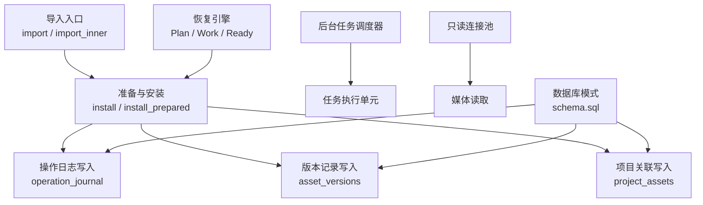
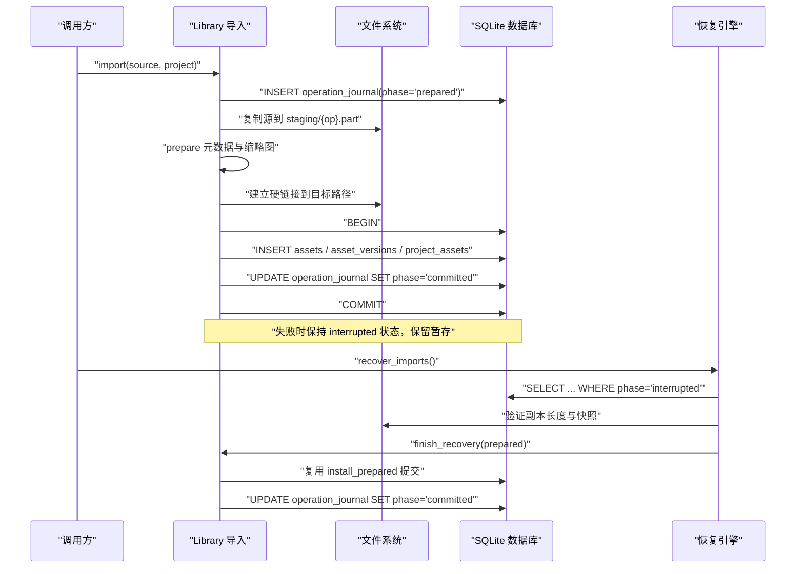
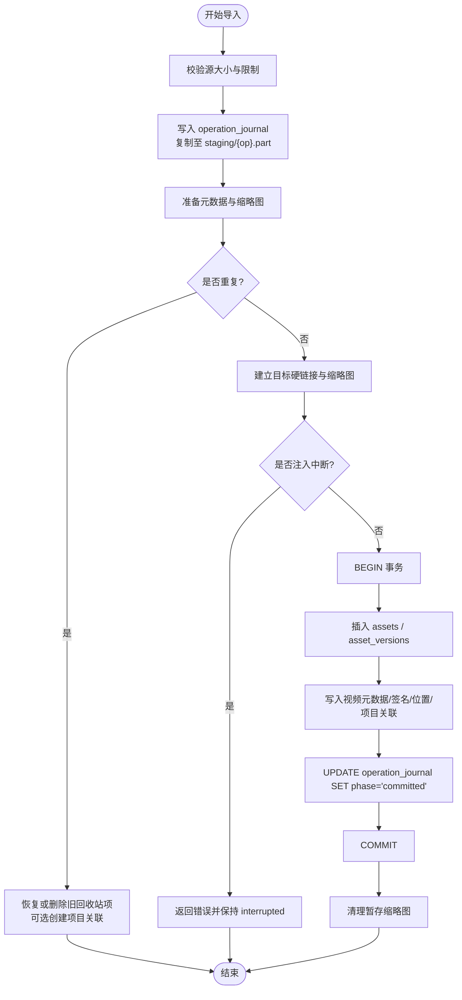
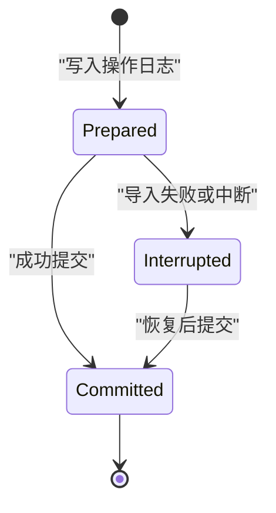
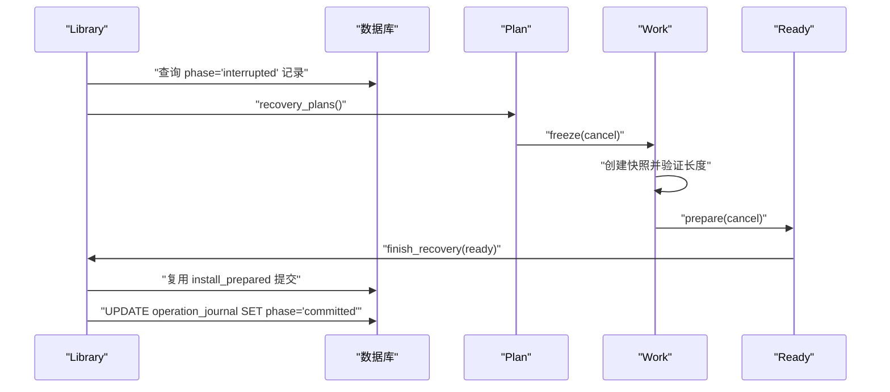
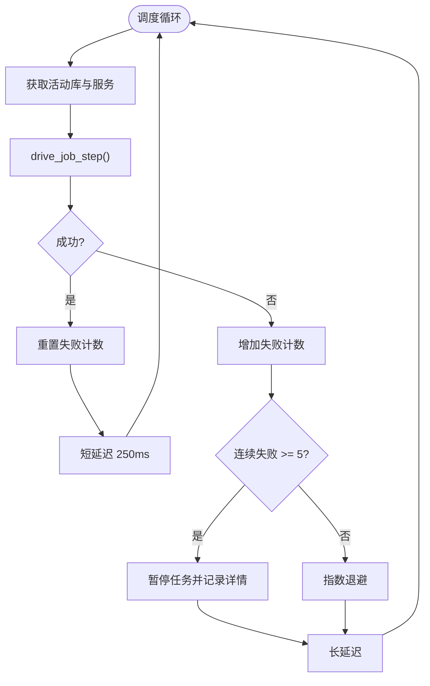
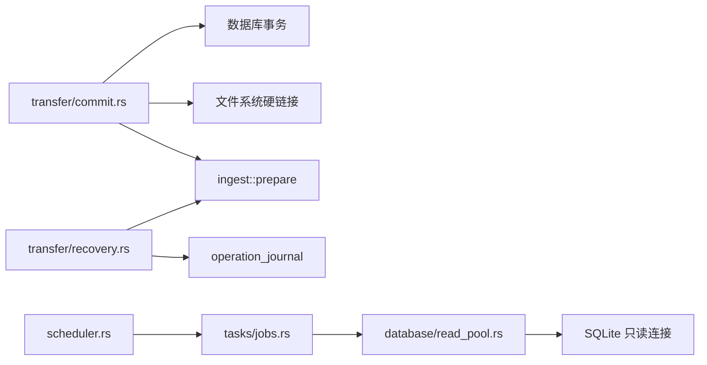
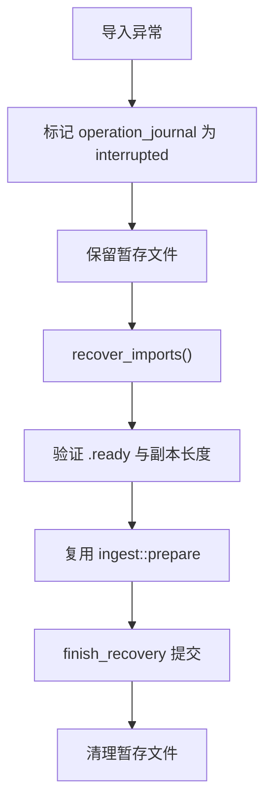

# 提交事务（Commit Transactions）

> Repo Wiki 节点 `commit-transactions`
> 导出自 Qoder 知识库快照 `8fbe02f6-57c2-4874-b725-1a8130851fd9`，代码基线 `7a7a8e75e18bd90294e09cd422dd7ed5a04813a0`（分支 main，zh-CN）。

<cite>
**本文引用的文件**   
- [commit.rs](../../../../crates/moriq-library/src/transfer/commit.rs)
- [recovery.rs](../../../../crates/moriq-library/src/transfer/recovery.rs)
- [journal.rs](../../../../crates/moriq-library/src/database/journal.rs)
- [read_pool.rs](../../../../crates/moriq-library/src/database/read_pool.rs)
- [schema.sql](../../../../crates/moriq-library/src/database/schema.sql)
- [jobs.rs](../../../../crates/moriq-library/src/tasks/jobs.rs)
- [scheduler.rs](../../../../crates/moriq-app/src/scheduler.rs)
- [lifecycle.rs](../../../../crates/moriq-library/src/library/lifecycle.rs)
- [recovery_tests.rs](../../../../crates/moriq-library/src/transfer/recovery_tests.rs)
- [tests.rs](../../../../crates/moriq-app/src/tests.rs)
</cite>

## 目录
1. [引言](#引言)
2. [项目结构](#项目结构)
3. [核心组件](#核心组件)
4. [架构总览](#架构总览)
5. [详细组件分析](#详细组件分析)
6. [依赖关系分析](#依赖关系分析)
7. [性能与并发特性](#性能与并发特性)
8. [故障恢复与回滚机制](#故障恢复与回滚机制)
9. [事务设计最佳实践](#事务设计最佳实践)
10. [测试与基准方法](#测试与基准方法)
11. [结论](#结论)

## 引言
本文件系统性说明 Moriq Space 的“提交事务”体系，围绕媒体导入、版本安装、操作日志和后台任务等关键路径展开。重点覆盖：
- 原子操作的实现机制，包括数据库事务与暂存文件的协同。
- 回滚与异常处理策略，以及未完成任务的恢复流程。
- 状态恢复系统，包括崩溃后修复、未完成导入重试和脏数据清理。
- 隔离级别、并发控制、锁策略与死锁相关考量。
- 事务粒度划分、嵌套事务处理和长事务优化建议。
- 故障注入、一致性验证与性能基准测试方法。

## 项目结构
与提交事务直接相关的代码分布在以下模块：
- 传输层：`transfer/commit.rs`、`transfer/recovery.rs`
- 数据库层：`database/journal.rs`、`database/read_pool.rs`、`database/schema.sql`
- 任务调度：`tasks/jobs.rs`、应用层 `scheduler.rs`
- 资源库生命周期：`library/lifecycle.rs`
- 测试用例：`transfer/recovery_tests.rs`、`app/tests.rs`

**图表来源**
- [commit.rs:25-120](../../../../crates/moriq-library/src/transfer/commit.rs#L25-L120)
- [commit.rs:201-293](../../../../crates/moriq-library/src/transfer/commit.rs#L201-L293)
- [recovery.rs:1-120](../../../../crates/moriq-library/src/transfer/recovery.rs#L1-L120)
- [schema.sql:1-42](../../../../crates/moriq-library/src/database/schema.sql#L1-L42)
- [jobs.rs:1-60](../../../../crates/moriq-library/src/tasks/jobs.rs#L1-L60)
- [scheduler.rs:1-120](../../../../crates/moriq-app/src/scheduler.rs#L1-L120)
- [read_pool.rs:1-97](../../../../crates/moriq-library/src/database/read_pool.rs#L1-L97)

**章节来源**
- [commit.rs:25-120](../../../../crates/moriq-library/src/transfer/commit.rs#L25-L120)
- [commit.rs:201-293](../../../../crates/moriq-library/src/transfer/commit.rs#L201-L293)
- [recovery.rs:1-120](../../../../crates/moriq-library/src/transfer/recovery.rs#L1-L120)
- [schema.sql:1-42](../../../../crates/moriq-library/src/database/schema.sql#L1-L42)
- [jobs.rs:1-60](../../../../crates/moriq-library/src/tasks/jobs.rs#L1-L60)
- [scheduler.rs:1-120](../../../../crates/moriq-app/src/scheduler.rs#L1-L120)
- [read_pool.rs:1-97](../../../../crates/moriq-library/src/database/read_pool.rs#L1-L97)

## 核心组件
- 导入与提交流水线：负责校验输入、复制至暂存、生成缩略图、检测重复、建立硬链接并写入数据库事务。
- 操作日志表：以 `prepared`、`committed`、`interrupted` 三态驱动恢复与清理。
- 恢复引擎：从中断的操作中重建工作，完成不可变媒体的预检查，最终复用已准备的介质提交事务。
- 只读连接池：为媒体线程提供冻结版本的只读访问，自动回滚遗留事务并清理临时表。
- 任务调度器：独立线程驱动后台任务，使用取消令牌和预算限制，失败时指数退避或暂停任务。

**章节来源**
- [commit.rs:25-120](../../../../crates/moriq-library/src/transfer/commit.rs#L25-L120)
- [commit.rs:201-293](../../../../crates/moriq-library/src/transfer/commit.rs#L201-L293)
- [recovery.rs:1-120](../../../../crates/moriq-library/src/transfer/recovery.rs#L1-L120)
- [read_pool.rs:1-97](../../../../crates/moriq-library/src/database/read_pool.rs#L1-L97)
- [scheduler.rs:1-120](../../../../crates/moriq-app/src/scheduler.rs#L1-L120)

## 架构总览
Moriq Space 的提交事务采用“日志驱动 + 事务提交”的两阶段设计：先通过 `operation_journal` 和暂存文件记录中间状态，再在数据库事务内完成所有持久化更新。这样即使进程崩溃，也能通过恢复流程继续完成提交。

**图表来源**
- [commit.rs:25-120](../../../../crates/moriq-library/src/transfer/commit.rs#L25-L120)
- [commit.rs:201-293](../../../../crates/moriq-library/src/transfer/commit.rs#L201-L293)
- [recovery.rs:1-120](../../../../crates/moriq-library/src/transfer/recovery.rs#L1-L120)
- [recovery.rs:201-229](../../../../crates/moriq-library/src/transfer/recovery.rs#L201-L229)

**章节来源**
- [commit.rs:25-120](../../../../crates/moriq-library/src/transfer/commit.rs#L25-L120)
- [commit.rs:201-293](../../../../crates/moriq-library/src/transfer/commit.rs#L201-L293)
- [recovery.rs:1-120](../../../../crates/moriq-library/src/transfer/recovery.rs#L1-L120)
- [recovery.rs:201-229](../../../../crates/moriq-library/src/transfer/recovery.rs#L201-L229)

## 详细组件分析

### 导入与提交流水线
导入过程分为三个阶段：
1. 输入校验与暂存：检查文件大小、创建唯一操作 ID、写入 `operation_journal` 初始状态。
2. 准备与安装：计算哈希、生成缩略图、检测重复素材；对非引用媒体建立硬链接，避免额外拷贝。
3. 事务提交：在单个数据库事务中插入资产、版本、视频元数据、相似签名、项目关联，并将操作日志标记为 `committed`。

关键特点：
- 重复内容检测基于 SHA256、字节数和项目范围，避免跨项目误判。
- 硬链接安装发生在事务之前，但事务失败会保留 `interrupted` 状态，由恢复流程接管。
- 引用源路径不会复制到本地，而是记录平台编码后的原始路径，并在提交前再次校验哈希。

**图表来源**
- [commit.rs:25-120](../../../../crates/moriq-library/src/transfer/commit.rs#L25-L120)
- [commit.rs:201-293](../../../../crates/moriq-library/src/transfer/commit.rs#L201-L293)

**章节来源**
- [commit.rs:25-120](../../../../crates/moriq-library/src/transfer/commit.rs#L25-L120)
- [commit.rs:201-293](../../../../crates/moriq-library/src/transfer/commit.rs#L201-L293)

### 操作日志与状态机
`operation_journal` 维护导入操作的三态：
- `prepared`：已记录操作，尚未进入完整安装。
- `committed`：已成功提交。
- `interrupted`：导入被中断或失败，等待恢复。

该状态机保证：
- 正常成功路径将状态推进到 `committed`。
- 异常路径将状态标记为 `interrupted`，同时保留用户源文件和暂存副本。
- 恢复流程仅处理 `interrupted` 记录，并通过 `recovery_plans` 暴露可恢复工作。

**图表来源**
- [schema.sql:35-42](../../../../crates/moriq-library/src/database/schema.sql#L35-L42)
- [commit.rs:25-120](../../../../crates/moriq-library/src/transfer/commit.rs#L25-L120)
- [recovery.rs:1-60](../../../../crates/moriq-library/src/transfer/recovery.rs#L1-L60)

**章节来源**
- [schema.sql:35-42](../../../../crates/moriq-library/src/database/schema.sql#L35-L42)
- [commit.rs:25-120](../../../../crates/moriq-library/src/transfer/commit.rs#L25-L120)
- [recovery.rs:1-60](../../../../crates/moriq-library/src/transfer/recovery.rs#L1-L60)

### 恢复引擎与未完成任务重新执行
恢复流程由 `Plan`、`Work`、`Ready` 三个对象组成：
- `Plan`：从数据库中读取中断记录，包含操作 ID、路径、平台、源、项目范围和引用标志。
- `Work`：冻结输入，创建硬链接快照，验证 `.ready` 收据中的预期大小。
- `Ready`：调用 `ingest::prepare` 生成已准备的介质结果，并可选择性验证外部引用源的哈希。

恢复提交步骤：
1. 校验当前记录是否与冻结计划一致，防止旧结果污染新会话。
2. 复用 `install_prepared` 完成资产与版本写入。
3. 将操作日志标记为 `committed`，并清理残留的暂存文件。

**图表来源**
- [recovery.rs:1-120](../../../../crates/moriq-library/src/transfer/recovery.rs#L1-L120)
- [recovery.rs:201-229](../../../../crates/moriq-library/src/transfer/recovery.rs#L201-L229)

**章节来源**
- [recovery.rs:1-120](../../../../crates/moriq-library/src/transfer/recovery.rs#L1-L120)
- [recovery.rs:201-229](../../../../crates/moriq-library/src/transfer/recovery.rs#L201-L229)

### 只读连接池与媒体读取隔离
`ReadPool` 为媒体线程提供只读连接，确保读取端不阻塞写入端：
- 连接池最多缓存 4 个只读连接。
- 首次借用时设置 SQLite 参数：`cache_size=-8192`、`temp_store=FILE`、`temp.cache_size=-2048`。
- `busy_timeout` 设置为 5 秒，降低短暂竞争导致的失败。
- `Drop` 实现自动回滚未提交事务，并清理临时表，然后归还连接。

这种设计避免了长时间媒体解码持有写锁，提升并发稳定性。

**章节来源**
- [read_pool.rs:1-97](../../../../crates/moriq-library/src/database/read_pool.rs#L1-L97)

### 后台任务调度与失败恢复
应用层调度器使用独立线程运行任务，关键点：
- 使用弱引用队列，服务释放后停止调度，避免悬挂任务。
- 失败次数达到阈值时暂停任务，避免持续失败导致抖动。
- 使用指数退避延迟重试，上限 30 秒。
- 支持任务取消令牌，取消后仍保留检查点，允许后续恢复。

**图表来源**
- [scheduler.rs:1-120](../../../../crates/moriq-app/src/scheduler.rs#L1-L120)

**章节来源**
- [scheduler.rs:1-120](../../../../crates/moriq-app/src/scheduler.rs#L1-L120)
- [jobs.rs:1-60](../../../../crates/moriq-library/src/tasks/jobs.rs#L1-L60)

## 依赖关系分析
提交事务的核心依赖如下：
- `transfer/commit.rs` 依赖数据库事务、文件系统硬链接、`ingest` 准备流程和 `metadata` 存储。
- `transfer/recovery.rs` 依赖 `operation_journal`、`ingest::prepare` 和 `organize` 路径编解码。
- `database/read_pool.rs` 依赖 SQLite 只读连接和临时表清理逻辑。
- `tasks/jobs.rs` 依赖 `read_pool`、媒体源、取消作用域和推理工作封装。
- `scheduler.rs` 依赖 `Service`、内存预算、任务槽位和取消管理器。

**图表来源**
- [commit.rs:25-120](../../../../crates/moriq-library/src/transfer/commit.rs#L25-L120)
- [recovery.rs:1-120](../../../../crates/moriq-library/src/transfer/recovery.rs#L1-L120)
- [read_pool.rs:1-97](../../../../crates/moriq-library/src/database/read_pool.rs#L1-L97)
- [jobs.rs:1-60](../../../../crates/moriq-library/src/tasks/jobs.rs#L1-L60)
- [scheduler.rs:1-120](../../../../crates/moriq-app/src/scheduler.rs#L1-L120)

**章节来源**
- [commit.rs:25-120](../../../../crates/moriq-library/src/transfer/commit.rs#L25-L120)
- [recovery.rs:1-120](../../../../crates/moriq-library/src/transfer/recovery.rs#L1-L120)
- [read_pool.rs:1-97](../../../../crates/moriq-library/src/database/read_pool.rs#L1-L97)
- [jobs.rs:1-60](../../../../crates/moriq-library/src/tasks/jobs.rs#L1-L60)
- [scheduler.rs:1-120](../../../../crates/moriq-app/src/scheduler.rs#L1-L120)

## 性能与并发特性
- 只读连接池减少媒体读取对写入端的干扰，提高导入与浏览并发能力。
- 硬链接安装避免重复拷贝，降低磁盘 I/O 压力。
- 重复检测基于哈希和字节数，快速跳过相同内容。
- 恢复流程复用已准备的介质，避免重复解码。
- 调度器使用固定工作线程和指数退避，避免风暴式重试。

潜在优化点：
- 大事务可考虑拆分写热点，例如将视频元数据与主版本写入分步处理，但需保持操作日志一致性。
- 连接池大小可根据并发导入量调整，注意 SQLite 只读连接数量上限。
- 对于长事务，建议在 UI 层面展示进度，并允许取消准备阶段而非提交阶段。

[本节为一般性性能讨论，不直接分析具体文件]

## 故障恢复与回滚机制

### 异常捕获与状态保存
导入失败时：
- 操作日志状态更新为 `interrupted`。
- 暂存文件保留，供恢复流程使用。
- 用户源文件不会被删除。

恢复流程：
- 查询 `interrupted` 记录，构造 `Plan`。
- 验证 `.ready` 收据和副本长度。
- 调用 `finish_recovery` 复用 `install_prepared` 提交。
- 成功后清理暂存文件并清除快照。

**图表来源**
- [commit.rs:25-120](../../../../crates/moriq-library/src/transfer/commit.rs#L25-L120)
- [recovery.rs:1-120](../../../../crates/moriq-library/src/transfer/recovery.rs#L1-L120)
- [recovery.rs:201-229](../../../../crates/moriq-library/src/transfer/recovery.rs#L201-L229)

**章节来源**
- [commit.rs:25-120](../../../../crates/moriq-library/src/transfer/commit.rs#L25-L120)
- [recovery.rs:1-120](../../../../crates/moriq-library/src/transfer/recovery.rs#L1-L120)
- [recovery.rs:201-229](../../../../crates/moriq-library/src/transfer/recovery.rs#L201-L229)

### 崩溃后数据修复与脏数据清理
- 若恢复记录发生变化，恢复会被拒绝，防止旧结果污染新会话。
- 引用源哈希不一致时，恢复失败并保留恢复副本，提示手动重新导入。
- 恢复期间创建的快照位于 `backups/.recovery-*` 目录，仅在成功完成后清理。
- 暂存文件清理失败会记录警告，但不阻止整体流程。

**章节来源**
- [recovery.rs:1-120](../../../../crates/moriq-library/src/transfer/recovery.rs#L1-L120)
- [recovery.rs:201-229](../../../../crates/moriq-library/src/transfer/recovery.rs#L201-L229)

### 事务隔离级别与并发控制
- SQLite 默认使用较弱的隔离级别，适合单进程桌面应用；通过只读连接池和 `busy_timeout` 缓解竞争。
- 外键约束启用，保证资产与版本关系的完整性。
- 无显式全局锁，主要依赖 SQLite 行级锁和连接级锁。
- 死锁检测由 SQLite 内部处理；若发生，上层应重试或降级。

建议：
- 避免在导入事务中进行耗时外部 IO。
- 将媒体解码和推理放入后台任务，提交阶段仅做轻量数据库写入。
- 使用操作日志状态作为分布式或进程间协调信号。

**章节来源**
- [schema.sql:1-42](../../../../crates/moriq-library/src/database/schema.sql#L1-L42)
- [read_pool.rs:1-97](../../../../crates/moriq-library/src/database/read_pool.rs#L1-L97)

## 事务设计最佳实践

### 事务粒度划分
- 导入事务应涵盖资产、版本、项目关联和操作日志更新。
- 元数据扩展字段（视频元数据、签名、位置）应纳入同一事务，保证一致性。
- 长任务（如 AI 推理）不应放在导入事务中，应拆分为后台任务。

### 嵌套事务处理
- SQLite 不支持真正的嵌套事务，建议使用外层事务包裹多个子操作。
- 若子操作可能失败，应在子函数内捕获错误并返回明确状态，由外层决定回滚。

### 长事务优化
- 避免在事务中执行网络请求、模型推理或大量文件扫描。
- 将预处理（哈希、缩略图、元数据提取）放在事务外。
- 使用操作日志状态机分段推进，便于恢复。

### 一致性保证
- 使用外键约束和唯一索引防止重复版本。
- 通过 `sha256` 和 `bytes` 联合判断重复内容。
- 引用源路径变更时需重新校验哈希。

**章节来源**
- [commit.rs:201-293](../../../../crates/moriq-library/src/transfer/commit.rs#L201-L293)
- [schema.sql:1-42](../../../../crates/moriq-library/src/database/schema.sql#L1-L42)

## 测试与基准方法

### 故障注入测试
- 在 `install_prepared` 中注入中断，验证状态保持为 `interrupted` 且暂存文件存在。
- 修改 `import_context.relative_path`，验证恢复被拒绝。
- 替换引用源文件内容，验证恢复失败并保留原片。

参考测试：
- [recovery_tests.rs:1-70](../../../../crates/moriq-library/src/transfer/recovery_tests.rs#L1-L70)
- [commit.rs:201-293](../../../../crates/moriq-library/src/transfer/commit.rs#L201-L293)

### 数据一致性验证
- 验证导入后 `assets`、`asset_versions`、`project_assets` 与 `operation_journal` 状态一致。
- 验证备份恢复后名称、描述、项目访问时间和活动记录保持不变。
- 验证通知分页和已读截止位置不消费未来条目。

参考测试：
- [journal.rs:201-316](../../../../crates/moriq-library/src/database/journal.rs#L201-L316)

### 性能基准测试
- 并发 JPEG 导入：验证 10 个工人在 1 GiB 内存预算下并行运行，峰值并发大于 1 且不大于 10。
- 预览缓存命中：验证小交互预算下缓存命中，损坏缓存时升级预算并重试。
- 媒体读取隔离：验证阻塞媒体读取不占用写入端，取消后释放库租约。

参考测试：
- [tests.rs:201-400](../../../../crates/moriq-app/src/tests.rs#L201-L400)

**章节来源**
- [recovery_tests.rs:1-70](../../../../crates/moriq-library/src/transfer/recovery_tests.rs#L1-L70)
- [journal.rs:201-316](../../../../crates/moriq-library/src/database/journal.rs#L201-L316)
- [tests.rs:201-400](../../../../crates/moriq-app/src/tests.rs#L201-L400)

## 结论
Moriq Space 的提交事务系统通过操作日志、暂存文件、只读连接池和后台任务调度，实现了高可靠、可恢复的媒体导入与版本管理。其核心优势在于：
- 两阶段提交确保原子性和一致性。
- 恢复引擎支持崩溃后自动修复和未完成任务重跑。
- 只读连接池隔离媒体读取，提升并发稳定性。
- 调度器具备失败暂停、指数退避和取消支持。

未来可在事务粒度、连接池规模和长任务拆分方面进一步优化，以适配更大规模媒体库和高并发场景。

[本节为总结性内容，不直接分析具体文件]