# 摄取机制 (Ingest Mechanism)

> Repo Wiki 节点 `ingest-mechanism`
> 导出自 Qoder 知识库快照 `8fbe02f6-57c2-4874-b725-1a8130851fd9`，代码基线 `7a7a8e75e18bd90294e09cd422dd7ed5a04813a0`（分支 main，zh-CN）。

<cite>
**本文引用的文件**   
- [ingest.rs](../../../../crates/moriq-library/src/transfer/ingest.rs)
- [commit.rs](../../../../crates/moriq-library/src/transfer/commit.rs)
- [recovery.rs](../../../../crates/moriq-library/src/transfer/recovery.rs)
- [import.rs](../../../../crates/moriq-library/src/transfer/import.rs)
- [export.rs](../../../../crates/moriq-library/src/transfer/export.rs)
- [synco.rs](../../../../crates/moriq-library/src/transfer/synco.rs)
- [scan.rs](../../../../crates/moriq-app/src/scan.rs)
- [jobs.rs](../../../../crates/moriq-library/src/tasks/jobs.rs)
- [jobs.rs](../../../../crates/moriq-app/src/jobs.rs)
- [scheduler.rs](../../../../crates/moriq-app/src/scheduler.rs)
</cite>

## 目录
1. [引言](#引言)
2. [项目结构与职责划分](#项目结构与职责划分)
3. [核心组件总览](#核心组件总览)
4. [架构概览](#架构概览)
5. [增量同步与差异计算](#增量同步与差异计算)
6. [冲突解决算法](#冲突解决算法)
7. [数据一致性与事务边界](#数据一致性与事务边界)
8. [任务调度、队列与资源限制](#任务调度队列与资源限制)
9. [摄取工作流配置示例](#摄取工作流配置示例)
10. [性能优化与大数据集处理经验](#性能优化与大数据集处理经验)
11. [故障排查指南](#故障排查指南)
12. [结论](#结论)

## 引言
本文件面向 Moriq Space 的“摄取机制”，即从外部文件或已导入素材进入库内版本体系、生成缩略图与元数据、建立项目关联，并在后台完成分析或导出等后续处理的完整流程。文档重点覆盖：

- 增量同步：扫描输入、复制暂存、哈希去重、差异识别和增量安装。
- 冲突解决：重复内容处理、同名路径策略、Synco 结果冲突校验。
- 一致性保证：操作日志、暂存回执、硬链接提交、SQLite 事务及恢复协议。
- 任务调度：后台任务登记、优先级、内存与并发限制、取消与重试。
- 配置与实践：同步规则、排除模式、触发条件、缓存与大图处理建议。

## 项目结构与职责划分
Moriq Space 的摄取相关代码主要分布在 `moriq-library` 的传输层和 `moriq-app` 的应用层：

| 模块 | 主要职责 | 关键文件 |
|---|---|---|
| 媒体准备与票据 | 创建导入票据、复制暂存、解码缩略图、估算内存、生成哈希与签名 | `crates/moriq-library/src/transfer/ingest.rs` |
| 安装与提交 | 查重、选择目标路径、硬链接安装、写入资产与版本表、更新操作日志 | `crates/moriq-library/src/transfer/commit.rs` |
| 恢复协议 | 查找中断操作、冻结原片、在工作者上重新解码并安全提交 | `crates/moriq-library/src/transfer/recovery.rs` |
| 受管布局与去重 | 解析项目、生成安全相对路径、避免覆盖、同内容多项目关联 | `crates/moriq-library/src/transfer/import.rs` |
| 导出 | 冻结导出计划、转换图像、保留 EXIF、输出目录结构 | `crates/moriq-library/src/transfer/export.rs` |
| Synco 交接 | 发送待编辑图片、接收远端结果、版本链、ACK 清理、冲突校验 | `crates/moriq-library/src/transfer/synco.rs` |
| 扫描器 | 深度优先遍历输入、跳过符号链接与库内部路径、流式发射导入项 | `crates/moriq-app/src/scan.rs` |
| 后台任务执行 | 任务类型判断、模型推理包装、失败记录、按项重试 | `crates/moriq-library/src/tasks/jobs.rs` |
| 应用任务服务 | 队列入口、取消信号、内存许可、驱动工作步骤 | `crates/moriq-app/src/jobs.rs` |
| 调度线程 | 弱引用服务、错误退避、暂停后自动停止调度 | `crates/moriq-app/src/scheduler.rs` |

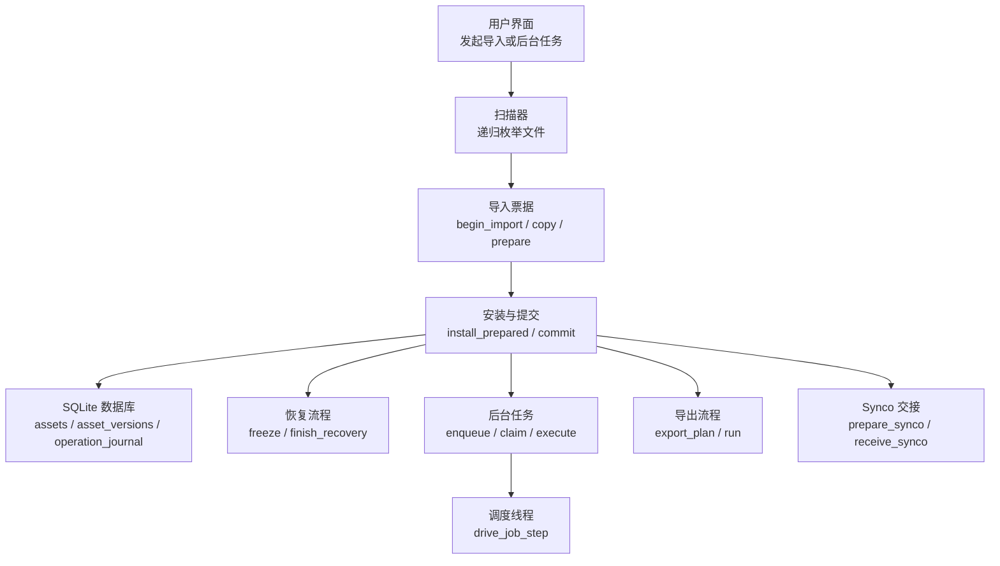

**图表来源**
- [scan.rs:1-137](../../../../crates/moriq-app/src/scan.rs#L1-L137)
- [ingest.rs:1-442](../../../../crates/moriq-library/src/transfer/ingest.rs#L1-L442)
- [commit.rs:1-293](../../../../crates/moriq-library/src/transfer/commit.rs#L1-L293)
- [recovery.rs:1-229](../../../../crates/moriq-library/src/transfer/recovery.rs#L1-L229)
- [jobs.rs:1-960](../../../../crates/moriq-library/src/tasks/jobs.rs#L1-L960)
- [jobs.rs:1-175](../../../../crates/moriq-app/src/jobs.rs#L1-L175)
- [scheduler.rs:1-283](../../../../crates/moriq-app/src/scheduler.rs#L1-L283)
- [export.rs:1-422](../../../../crates/moriq-library/src/transfer/export.rs#L1-L422)
- [synco.rs:1-595](../../../../crates/moriq-library/src/transfer/synco.rs#L1-L595)

**章节来源**
- [scan.rs:1-137](../../../../crates/moriq-app/src/scan.rs#L1-L137)
- [ingest.rs:1-442](../../../../crates/moriq-library/src/transfer/ingest.rs#L1-L442)
- [commit.rs:1-293](../../../../crates/moriq-library/src/transfer/commit.rs#L1-L293)
- [recovery.rs:1-229](../../../../crates/moriq-library/src/transfer/recovery.rs#L1-L229)
- [import.rs:1-352](../../../../crates/moriq-library/src/transfer/import.rs#L1-L352)
- [export.rs:1-422](../../../../crates/moriq-library/src/transfer/export.rs#L1-L422)
- [synco.rs:1-595](../../../../crates/moriq-library/src/transfer/synco.rs#L1-L595)
- [jobs.rs:1-960](../../../../crates/moriq-library/src/tasks/jobs.rs#L1-L960)
- [jobs.rs:1-175](../../../../crates/moriq-app/src/jobs.rs#L1-L175)
- [scheduler.rs:1-283](../../../../crates/moriq-app/src/scheduler.rs#L1-L283)

## 核心组件总览
摄取机制的核心是“票据 + 暂存 + 安装 + 日志”四段式结构：

1. **票据阶段**：校验源文件长度、编码平台与源路径、记录 `operation_journal` 和 `import_context`，返回跨线程可克隆的票据对象。
2. **暂存阶段**：分块复制源文件到 `staging/{operation}.part`，写入字节回执 `staging/{operation}.ready`，支持取消标志。
3. **准备阶段**：解码缩略图、计算哈希、提取元数据、视频信息、相似性签名，并估算内存预算。
4. **安装阶段**：查重、选择受管路径、硬链接安装媒体与缩略图、写入资产与版本表、维护项目关联、提交操作日志。

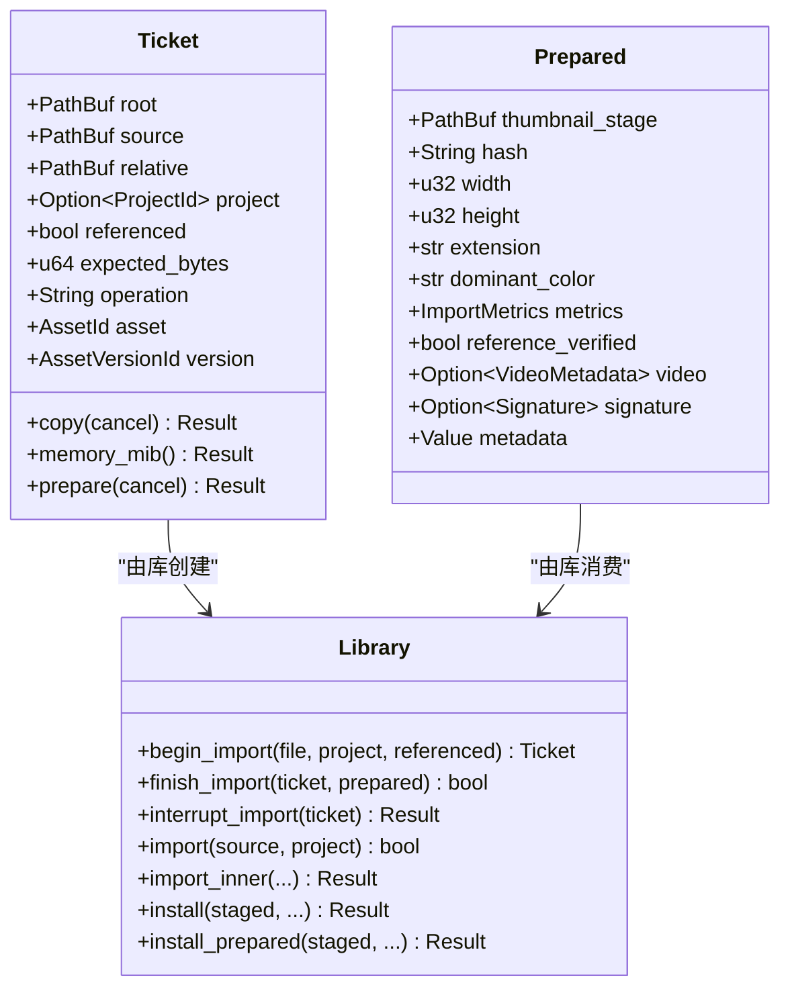

**图表来源**
- [ingest.rs:1-442](../../../../crates/moriq-library/src/transfer/ingest.rs#L1-L442)
- [commit.rs:1-293](../../../../crates/moriq-library/src/transfer/commit.rs#L1-L293)

**章节来源**
- [ingest.rs:1-442](../../../../crates/moriq-library/src/transfer/ingest.rs#L1-L442)
- [commit.rs:1-293](../../../../crates/moriq-library/src/transfer/commit.rs#L1-L293)

## 架构概览
下图展示一次典型导入的生命周期，以及它与恢复、后台任务和 Synco 的关系：

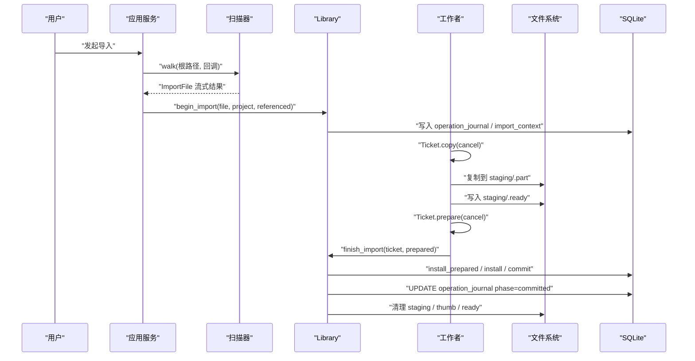

**图表来源**
- [scan.rs:1-137](../../../../crates/moriq-app/src/scan.rs#L1-L137)
- [ingest.rs:1-442](../../../../crates/moriq-library/src/transfer/ingest.rs#L1-L442)
- [commit.rs:1-293](../../../../crates/moriq-library/src/transfer/commit.rs#L1-L293)

**章节来源**
- [scan.rs:1-137](../../../../crates/moriq-app/src/scan.rs#L1-L137)
- [ingest.rs:1-442](../../../../crates/moriq-library/src/transfer/ingest.rs#L1-L442)
- [commit.rs:1-293](../../../../crates/moriq-library/src/transfer/commit.rs#L1-L293)

## 增量同步与差异计算
### 文件变更检测
增量同步的第一步是“扫描”。扫描器以深度优先方式遍历显式来源，具有以下行为：

- 跳过符号链接。
- 拒绝将资源库内部路径再次作为导入来源。
- 跳过 `.moriq` 扩展名目录。
- 仅传递系统支持的媒体文件。
- 通过有界通道流式调用回调，避免一次性加载整个目录树。
- 支持原子布尔取消标志，防止长时间扫描阻塞。

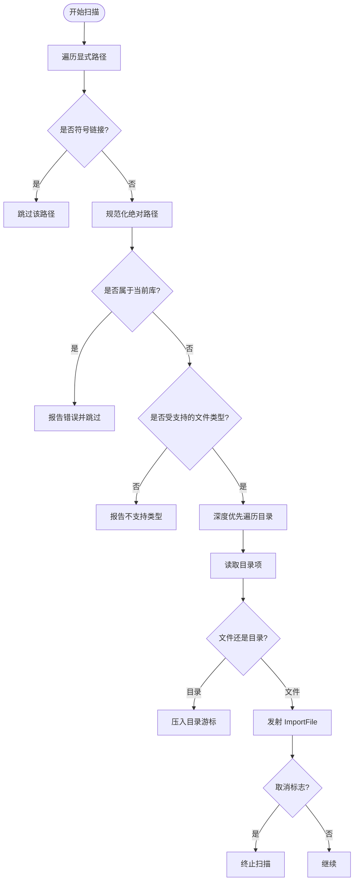

**图表来源**
- [scan.rs:1-137](../../../../crates/moriq-app/src/scan.rs#L1-L137)

**章节来源**
- [scan.rs:1-137](../../../../crates/moriq-app/src/scan.rs#L1-L137)

### 差异计算
差异计算并不依赖传统 Git 风格的 diff，而是基于“内容指纹 + 大小 + 项目范围”的语义去重：

1. **哈希去重**：对暂存文件计算 SHA-256。
2. **大小校验**：结合文件大小，避免不同内容恰好产生相同哈希。
3. **项目范围过滤**：查重查询考虑目标项目是否为空；如果指定项目为空，则只考虑未加入任何项目的资产，避免把公共原片误判为项目内重复。
4. **引用模式区分**：引用导入不复制媒体，而是记录原始位置，因此查重逻辑与普通导入不同。
5. **重复内容多项目关联**：若内容重复但需要出现在多个项目中，会创建独立的项目文件关联，而不是覆盖已有版本。

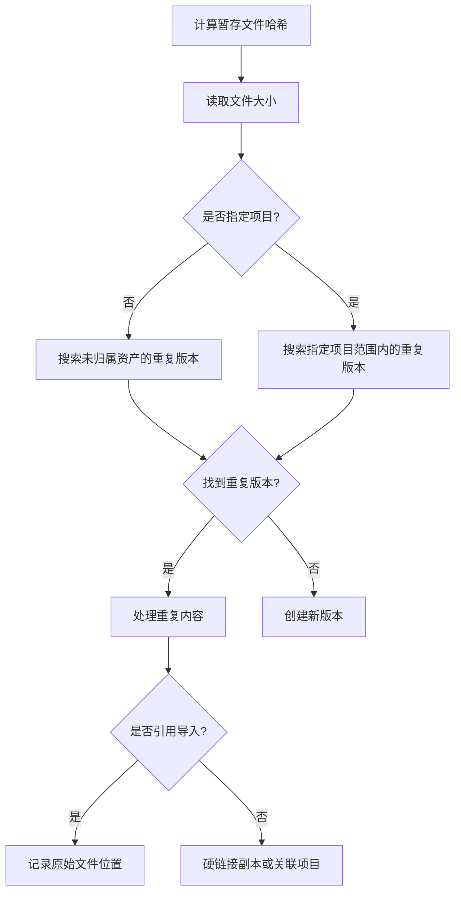

**图表来源**
- [commit.rs:1-293](../../../../crates/moriq-library/src/transfer/commit.rs#L1-L293)
- [import.rs:1-352](../../../../crates/moriq-library/src/transfer/import.rs#L1-L352)

**章节来源**
- [commit.rs:1-293](../../../../crates/moriq-library/src/transfer/commit.rs#L1-L293)
- [import.rs:1-352](../../../../crates/moriq-library/src/transfer/import.rs#L1-L352)

### 增量更新策略
增量更新策略的核心是“幂等 + 可恢复 + 最小写放大”：

- 使用 `operation_id` 标识一次导入生命周期。
- 先写 `operation_journal`，再写 `import_context`，形成恢复线索。
- 使用 `staging/{operation}.ready` 回执标记复制完成，避免恢复流程处理尚未写完的副本。
- 正常提交时删除 `.part`、`.ready`、`.thumb`。
- 异常或中断时保留暂存副本，并将操作标记为 `interrupted`，供恢复流程重建。
- 引用导入会在最终提交前再次校验原始源文件哈希，确保远程或共享源未被替换。

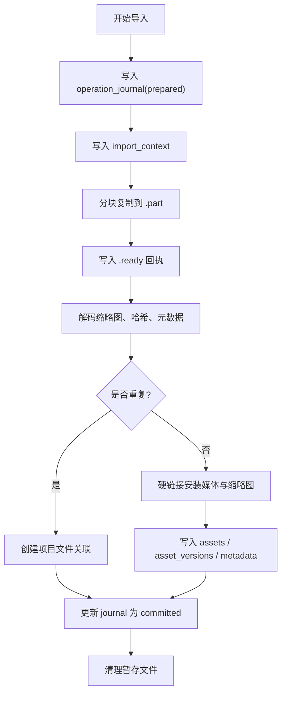

**图表来源**
- [commit.rs:1-293](../../../../crates/moriq-library/src/transfer/commit.rs#L1-L293)
- [ingest.rs:1-442](../../../../crates/moriq-library/src/transfer/ingest.rs#L1-L442)

**章节来源**
- [commit.rs:1-293](../../../../crates/moriq-library/src/transfer/commit.rs#L1-L293)
- [ingest.rs:1-442](../../../../crates/moriq-library/src/transfer/ingest.rs#L1-L442)

## 冲突解决算法
### 时间戳比较
当前代码并未实现“以时间戳决定谁覆盖谁”的通用冲突算法。摄入侧更倾向于“内容指纹 + 路径安全 + 项目归属”的确定性策略：

- 普通导入不会覆盖已有受管路径。
- 同名文件通过递增后缀避免覆盖。
- 重复内容可在多个项目中存在，但资产本身仍唯一。
- 恢复流程要求恢复记录完全匹配，否则拒绝提交，防止旧结果覆盖新状态。

### 内容优先级
内容优先级主要体现在以下场景：

1. **重复内容去重**：同一哈希+大小命中现有版本时，优先复用已有版本，避免冗余存储。
2. **项目文件关联**：当重复内容需要出现在多个项目时，通过 `project_files` 建立独立关联，而不是复制媒体。
3. **引用导入**：引用导入不复制媒体，而是记录原始位置；若原始源发生变化，则在提交阶段报错，阻止不一致状态入库。
4. **Synco 回传结果**：收到远端编辑结果后，会创建新的 `asset_versions` 版本，并通过 `parent_version_id` 构建版本链；显示版本可切换，但历史版本不被删除。

### 手动冲突处理界面
Synco 提供了较完整的“人工介入点”：

- 客户端可以准备 Synco 任务，生成受管副本并登记 `queued` 状态。
- 远端处理后返回状态，本地通过 `receive_synco` 校验结果、写入新版本、生成 ACK。
- 如果同一任务返回不同结果，会报“冲突结果”错误。
- 如果任务已完成或已被确认交付，再次投递会被忽略或拒绝。
- 用户可以查看任务状态、错误信息、失败项，并基于失败项创建重试任务。

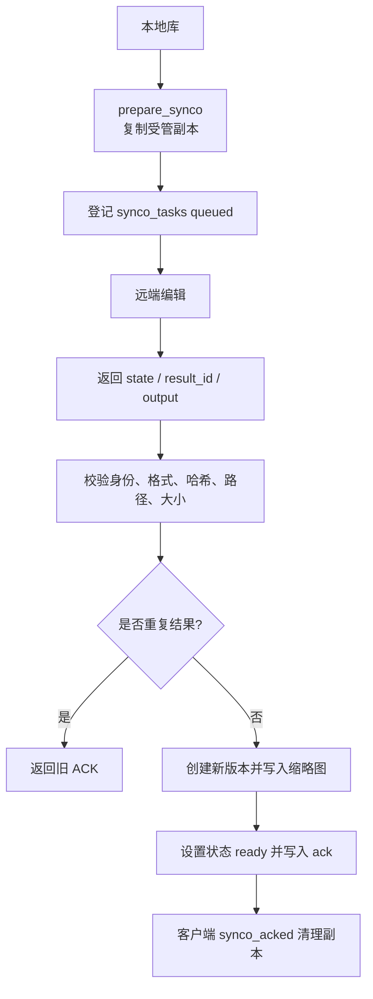

**图表来源**
- [synco.rs:1-595](../../../../crates/moriq-library/src/transfer/synco.rs#L1-L595)

**章节来源**
- [synco.rs:1-595](../../../../crates/moriq-library/src/transfer/synco.rs#L1-L595)
- [commit.rs:1-293](../../../../crates/moriq-library/src/transfer/commit.rs#L1-L293)
- [import.rs:1-352](../../../../crates/moriq-library/src/transfer/import.rs#L1-L352)

## 数据一致性与事务边界
### 事务边界定义
摄取过程的事务边界分为三层：

1. **票据登记事务**：`begin_import` 中插入 `operation_journal` 和 `import_context`，保证即使后续工作崩溃，也能找到恢复线索。
2. **安装提交事务**：`install_prepared` 中将媒体路径、版本、元数据、视频信息、相似性签名、项目关联写入 SQLite，并以单个事务提交。
3. **Synco 接收事务**：`receive_synco` 在成功接收远端结果时，统一写入新版本、缩略图、任务状态和 ACK。

### ACID 特性
- **原子性**：媒体安装、版本写入、项目关联在同一 SQLite 事务中提交；任一失败都会回滚。
- **一致性**：哈希、大小、路径、格式、尺寸等字段在写入前经过多层校验；引用导入最终再次校验源文件哈希。
- **隔离性**：通过 SQLite 连接上的事务控制；同时使用库级锁 `_lease` 防止并发打开冲突库。
- **持久性**：SQLite 落盘后，`operation_journal` 提供恢复依据；恢复流程会重新验证回执大小与原片长度。

### 最终一致性模型
对于 Synco 等跨进程、跨机器流程，系统采用“强校验 + 幂等登记 + ACK 清理”的最终一致性模式：

- 远端结果必须满足严格的格式、路径、哈希和大小约束。
- 同一任务多次返回相同结果时，第二次返回的是上一次生成的 ACK，而不是新建版本。
- 客户端收到 ACK 后调用 `synco_acked`，服务端清理临时副本。
- 如果客户端重启后仍未 ACK，清理任务会延迟删除不再需要的副本。

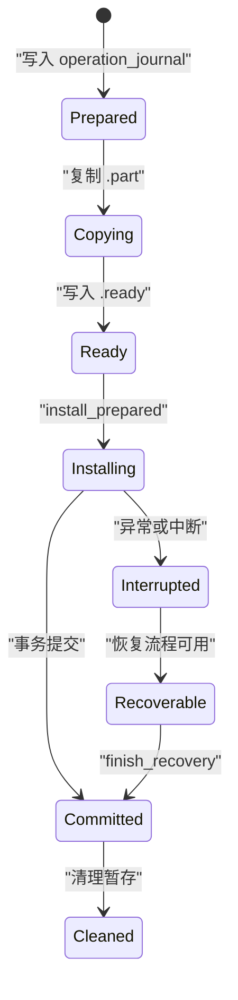

**图表来源**
- [commit.rs:1-293](../../../../crates/moriq-library/src/transfer/commit.rs#L1-L293)
- [recovery.rs:1-229](../../../../crates/moriq-library/src/transfer/recovery.rs#L1-L229)

**章节来源**
- [commit.rs:1-293](../../../../crates/moriq-library/src/transfer/commit.rs#L1-L293)
- [recovery.rs:1-229](../../../../crates/moriq-library/src/transfer/recovery.rs#L1-L229)
- [synco.rs:1-595](../../../../crates/moriq-library/src/transfer/synco.rs#L1-L595)

## 任务调度、队列与资源限制
### 队列处理
后台任务通过 `background_jobs`、`background_job_items`、`background_job_errors` 等表实现持久化队列：

- `enqueue_media_job` 根据任务类型、工作区范围和素材集合登记任务。
- `claim_job_step` 按优先级、创建时间和 ID 领取下一个未处理项。
- 每个任务项包含序列号 `seq` 和版本 ID，支持断点续跑。
- 任务完成后清理 `background_job_items`，避免无限增长。
- 失败项可单独重试，重试任务继承原任务的优先级和工作区范围。

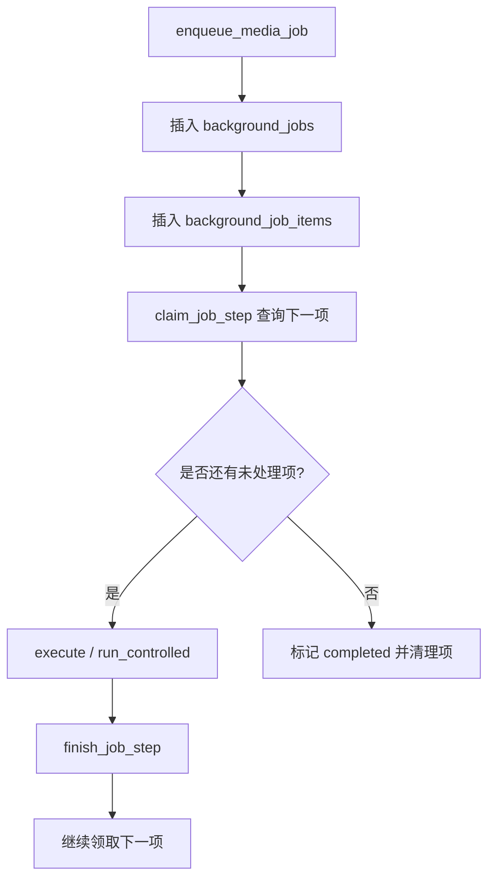

**图表来源**
- [jobs.rs:1-960](../../../../crates/moriq-library/src/tasks/jobs.rs#L1-L960)

**章节来源**
- [jobs.rs:1-960](../../../../crates/moriq-library/src/tasks/jobs.rs#L1-L960)

### 优先级排序
任务优先级范围为 `-100` 到 `100`，取值非法时会直接报错。优先级高的任务先被领取；同优先级下按创建时间排序，最后按任务 ID 排序，保证稳定性。

### 资源限制
系统对摄取和分析任务做了多层资源限制：

| 限制维度 | 实现方式 |
|---|---|
| 并发任务数 | `job_slot` 令牌控制最多并行任务数量 |
| 媒体内存预算 | `import_memory` 按任务估算的 MiB 申请许可 |
| 单文件体积 | `native::file_limit` 限制源文件和复制上限 |
| 图像尺寸 | 解码前检查宽高、像素乘积，过大时回退到固定预算 |
| 导出尺寸 | `max_edge` 限制最大边长，默认不超过原生最大值 |
| 导出质量 | 质量值必须在 `1` 到 `100` |
| 导出旋转 | 仅允许 `0 / 90 / 180 / 270` 度 |

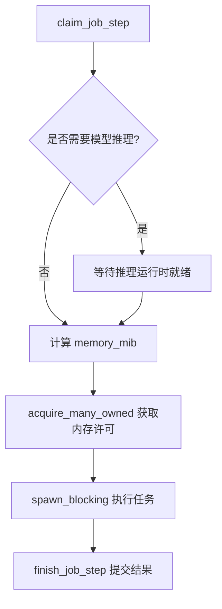

**图表来源**
- [jobs.rs:1-175](../../../../crates/moriq-app/src/jobs.rs#L1-L175)
- [ingest.rs:1-442](../../../../crates/moriq-library/src/transfer/ingest.rs#L1-L442)

**章节来源**
- [jobs.rs:1-175](../../../../crates/moriq-app/src/jobs.rs#L1-L175)
- [jobs.rs:1-960](../../../../crates/moriq-library/src/tasks/jobs.rs#L1-L960)
- [ingest.rs:1-442](../../../../crates/moriq-library/src/transfer/ingest.rs#L1-L442)

### 调度线程与错误退避
调度线程以弱引用持有服务实例，最后一个公开服务释放后停止调度。它周期性尝试驱动一个库的任务，并根据错误次数进行指数退避：

- 连续失败超过阈值时，会将相关任务置为 `paused`，并写入错误详情。
- 取消信号按库和任务粒度注册，单项取消不会影响其他任务。
- 如果等待内存许可期间切换了库，旧任务结果会被拒绝，避免跨库污染。

**章节来源**
- [scheduler.rs:1-283](../../../../crates/moriq-app/src/scheduler.rs#L1-L283)
- [jobs.rs:1-175](../../../../crates/moriq-app/src/jobs.rs#L1-L175)

## 摄取工作流配置示例
以下示例说明如何配置常见的摄取工作流。注意这些是行为描述，不是直接粘贴的代码片段。

### 基本导入流程
- 输入：本地图片或视频文件。
- 规则：
  - 跳过符号链接。
  - 跳过资源库内部路径。
  - 跳过 `.moriq` 目录。
  - 仅处理受支持的文件类型。
- 输出：
  - 媒体文件以硬链接形式存入 `assets/{项目}/{相对路径}`。
  - 缩略图存入 `thumbnails/256/{version}.png`。
  - 元数据、EXIF、视频信息、相似性签名写入数据库。

### 同步规则设置
- 按项目分组导入：传入 `project_name`，系统会查找或创建顶级项目。
- 保留相对目录：通过 `relative` 字段保留原始子目录结构。
- 重复内容处理：
  - 相同哈希+大小复用现有版本。
  - 不同项目中的重复内容分别建立项目文件关联。
  - 同名文件自动追加 `(2)`、`(3)` 等后缀。

### 排除模式
- 排除符号链接。
- 排除库内部路径。
- 排除 `.moriq` 扩展名目录。
- 排除不受支持的文件类型。
- 排除超出文件大小预算的文件。

### 触发条件
- 用户主动发起导入。
- 扫描器检测到有效文件并回调。
- 后台任务队列中有待处理任务。
- 恢复流程发现 `operation_journal.phase='interrupted'` 的记录。
- Synco 远端返回任务状态变化。

### 参考实现路径
- 扫描与过滤：[scan.rs:1-137](../../../../crates/moriq-app/src/scan.rs#L1-L137)
- 项目解析与路径生成：[import.rs:1-352](../../../../crates/moriq-library/src/transfer/import.rs#L1-L352)
- 导入事务与安装：[commit.rs:1-293](../../../../crates/moriq-library/src/transfer/commit.rs#L1-L293)
- 后台任务登记与执行：[jobs.rs:1-960](../../../../crates/moriq-library/src/tasks/jobs.rs#L1-L960)

**章节来源**
- [scan.rs:1-137](../../../../crates/moriq-app/src/scan.rs#L1-L137)
- [import.rs:1-352](../../../../crates/moriq-library/src/transfer/import.rs#L1-L352)
- [commit.rs:1-293](../../../../crates/moriq-library/src/transfer/commit.rs#L1-L293)
- [jobs.rs:1-960](../../../../crates/moriq-library/src/tasks/jobs.rs#L1-L960)

## 性能优化与大数据集处理经验
### 缓存策略
- **缩略图缓存**：每次导入生成 `256` 像素缩略图，用于列表预览和主导色计算。
- **元数据缓存**：EXIF、AI 标签、描述、主题等信息存储在数据库，避免重复解析。
- **相似性签名**：非视频媒体生成签名，用于后续相似度检索。
- **导出缓存**：导出前先复制一份不可变副本，校验哈希后再转换或原样发布。

### 大图处理
- 解码前估算所需内存，JPEG/PNG/WebP/Gif/Bmp 使用实际尺寸估算，RAW 和视频走固定预算或原生估算。
- 像素乘积超过阈值时，回退到固定内存预算，避免 OOM。
- 导出时先限制最大边长，再进行缩放、旋转和编码，避免无意义放大。
- JPEG 透明背景会进行 Alpha 预乘合成，避免导出黑边。

### 大数据集处理
- 扫描使用流式回调，不一次性加载所有文件。
- 导入使用分块复制和取消标志，支持中途停止。
- 后台任务按项分页领取，支持断点续跑。
- 导出批量上限为 `10000`，避免一次性构建过大计划。
- 调度线程对连续失败做指数退避，最高间隔约 `30` 秒。

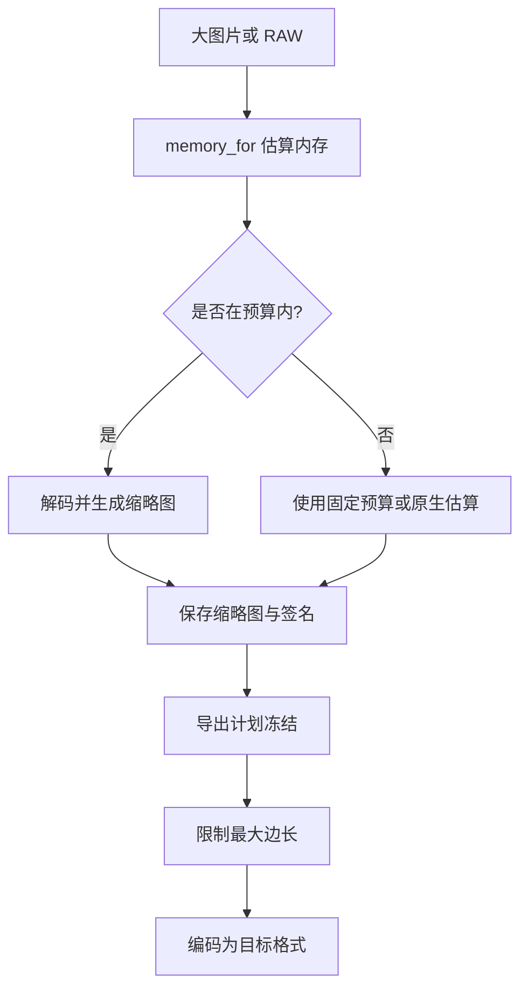

**图表来源**
- [ingest.rs:1-442](../../../../crates/moriq-library/src/transfer/ingest.rs#L1-L442)
- [export.rs:1-422](../../../../crates/moriq-library/src/transfer/export.rs#L1-L422)

**章节来源**
- [ingest.rs:1-442](../../../../crates/moriq-library/src/transfer/ingest.rs#L1-L442)
- [export.rs:1-422](../../../../crates/moriq-library/src/transfer/export.rs#L1-L422)
- [scan.rs:1-137](../../../../crates/moriq-app/src/scan.rs#L1-L137)
- [jobs.rs:1-175](../../../../crates/moriq-app/src/jobs.rs#L1-L175)
- [scheduler.rs:1-283](../../../../crates/moriq-app/src/scheduler.rs#L1-L283)

## 故障排查指南
### 常见错误与定位
| 现象 | 可能原因 | 排查建议 |
|---|---|---|
| 导入时报“媒体超出文件大小预算或为空文件” | 源文件为空或超过 `native::file_limit` | 检查文件大小和系统限制 |
| 导入时报“图片尺寸无效” | 解码得到零宽或零高 | 检查媒体是否损坏 |
| 导入时报“不支持的媒体格式” | 文件格式无法识别 | 确认扩展名或容器类型 |
| 导入中途被取消后无法恢复 | 缺少 `.ready` 回执或原片丢失 | 保留原片并重新导入 |
| 恢复时报“恢复副本不完整” | `.ready` 文件大小与实际不符 | 检查磁盘空间和权限 |
| Synco 回执报“身份不匹配” | 远端返回字段与请求不一致 | 检查任务 ID、客户端 ID、项目 ID |
| Synco 回执报“冲突结果” | 同一任务返回不同 `result_id` | 确认远端是否重复提交 |
| 后台任务连续失败后被暂停 | 调度器错误退避达到阈值 | 查看任务失败详情并修复底层问题 |

### 恢复流程要点
- 恢复流程会从 `operation_journal` 中筛选 `phase='interrupted'` 的记录。
- 优先使用 `staging/{operation}.part`，否则回退到记录的原始路径。
- 读取 `.ready` 回执并校验预期字节数。
- 在临时快照目录中对原片建立硬链接，避免影响用户原文件。
- 在工作者上重新执行 `prepare`，引用导入会再次校验原片哈希。
- 成功后调用 `install_prepared`，并把操作日志更新为 `committed`。

**章节来源**
- [recovery.rs:1-229](../../../../crates/moriq-library/src/transfer/recovery.rs#L1-L229)
- [ingest.rs:1-442](../../../../crates/moriq-library/src/transfer/ingest.rs#L1-L442)
- [synco.rs:1-595](../../../../crates/moriq-library/src/transfer/synco.rs#L1-L595)
- [jobs.rs:1-960](../../../../crates/moriq-library/src/tasks/jobs.rs#L1-L960)

## 结论
Moriq Space 的摄取机制以“票据 + 暂存 + 安装 + 日志”为核心，通过哈希去重、项目范围查重、硬链接安装和 SQLite 事务保证数据一致性；通过 `.ready` 回执和恢复流程保证中断后可恢复；通过 Synco 协议支持远端编辑和版本链；通过后台任务队列、优先级、内存许可和调度退避机制支撑大规模媒体处理。

在实际使用中，应重视以下实践：

- 始终保留原始媒体，不要依赖中间暂存文件作为长期备份。
- 对大图片和 RAW 文件关注内存预算，必要时分批导入。
- 使用项目分组和相对路径组织素材，避免同名冲突。
- 对 Synco 任务关注状态和 ACK，确保远端结果幂等接收。
- 对后台任务使用优先级和重试机制，避免一次性阻塞系统。
- 定期检查恢复计划和失败任务，保持库处于可恢复状态。