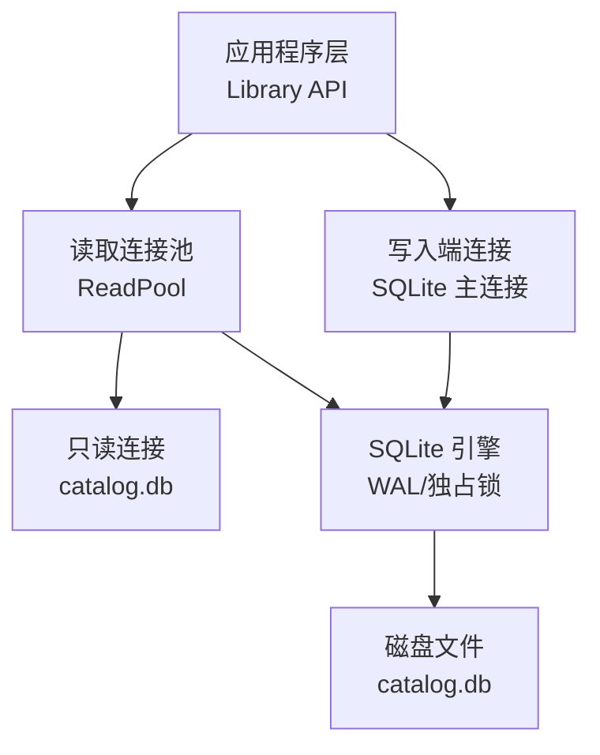
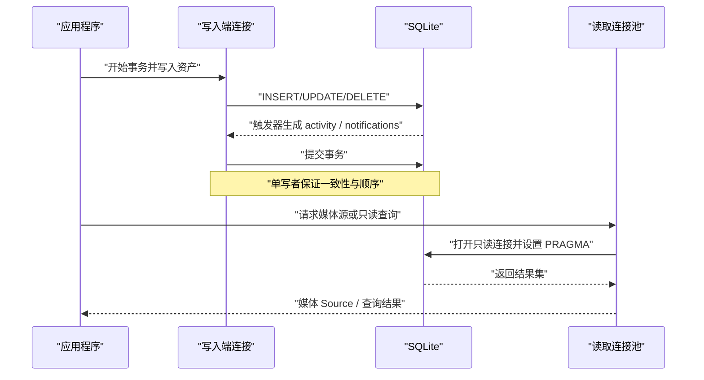
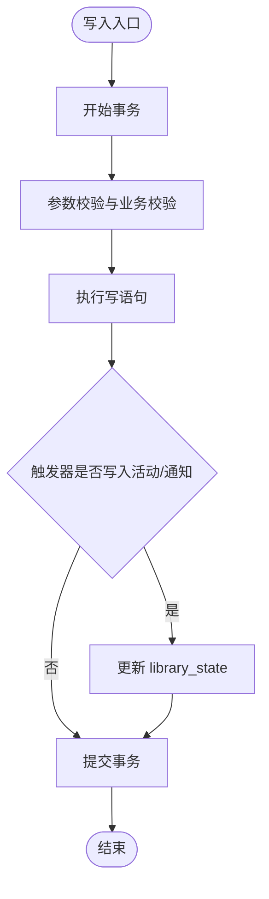
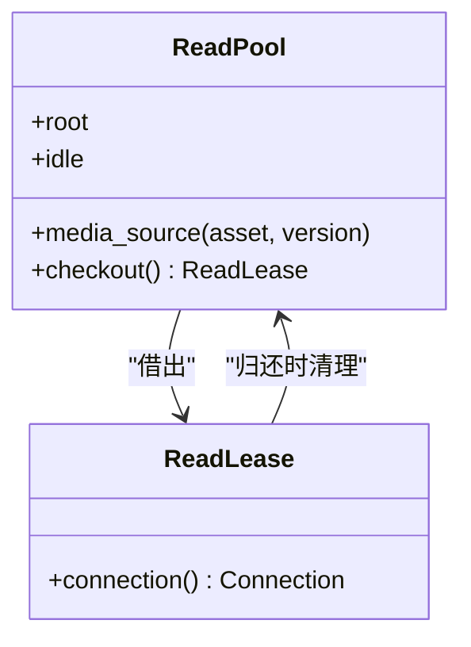
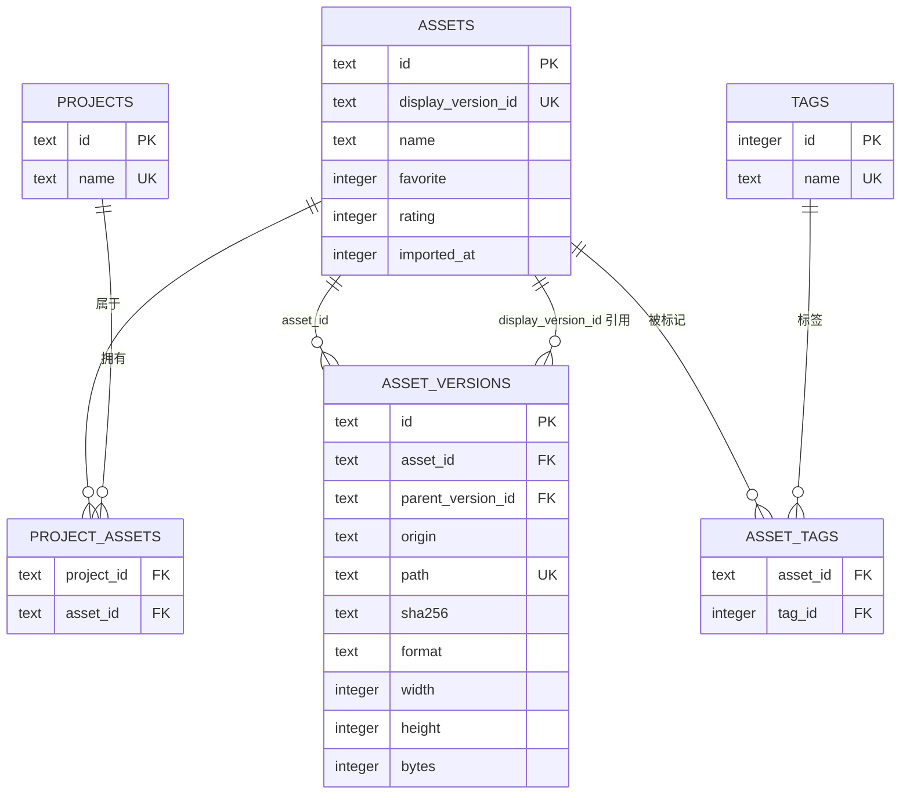
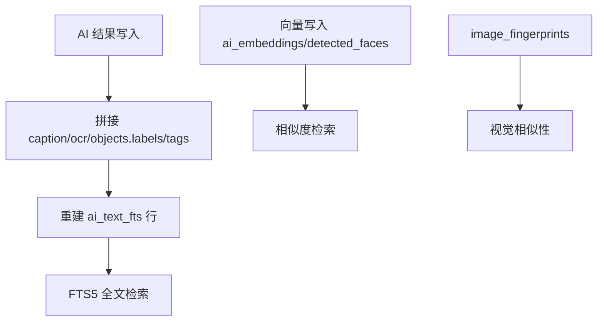
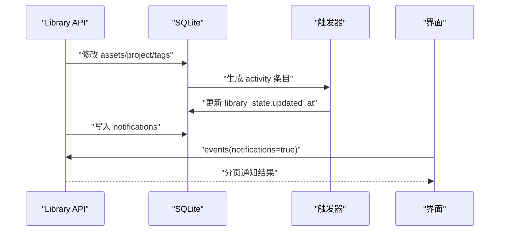
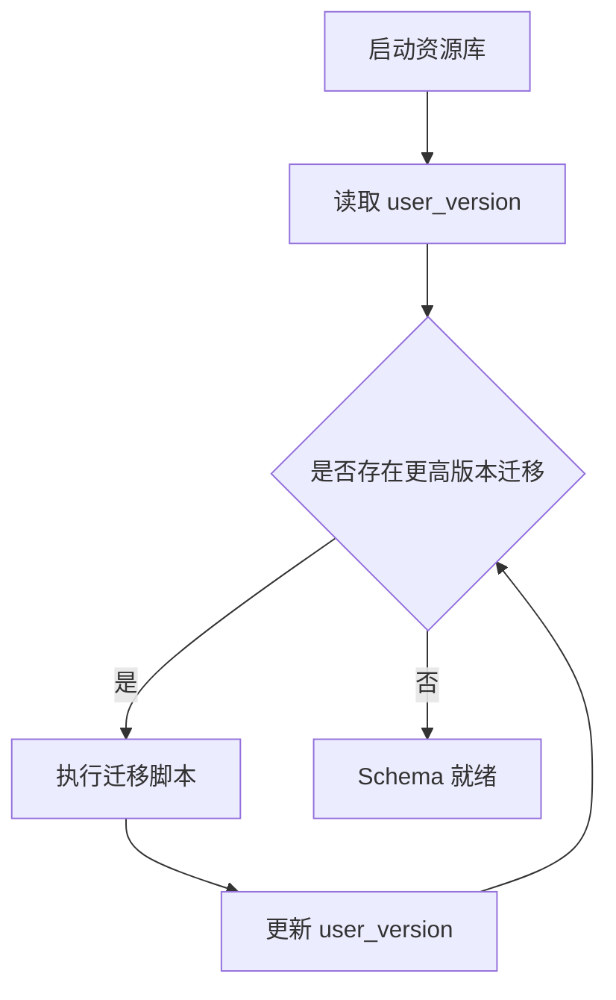
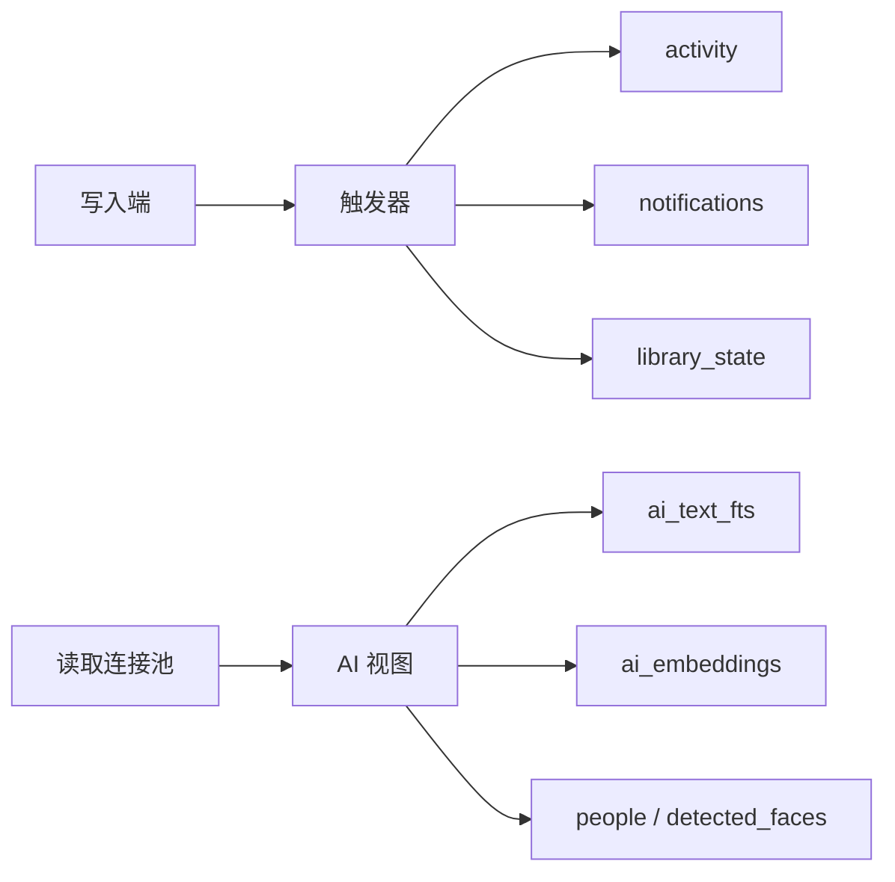

# 数据库设计与Schema管理

> Repo Wiki 节点 `database-schema`
> 导出自 Qoder 知识库快照 `8fbe02f6-57c2-4874-b725-1a8130851fd9`，代码基线 `7a7a8e75e18bd90294e09cd422dd7ed5a04813a0`（分支 main，zh-CN）。

<cite>
**本文引用的文件**   
- [schema.sql](../../../crates/moriq-library/src/database/schema.sql)
- [journal.rs](../../../crates/moriq-library/src/database/journal.rs)
- [read_pool.rs](../../../crates/moriq-library/src/database/read_pool.rs)
- [migration_10.sql](../../../crates/moriq-library/src/database/migrations/migration_10.sql)
- [migration_14.sql](../../../crates/moriq-library/src/database/migrations/migration_14.sql)
- [migration_15.sql](../../../crates/moriq-library/src/database/migrations/migration_15.sql)
- [migration_16.sql](../../../crates/moriq-library/src/database/migrations/migration_16.sql)
- [migration_17.sql](../../../crates/moriq-library/src/database/migrations/migration_17.sql)
- [migration_20.sql](../../../crates/moriq-library/src/database/migrations/migration_20.sql)
- [migration_23.sql](../../../crates/moriq-library/src/database/migrations/migration_23.sql)
- [migration_24.sql](../../../crates/moriq-library/src/database/migrations/migration_24.sql)
- [migration_26.sql](../../../crates/moriq-library/src/database/migrations/migration_26.sql)
- [migration_27.sql](../../../crates/moriq-library/src/database/migrations/migration_27.sql)
</cite>

## 目录
1. [引言](#引言)
2. [项目结构](#项目结构)
3. [核心组件](#核心组件)
4. [架构总览](#架构总览)
5. [详细组件分析](#详细组件分析)
6. [依赖关系分析](#依赖关系分析)
7. [性能与优化](#性能与优化)
8. [故障排除指南](#故障排除指南)
9. [结论](#结论)

## 引言
本文面向 Moriq Space 资源库的 SQLite 数据库设计，围绕单写者模式、Schema 演进、索引策略、AI 特征存储、事务与并发控制、日志记录以及读取池展开。读者无需深入 Rust 源码即可理解数据模型、迁移机制和查询优化思路；同时为开发者提供关键实现文件的定位信息，便于进一步阅读代码。

## 项目结构
数据库相关代码集中在 `moriq-library` crate 中，采用“基础 Schema + 增量迁移”的结构：
- 初始 Schema 定义在静态 SQL 文件中，用于新建资源库时建立基础表、外键、索引和触发器。
- 每次变更通过带版本号编号的迁移脚本逐步演进，由运行时按顺序应用。
- 运行时维护两个关键对象：写入端连接（单写者）和只读连接池（供媒体线程等并发读取）。
- 活动、通知、后台任务、AI 结果等扩展能力以追加表和视图形式随版本推进。

**图表来源**
- [journal.rs:1-80](../../../crates/moriq-library/src/database/journal.rs#L1-L80)
- [read_pool.rs:1-97](../../../crates/moriq-library/src/database/read_pool.rs#L1-L97)

**章节来源**
- [schema.sql:1-42](../../../crates/moriq-library/src/database/schema.sql#L1-L42)
- [journal.rs:1-80](../../../crates/moriq-library/src/database/journal.rs#L1-L80)
- [read_pool.rs:1-97](../../../crates/moriq-library/src/database/read_pool.rs#L1-L97)

## 核心组件
- **单写者写入端**：所有写操作通过单一 `Connection` 执行，借助 SQLite 事务保证原子性。
- **读取连接池**：最多缓存若干只读连接，避免频繁打开关闭文件句柄；租约到期自动清理临时表并归还连接。
- **Schema 与迁移系统**：以 `user_version` 标识当前 Schema 版本，每个迁移脚本负责增量建表、索引、视图、触发器和数据迁移。
- **活动与通知**：基于 `activity`、`notifications`、`library_state` 等表，配合触发器记录资产和项目变更历史，并提供分页读取接口。
- **后台任务与 AI 元数据**：使用 `background_jobs`、`ai_results`、`ai_embeddings`、`ai_analysis_runs` 等表支持异步任务和 AI 分类、描述、向量特征。
- **虚拟文件夹与工作区**：通过 `virtual_folders`、`project_ai_profiles`、`workspace_*` 等表支撑工作区隔离、集合和 AI 配置。

**章节来源**
- [schema.sql:1-42](../../../crates/moriq-library/src/database/schema.sql#L1-L42)
- [migration_10.sql:1-43](../../../crates/moriq-library/src/database/migrations/migration_10.sql#L1-L43)
- [migration_14.sql:1-12](../../../crates/moriq-library/src/database/migrations/migration_14.sql#L1-L12)
- [migration_15.sql:1-30](../../../crates/moriq-library/src/database/migrations/migration_15.sql#L1-L30)
- [migration_16.sql:1-5](../../../crates/moriq-library/src/database/migrations/migration_16.sql#L1-L5)
- [migration_17.sql:1-7](../../../crates/moriq-library/src/database/migrations/migration_17.sql#L1-L7)
- [migration_20.sql:1-4](../../../crates/moriq-library/src/database/migrations/migration_20.sql#L1-L4)
- [migration_23.sql:1-128](../../../crates/moriq-library/src/database/migrations/migration_23.sql#L1-L128)
- [migration_24.sql:1-35](../../../crates/moriq-library/src/database/migrations/migration_24.sql#L1-L35)
- [migration_26.sql:1-47](../../../crates/moriq-library/src/database/migrations/migration_26.sql#L1-L47)
- [migration_27.sql:1-9](../../../crates/moriq-library/src/database/migrations/migration_27.sql#L1-L9)

## 架构总览
资源库数据库遵循“单写多读”架构：
- 写路径：应用程序调用 Library API，内部开启 SQLite 事务，修改核心表并通过触发器产生活动、通知或状态更新。
- 读路径：媒体渲染、预览、相似搜索等并发读取通过 `ReadPool` 获取只读连接，必要时使用临时表加速批量处理。
- 一致性：SQLite 的单写者语义由连接级别保证；`PRAGMA foreign_keys = ON` 确保引用完整性；迁移过程以 `user_version` 作为权威版本标记。
- 可观测性：`activity`、`notifications`、`library_state` 提供审计与 UI 刷新依据；`background_jobs` 暴露任务进度与失败原因。

**图表来源**
- [journal.rs:1-80](../../../crates/moriq-library/src/database/journal.rs#L1-L80)
- [read_pool.rs:1-97](../../../crates/moriq-library/src/database/read_pool.rs#L1-L97)

**章节来源**
- [journal.rs:1-80](../../../crates/moriq-library/src/database/journal.rs#L1-L80)
- [read_pool.rs:1-97](../../../crates/moriq-library/src/database/read_pool.rs#L1-L97)

## 详细组件分析

### 单写者模式与事务管理
- 写入端使用单个 `Connection`，所有写操作被包裹在事务中。例如更新资料、访问项目、回收站状态、通知写入等均通过显式事务完成。
- 事务内可能包含多次 SQL 执行，提交前若发生错误会回滚，避免部分写入造成不一致。
- 通过 `touch_metadata` 等方法更新 `library_state.updated_at`，驱动界面缓存失效与增量刷新。
- 单写者模式避免了复杂分布式锁，但要求上层协调写入入口，防止多个写连接并行。

**图表来源**
- [journal.rs:1-80](../../../crates/moriq-library/src/database/journal.rs#L1-L80)
- [migration_10.sql:1-43](../../../crates/moriq-library/src/database/migrations/migration_10.sql#L1-L43)

**章节来源**
- [journal.rs:1-80](../../../crates/moriq-library/src/database/journal.rs#L1-L80)
- [migration_10.sql:1-43](../../../crates/moriq-library/src/database/migrations/migration_10.sql#L1-L43)

### 读取连接池与并发读取
- `ReadPool` 维护一个空闲连接列表，借出 `ReadLease` 给媒体线程等读取方。
- 首次借用时创建只读连接，设置 `busy_timeout`、内存缓存大小和临时存储策略，减少锁竞争与磁盘 I/O。
- `Drop` 实现保证：
  - 若有未提交事务则先回滚；
  - 清理该连接上的临时表，避免泄漏；
  - 将连接放回池中，上限为固定数量，防止连接爆炸。
- 这种设计让媒体解码、预览等高频读取路径复用连接，降低 SQLite 打开开销。

**图表来源**
- [read_pool.rs:1-97](../../../crates/moriq-library/src/database/read_pool.rs#L1-L97)

**章节来源**
- [read_pool.rs:1-97](../../../crates/moriq-library/src/database/read_pool.rs#L1-L97)

### 核心 Schema 与字段约束
- `library_identity`：资源库唯一身份。
- `assets`：素材主表，包含展示版本引用、名称、收藏标志、评分、导入时间等。
- `asset_versions`：素材版本表，包含来源类型、路径、SHA256、格式、尺寸、字节数等，并维护父子版本关系。
- `asset_order`：稠密递增位置表，用于避免深 OFFSET 扫描，配合触发器维护插入顺序。
- `projects`、`project_assets`：项目及其成员关系。
- `tags`、`asset_tags`：标签与素材标签关系。
- `operation_journal`：早期操作日志表，记录路径与阶段。
- 所有外键启用延迟检查，结合 `PRAGMA foreign_keys = ON` 保证引用一致性。

**图表来源**
- [schema.sql:1-42](../../../crates/moriq-library/src/database/schema.sql#L1-L42)

**章节来源**
- [schema.sql:1-42](../../../crates/moriq-library/src/database/schema.sql#L1-L42)

### 索引策略与查询优化
- 版本哈希索引 `versions_hash(sha256)`：快速去重与重复检测。
- 版本资产索引 `versions_asset(asset_id)`：按资产查找所有版本。
- 父版本索引 `versions_parent(parent_version_id)`：遍历版本树。
- 素材排序索引 `assets_order(imported_at DESC,id DESC)`：按导入时间与 ID 稳定排序。
- 收藏优先索引 `assets_favorites(favorite,imported_at DESC,id DESC)`：常用 UI 过滤场景。
- 标签反向索引 `asset_tags_reverse(tag_id,asset_id)`：按标签查素材。
- EXIF 索引：相机、拍摄时间、ISO、GPS 坐标索引提升筛选性能。
- 后台任务调度索引 `background_jobs_schedule(state,inflight,priority DESC,created_at)`：提高任务队列选择效率。
- 工作区索引：`workspace_people_scope`、`workspace_folders_scope`、`workspace_jobs_scope` 提升工作区范围查询效率。

这些索引覆盖常见查询路径，包括：
- 按 SHA256 查重；
- 按资产查版本；
- 按收藏、时间排序；
- 按标签、EXIF 字段筛选；
- 按工作区维度组织 AI 结果与任务。

**章节来源**
- [schema.sql:1-42](../../../crates/moriq-library/src/database/schema.sql#L1-L42)
- [migration_14.sql:1-12](../../../crates/moriq-library/src/database/migrations/migration_14.sql#L1-L12)
- [migration_17.sql:1-7](../../../crates/moriq-library/src/database/migrations/migration_17.sql#L1-L7)
- [migration_26.sql:1-47](../../../crates/moriq-library/src/database/migrations/migration_26.sql#L1-L47)

### 全文搜索与 AI 特征索引
- 文本全文检索使用 SQLite FTS5 虚拟表 `ai_text_fts`，tokenize 为 trigram，内容来自 AI 结果的 caption、OCR、对象标签与标签数组。
- 触发器在 `ai_results` 增删改时重建对应 `version_id` 的 FTS 行，保持与有效内容一致。
- AI 向量嵌入存储在 `ai_embeddings.vector` 列，类型为 BLOB，主键为 `(version_id,model_id,revision)`。
- 人物人脸向量存储在 `detected_faces.vector`，并与 `people` 表关联。
- 图像指纹表 `image_fingerprints` 保存缩略图级别的哈希与颜色统计，辅助相似性检索。
- 通过视图 `ai_effective_content`、`ai_visible_tags`、`asset_ai_categories`、`ai_search_source` 聚合 AI 结果、人工覆盖、词汇表与可见标签，形成统一搜索输入。

**图表来源**
- [migration_15.sql:1-30](../../../crates/moriq-library/src/database/migrations/migration_15.sql#L1-L30)
- [migration_23.sql:1-128](../../../crates/moriq-library/src/database/migrations/migration_23.sql#L1-L128)
- [migration_24.sql:1-35](../../../crates/moriq-library/src/database/migrations/migration_24.sql#L1-L35)
- [migration_26.sql:1-47](../../../crates/moriq-library/src/database/migrations/migration_26.sql#L1-L47)
- [migration_27.sql:1-9](../../../crates/moriq-library/src/database/migrations/migration_27.sql#L1-L9)

**章节来源**
- [migration_15.sql:1-30](../../../crates/moriq-library/src/database/migrations/migration_15.sql#L1-L30)
- [migration_23.sql:1-128](../../../crates/moriq-library/src/database/migrations/migration_23.sql#L1-L128)
- [migration_24.sql:1-35](../../../crates/moriq-library/src/database/migrations/migration_24.sql#L1-L35)
- [migration_26.sql:1-47](../../../crates/moriq-library/src/database/migrations/migration_26.sql#L1-L47)
- [migration_27.sql:1-9](../../../crates/moriq-library/src/database/migrations/migration_27.sql#L1-L9)

### 事务、活动与通知
- 活动表 `activity` 通过触发器记录资产导入、重命名、收藏、评分、备注、回收站、永久删除、标签变更、项目成员变更、项目创建与编辑、版本新增等行为。
- 通知表 `notifications` 提供分级通知、可选关联资产、重试策略与已读截止位点。
- `library_state.updated_at` 通过多个表的触发器维护，反映资源库最近修改时间，供 UI 与缓存判断是否需要刷新。
- 事件读取使用游标分页，限制每页条数，避免深分页带来的性能问题。

**图表来源**
- [migration_10.sql:1-43](../../../crates/moriq-library/src/database/migrations/migration_10.sql#L1-L43)
- [journal.rs:1-120](../../../crates/moriq-library/src/database/journal.rs#L1-L120)

**章节来源**
- [migration_10.sql:1-43](../../../crates/moriq-library/src/database/migrations/migration_10.sql#L1-L43)
- [journal.rs:1-120](../../../crates/moriq-library/src/database/journal.rs#L1-L120)

### 后台任务与迁移流程
- 后台任务表 `background_jobs` 支持多种任务状态、优先级、进度、失败计数与错误消息，并通过 `background_job_items` 记录分片项。
- 图像指纹任务与缩略图任务共用调度结构，便于暂停、恢复与取消。
- 迁移流程：
  - 使用 `PRAGMA user_version` 标记当前 Schema 版本；
  - 每个迁移脚本末尾更新版本号；
  - 运行时按顺序执行迁移脚本，保证向后兼容。

**图表来源**
- [migration_14.sql:1-12](../../../crates/moriq-library/src/database/migrations/migration_14.sql#L1-L12)
- [migration_10.sql:1-43](../../../crates/moriq-library/src/database/migrations/migration_10.sql#L1-L43)

**章节来源**
- [migration_14.sql:1-12](../../../crates/moriq-library/src/database/migrations/migration_14.sql#L1-L12)
- [migration_10.sql:1-43](../../../crates/moriq-library/src/database/migrations/migration_10.sql#L1-L43)

### 工作区、虚拟文件夹与 AI 配置
- 工作区以项目为单位进行隔离，`workspace_people`、`workspace_folders`、`workspace_jobs` 分别绑定人物、虚拟文件夹与后台任务到工作区。
- `project_ai_profiles` 保存项目的 AI 配置，包括最大主题数与分类词表 JSON。
- 删除项目时触发清理，移除对应工作区下的关联数据。
- 虚拟文件夹 `virtual_folders` 与素材成员 `virtual_folder_assets` 构成动态分组，常用于智能相册或规则集合。

**章节来源**
- [migration_16.sql:1-5](../../../crates/moriq-library/src/database/migrations/migration_16.sql#L1-L5)
- [migration_26.sql:1-47](../../../crates/moriq-library/src/database/migrations/migration_26.sql#L1-L47)

### 实际查询示例与数据访问模式
以下为典型查询思路与访问模式（不直接给出 SQL 文本，仅提供结构与用途说明）：
- 按 SHA256 查重：使用 `asset_versions.sha256` 上的索引，快速定位相同内容的不同版本。
- 按收藏与时间排序：使用 `assets.favorite`、`assets.imported_at`、`assets.id` 组合排序，适合首页与收藏夹列表。
- 按标签查素材：通过 `asset_tags.tag_id` 与 `asset_tags.asset_id` 双向关系查询，常与 `tags.name` 联表。
- 按 EXIF 筛选：使用 `version_exif` 中的相机、拍摄时间、ISO、GPS 索引进行条件过滤。
- 全文搜索：对 `ai_text_fts` 使用匹配表达式，返回匹配的 `version_id`，再联表获取素材信息。
- 向量相似度：从 `ai_embeddings.vector` 或 `detected_faces.vector` 中提取向量参与相似度计算。
- 活动分页：使用 `activity.id DESC` 游标分页，限制每页条数，避免全表扫描。
- 通知分页：使用 `notifications.read_at` 与 `id` 组合索引，按截止位点读取未读通知。

**章节来源**
- [schema.sql:1-42](../../../crates/moriq-library/src/database/schema.sql#L1-L42)
- [migration_15.sql:1-30](../../../crates/moriq-library/src/database/migrations/migration_15.sql#L1-L30)
- [migration_17.sql:1-7](../../../crates/moriq-library/src/database/migrations/migration_17.sql#L1-L7)
- [migration_23.sql:1-128](../../../crates/moriq-library/src/database/migrations/migration_23.sql#L1-L128)
- [journal.rs:1-120](../../../crates/moriq-library/src/database/journal.rs#L1-L120)

## 依赖关系分析
- 写入端依赖 SQLite 的事务与触发器能力，确保业务逻辑与审计日志一致。
- 读取端依赖 `ReadPool` 的连接复用与临时表清理机制，保障高并发读取稳定性。
- 迁移脚本依赖 `PRAGMA user_version` 与严格顺序执行，避免 Schema 漂移。
- AI 模块依赖 `ai_results`、`ai_analysis_runs`、`ai_effective_results`、`ai_overrides`、`ai_vocabulary`、`ai_rejected_tags` 等表，并通过视图与触发器维持 FTS 与有效内容同步。
- 工作区与虚拟文件夹依赖项目与资产的关系表，确保删除级联与空间隔离。

**图表来源**
- [migration_10.sql:1-43](../../../crates/moriq-library/src/database/migrations/migration_10.sql#L1-L43)
- [migration_15.sql:1-30](../../../crates/moriq-library/src/database/migrations/migration_15.sql#L1-L30)
- [migration_23.sql:1-128](../../../crates/moriq-library/src/database/migrations/migration_23.sql#L1-L128)
- [migration_26.sql:1-47](../../../crates/moriq-library/src/database/migrations/migration_26.sql#L1-L47)

**章节来源**
- [migration_10.sql:1-43](../../../crates/moriq-library/src/database/migrations/migration_10.sql#L1-L43)
- [migration_15.sql:1-30](../../../crates/moriq-library/src/database/migrations/migration_15.sql#L1-L30)
- [migration_23.sql:1-128](../../../crates/moriq-library/src/database/migrations/migration_23.sql#L1-L128)
- [migration_26.sql:1-47](../../../crates/moriq-library/src/database/migrations/migration_26.sql#L1-L47)

## 性能与优化
- 连接层面：
  - 写入端使用单连接与事务，避免并发写冲突。
  - 读取端复用连接，设置 `cache_size`、`temp_store=FILE`、`temp.cache_size` 以降低内存抖动与磁盘临时文件压力。
- 索引层面：
  - 针对高频过滤字段建立复合索引，如收藏+时间+ID、EXIF 字段、任务调度键。
  - 使用稠密顺序表 `asset_order` 替代深 OFFSET 分页。
- AI 层面：
  - FTS5 内容重建触发器需权衡写入放大，建议在批量导入后集中重建或使用分批提交。
  - 向量存储为 BLOB，建议仅在需要相似度检索时加载，避免全表扫描。
- 视图层面：
  - AI 有效内容视图涉及 JSON 解析与多表联表，应谨慎使用于热路径，必要时物化结果或缓存。
- 迁移层面：
  - 迁移脚本应尽量幂等，使用 `CREATE TABLE IF NOT EXISTS`、`DROP VIEW IF EXISTS` 等保护语句。
  - 大表变更建议使用增量索引与分批更新，避免长时间锁表。

[本节为通用指导，不直接分析具体文件]

## 故障排除指南
- 写操作失败：
  - 检查事务是否被其他写连接占用；确认单写者入口是否正确。
  - 查看 SQLite 忙超时与锁等待日志，必要时调整 `busy_timeout`。
- 读取卡顿：
  - 检查 `ReadPool` 是否耗尽连接，确认临时表是否被正确清理。
  - 关注 FTS5 重建触发器导致的写入放大，避免在高负载下频繁更新 AI 结果。
- 数据不一致：
  - 验证外键约束是否启用，检查迁移是否完整应用。
  - 核对 `user_version` 与实际表结构是否匹配。
- 通知与活动异常：
  - 检查 `library_state.updated_at` 触发器是否正常更新。
  - 确认通知分页截止位点逻辑不会消费未来条目。

**章节来源**
- [read_pool.rs:1-97](../../../crates/moriq-library/src/database/read_pool.rs#L1-L97)
- [journal.rs:1-200](../../../crates/moriq-library/src/database/journal.rs#L1-L200)
- [migration_10.sql:1-43](../../../crates/moriq-library/src/database/migrations/migration_10.sql#L1-L43)

## 结论
Moriq Space 的资源库数据库以 SQLite 单写者为核心，通过严格的 Schema 与迁移机制、完善的索引策略、AI 特征与全文检索支持，以及读写分离的连接池设计，实现了高性能、可扩展且易于维护的数据层。对于后续演进，建议继续遵循“小步快跑”的迁移原则，谨慎引入视图与触发器的复杂度，并在 AI 相关写入路径上做好批量化与节流控制。