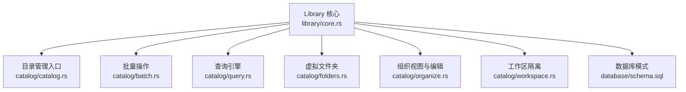
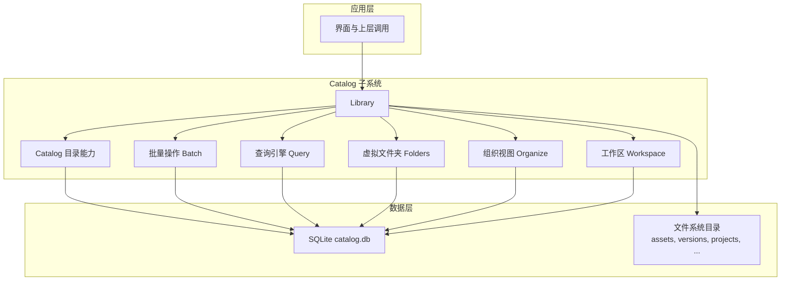
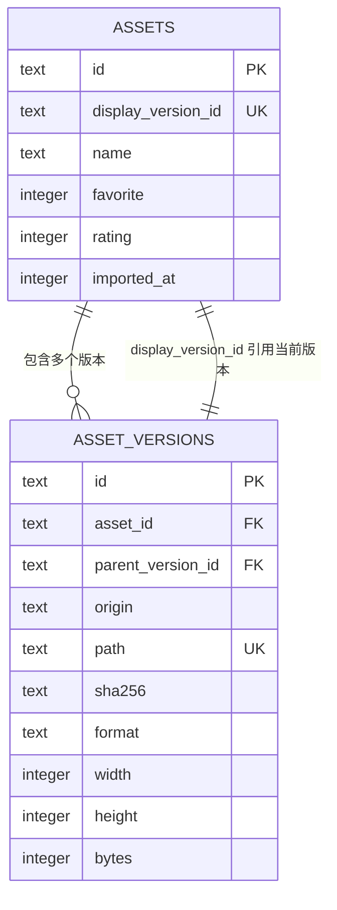
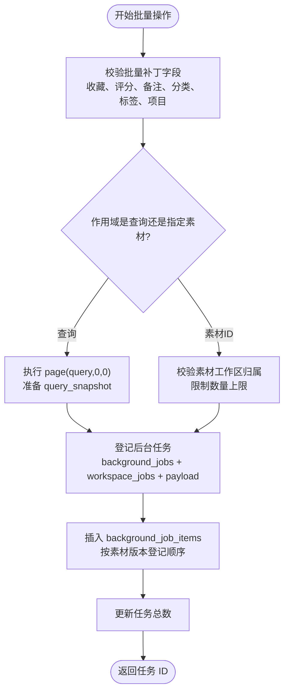
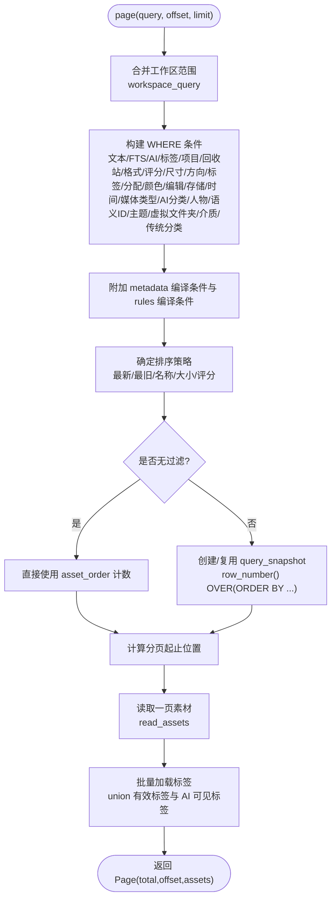
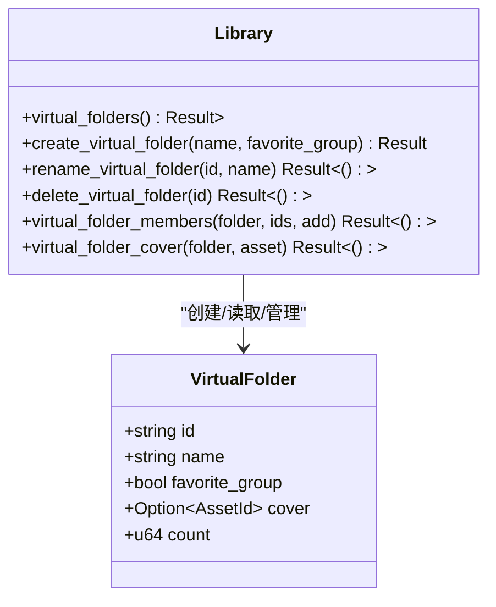
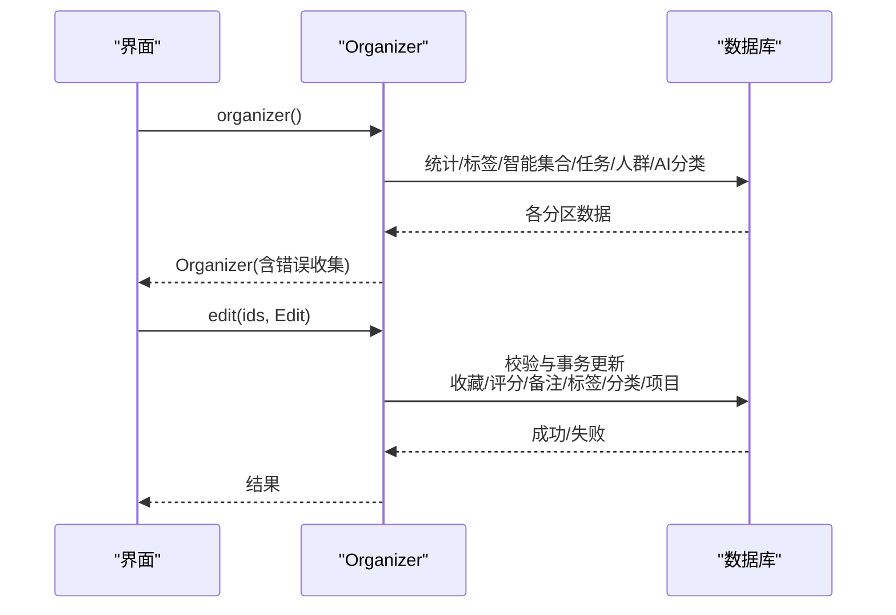
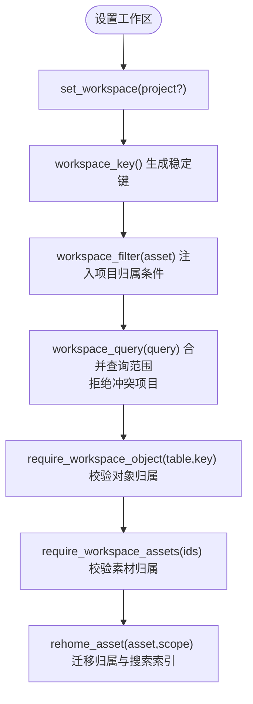
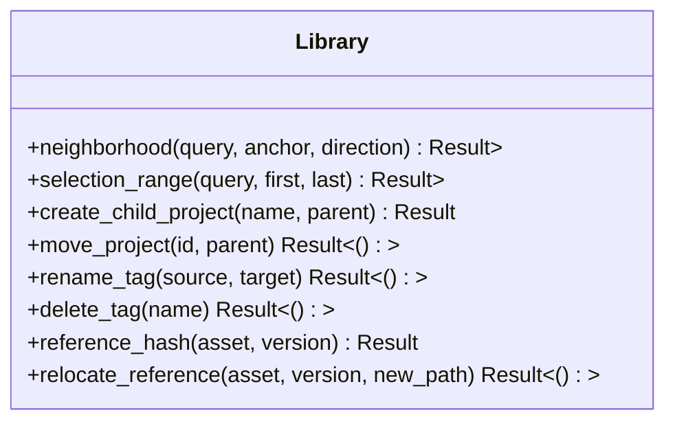
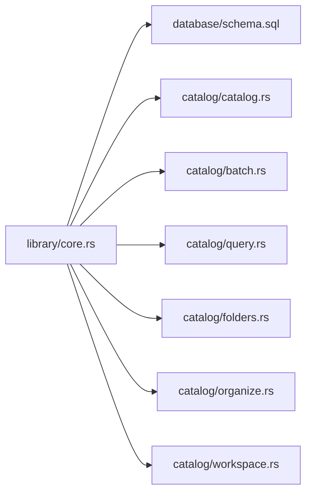

# 目录管理系统 (Catalog)

> Repo Wiki 节点 `catalog-system`
> 导出自 Qoder 知识库快照 `8fbe02f6-57c2-4874-b725-1a8130851fd9`，代码基线 `7a7a8e75e18bd90294e09cd422dd7ed5a04813a0`（分支 main，zh-CN）。

<cite>
**本文引用的文件**   
- [lib.rs](../../../../crates/moriq-library/src/lib.rs)
- [core.rs](../../../../crates/moriq-library/src/library/core.rs)
- [schema.sql](../../../../crates/moriq-library/src/database/schema.sql)
- [catalog.rs](../../../../crates/moriq-library/src/catalog/catalog.rs)
- [batch.rs](../../../../crates/moriq-library/src/catalog/batch.rs)
- [query.rs](../../../../crates/moriq-library/src/catalog/query.rs)
- [folders.rs](../../../../crates/moriq-library/src/catalog/folders.rs)
- [organize.rs](../../../../crates/moriq-library/src/catalog/organize.rs)
- [workspace.rs](../../../../crates/moriq-library/src/catalog/workspace.rs)
</cite>

## 目录
1. [引言](#引言)
2. [项目结构](#项目结构)
3. [核心组件](#核心组件)
4. [架构总览](#架构总览)
5. [详细组件分析](#详细组件分析)
6. [依赖关系分析](#依赖关系分析)
7. [性能考虑](#性能考虑)
8. [故障排查指南](#故障排查指南)
9. [结论](#结论)
10. [附录：Rust API 与最佳实践](#附录rust-api-与最佳实践)

## 引言
本文面向 Moriq Space 的 Catalog 子系统，目标是帮助读者理解素材目录管理系统的整体设计、实体模型、批量操作机制、查询引擎、文件夹组织、工作区隔离以及相关的 Rust API 使用方式。文档从仓库结构出发，逐步深入到数据库模式、事务边界、权限校验和性能优化策略，并提供可视化图表辅助理解。

## 项目结构
Catalog 子系统位于 `crates/moriq-library` 中，围绕 Library 对象暴露目录管理能力。核心入口在模块根文件中声明子模块，并在库初始化时完成资源库创建、打开、迁移与锁控制。

**图表来源**
- [lib.rs:12-62](../../../../crates/moriq-library/src/lib.rs#L12-L62)
- [core.rs:1-120](../../../../crates/moriq-library/src/library/core.rs#L1-L120)
- [catalog.rs:1-40](../../../../crates/moriq-library/src/catalog/catalog.rs#L1-L40)
- [batch.rs:1-40](../../../../crates/moriq-library/src/catalog/batch.rs#L1-L40)
- [query.rs:1-40](../../../../crates/moriq-library/src/catalog/query.rs#L1-L40)
- [folders.rs:1-30](../../../../crates/moriq-library/src/catalog/folders.rs#L1-L30)
- [organize.rs:1-40](../../../../crates/moriq-library/src/catalog/organize.rs#L1-L40)
- [workspace.rs:1-40](../../../../crates/moriq-library/src/catalog/workspace.rs#L1-L40)
- [schema.sql:1-42](../../../../crates/moriq-library/src/database/schema.sql#L1-L42)

**章节来源**
- [lib.rs:12-62](../../../../crates/moriq-library/src/lib.rs#L12-L62)
- [core.rs:1-120](../../../../crates/moriq-library/src/library/core.rs#L1-L120)

## 核心组件
- Library：资源库生命周期与 Catalog 能力的统一入口，负责锁、清单、迁移、目录结构和数据库连接。
- Catalog：素材导航、范围选择、项目树、标签管理、外部引用重定位等目录级能力。
- Batch：批量导入登记与后台任务执行，支持按查询或指定素材集合进行批量修改。
- Query：构建复杂筛选条件、分页、排序、布局尺寸计算与标签批量加载。
- Folders：虚拟文件夹（收藏分组）的创建、重命名、删除、成员管理和封面选择。
- Organize：组织视图汇总（统计、标签、智能集合、AI 分类）、素材详情、批量编辑。
- Workspace：项目工作区隔离、跨项目校验、复制与归属迁移。

**章节来源**
- [lib.rs:12-62](../../../../crates/moriq-library/src/lib.rs#L12-L62)
- [catalog.rs:1-120](../../../../crates/moriq-library/src/catalog/catalog.rs#L1-L120)
- [batch.rs:1-159](../../../../crates/moriq-library/src/catalog/batch.rs#L1-L159)
- [query.rs:1-284](../../../../crates/moriq-library/src/catalog/query.rs#L1-L284)
- [folders.rs:1-200](../../../../crates/moriq-library/src/catalog/folders.rs#L1-L200)
- [organize.rs:1-200](../../../../crates/moriq-library/src/catalog/organize.rs#L1-L200)
- [workspace.rs:1-200](../../../../crates/moriq-library/src/catalog/workspace.rs#L1-L200)

## 架构总览
Catalog 子系统以 Library 为中心，对外提供目录、素材、项目和元数据管理能力；对内通过 SQLite 持久化，并借助迁移脚本维护 schema 演进。工作区用于隔离多项目上下文，确保读计划和写操作都在一致的项目范围内执行。

**图表来源**
- [lib.rs:12-62](../../../../crates/moriq-library/src/lib.rs#L12-L62)
- [core.rs:1-120](../../../../crates/moriq-library/src/library/core.rs#L1-L120)
- [catalog.rs:1-120](../../../../crates/moriq-library/src/catalog/catalog.rs#L1-L120)
- [batch.rs:1-159](../../../../crates/moriq-library/src/catalog/batch.rs#L1-L159)
- [query.rs:1-284](../../../../crates/moriq-library/src/catalog/query.rs#L1-L284)
- [folders.rs:1-200](../../../../crates/moriq-library/src/catalog/folders.rs#L1-L200)
- [organize.rs:1-200](../../../../crates/moriq-library/src/catalog/organize.rs#L1-L200)
- [workspace.rs:1-200](../../../../crates/moriq-library/src/catalog/workspace.rs#L1-L200)

## 详细组件分析

### 素材元数据实体模型：Asset 与 AssetVersion
资产模型由 `assets` 和 `asset_versions` 两个表组成，形成“素材”与其“版本”的一对多关系。每个素材有一个当前显示版本，所有版本共享素材基础属性，而格式、尺寸、字节数、路径和校验和属于版本级别。

**图表来源**
- [schema.sql:1-42](../../../../crates/moriq-library/src/database/schema.sql#L1-L42)

关键业务规则与字段含义：
- `assets.id`：素材唯一标识。
- `assets.display_version_id`：指向当前展示版本的版本 ID，具有唯一约束。
- `assets.favorite`：收藏标记，取值 0 或 1。
- `assets.rating`：评分，取值 0～5。
- `assets.imported_at`：导入时间戳。
- `asset_versions.asset_id`：所属素材 ID，外键关联。
- `asset_versions.parent_version_id`：父版本 ID，用于版本链。
- `asset_versions.origin`：来源类型，限定为 original、synco、import、export。
- `asset_versions.path`：物理路径，全局唯一。
- `asset_versions.sha256`：内容校验和，长度固定为 64。
- `asset_versions.format / width / height / bytes`：媒体格式和尺寸体积信息。

索引设计：
- `versions_hash`：基于 sha256 的索引，便于去重与查找。
- `versions_asset`：基于 asset_id 的索引，加速素材版本查询。
- `versions_parent`：基于 parent_version_id 的索引，加速版本链遍历。
- `assets_order`：基于导入时间和 ID 的密集序列表，避免深 OFFSET 扫描。

**章节来源**
- [schema.sql:1-42](../../../../crates/moriq-library/src/database/schema.sql#L1-L42)
- [query.rs:201-284](../../../../crates/moriq-library/src/catalog/query.rs#L201-L284)

### 批量操作机制：Batch
批量操作将用户的选择范围和修改内容冻结为可跟踪的后台任务，支持两种作用域：
- 按查询范围：先执行一次 page 建立 query_snapshot，再根据当前查询结果登记任务项。
- 按素材 ID 集合：要求精确工作区归属，限制数量上限，并使用临时表记录选中素材。

**图表来源**
- [batch.rs:1-159](../../../../crates/moriq-library/src/catalog/batch.rs#L1-L159)

实现要点：
- 校验函数拒绝无效长度、非法取值和无实际修改的请求。
- 查询作用域优先复用 query_snapshot，未过滤场景直接读取 asset_order。
- 素材作用域要求 require_workspace_assets，并通过临时表 batch_selection 记录选中项。
- 后台任务登记包括 job 元数据、工作区映射、JSON 载荷与逐项版本 ID。
- apply 在事务中应用单个素材的批量修改，遵循标签和项目归属约束；当目标项目不同时会克隆素材副本，否则仅添加项目关联并重新归属。

事务与一致性：
- enqueue_batch 在单一事务中写入任务、工作区映射、载荷与任务项，保证原子性。
- apply 使用 rusqlite 事务执行 UPDATE/INSERT/DELETE，保持标签、分类和项目关联的一致性。

**章节来源**
- [batch.rs:1-159](../../../../crates/moriq-library/src/catalog/batch.rs#L1-L159)

### 查询引擎：Query
查询引擎负责组合文本搜索、收藏、项目范围、回收站、格式、评分、尺寸、方向、标签、分配状态、颜色、编辑时间、存储状态、时间区间、媒体类型、AI 分类、人物、语义 ID、主题、虚拟文件夹、介质类型和传统分类等多维条件。

**图表来源**
- [query.rs:1-200](../../../../crates/moriq-library/src/catalog/query.rs#L1-L200)
- [query.rs:201-284](../../../../crates/moriq-library/src/catalog/query.rs#L201-L284)

关键行为：
- 文本搜索：短文本走 INSTR 模糊匹配，长文本走全文检索索引。
- 项目范围：支持递归后代项目，也可强制精确项目。
- 快照机制：非默认查询会写入 query_snapshot 临时表，并按排序生成 position 序列，后续分页基于 position 而非 OFFSET。
- 标签加载：对一页素材一次性拉取标签，避免逐素材展开 AI 视图。
- 布局尺寸：layout_sizes 复用查询顺序，仅读取宽高而不解码原图。

分页优化：
- 最大页宽限制为 128，避免过大页面。
- 无过滤查询直接使用 asset_order 减少 SQL 复杂度。
- 精确项目页使用简化 SQL，避免不必要 AI/search 视图参与计划。

**章节来源**
- [query.rs:1-284](../../../../crates/moriq-library/src/catalog/query.rs#L1-L284)

### 文件夹管理：Folders
虚拟文件夹用于收藏分组与动态分组，不改变素材本体，只维护成员关系和封面。

**图表来源**
- [folders.rs:1-200](../../../../crates/moriq-library/src/catalog/folders.rs#L1-L200)

功能说明：
- virtual_folders：列出当前工作区的虚拟文件夹，附带封面与成员计数。
- create_virtual_folder：创建收藏分组或非收藏分组，并登记工作区归属。
- rename_virtual_folder：校验名称与工作区后更新。
- delete_virtual_folder：删除分组及成员关联，保留素材。
- virtual_folder_members：增删成员，要求工作区对象与素材均处于允许的工作区范围，限制数量上限。
- virtual_folder_cover：设置封面，必须为分组内有效成员；失效时回退到稳定规则下的最近成员。

测试覆盖：
- 验证分组封面仅使用有效成员，删除或移除成员后封面回退逻辑正确。

**章节来源**
- [folders.rs:1-246](../../../../crates/moriq-library/src/catalog/folders.rs#L1-L246)

### 组织功能：Organize
Organize 聚合项目、标签、分类、任务、智能集合等管理视图，并提供素材详情与批量编辑能力。

**图表来源**
- [organize.rs:1-400](../../../../crates/moriq-library/src/catalog/organize.rs#L1-L400)

重点能力：
- organizer：分块读取统计数据、标签、智能集合、任务、人群、AI 分类、视频计数、回收站计数、编辑计数、RAW 计数、Synco 任务与描述；每个分区独立捕获错误，避免单点失败影响其他分区。
- smart_collections：按工作区读取智能集合及其 TOML 查询规则。
- details/details_metadata：组装素材详情，区分纯数据库字段与完整媒体读取。
- edit：批量编辑素材，限制参数长度与数量，在工作区内逐项更新，必要时触发项目归属变更与副本克隆。

**章节来源**
- [organize.rs:1-400](../../../../crates/moriq-library/src/catalog/organize.rs#L1-L400)

### 工作区：Workspace
工作区表示当前项目范围，用于隔离多项目上下文、权限控制和共享机制。

**图表来源**
- [workspace.rs:1-200](../../../../crates/moriq-library/src/catalog/workspace.rs#L1-L200)

关键职责：
- set_workspace/query_scope：冻结读写会话的项目范围。
- workspace_key/workspace_filter：生成稳定键与 SQL 过滤条件。
- workspace_query：将工作区合并进查询，禁止与会话范围冲突。
- require_workspace_object/require_workspace_assets：严格校验对象与素材的工作区归属。
- rehome_asset：在项目间移动素材时，迁移人脸人物、虚拟文件夹成员、文本搜索索引。
- copy_to_project：复制素材到新项目，可选择是否保留注释与 AI 数据。
- create_project_configured：按模板创建项目，预置 AI 分类与主题。
- migrate：在升级时拆分共享人物、分组与配置，建立项目独立数据。

**章节来源**
- [workspace.rs:1-439](../../../../crates/moriq-library/src/catalog/workspace.rs#L1-L439)

### Catalog 目录能力：Catalog
Catalog 提供素材导航、范围选择、项目树管理与标签管理等能力。

**图表来源**
- [catalog.rs:1-200](../../../../crates/moriq-library/src/catalog/catalog.rs#L1-L200)

功能说明：
- neighborhood：按当前筛选和排序返回锚点附近少量素材，支持跨分页浏览。
- selection_range：解析两个锚点之间的素材范围，限制最多 10000 张。
- create_child_project：校验名称并创建子项目，同时写入工作区 AI 配置。
- move_project：调整项目父级，拒绝循环移动。
- rename_tag/delete_tag：重命名或删除标签，同步有效标签与 AI 拒绝标签，更新 edited_at。
- reference_hash/relocate_reference：校验外部引用版本哈希并重定位路径。

**章节来源**
- [catalog.rs:1-200](../../../../crates/moriq-library/src/catalog/catalog.rs#L1-L200)

## 依赖关系分析
Catalog 子系统内部模块耦合清晰：
- Library 作为统一入口，持有数据库连接与工作区状态。
- Catalog/Batch/Query/Folders/Organize/Workspace 各自承担单一职责，通过 Library 方法协作。
- 数据库模式由 schema.sql 与迁移脚本共同维护，Library 在 open_inner 中执行迁移。

**图表来源**
- [lib.rs:12-62](../../../../crates/moriq-library/src/lib.rs#L12-L62)
- [core.rs:1-200](../../../../crates/moriq-library/src/library/core.rs#L1-L200)

潜在风险：
- 大量动态 SQL 拼接需确保参数化，避免注入与语法错误。
- 临时表（query_snapshot、batch_selection）的生命周期需与事务一致。
- 工作区校验必须在每次写操作前执行，防止跨项目污染。

**章节来源**
- [lib.rs:12-62](../../../../crates/moriq-library/src/lib.rs#L12-L62)
- [core.rs:1-200](../../../../crates/moriq-library/src/library/core.rs#L1-L200)

## 性能考虑
- 密集序列表 asset_order：避免深 OFFSET 扫描，适合快速分页与相邻素材浏览。
- 查询快照 query_snapshot：为非默认查询建立 row_number 序列，分页基于 position。
- 标签批量加载：对一页素材一次性加载标签，避免重复展开 AI 视图。
- 文本搜索优化：短文本走 INSTR，长文本走 FTS 索引。
- 精确项目页：使用简化 SQL，跳过不必要的 AI/search 视图。
- 布局尺寸：layout_sizes 仅读取宽高，不解码原图。
- 封面与预览：受大小限制与解码限制保护，避免大图像导致内存爆炸。

[本节为通用性能建议，不直接分析具体文件]

## 故障排查指南
常见错误与处理建议：
- 查询范围冲突：workspace_query 检测到查询项目与会话不一致，应刷新页面重新选择项目。
- 工作区对象不存在：require_workspace_object 报告对象不属于当前项目，进入对应项目后再操作。
- 选区跨项目：require_workspace_assets 或 require_exact_workspace_assets 提示选区包含其他项目素材，重新选择。
- 批量操作无修改：validate 拒绝空补丁，至少修改一个字段。
- 标签长度或数量超限：Edit/AddTags/RemoveTags 有长度与数量限制。
- 评分无效：rating 必须在 0～5。
- 备注过长：notes 最大 64 KiB。
- 封面图片过大：封面图片超过 256 MiB 将被拒绝。
- 资源库被占用：Error::Locked 表示另一个进程或窗口正在使用。

**章节来源**
- [batch.rs:1-159](../../../../crates/moriq-library/src/catalog/batch.rs#L1-L159)
- [organize.rs:201-400](../../../../crates/moriq-library/src/catalog/organize.rs#L201-L400)
- [workspace.rs:1-200](../../../../crates/moriq-library/src/catalog/workspace.rs#L1-L200)
- [lib.rs:120-200](../../../../crates/moriq-library/src/lib.rs#L120-L200)

## 结论
Moriq Space 的 Catalog 子系统围绕 Library 提供完整的素材目录管理能力，涵盖实体模型、批量操作、查询引擎、虚拟文件夹、组织视图和工作区隔离。其设计强调事务一致性、工作区安全校验与查询性能优化，适合大规模素材库的日常管理与高级检索需求。

[本节为总结性内容，不直接分析具体文件]

## 附录：Rust API 与最佳实践
以下列举常用 API 与调用建议，供开发者参考。

- 资源库生命周期
  - 创建资源库：`Library::create(parent, name)`
  - 打开资源库：`Library::open(root)`
  - 重命名资源库：`Library::rename(name)`

- 工作区与项目
  - 设置工作区：`Library::set_workspace(project?)`
  - 获取工作区：`Library::workspace()`
  - 创建子项目：`Library::create_child_project(name, parent?)`
  - 移动项目：`Library::move_project(id, parent?)`
  - 复制素材到项目：`Library::copy_to_project(ids, project, annotations)`
  - 配置化创建项目：`Library::create_project_configured(name, parent?, template)`

- 批量操作
  - 登记批量任务：`Library::enqueue_batch(scope, patch)`
  - 批量补丁字段：favorite/rating/notes/category/add_tags/remove_tags/project

- 查询与分页
  - 分页查询：`Library::page(query, offset, limit)`
  - 相邻素材：`Library::neighborhood(query, anchor, direction)`
  - 范围选择：`Library::selection_range(query, first, last)`
  - 布局尺寸：`Library::layout_sizes(query)`

- 文件夹管理
  - 列出虚拟文件夹：`Library::virtual_folders()`
  - 创建虚拟文件夹：`Library::create_virtual_folder(name, favorite_group)`
  - 重命名虚拟文件夹：`Library::rename_virtual_folder(id, name)`
  - 删除虚拟文件夹：`Library::delete_virtual_folder(id)`
  - 管理成员：`Library::virtual_folder_members(folder, ids, add)`
  - 设置封面：`Library::virtual_folder_cover(folder, asset)`

- 组织与编辑
  - 组织视图：`Library::organizer()`
  - 智能集合：`Library::smart_collections()`
  - 素材详情：`Library::details(id)`
  - 批量编辑：`Library::edit(ids, edit)`

最佳实践：
- 始终在使用查询或批量操作前设置工作区，避免跨项目误操作。
- 对大批量操作使用 enqueue_batch，让后台任务分批执行，提高稳定性。
- 分页查询尽量使用 page，避免自行 OFFSET 深层偏移。
- 对标签与分类变更使用 Edit 或 BatchPatch，保持一致的事务边界。
- 处理网络引用路径时使用 organize.reject_network_reference，避免自动访问不安全位置。

**章节来源**
- [core.rs:1-200](../../../../crates/moriq-library/src/library/core.rs#L1-L200)
- [workspace.rs:1-200](../../../../crates/moriq-library/src/catalog/workspace.rs#L1-L200)
- [batch.rs:1-159](../../../../crates/moriq-library/src/catalog/batch.rs#L1-L159)
- [query.rs:1-284](../../../../crates/moriq-library/src/catalog/query.rs#L1-L284)
- [folders.rs:1-200](../../../../crates/moriq-library/src/catalog/folders.rs#L1-L200)
- [organize.rs:1-400](../../../../crates/moriq-library/src/catalog/organize.rs#L1-L400)