# 工作区隔离（Workspace）

> Repo Wiki 节点 `workspace-isolation`
> 导出自 Qoder 知识库快照 `8fbe02f6-57c2-4874-b725-1a8130851fd9`，代码基线 `7a7a8e75e18bd90294e09cd422dd7ed5a04813a0`（分支 main，zh-CN）。

<cite>
**本文引用的文件**   
- [workspace.rs](../../../../crates/moriq-library/src/catalog/workspace.rs)
- [project_isolation.rs](../../../../crates/moriq-library/src/catalog/project_isolation.rs)
- [query.rs](../../../../crates/moriq-library/src/catalog/query.rs)
- [workspace_tests.rs](../../../../crates/moriq-library/src/tests/workspace_tests.rs)
- [project_isolation_tests.rs](../../../../crates/moriq-library/src/tests/project_isolation_tests.rs)
</cite>

## 目录
1. [引言](#引言)
2. [项目结构](#项目结构)
3. [核心组件](#核心组件)
4. [架构总览](#架构总览)
5. [详细组件分析](#详细组件分析)
6. [依赖关系分析](#依赖关系分析)
7. [性能考虑](#性能考虑)
8. [故障排查指南](#故障排查指南)
9. [结论](#结论)

## 引言
本文件系统性说明 Moriq Space 目录管理系统中的“工作区隔离”机制。工作区的核心目标是：在同一资源库中安全地管理多个项目，确保每个项目的素材身份、元数据、AI 结果、人物识别、虚拟分组和查询范围彼此隔离；同时允许在受控条件下将素材复制到目标项目，并正确处理注释、标签、AI 分类与人员数据的复制策略。

该机制围绕以下关键点展开：
- 工作区即当前操作的项目范围，空值表示整个资源库聚合视图。
- 所有跨项目写操作必须通过安全检查，拒绝隐式或显式的跨项目修改。
- 素材复制会生成新的资产与版本标识，保留内容但隔离可变状态。
- AI 数据与人员信息在项目间严格隔离，避免跨项目污染。
- 查询作用域由工作区冻结，防止异步读取计划被后续会话变更影响。

## 项目结构
工作区相关逻辑主要集中在 `moriq-library` 的目录层：
- `catalog/workspace.rs`：工作区上下文、作用域转换、安全检查与迁移辅助。
- `catalog/project_isolation.rs`：项目级资产克隆、文件副本管理、旧模型升级。
- `catalog/query.rs`：基于工作区的分页查询与项目精确匹配。
- `tests/workspace_tests.rs` 与 `tests/project_isolation_tests.rs`：覆盖工作区行为与隔离语义的测试。

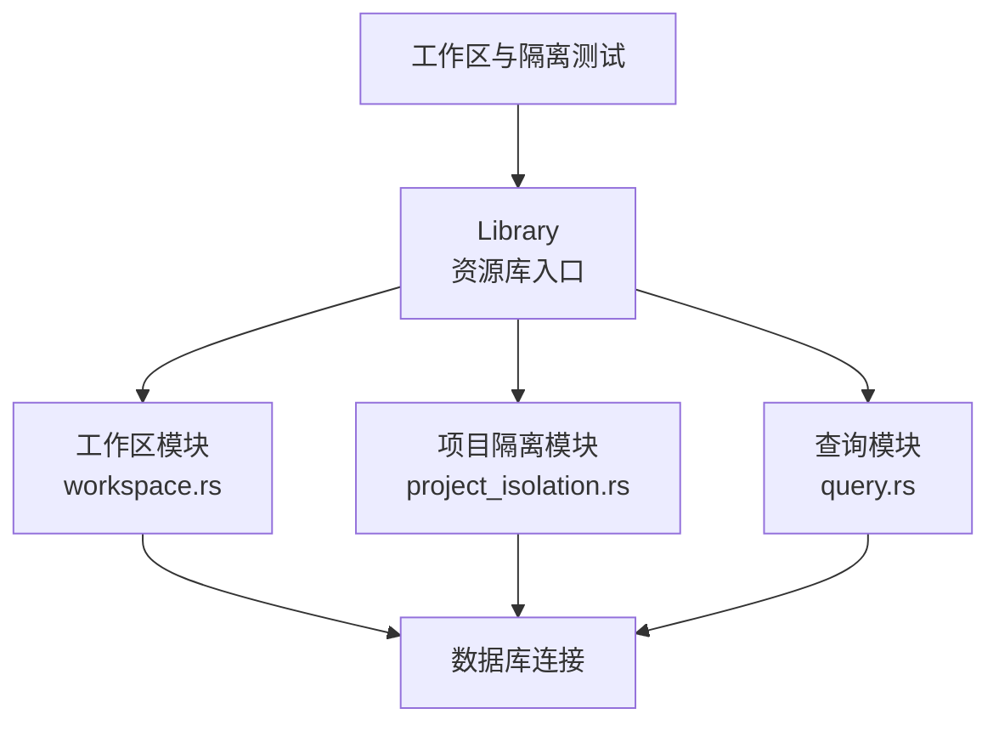

**图表来源**
- [workspace.rs:1-439](../../../../crates/moriq-library/src/catalog/workspace.rs#L1-L439)
- [project_isolation.rs:1-270](../../../../crates/moriq-library/src/catalog/project_isolation.rs#L1-L270)
- [query.rs:1-284](../../../../crates/moriq-library/src/catalog/query.rs#L1-L284)

**章节来源**
- [workspace.rs:1-439](../../../../crates/moriq-library/src/catalog/workspace.rs#L1-L439)
- [project_isolation.rs:1-270](../../../../crates/moriq-library/src/catalog/project_isolation.rs#L1-L270)
- [query.rs:1-284](../../../../crates/moriq-library/src/catalog/query.rs#L1-L284)

## 核心组件
本节聚焦工作区 API 与其职责边界。

| API | 主要职责 | 关键约束与返回值 |
|---|---|---|
| `copy_to_project` | 将指定素材复制到目标项目，处理文件、注释、标签、AI 数据与人员归属 | 限制 1～10000 个素材；按选项清除注释与 AI 数据；提交后清理失败会延迟记录 |
| `create_project_configured` | 根据模板创建项目并初始化 AI 分类配置 | 名称长度校验；主题类分类注入；配置有效性校验 |
| `set_workspace` | 设置后续资源库操作的项目范围 | 支持空值表示聚合视图 |
| `workspace` | 返回当前项目范围 | 返回 `Option<ProjectId>` |
| `query_scope` | 冻结检索作用域 | 有项目则返回项目作用域，否则返回资源库作用域 |
| `workspace_key` | 将工作区转换为稳定键 | 空项目映射为空字符串 |
| `workspace_filter` | 构建资产表达式过滤器 | 项目存在时生成项目成员条件，否则返回恒真条件 |
| `workspace_query` | 合并工作区条件并拒绝冲突项目请求 | 若传入查询的项目与工作区不一致则报错 |
| `require_workspace_object` | 检查内部对象是否属于当前项目 | 仅支持人物、文件夹、任务三类对象 |
| `require_workspace_assets` | 验证所选素材均处于允许的工作区 | 逐项检查素材所属项目 |
| `require_exact_workspace_assets` | 对需精确归属的操作逐项校验 | 要求素材明确属于当前工作区 |

**章节来源**
- [workspace.rs:1-210](../../../../crates/moriq-library/src/catalog/workspace.rs#L1-L210)
- [workspace.rs:210-439](../../../../crates/moriq-library/src/catalog/workspace.rs#L210-L439)

## 架构总览
下图展示工作区如何贯穿调用链：上层操作先设置工作区，再进入查询或写操作；写操作触发项目隔离，必要时复制文件与元数据；查询操作在工作区冻结后执行 SQL，避免跨项目误读。

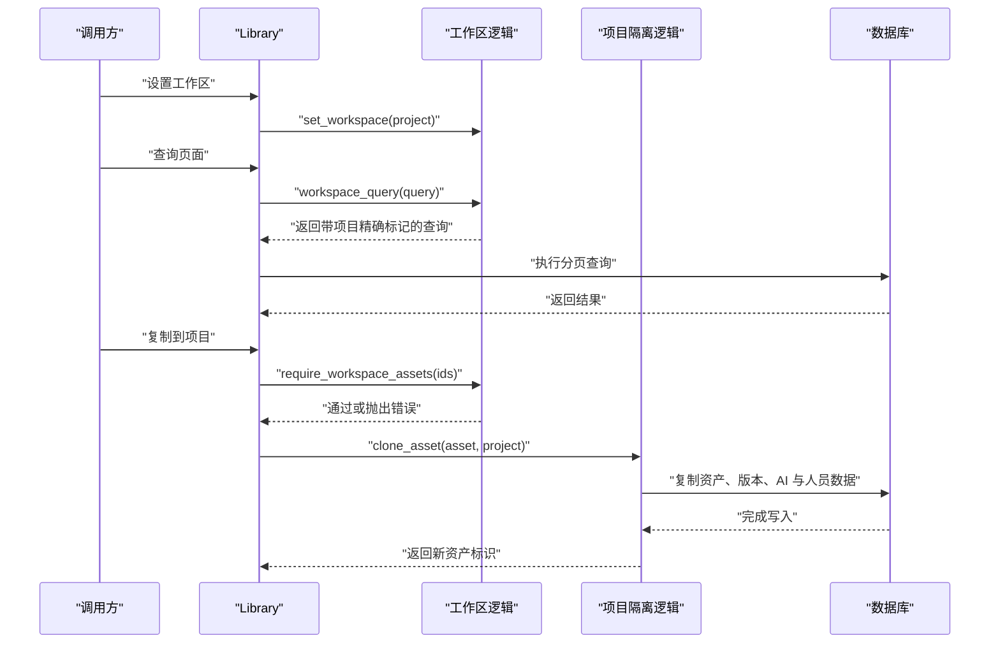

**图表来源**
- [workspace.rs:1-210](../../../../crates/moriq-library/src/catalog/workspace.rs#L1-L210)
- [project_isolation.rs:1-270](../../../../crates/moriq-library/src/catalog/project_isolation.rs#L1-L270)
- [query.rs:1-284](../../../../crates/moriq-library/src/catalog/query.rs#L1-L284)

## 详细组件分析

### 工作区概念与作用
工作区表示当前资源库操作的“项目范围”。其设计原则是：
- 多项目隔离：不同项目拥有独立的素材身份、版本、标签、AI 结果、人物与虚拟分组。
- 权限控制：通过 `require_workspace_object` 与 `require_workspace_assets` 等函数，阻止非当前项目范围内的修改。
- 数据安全：复制只保留内容与有效 AI 结果，不复制可变注释、标签、AI 覆盖与人员归属，除非显式启用。

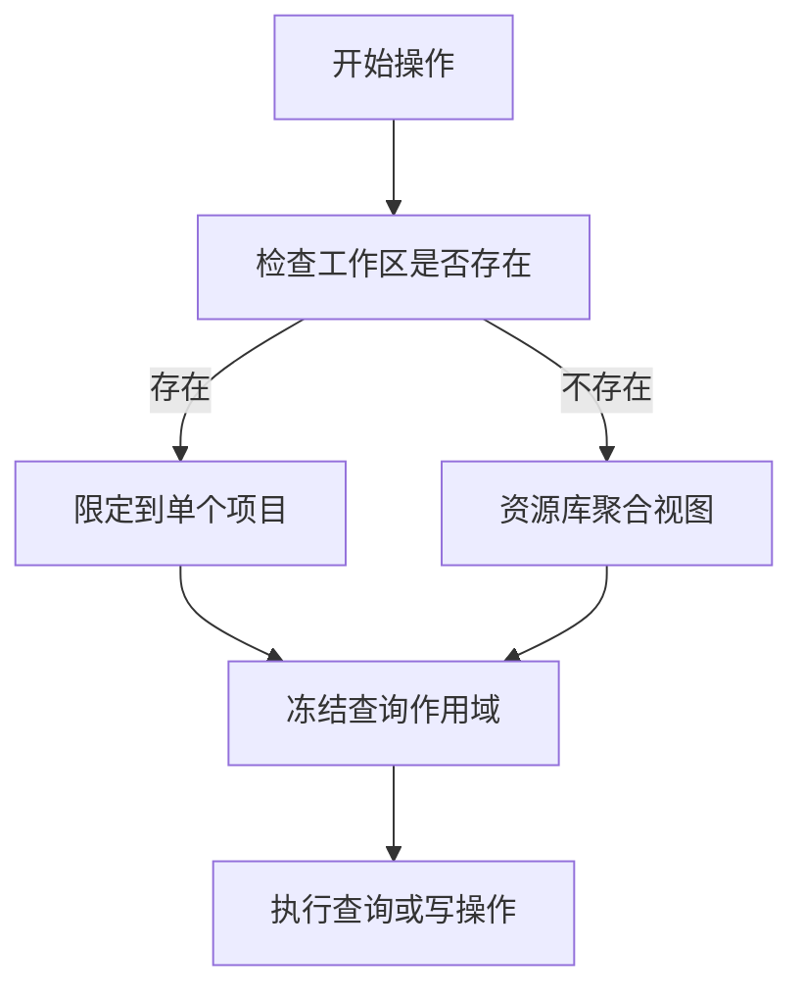

**图表来源**
- [workspace.rs:120-170](../../../../crates/moriq-library/src/catalog/workspace.rs#L120-L170)
- [query.rs:1-284](../../../../crates/moriq-library/src/catalog/query.rs#L1-L284)

**章节来源**
- [workspace.rs:120-210](../../../../crates/moriq-library/src/catalog/workspace.rs#L120-L210)
- [query.rs:1-284](../../../../crates/moriq-library/src/catalog/query.rs#L1-L284)

### 工作区键与查询过滤器
- `workspace_key`：将当前工作区转换为稳定的字符串键。空项目映射为空字符串，用于内部表中的归属比较。
- `workspace_filter`：为固定资产表达式生成过滤条件。当工作区存在时，构造“资产必须在当前项目成员表中”的条件；否则返回恒真条件。
- `asset_scope`：从 `project_assets` 中解析资产的最小项目归属，作为资产的工作区键。

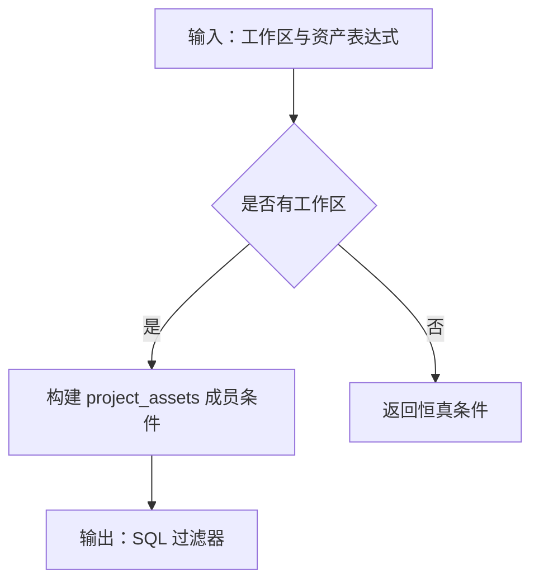

**图表来源**
- [workspace.rs:140-180](../../../../crates/moriq-library/src/catalog/workspace.rs#L140-L180)

**章节来源**
- [workspace.rs:140-180](../../../../crates/moriq-library/src/catalog/workspace.rs#L140-L180)

### 工作区查询合并与冲突拒绝
`workspace_query` 负责将工作区条件合并到查询对象中，并执行强一致性检查：
- 如果当前工作区存在，而传入查询也指定了项目，则必须一致；否则直接返回无效参数错误。
- 成功后，强制将查询的项目字段设置为当前工作区，并开启 `project_exact`，使后续查询使用精确项目匹配而非递归子项目匹配。

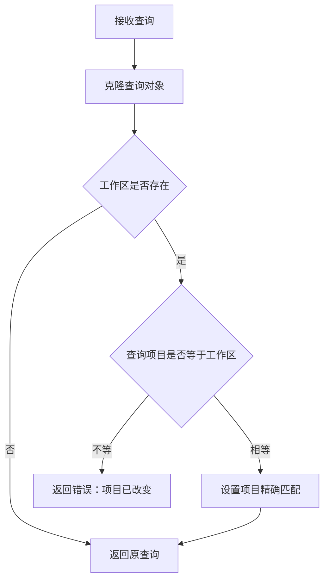

**图表来源**
- [workspace.rs:160-190](../../../../crates/moriq-library/src/catalog/workspace.rs#L160-L190)

**章节来源**
- [workspace.rs:160-190](../../../../crates/moriq-library/src/catalog/workspace.rs#L160-L190)

### 安全检查机制
工作区安全检查分为两类：

1. 对象级安全检查：`require_workspace_object`
   - 支持的对象类型：人物、文件夹、任务。
   - 通过内部工作区映射表判断对象归属是否与当前工作区一致。
   - 不一致时返回“此内容属于其他项目，请先进入所属项目”。

2. 资产级安全检查：`require_workspace_assets` 与 `require_exact_workspace_assets`
   - `require_workspace_assets`：在工作区存在时，逐项检查资产所属项目是否等于工作区。
   - `require_exact_workspace_assets`：要求资产明确属于当前工作区，常用于分类、集合等需要精确归属的操作。

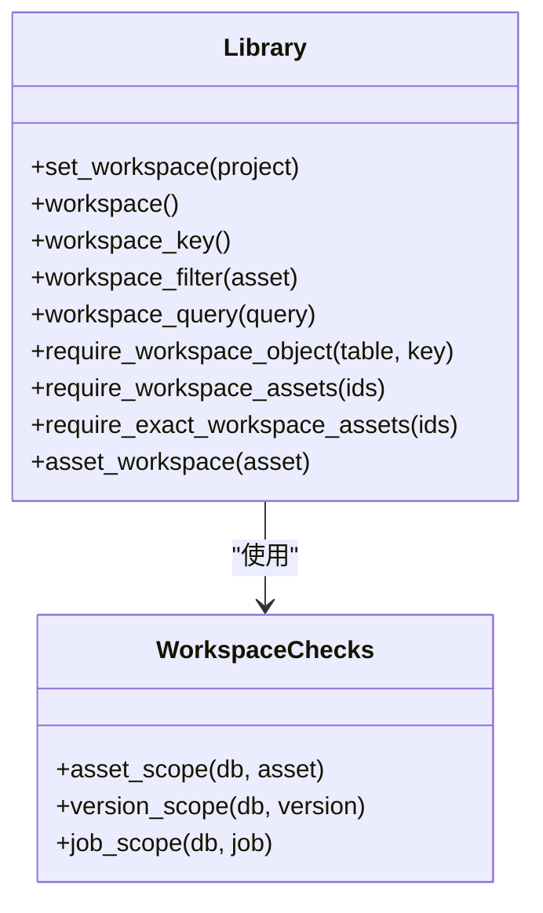

**图表来源**
- [workspace.rs:1-210](../../../../crates/moriq-library/src/catalog/workspace.rs#L1-L210)
- [workspace.rs:210-439](../../../../crates/moriq-library/src/catalog/workspace.rs#L210-L439)

**章节来源**
- [workspace.rs:1-210](../../../../crates/moriq-library/src/catalog/workspace.rs#L1-L210)
- [workspace.rs:210-439](../../../../crates/moriq-library/src/catalog/workspace.rs#L210-L439)

### 复制到项目：`copy_to_project`
该方法是跨项目素材复制的核心入口，其行为如下：
- 输入校验：数量必须在 1～10000 之间。
- 去重检查：如果目标项目中已存在相同源资产，则跳过。
- 资产克隆：调用项目隔离模块创建独立资产与版本。
- 注释与 AI 数据策略：
  - 若未启用注释复制：清空收藏、评分、备注；删除资产标签与分类；删除 AI 覆盖、拒绝标签、分析运行、结果、嵌入、人脸检测等数据。
  - 清理人员数据：删除仅在当前工作区中引用的人物，避免跨项目共享可变人员状态。
- 事务与文件副本：数据库事务提交后，文件副本才最终提交；失败时会延迟清理临时副本并记录诊断。

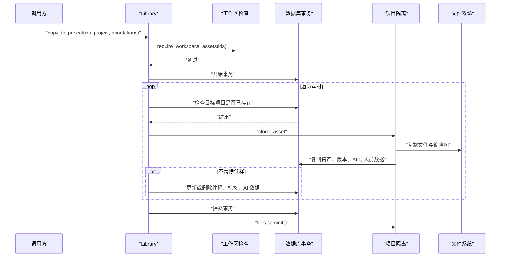

**图表来源**
- [workspace.rs:1-120](../../../../crates/moriq-library/src/catalog/workspace.rs#L1-L120)
- [project_isolation.rs:1-270](../../../../crates/moriq-library/src/catalog/project_isolation.rs#L1-L270)

**章节来源**
- [workspace.rs:1-120](../../../../crates/moriq-library/src/catalog/workspace.rs#L1-L120)
- [project_isolation.rs:1-270](../../../../crates/moriq-library/src/catalog/project_isolation.rs#L1-L270)

### 创建项目并初始化 AI 分类：`create_project_configured`
该方法不仅创建项目，还根据模板注入初始 AI 分类：
- 模板支持人像、产品、旅行等主题，并为每个主题生成类别。
- 若模板来自已有项目，则复用其 AI 配置；否则使用默认配置。
- 分类注入后会进行有效性校验，非法配置直接返回错误。
- 最终将项目与 AI 分类快照写入数据库。

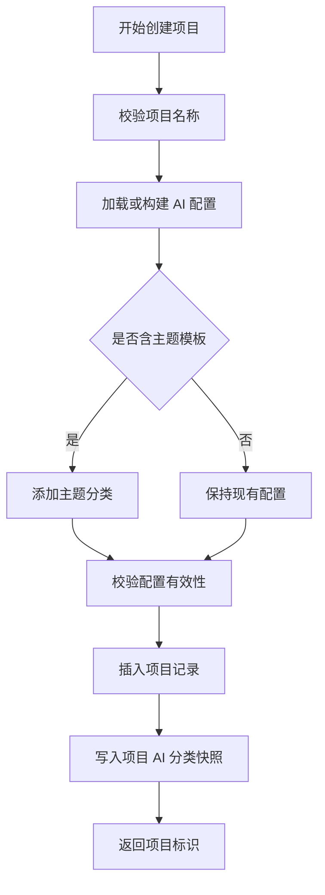

**图表来源**
- [workspace.rs:60-120](../../../../crates/moriq-library/src/catalog/workspace.rs#L60-L120)

**章节来源**
- [workspace.rs:60-120](../../../../crates/moriq-library/src/catalog/workspace.rs#L60-L120)

### 资产克隆机制与数据隔离
项目隔离模块负责将“相同内容”在不同项目中实现“独立身份”：
- 复用已有有效副本：若目标项目已有相同源资产的副本，则直接注册成员关系，避免重复复制。
- 新资产与版本：为每个项目生成新的资产 ID 与版本 ID，路径指向项目专属拷贝目录。
- 文件复制：仅复制实际存在的媒体文件与缩略图；离线缺失状态会被保留。
- 元数据复制：复制版本、位置、EXIF、指纹、AI 结果、AI 嵌入、AI 覆盖、AI 拒绝标签等。
- AI 分析运行：复制分析运行并重建有效结果映射。
- 人员与人脸：复制人脸检测记录，并重新登记人物归属。
- 分类与虚拟分组：在新项目中建立独立分类映射，清理不属于当前项目的虚拟分组成员。
- 幂等性：通过 `project_copies` 表保证重复复制不会破坏数据。

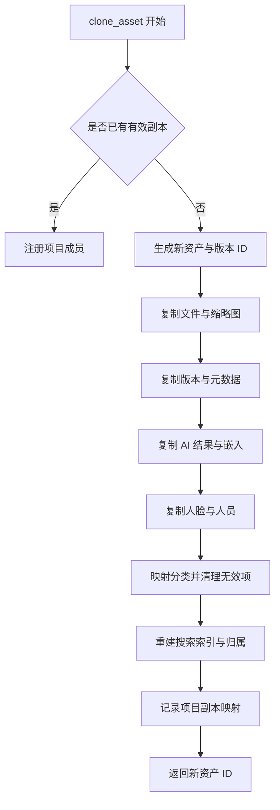

**图表来源**
- [project_isolation.rs:1-270](../../../../crates/moriq-library/src/catalog/project_isolation.rs#L1-L270)
- [workspace.rs:210-439](../../../../crates/moriq-library/src/catalog/workspace.rs#L210-L439)

**章节来源**
- [project_isolation.rs:1-270](../../../../crates/moriq-library/src/catalog/project_isolation.rs#L1-L270)
- [workspace.rs:210-439](../../../../crates/moriq-library/src/catalog/workspace.rs#L210-L439)

### 查询作用域与项目精确匹配
分页查询方法会在执行前调用 `workspace_query`，将工作区冻结到查询对象中。随后根据 `project_exact` 决定：
- 精确匹配：直接使用当前项目 ID 过滤，避免递归子项目匹配。
- 非精确匹配：允许包含子项目。

这保证了：
- 用户切换工作区后，历史查询计划不会被后续会话修改影响。
- 同一资源库下不同项目的分页结果互不干扰。

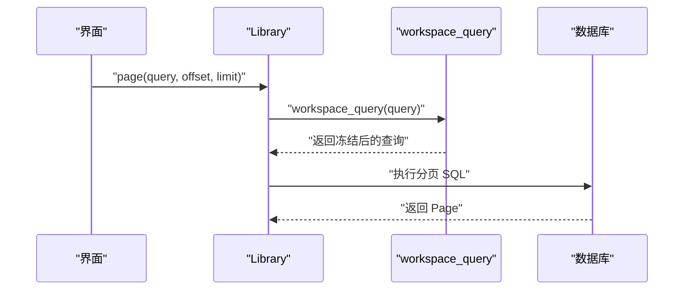

**图表来源**
- [query.rs:1-284](../../../../crates/moriq-library/src/catalog/query.rs#L1-L284)
- [workspace.rs:160-190](../../../../crates/moriq-library/src/catalog/workspace.rs#L160-L190)

**章节来源**
- [query.rs:1-284](../../../../crates/moriq-library/src/catalog/query.rs#L1-L284)
- [workspace.rs:160-190](../../../../crates/moriq-library/src/catalog/workspace.rs#L160-L190)

## 依赖关系分析
工作区模块与项目隔离模块之间存在清晰依赖：
- 工作区模块提供上下文、作用域转换与安全检查。
- 项目隔离模块实现具体复制、迁移与文件管理。
- 查询模块依赖工作区提供的精确项目匹配能力。

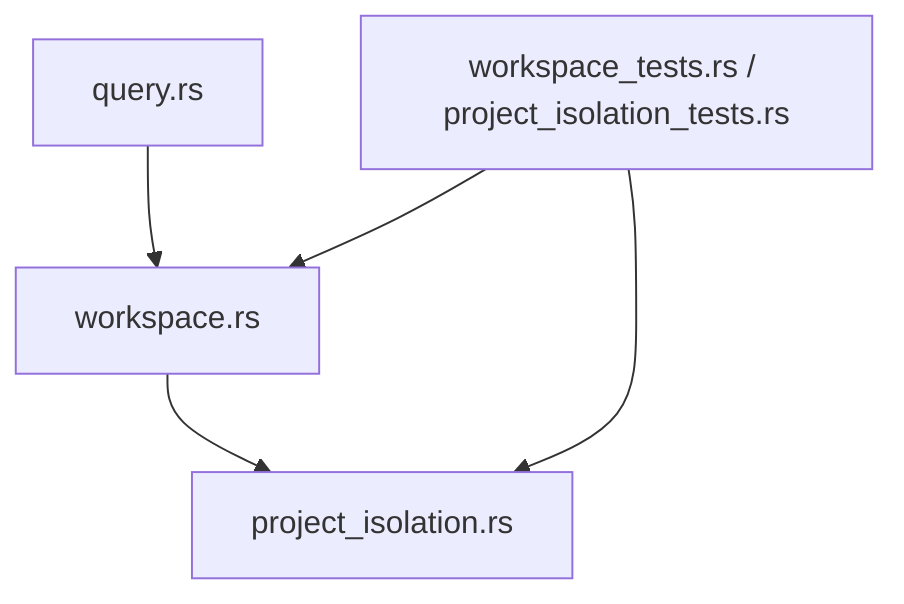

**图表来源**
- [workspace.rs:1-439](../../../../crates/moriq-library/src/catalog/workspace.rs#L1-L439)
- [project_isolation.rs:1-270](../../../../crates/moriq-library/src/catalog/project_isolation.rs#L1-L270)
- [query.rs:1-284](../../../../crates/moriq-library/src/catalog/query.rs#L1-L284)

**章节来源**
- [workspace.rs:1-439](../../../../crates/moriq-library/src/catalog/workspace.rs#L1-L439)
- [project_isolation.rs:1-270](../../../../crates/moriq-library/src/catalog/project_isolation.rs#L1-L270)
- [query.rs:1-284](../../../../crates/moriq-library/src/catalog/query.rs#L1-L284)

## 性能考虑
- 批量复制限制：`copy_to_project` 限制最大 10000 条素材，避免单次事务过大。
- 查询快照优化：普通项目首屏使用专用投影减少无关视图计算，提升分页性能。
- 临时查询表：大量筛选时使用临时表缓存排序与计数，降低重复计算。
- 文件复制延迟清理：未提交的副本在析构时清理，失败时记录警告以便恢复。
- 幂等复制：通过 `project_copies` 表避免重复复制带来的额外开销。

[本节为通用性能建议，不直接分析具体代码行]

## 故障排查指南
常见问题与定位方式：

| 现象 | 可能原因 | 排查与修复建议 |
|---|---|---|
| 复制到项目时报错“请选择 1～10000 个素材” | 输入素材数量为 0 或超过上限 | 检查调用方传入的素材列表长度 |
| 提示“选区包含其他项目的素材，请重新选择” | 所选素材不属于当前工作区 | 确认当前工作区是否正确，或先切换到素材所属项目 |
| 提示“此内容属于其他项目，请先进入所属项目” | 操作的目标对象不在当前工作区映射中 | 使用 `require_workspace_object` 前确认对象归属 |
| 提示“查询所属项目已改变，请重新打开页面” | 查询对象中的项目与工作区不一致 | 刷新页面或重新构建查询 |
| 复制到项目后 AI 描述丢失 | 未启用注释复制 | 确认调用时注释复制参数，或检查 AI 覆盖与有效结果是否被保留 |
| 复制后人物归属异常 | 人物数据跨项目共享 | 检查工作区迁移与人物复制逻辑，确保人物仅在所属项目可见 |
| 项目升级后行为异常 | 旧版共享素材模型未正确拆分 | 检查迁移日志与备份目录，确认 `project_copies` 与项目成员表已重建 |

**章节来源**
- [workspace.rs:1-210](../../../../crates/moriq-library/src/catalog/workspace.rs#L1-L210)
- [project_isolation.rs:1-270](../../../../crates/moriq-library/src/catalog/project_isolation.rs#L1-L270)
- [workspace_tests.rs:1-200](../../../../crates/moriq-library/src/tests/workspace_tests.rs#L1-L200)
- [project_isolation_tests.rs:1-200](../../../../crates/moriq-library/src/tests/project_isolation_tests.rs#L1-L200)

## 结论
工作区隔离机制以“项目范围”为核心，通过上下文冻结、作用域转换、安全检查与资产克隆，实现了多项目下的数据隔离与操作安全。`copy_to_project` 与 `create_project_configured` 分别承担素材复制与项目初始化职责；`set_workspace`、`workspace`、`query_scope`、`workspace_key`、`workspace_filter`、`workspace_query` 共同保证查询与写操作始终作用于预期项目；`require_workspace_object` 与 `require_workspace_assets` 提供跨项目防护。配合测试覆盖，该机制能够在复杂业务场景下维持资源库的一致性与安全性。

[本节为总结性内容，不直接分析具体代码行]