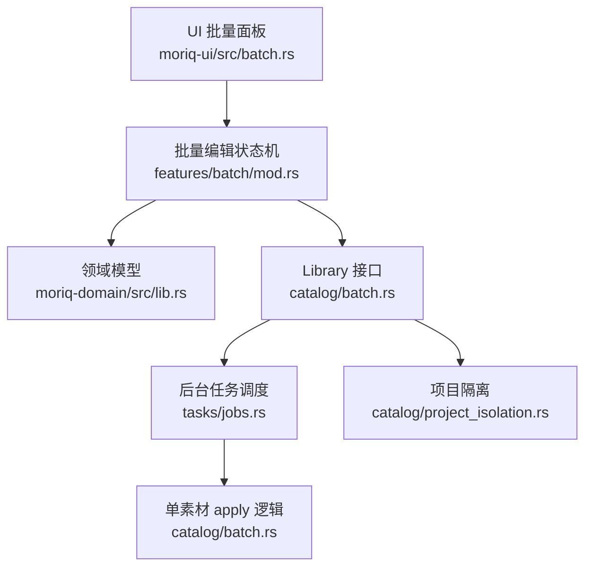
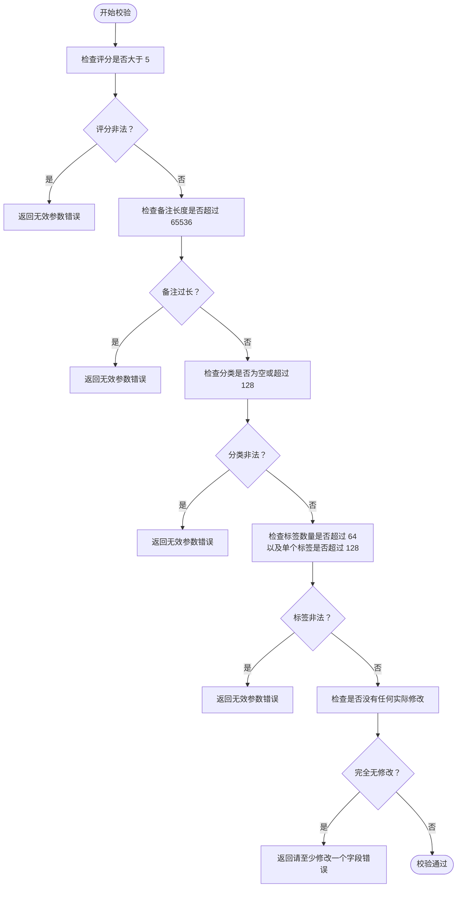
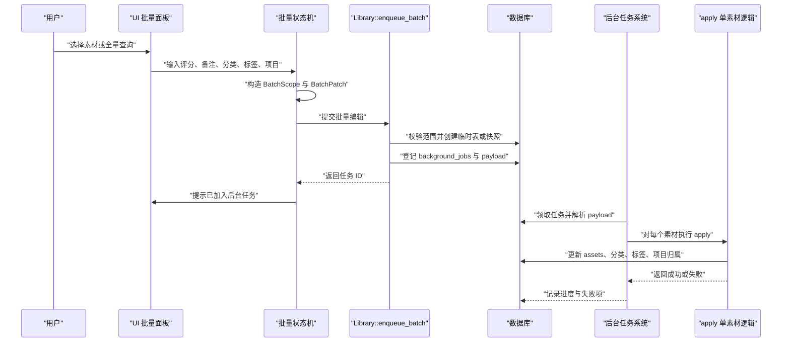
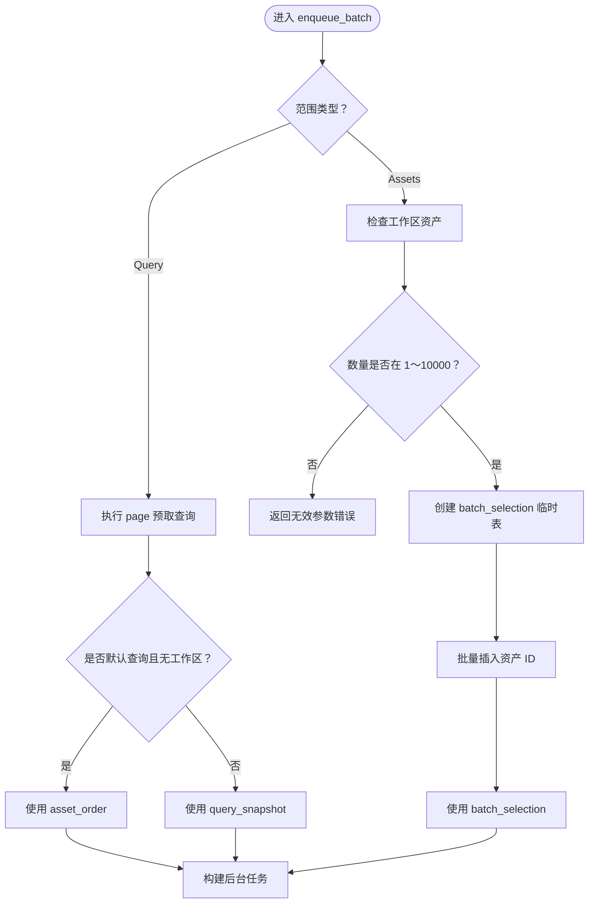
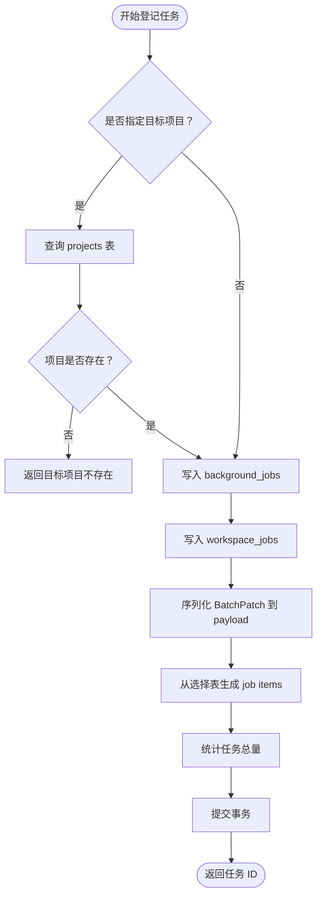
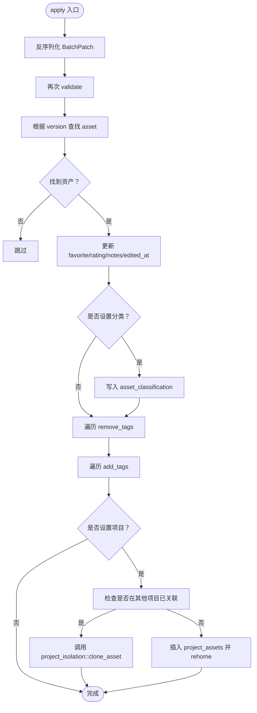
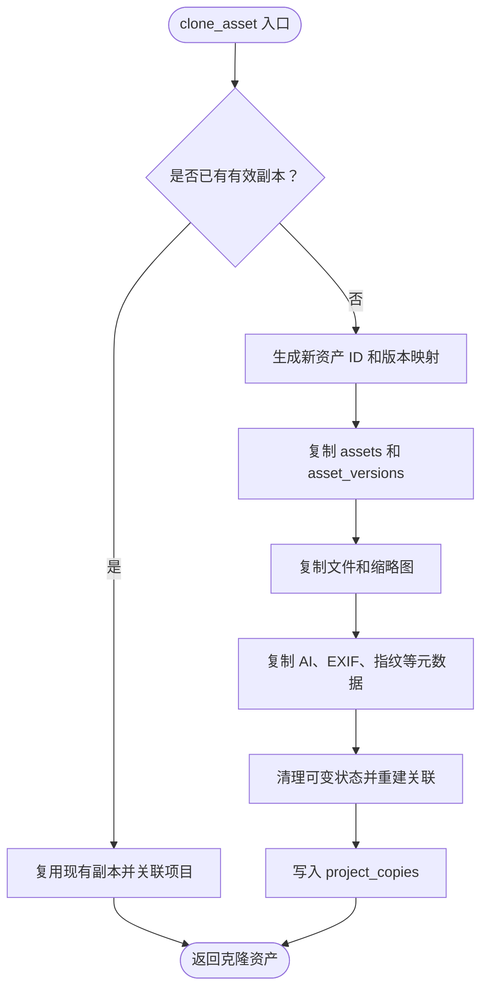
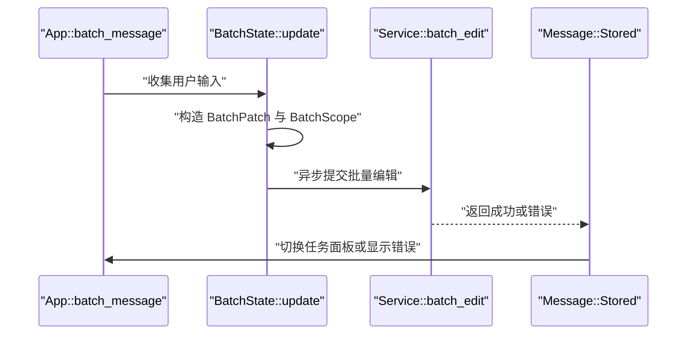
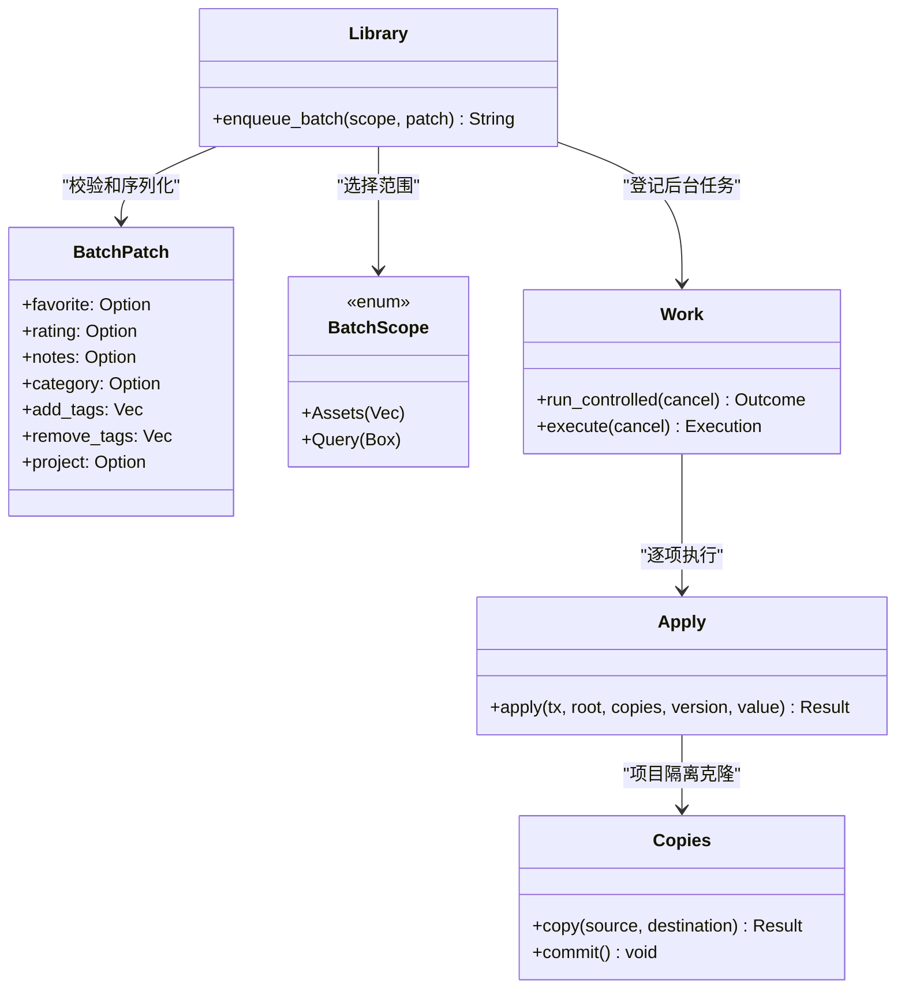
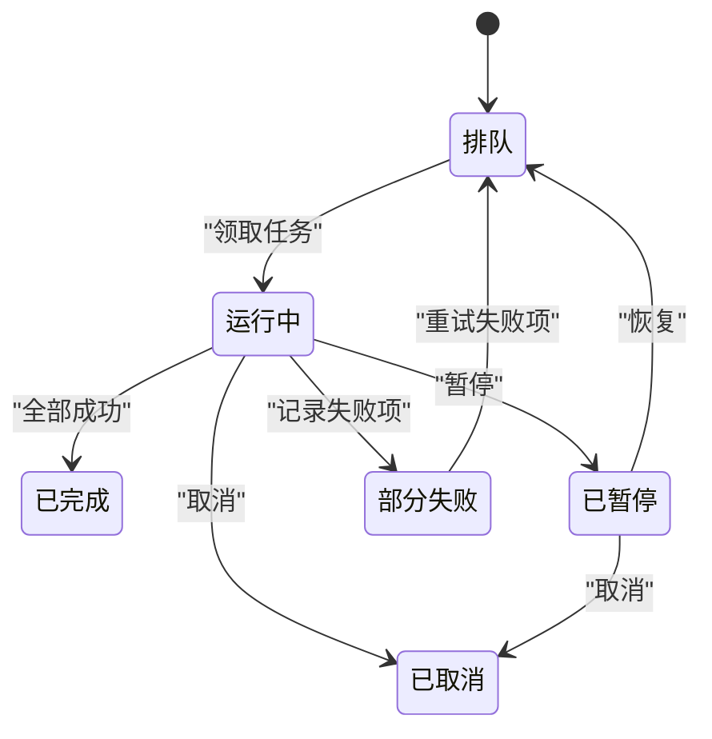

# 批量操作 (Batch)

> Repo Wiki 节点 `batch-operations`
> 导出自 Qoder 知识库快照 `8fbe02f6-57c2-4874-b725-1a8130851fd9`，代码基线 `7a7a8e75e18bd90294e09cd422dd7ed5a04813a0`（分支 main，zh-CN）。

<cite>
**本文引用的文件**
- [batch.rs](../../../../crates/moriq-library/src/catalog/batch.rs)
- [lib.rs（领域模型）](../../../../crates/moriq-domain/src/lib.rs)
- [project_isolation.rs](../../../../crates/moriq-library/src/catalog/project_isolation.rs)
- [jobs.rs（后台任务）](../../../../crates/moriq-library/src/tasks/jobs.rs)
- [batch.rs（UI 适配层）](../../../../crates/moriq-ui/src/batch.rs)
- [mod.rs（批量编辑状态机）](../../../../crates/moriq-ui/src/features/batch/mod.rs)
</cite>

## 目录
1. [引言](#引言)
2. [项目结构定位](#项目结构定位)
3. [核心数据结构与验证规则](#核心数据结构与验证规则)
4. [架构总览](#架构总览)
5. [详细组件分析](#详细组件分析)
6. [依赖关系分析](#依赖关系分析)
7. [性能与并发特性](#性能与并发特性)
8. [Rust API 调用示例](#rust-api-调用示例)
9. [故障排查指南](#故障排查指南)
10. [结论](#结论)

## 引言
本文聚焦 Moriq Space 目录管理系统中的“批量操作”模块，重点说明以下能力：
- `BatchPatch` 数据结构和字段约束，包括收藏、评分、备注、分类、标签和项目归属。
- `enqueue_batch` 方法如何选择范围、冻结查询快照或资产集合、登记后台任务并处理错误。
- `apply` 函数如何对单个素材应用批量修改，以及它与项目隔离、资产克隆的关系。
- 与后台作业系统的集成方式、项目隔离策略和 UI 提交流程。
- 性能优化建议与常见错误处理方案。

该模块的核心思想是：**用户在前端发起批量修改请求后，后端不直接同步遍历大量素材，而是将修改意图持久化为后台任务，再由任务系统逐项执行，从而提升可取消性、可恢复性和可扩展性。**

## 项目结构定位
批量操作横跨领域模型、目录服务、后台任务和 UI 层：



**图表来源**
- [batch.rs（UI 适配层）:1-76](../../../../crates/moriq-ui/src/batch.rs#L1-L76)
- [mod.rs（批量编辑状态机）:1-153](../../../../crates/moriq-ui/src/features/batch/mod.rs#L1-L153)
- [lib.rs（领域模型）:460-474](../../../../crates/moriq-domain/src/lib.rs#L460-L474)
- [batch.rs（目录批量）:1-159](../../../../crates/moriq-library/src/catalog/batch.rs#L1-L159)
- [jobs.rs（后台任务）:1-200](../../../../crates/moriq-library/src/tasks/jobs.rs#L1-L200)
- [project_isolation.rs:1-270](../../../../crates/moriq-library/src/catalog/project_isolation.rs#L1-L270)

**章节来源**
- [batch.rs（目录批量）:1-159](../../../../crates/moriq-library/src/catalog/batch.rs#L1-L159)
- [lib.rs（领域模型）:460-474](../../../../crates/moriq-domain/src/lib.rs#L460-L474)
- [batch.rs（UI 适配层）:1-76](../../../../crates/moriq-ui/src/batch.rs#L1-L76)
- [mod.rs（批量编辑状态机）:1-153](../../../../crates/moriq-ui/src/features/batch/mod.rs#L1-L153)

## 核心数据结构与验证规则

### BatchPatch 字段语义
`BatchPatch` 表示一次批量修改的增量意图，所有字段均为可选；只有至少一个字段生效时，请求才被接受。

| 字段 | 类型 | 含义 | 约束与行为 |
|---|---|---|---|
| `favorite` | `Option<bool>` | 设置收藏状态 | 若为 `Some(true)` 则收藏；`Some(false)` 则取消收藏；未设置则保持原值。 |
| `rating` | `Option<u8>` | 设置评分 | 必须在 0～5 之间；超过 5 会触发无效参数错误。 |
| `notes` | `Option<String>` | 设置备注 | 长度上限为 65536；未设置时不会覆盖现有备注。 |
| `category` | `Option<String>` | 设置分类 | 不能为空字符串，且去除空白后长度不能超过 128。 |
| `add_tags` | `Vec<String>` | 新增标签 | 每个标签长度不超过 128；与删除标签总数不超过 64。 |
| `remove_tags` | `Vec<String>` | 删除标签 | 同上；删除时会记录被拒绝标签以便后续 AI 标签建议。 |
| `project` | `Option<ProjectId>` | 变更项目归属 | 目标项目必须存在；可能触发资产克隆或同项目内重新归属。 |

**章节来源**
- [lib.rs（领域模型）:460-474](../../../../crates/moriq-domain/src/lib.rs#L460-L474)
- [batch.rs（目录批量）:1-35](../../../../crates/moriq-library/src/catalog/batch.rs#L1-L35)

### 批量字段校验规则
`validate` 函数在两个位置被调用：
1. `enqueue_batch` 入口处，防止无效批量请求进入后台队列。
2. `apply` 函数中，确保后台任务执行时对每条素材再次校验。

主要校验逻辑如下：



**图表来源**
- [batch.rs（目录批量）:1-35](../../../../crates/moriq-library/src/catalog/batch.rs#L1-L35)

关键约束总结：
- **评分**：必须小于等于 5。
- **备注**：最大 65536 字符。
- **分类**：去空白后不能为空，且最大 128 字符。
- **标签**：新增与删除标签合计不超过 64，单个标签不超过 128。
- **空修改**：如果所有字段均未提供实际修改，则拒绝请求。

**章节来源**
- [batch.rs（目录批量）:1-35](../../../../crates/moriq-library/src/catalog/batch.rs#L1-L35)

## 架构总览
批量操作的完整生命周期分为三个阶段：

1. **前端组装**：用户在 UI 中选择范围、填写批量字段，状态机会生成 `BatchScope` 和 `BatchPatch`。
2. **后端登记**：`Library::enqueue_batch` 校验范围、创建临时选择表或查询快照、写入后台任务元数据和负载。
3. **后台执行**：任务系统取出任务，逐条解析 `BatchPatch`，并通过 `apply` 更新素材属性、分类、标签和项目归属。



**图表来源**
- [mod.rs（批量编辑状态机）:1-153](../../../../crates/moriq-ui/src/features/batch/mod.rs#L1-L153)
- [batch.rs（目录批量）:36-110](../../../../crates/moriq-library/src/catalog/batch.rs#L36-L110)
- [jobs.rs（后台任务）:1-200](../../../../crates/moriq-library/src/tasks/jobs.rs#L1-L200)
- [batch.rs（目录批量）:111-159](../../../../crates/moriq-library/src/catalog/batch.rs#L111-L159)

**章节来源**
- [mod.rs（批量编辑状态机）:1-153](../../../../crates/moriq-ui/src/features/batch/mod.rs#L1-L153)
- [batch.rs（目录批量）:36-159](../../../../crates/moriq-library/src/catalog/batch.rs#L36-L159)
- [jobs.rs（后台任务）:1-200](../../../../crates/moriq-library/src/tasks/jobs.rs#L1-L200)

## 详细组件分析

### 批量范围冻结：BatchScope::Query 与 BatchScope::Assets
`enqueue_batch` 根据 `BatchScope` 决定如何冻结选择范围：

#### Query 范围
- 使用 `self.page(query, 0, 0)` 预取查询结果，确保查询快照稳定。
- 如果是默认查询且当前没有工作区，则使用 `asset_order` 作为基准。
- 否则使用 `query_snapshot` 作为查询快照表名。

#### Assets 范围
- 通过 `require_workspace_assets(ids)` 校验资产属于当前工作区。
- 如果数量为 0 或超过 10000，直接返回无效参数错误。
- 创建临时表 `batch_selection`，并将资产 ID 批量插入。
- 最终使用 `batch_selection` 作为任务项来源。



**图表来源**
- [batch.rs（目录批量）:36-82](../../../../crates/moriq-library/src/catalog/batch.rs#L36-L82)

**章节来源**
- [batch.rs（目录批量）:36-82](../../../../crates/moriq-library/src/catalog/batch.rs#L36-L82)

### 后台任务登记与事务处理
登记阶段完成以下工作：

1. **目标项目存在性检查**：如果 `patch.project` 指定了项目，先查询 `projects` 表确认目标项目存在。
2. **写入后台任务主记录**：插入 `background_jobs`，类型为 `batch`，优先级为 20，初始状态为 `queued`。
3. **绑定工作区**：插入 `workspace_jobs`，使任务与工作区关联。
4. **序列化负载**：将 `BatchPatch` 序列化为 JSON 存入 `background_job_payload`。
5. **计算任务项**：从选择的资源表连接 `assets`，按 `display_version_id` 生成 `background_job_items`。
6. **统计总量**：更新任务的 `total` 字段。
7. **提交事务**：所有步骤在一个事务中提交，保证一致性。



**图表来源**
- [batch.rs（目录批量）:83-110](../../../../crates/moriq-library/src/catalog/batch.rs#L83-L110)

**章节来源**
- [batch.rs（目录批量）:83-110](../../../../crates/moriq-library/src/catalog/batch.rs#L83-L110)

### apply 函数：单素材批量修改
`apply` 是后台任务执行时对单个素材调用的核心逻辑。它接收数据库连接、根路径、项目复制缓存、版本标识和反序列化的 JSON 负载。

主要流程：

1. **反序列化并校验**：将 JSON 负载转为 `BatchPatch`，并再次调用 `validate`。
2. **定位资产**：根据版本 ID 查找对应资产；如果版本不存在，直接跳过。
3. **基础属性更新**：使用 `coalesce` 保留未提供的字段，同时更新 `edited_at`。
4. **分类更新**：插入或更新 `asset_classification`，并标记为手动分类。
5. **删除标签**：从 `asset_tags` 删除指定标签，并把被删除标签记录到 `ai_rejected_tags`。
6. **新增标签**：确保标签存在，再建立资产与标签关系。
7. **项目归属变更**：
   - 如果资产已在其他项目中存在关联，则调用 `project_isolation::clone_asset` 进行资产克隆。
   - 否则直接插入 `project_assets` 并调用 `workspace::rehome_asset` 更新工作区归属。



**图表来源**
- [batch.rs（目录批量）:111-159](../../../../crates/moriq-library/src/catalog/batch.rs#L111-L159)

**章节来源**
- [batch.rs（目录批量）:111-159](../../../../crates/moriq-library/src/catalog/batch.rs#L111-L159)

### 项目隔离与资产克隆
当批量移动素材到新项目时，系统需要避免多个项目共享可变状态。`project_isolation::clone_asset` 负责为目标项目创建独立资产身份：

- 如果已经存在有效副本，则复用该副本并直接关联目标项目。
- 否则生成新的资产 ID 和版本映射。
- 复制必要文件：原始资产文件、缩略图、AI 结果、人脸检测结果等。
- 复制元数据表：资产版本、文件位置、视频元数据、EXIF、指纹、AI 结果、嵌入、覆盖结果、拒绝标签等。
- 清理旧的可变状态：如标签、分类、虚拟文件夹关联等，由新资产继承。
- 最后写入 `project_copies` 以记录源资产、目标项目和克隆资产的映射。



**图表来源**
- [project_isolation.rs:1-270](../../../../crates/moriq-library/src/catalog/project_isolation.rs#L1-L270)

**章节来源**
- [project_isolation.rs:1-270](../../../../crates/moriq-library/src/catalog/project_isolation.rs#L1-L270)

### UI 提交流程与状态管理
UI 层的批量编辑由 `App::batch_message` 和 `BatchState::update` 共同维护：

- `App::batch_context` 提供当前库、项目、查询、选中资产、语言和目标项目列表。
- `BatchState::update` 将用户输入转换为 `BatchPatch` 和 `BatchScope`。
- 当用户点击应用时，UI 调用 `service.batch_edit(owner, scope, patch)`，并将结果包装为消息回传。
- 成功后切换到任务面板，并刷新整理视图。



**图表来源**
- [batch.rs（UI 适配层）:1-76](../../../../crates/moriq-ui/src/batch.rs#L1-L76)
- [mod.rs（批量编辑状态机）:1-153](../../../../crates/moriq-ui/src/features/batch/mod.rs#L1-L153)

**章节来源**
- [batch.rs（UI 适配层）:1-76](../../../../crates/moriq-ui/src/batch.rs#L1-L76)
- [mod.rs（批量编辑状态机）:1-153](../../../../crates/moriq-ui/src/features/batch/mod.rs#L1-L153)

## 依赖关系分析



**图表来源**
- [lib.rs（领域模型）:460-474](../../../../crates/moriq-domain/src/lib.rs#L460-L474)
- [batch.rs（目录批量）:36-159](../../../../crates/moriq-library/src/catalog/batch.rs#L36-L159)
- [jobs.rs（后台任务）:1-200](../../../../crates/moriq-library/src/tasks/jobs.rs#L1-L200)
- [project_isolation.rs:1-270](../../../../crates/moriq-library/src/catalog/project_isolation.rs#L1-L270)

**章节来源**
- [lib.rs（领域模型）:460-474](../../../../crates/moriq-domain/src/lib.rs#L460-L474)
- [batch.rs（目录批量）:36-159](../../../../crates/moriq-library/src/catalog/batch.rs#L36-L159)
- [jobs.rs（后台任务）:1-200](../../../../crates/moriq-library/src/tasks/jobs.rs#L1-L200)
- [project_isolation.rs:1-270](../../../../crates/moriq-library/src/catalog/project_isolation.rs#L1-L270)

## 性能与并发特性

### 性能特征
- **批量登记 O(1)**：登记阶段只写入少量元数据，不直接遍历全部素材。
- **批量执行 O(n)**：后台任务按 `background_job_items` 顺序逐项执行，适合大规模素材。
- **临时表优化**：`BatchScope::Assets` 使用临时表减少重复查询。
- **查询快照**：`BatchScope::Query` 通过预取查询快照避免动态查询漂移。
- **资产克隆成本较高**：跨项目移动可能复制文件和多张元数据表，应避免频繁大批量跨项目移动。

### 并发与可取消
- 后台任务具有任务 ID 和 generation 号，用于避免旧任务覆盖新任务。
- 支持暂停、恢复、取消和重试失败项。
- 批量任务优先级固定为 20，与其他媒体任务区分开。
- 任务执行过程中可检查取消标志，并在失败时记录逐项错误。

### 优化建议
1. **优先使用查询范围**：对大规模素材使用 `BatchScope::Query`，避免一次性传入过多资产 ID。
2. **控制单次批量规模**：资产范围限制为最多 10000，超大范围应拆分或使用查询快照。
3. **谨慎跨项目移动**：跨项目移动会触发资产克隆，尽量合并同类操作。
4. **利用标签批量操作**：新增或删除标签时使用合理数量的标签，避免超过 64 的限制。
5. **监控后台任务**：通过任务状态和失败记录观察批量任务进度，必要时暂停或重试。

[本节为通用性能讨论，不直接分析具体代码行]

## Rust API 调用示例

以下示例基于仓库中实际使用的类型和调用模式编写，仅展示调用思路和参数结构，不包含具体源码内容。

### 批量编辑：设置收藏、评分、备注、分类和标签
```rust
use moriq_domain::{BatchPatch, BatchScope};

// 假设 library 是 Library 实例
let patch = BatchPatch {
    favorite: Some(true),
    rating: Some(4),
    notes: Some("批量标注".to_string()),
    category: Some("重要".to_string()),
    add_tags: vec!["待审核".to_string(), "高质量".to_string()],
    remove_tags: vec!["草稿".to_string()],
    project: None,
};

let scope = BatchScope::Query(Box::new(current_query));
let job_id = library.enqueue_batch(scope, patch)?;
```

### 批量标签管理：仅添加和删除标签
```rust
let patch = BatchPatch {
    favorite: None,
    rating: None,
    notes: None,
    category: None,
    add_tags: vec!["已归档".to_string()],
    remove_tags: vec!["临时".to_string(), "废弃".to_string()],
    project: None,
};

let scope = BatchScope::Assets(selected_asset_ids);
let job_id = library.enqueue_batch(scope, patch)?;
```

### 批量项目移动：移动到目标项目
```rust
use moriq_domain::ProjectId;

let target_project = ProjectId::from("目标项目ID");
let patch = BatchPatch {
    favorite: None,
    rating: None,
    notes: None,
    category: None,
    add_tags: vec![],
    remove_tags: vec![],
    project: Some(target_project),
};

let scope = BatchScope::Query(Box::new(all_assets_query));
let job_id = library.enqueue_batch(scope, patch)?;
```

说明：
- `BatchScope::Query` 适用于全量或筛选后的素材集合。
- `BatchScope::Assets` 适用于明确选中的素材 ID 列表。
- `enqueue_batch` 返回后台任务 ID，可用于查询任务状态、进度和失败项。
- 跨项目移动会触发 `project_isolation::clone_asset`，因此涉及文件复制和元数据克隆。

**章节来源**
- [lib.rs（领域模型）:460-474](../../../../crates/moriq-domain/src/lib.rs#L460-L474)
- [batch.rs（目录批量）:36-159](../../../../crates/moriq-library/src/catalog/batch.rs#L36-L159)
- [project_isolation.rs:1-270](../../../../crates/moriq-library/src/catalog/project_isolation.rs#L1-L270)

## 故障排查指南

### 常见错误及原因
| 错误场景 | 可能原因 | 处理方式 |
|---|---|---|
| “批量字段内容或数量无效” | 评分超过 5、备注过长、分类为空或过长、标签数量或长度超限 | 修正字段值，确保满足 `validate` 约束。 |
| “请至少修改一个字段” | 所有 `BatchPatch` 字段均未提供实际修改 | 至少设置收藏、评分、备注、分类、标签或项目之一。 |
| “请选择素材或使用完整查询范围” | 资产列表为空或超过 10000 | 缩小选择范围或使用查询范围。 |
| “目标项目已不存在” | 指定移动到的项目已被删除 | 重新选择有效项目。 |
| 后台任务卡住或失败 | 任务被暂停、取消或单项素材处理失败 | 查看任务状态、失败记录和错误信息。 |

### 任务状态与重试
后台任务系统提供以下能力：
- **暂停任务**：将任务状态设为 `paused`，停止继续执行。
- **恢复任务**：将任务状态设回 `queued`，允许继续执行。
- **取消任务**：将任务状态设为 `cancelled`。
- **重试失败项**：根据历史失败记录创建新任务，只处理仍可处理的素材。
- **查看失败详情**：通过任务 ID 获取失败资产、版本和错误消息。



**图表来源**
- [jobs.rs（后台任务）:200-500](../../../../crates/moriq-library/src/tasks/jobs.rs#L200-L500)

**章节来源**
- [batch.rs（目录批量）:1-110](../../../../crates/moriq-library/src/catalog/batch.rs#L1-L110)
- [jobs.rs（后台任务）:200-500](../../../../crates/moriq-library/src/tasks/jobs.rs#L200-L500)

## 结论
批量操作模块通过 `BatchPatch` 和 `BatchScope` 将用户意图结构化，再通过 `enqueue_batch` 将批量修改登记为后台任务，最后由 `apply` 逐项执行。该设计实现了：
- **强约束**：评分、备注、分类、标签和项目归属均有明确校验。
- **可恢复**：任务状态、失败记录和重试机制保证批量操作可靠。
- **项目安全**：跨项目移动通过资产克隆避免共享可变状态。
- **可扩展**：后台任务系统与 UI、数据库、文件系统和项目隔离紧密协作。

在实际使用中，应优先使用查询范围、控制批量规模、谨慎跨项目移动，并结合任务状态和失败记录进行运维和排错。

[本节为总结性内容，不直接分析具体代码行]