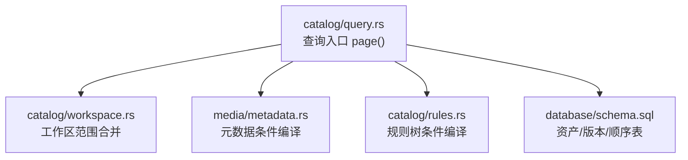
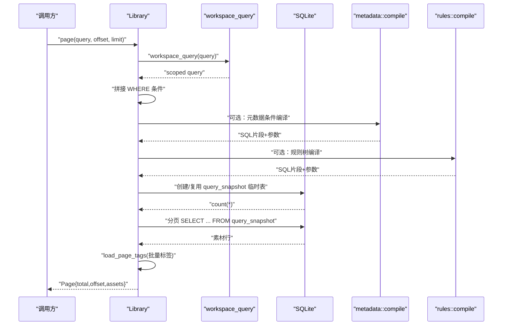
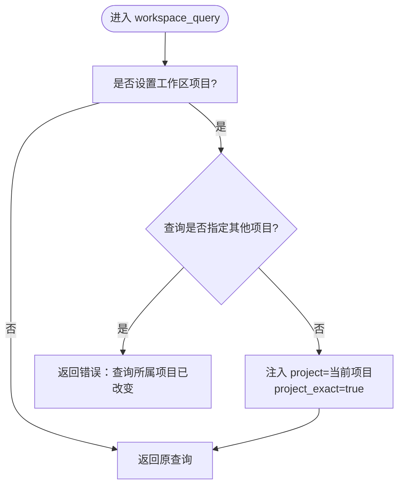
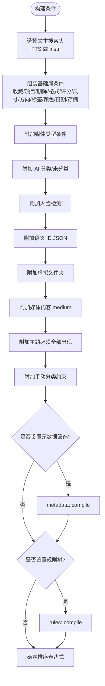
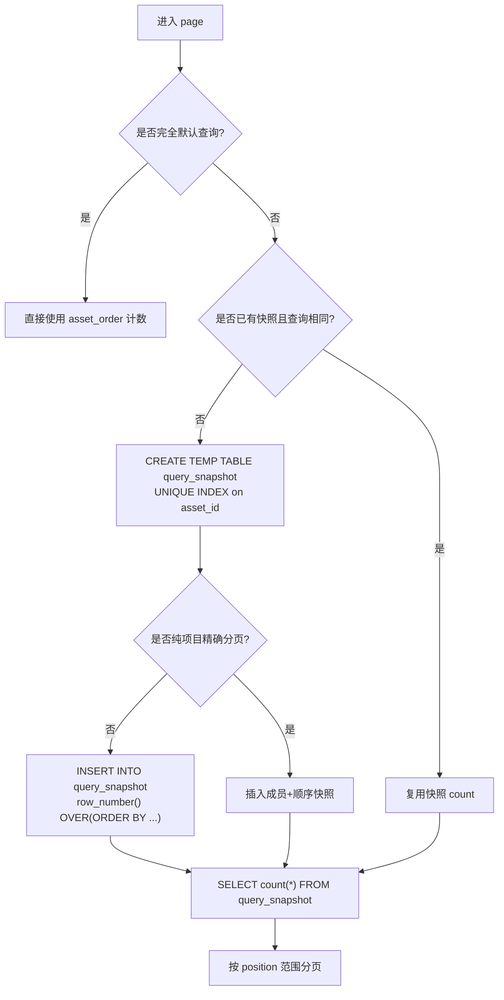
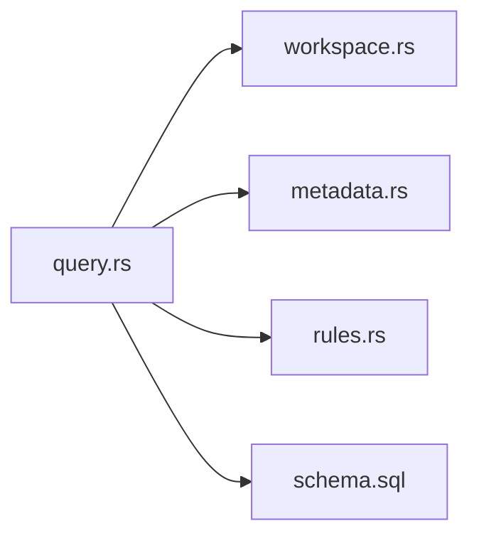

# 查询引擎（Query）

> Repo Wiki 节点 `query-engine`
> 导出自 Qoder 知识库快照 `8fbe02f6-57c2-4874-b725-1a8130851fd9`，代码基线 `7a7a8e75e18bd90294e09cd422dd7ed5a04813a0`（分支 main，zh-CN）。

<cite>
**本文引用的文件**   
- [crates/moriq-library/src/catalog/query.rs](../../../../crates/moriq-library/src/catalog/query.rs)
- [crates/moriq-library/src/catalog/workspace.rs](../../../../crates/moriq-library/src/catalog/workspace.rs)
- [crates/moriq-library/src/media/metadata.rs](../../../../crates/moriq-library/src/media/metadata.rs)
- [crates/moriq-library/src/catalog/rules.rs](../../../../crates/moriq-library/src/catalog/rules.rs)
- [crates/moriq-library/src/database/schema.sql](../../../../crates/moriq-library/src/database/schema.sql)
</cite>

## 目录
1. [引言](#引言)
2. [项目结构](#项目结构)
3. [核心组件](#核心组件)
4. [架构总览](#架构总览)
5. [详细组件分析](#详细组件分析)
6. [依赖关系分析](#依赖关系分析)
7. [性能与优化](#性能与优化)
8. [故障排查指南](#故障排查指南)
9. [结论](#结论)
10. [附录：查询构建示例与最佳实践](#附录：查询构建示例与最佳实践)

## 引言
本文件聚焦 Moriq Space 目录管理系统中的查询引擎，围绕 `Library::page` 方法展开，系统性说明工作区范围合并、动态 SQL 条件构建、全文搜索优化、分页策略、筛选条件编译、排序选项、查询快照缓存以及标签批量加载等关键机制。文档旨在帮助读者理解复杂筛选条件的组合方式、性能调优手段和常见查询模式，既适合开发者深入源码，也适合非专业用户理解系统行为。

## 项目结构
查询引擎主要位于 `moriq-library` crate 的目录管理与媒体检索相关模块中：
- 查询入口与主流程：`catalog/query.rs`
- 工作区范围控制：`catalog/workspace.rs`
- 元数据筛选编译：`media/metadata.rs`
- 规则树筛选编译：`catalog/rules.rs`
- 数据库表结构与索引：`database/schema.sql`

图表来源
- [crates/moriq-library/src/catalog/query.rs:1-180](../../../../crates/moriq-library/src/catalog/query.rs#L1-L180)
- [crates/moriq-library/src/catalog/workspace.rs:1-120](../../../../crates/moriq-library/src/catalog/workspace.rs#L1-L120)
- [crates/moriq-library/src/media/metadata.rs:1-153](../../../../crates/moriq-library/src/media/metadata.rs#L1-L153)
- [crates/moriq-library/src/catalog/rules.rs:1-53](../../../../crates/moriq-library/src/catalog/rules.rs#L1-L53)
- [crates/moriq-library/src/database/schema.sql:1-42](../../../../crates/moriq-library/src/database/schema.sql#L1-L42)

章节来源
- [crates/moriq-library/src/catalog/query.rs:1-180](../../../../crates/moriq-library/src/catalog/query.rs#L1-L180)
- [crates/moriq-library/src/database/schema.sql:1-42](../../../../crates/moriq-library/src/database/schema.sql#L1-L42)

## 核心组件
- `Library::page`：根据当前工作区、查询条件和分页参数返回一页素材及总数。
- 工作区过滤：将当前项目范围注入查询，并拒绝跨项目访问。
- 动态 SQL 构建：按文本搜索、收藏、项目范围、删除状态、格式、评分、尺寸、方向、标签、颜色、日期、存储状态、媒体类型、AI 分类、人脸检测、语义 ID、虚拟文件夹、主题、手动分类等条件拼接 WHERE 子句。
- 全文搜索优化：短文本走通用列匹配；长文本走 FTS 视图或 AI 文本视图。
- 查询快照：临时表 + 唯一索引复用，避免重复规划昂贵视图。
- 排序：支持最新、最旧、名称、大小、评分；语义活跃时按语义 ID 列表顺序稳定排序。
- 标签批量加载：对当前页素材一次性读取有效标签，避免逐条展开 AI 视图。

章节来源
- [crates/moriq-library/src/catalog/query.rs:1-180](../../../../crates/moriq-library/src/catalog/query.rs#L1-L180)
- [crates/moriq-library/src/catalog/query.rs:180-284](../../../../crates/moriq-library/src/catalog/query.rs#L180-L284)

## 架构总览
查询流程从应用层构造 `Query` 开始，进入 `page` 后依次完成：
1. 工作区范围校验与合并。
2. 动态条件拼装，包括基础过滤、元数据、规则树。
3. 选择全文搜索路径（FTS 或通用列）。
4. 生成排序表达式。
5. 计算总数（优先使用查询快照）。
6. 根据未过滤或已过滤路径选取数据源并分页。
7. 读取素材行并批量加载标签。

图表来源
- [crates/moriq-library/src/catalog/query.rs:1-180](../../../../crates/moriq-library/src/catalog/query.rs#L1-L180)
- [crates/moriq-library/src/catalog/query.rs:180-284](../../../../crates/moriq-library/src/catalog/query.rs#L180-L284)
- [crates/moriq-library/src/catalog/workspace.rs:100-160](../../../../crates/moriq-library/src/catalog/workspace.rs#L100-L160)
- [crates/moriq-library/src/media/metadata.rs:90-153](../../../../crates/moriq-library/src/media/metadata.rs#L90-L153)
- [crates/moriq-library/src/catalog/rules.rs:1-53](../../../../crates/moriq-library/src/catalog/rules.rs#L1-L53)

## 详细组件分析

### 工作区查询合并与范围隔离
工作区用于限定后续操作所属的项目。`workspace_query` 会将当前会话的项目范围强制注入查询，若查询显式指定了不同项目则直接报错，保证跨项目访问被拒绝。当处于项目模式下，查询还会切换到精确项目匹配逻辑，避免递归祖先匹配带来的额外开销。

关键点
- 会话级项目范围冻结为查询键，避免异步任务共享可变范围。
- 冲突项目立即返回错误，防止页面上下文不一致。
- 精确匹配可跳过递归 descendants 子查询，减少计划成本。

图表来源
- [crates/moriq-library/src/catalog/workspace.rs:100-160](../../../../crates/moriq-library/src/catalog/workspace.rs#L100-L160)

章节来源
- [crates/moriq-library/src/catalog/workspace.rs:100-160](../../../../crates/moriq-library/src/catalog/workspace.rs#L100-L160)

### 动态 SQL 条件构建
`page` 方法负责把 `Query` 字段映射到 SQL 条件与绑定参数。整体条件由多个部分组成：
- 文本搜索头：短文本使用 `name/notes/AI 正文/有效标签` 的 `instr` 匹配；长文本使用 FTS 或 AI 文本 FTS。
- 固定尾条件：收藏、项目范围、删除状态、格式、评分、字节数上下界、时间范围、宽度、方向、无标签、未分配、标签名、主色、编辑时间、存储状态、之前时间。
- 媒体类型：原始/视频分别对应不同的格式集合。
- AI 分类：按类别或“未分类”反向匹配。
- 人脸检测：按 person_id 过滤。
- 语义 ID：JSON 数组包含 asset_id。
- 虚拟文件夹：关联 `virtual_folder_assets`。
- 媒体内容：按 `ai_effective_content.medium`。
- 主题：必须包含全部指定主题值。
- 手动分类：仅在存在 AI 结果时要求手动分类。

随后，如果设置了元数据筛选，则追加 `version_exif` 条件；如果设置了规则树，则追加规则树编译结果。最终通过参数化绑定执行。

图表来源
- [crates/moriq-library/src/catalog/query.rs:1-160](../../../../crates/moriq-library/src/catalog/query.rs#L1-L160)
- [crates/moriq-library/src/media/metadata.rs:90-153](../../../../crates/moriq-library/src/media/metadata.rs#L90-L153)
- [crates/moriq-library/src/catalog/rules.rs:1-53](../../../../crates/moriq-library/src/catalog/rules.rs#L1-L53)

章节来源
- [crates/moriq-library/src/catalog/query.rs:1-160](../../../../crates/moriq-library/src/catalog/query.rs#L1-L160)

### 全文搜索优化
- 短文本：直接使用 `name`、`notes`、AI 正文、有效标签的 `instr` 匹配，参数化避免注入风险。
- 长文本：优先命中 `search_fts` 或 `ai_text_fts` 全文索引视图，避免全表扫描。
- 用户输入统一参数化，并通过转义函数处理通配符字符，确保安全性。

章节来源
- [crates/moriq-library/src/catalog/query.rs:1-120](../../../../crates/moriq-library/src/catalog/query.rs#L1-L120)

### 筛选条件编译详解
- 文本搜索：见上节。
- 收藏过滤：布尔标志决定是否仅返回 `favorite=1`。
- 项目范围：默认递归祖先匹配；精确模式下只匹配当前项目。
- 删除状态：通过 `deleted_at IS NOT NULL` 判断是否在回收站。
- 格式筛选：按具体格式字符串匹配。
- 评分范围：最小评分下界。
- 尺寸过滤：最小字节数和最大字节数。
- 方向筛选：横向、纵向、正方形三态。
- 标签筛选：支持“无标签”和指定标签名。
- 颜色筛选：按主色调匹配。
- 日期过滤：自某时间之后；也可指定之前时间。
- 存储状态：是否存在本地文件位置。
- 媒体类型：原始或视频。
- AI 分类：按类别或“未分类”。
- 人脸检测：按 person_id。
- 语义 ID：JSON 数组包含 asset_id。
- 虚拟文件夹：按 folder_id 关联。
- 主题筛选：必须同时包含所有主题值。
- 手动分类：当存在 AI 结果时，要求分类为手动。

元数据筛选编译过程会限制最多 32 个条件，校验字段合法性与范围有效性，并对时间字段进行规范化解析，再拼接为 `EXISTS(version_exif)` 子句。

规则树编译递归地将 AND/OR/NOT 与叶子节点（名称、备注、标签、格式、评分等）转换为带参数的 SQL 片段，保持参数序号与绑定值一致。

章节来源
- [crates/moriq-library/src/media/metadata.rs:90-153](../../../../crates/moriq-library/src/media/metadata.rs#L90-L153)
- [crates/moriq-library/src/catalog/rules.rs:1-53](../../../../crates/moriq-library/src/catalog/rules.rs#L1-L53)
- [crates/moriq-library/src/catalog/query.rs:1-160](../../../../crates/moriq-library/src/catalog/query.rs#L1-L160)

### 查询快照（query_snapshot）机制
为避免每次查询都重新规划昂贵的 AI 与全文视图，系统引入 SQLite 临时表 `query_snapshot`：
- 首次遇到非空查询时，创建临时表并建立基于 `asset_id` 的唯一索引。
- 将排序后的 `row_number()` 结果写入快照表，保存每个资产的位置。
- 若相同查询再次出现，直接复用快照计数，跳过重新执行。
- 针对“纯项目分页”这一高频场景，使用更简单的成员关系与顺序子查询，避免无关 AI/search 视图。

快照表结构与用途
- `position INTEGER PRIMARY KEY`：密集排名，避免深 OFFSET。
- `asset_id TEXT NOT NULL UNIQUE`：唯一资产标识。
- 配合 `assets`、`asset_versions` 和 `asset_order` 实现高效分页。

图表来源
- [crates/moriq-library/src/catalog/query.rs:100-180](../../../../crates/moriq-library/src/catalog/query.rs#L100-L180)
- [crates/moriq-library/src/database/schema.sql:1-42](../../../../crates/moriq-library/src/database/schema.sql#L1-L42)

章节来源
- [crates/moriq-library/src/catalog/query.rs:100-180](../../../../crates/moriq-library/src/catalog/query.rs#L100-L180)
- [crates/moriq-library/src/database/schema.sql:1-42](../../../../crates/moriq-library/src/database/schema.sql#L1-L42)

### 分页处理
- 总数计算：默认查询直接读 `asset_order`；非默认查询先写快照再读快照总数。
- 分页区间：取 `offset` 到 `min(offset+limit, 128)`，上限截断防止单页过大。
- 数据源选择：
  - 未过滤：直接从 `asset_order` 倒序取范围。
  - 已过滤：从 `query_snapshot` 正序取范围。
- 最终 SELECT 只拉取必要字段，减少 IO。

章节来源
- [crates/moriq-library/src/catalog/query.rs:120-200](../../../../crates/moriq-library/src/catalog/query.rs#L120-L200)

### 排序选项（SortOrder）
支持的排序：
- 最新：按导入时间降序，次级按资产 ID 降序。
- 最旧：按导入时间升序，次级按资产 ID 升序。
- 名称：按名称不区分大小写排序，次级按资产 ID。
- 大小：按字节数降序，次级按资产 ID。
- 评分：按评分降序，次级按资产 ID。

当启用“语义活跃”时，排序改为按语义 ID 列表的顺序稳定排列，保证界面展示顺序与用户期望一致。

章节来源
- [crates/moriq-library/src/catalog/query.rs:140-180](../../../../crates/moriq-library/src/catalog/query.rs#L140-L180)

### 标签批量加载
为提高 UI 渲染效率，系统在获取一页素材后批量加载这些素材的有效标签，而不是对每个素材单独展开 AI 视图。该方法：
- 将当前页资产 ID 序列化为 JSON。
- 通过 `WITH selected AS MATERIALIZED` 联合真实标签与 AI 可见标签。
- 按资产 ID 分组填充 `Asset.tags`。

章节来源
- [crates/moriq-library/src/catalog/query.rs:200-284](../../../../crates/moriq-library/src/catalog/query.rs#L200-L284)

## 依赖关系分析
- `query.rs` 依赖：
  - `workspace.rs`：工作区范围合并与校验。
  - `metadata.rs`：元数据筛选编译。
  - `rules.rs`：规则树筛选编译。
  - `schema.sql`：资产、版本、顺序表、项目-资产关系等基础结构。
- 外部依赖：
  - SQLite 全文索引视图（如 `search_fts`、`ai_text_fts`）。
  - AI 相关视图（如 `effective_asset_tags`、`ai_effective_content`、`detected_faces`）。
  - JSON 辅助函数（如 `json_each`）。

图表来源
- [crates/moriq-library/src/catalog/query.rs:1-180](../../../../crates/moriq-library/src/catalog/query.rs#L1-L180)
- [crates/moriq-library/src/catalog/workspace.rs:100-160](../../../../crates/moriq-library/src/catalog/workspace.rs#L100-L160)
- [crates/moriq-library/src/media/metadata.rs:90-153](../../../../crates/moriq-library/src/media/metadata.rs#L90-L153)
- [crates/moriq-library/src/catalog/rules.rs:1-53](../../../../crates/moriq-library/src/catalog/rules.rs#L1-L53)
- [crates/moriq-library/src/database/schema.sql:1-42](../../../../crates/moriq-library/src/database/schema.sql#L1-L42)

章节来源
- [crates/moriq-library/src/catalog/query.rs:1-180](../../../../crates/moriq-library/src/catalog/query.rs#L1-L180)

## 性能与优化
- 临时表复用：`query_snapshot` 避免重复规划昂贵视图；相同查询复用计数。
- 索引使用：
  - `assets_order`：默认排序与回收站快速计数。
  - `versions_hash`、`versions_asset`、`versions_parent`：版本查询加速。
  - `asset_tags_reverse`：标签反向查找。
  - `query_snapshot_asset`：快照去重与快速定位。
- 缓存策略：
  - 内存快照 `self.snapshot` 缓存最近一次非默认查询的计数。
  - 纯项目精确分页走快速路径，减少不必要视图展开。
- 参数化与转义：
  - 所有用户输入均作为参数绑定，避免 SQL 注入。
  - 短文本搜索对通配符字符做转义，保证正确匹配。
- 批量 I/O：
  - 标签批量加载减少多次视图展开。
  - 分页 LIMIT 上限 128，避免超大页导致内存与传输压力。

章节来源
- [crates/moriq-library/src/catalog/query.rs:100-200](../../../../crates/moriq-library/src/catalog/query.rs#L100-L200)
- [crates/moriq-library/src/database/schema.sql:1-42](../../../../crates/moriq-library/src/database/schema.sql#L1-L42)

## 故障排查指南
- “查询所属项目已改变，请重新打开页面”
  - 原因：当前工作区与查询指定的项目不一致。
  - 处理：重置工作区或重建查询。
- “此内容属于其他项目，请先进入所属项目”
  - 原因：操作对象不属于当前工作区。
  - 处理：切换到目标项目后再操作。
- “选区包含其他项目的素材，请重新选择”
  - 原因：选中资产跨越多个项目。
  - 处理：在单一项目内选择资产。
- “最多 32 个元数据条件”
  - 原因：元数据筛选条件过多。
  - 处理：拆分查询或精简条件。
- “元数据字段、文字或范围无效”
  - 原因：字段不在允许列表、字符串过长或范围 min>max。
  - 处理：修正字段名、缩短字符串、调整范围。
- “元数据检索条件为空”
  - 原因：未提供任何有效的元数据筛选项。
  - 处理：至少提供一个字段或范围。

章节来源
- [crates/moriq-library/src/catalog/workspace.rs:100-200](../../../../crates/moriq-library/src/catalog/workspace.rs#L100-L200)
- [crates/moriq-library/src/media/metadata.rs:90-153](../../../../crates/moriq-library/src/media/metadata.rs#L90-L153)

## 结论
查询引擎以 `page` 为核心，将工作区范围、动态条件、全文搜索、排序、分页与缓存有机整合，在保证安全与正确性的前提下提供高性能的素材检索能力。通过临时表复用、索引优化、参数化绑定与批量加载等手段，系统能够在复杂筛选条件下维持稳定的响应速度，并为上层 UI 提供一致的排序与布局信息。

## 附录：查询构建示例与最佳实践
- 基本示例
  - 按项目名称模糊搜索：设置文本字段，保持其他条件为空。
  - 仅查看收藏：启用收藏过滤。
  - 仅查看回收站：启用删除状态过滤。
- 复杂筛选组合
  - 图片类型 + 高分辨率 + 高评分：设置媒体类型为图像、最小宽度和最小评分。
  - 人像摄影 + 人像主题：设置 AI 分类为人像，主题包含人像。
  - 特定人物：设置人脸检测 person_id。
  - 虚拟文件夹：设置文件夹 ID。
  - 手动分类：在有 AI 结果的条件下启用手动分类。
- 性能调优技巧
  - 尽量使用精确项目模式以减少递归匹配。
  - 合理使用全文搜索：长文本走 FTS，短文本走通用列。
  - 避免过大的分页：限制每页数量，必要时使用语义活跃排序。
  - 复用查询：同一查询多次调用可命中内存缓存与临时表。
- 常见查询模式
  - 按时间倒序浏览：使用最新排序，配合时间范围。
  - 按名称排序浏览：使用名称排序，适用于相册浏览。
  - 按大小筛选大文件：使用大小排序与最小字节数。
  - 按评分筛选高质量：使用评分排序与最小评分。

[本节为概念性指导，不直接分析具体代码文件]