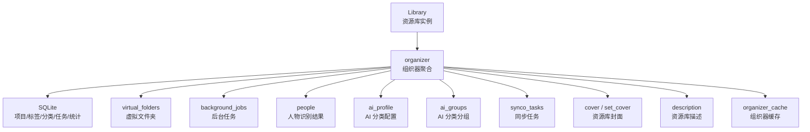
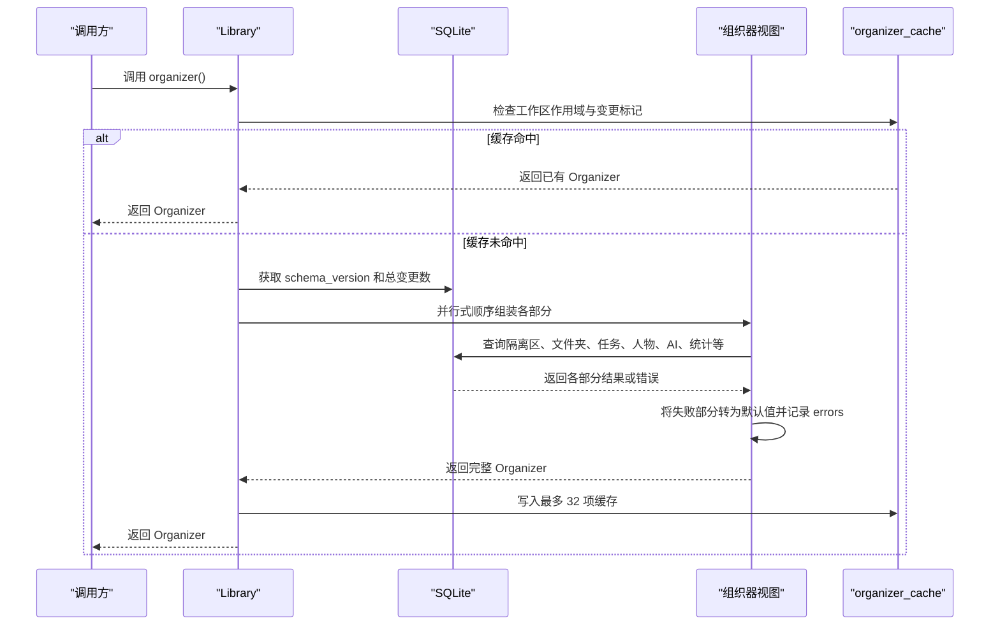
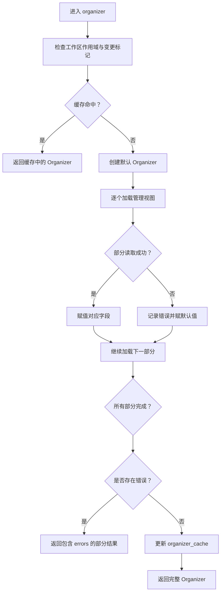
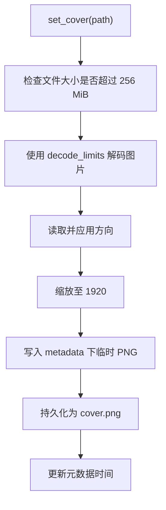
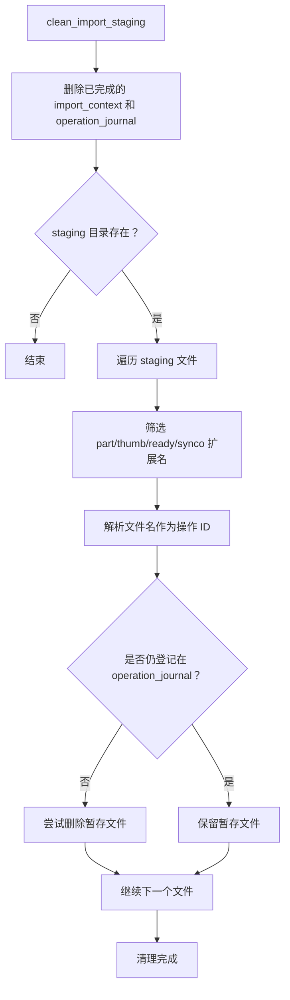
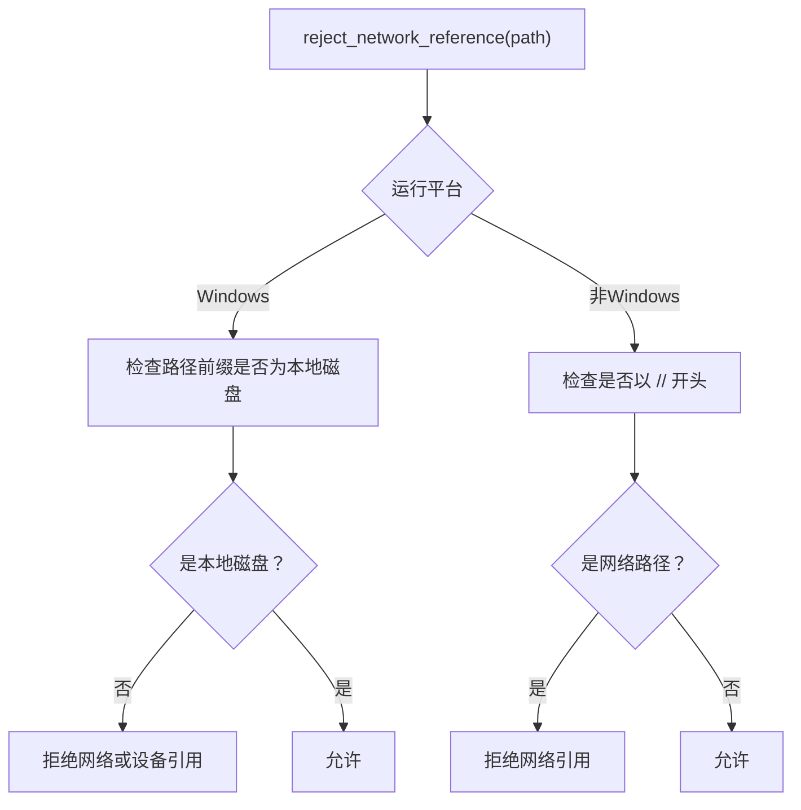
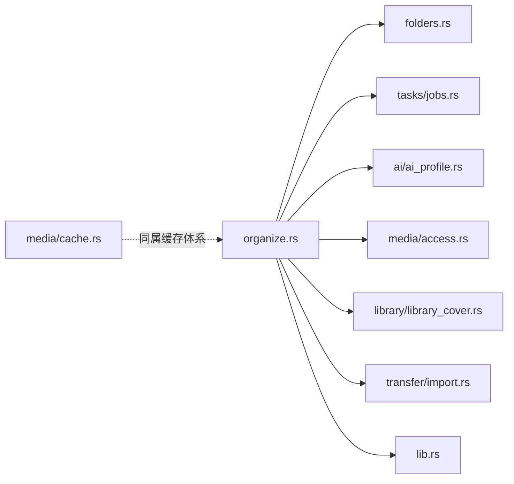
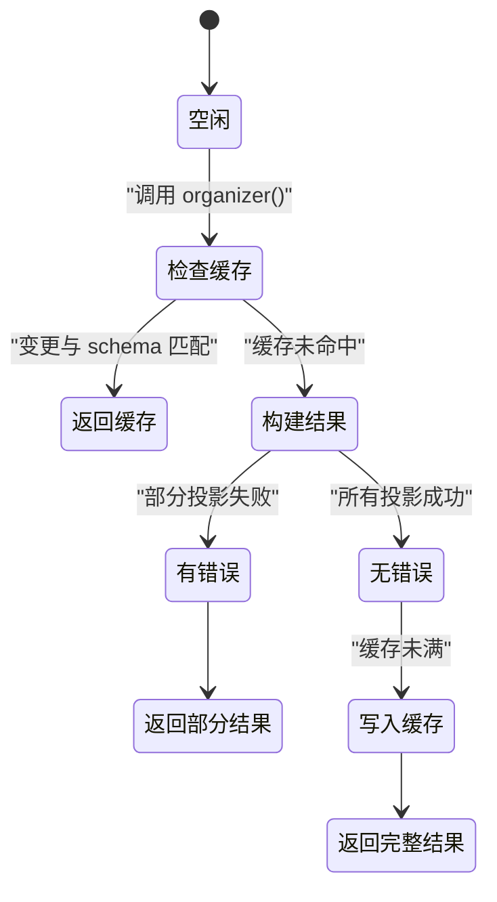
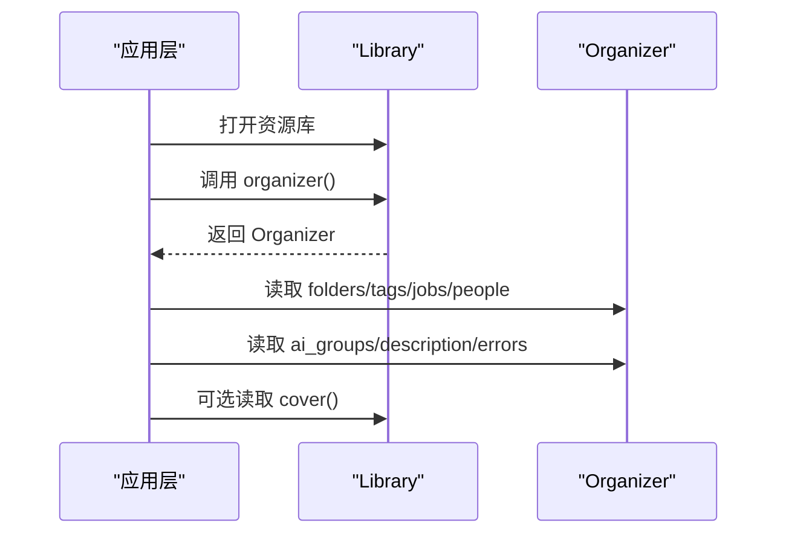

# 素材组织（Organize）

> Repo Wiki 节点 `asset-organization`
> 导出自 Qoder 知识库快照 `8fbe02f6-57c2-4874-b725-1a8130851fd9`，代码基线 `7a7a8e75e18bd90294e09cd422dd7ed5a04813a0`（分支 main，zh-CN）。

<cite>
**本文引用的文件**
- [organize.rs](../../../../crates/moriq-library/src/catalog/organize.rs)
- [folders.rs](../../../../crates/moriq-library/src/catalog/folders.rs)
- [overview.rs](../../../../crates/moriq-library/src/catalog/overview.rs)
- [library_cover.rs](../../../../crates/moriq-library/src/library/library_cover.rs)
- [import.rs](../../../../crates/moriq-library/src/transfer/import.rs)
- [access.rs](../../../../crates/moriq-library/src/media/access.rs)
- [cache.rs](../../../../crates/moriq-library/src/media/cache.rs)
- [ai_profile.rs](../../../../crates/moriq-library/src/ai/ai_profile.rs)
- [jobs.rs](../../../../crates/moriq-library/src/tasks/jobs.rs)
- [lib.rs](../../../../crates/moriq-library/src/lib.rs)
</cite>

## 目录
1. [引言](#引言)
2. [项目结构定位](#项目结构定位)
3. [核心组件总览](#核心组件总览)
4. [架构概览](#架构概览)
5. [详细组件分析](#详细组件分析)
6. [依赖关系分析](#依赖关系分析)
7. [性能与缓存特性](#性能与缓存特性)
8. [故障排查指南](#故障排查指南)
9. [最佳实践与使用示例](#最佳实践与使用示例)
10. [结论](#结论)

## 引言
本文件聚焦 Moriq Space 目录管理系统中的“素材组织”能力，围绕 `Library::organizer` 方法展开。该方法是资源库管理视图的统一入口：它汇总项目、标签、智能集合、任务、人物识别、AI 分类配置与分组、视频统计、回收站计数、同步任务、资源库描述等信息，并复用数据库读取缓存。文档同时说明资源库描述、自定义封面、导入上下文清理、网络路径安全检查、缩略图与预览解码限制、以及大型资源库的性能优化策略。

## 项目结构定位
素材组织功能主要位于 `moriq-library` 领域库中：

- 组织器主逻辑：`crates/moriq-library/src/catalog/organize.rs`
- 虚拟文件夹视图：`crates/moriq-library/src/catalog/folders.rs`
- 首页摘要查询：`crates/moriq-library/src/catalog/overview.rs`
- 资源库封面读写：`crates/moriq-library/src/library/library_cover.rs`
- 导入路径与受管位置：`crates/moriq-library/src/transfer/import.rs`
- 缩略图与预览访问：`crates/moriq-library/src/media/access.rs`
- 媒体缓存修剪：`crates/moriq-library/src/media/cache.rs`
- AI 分类配置与分组：`crates/moriq-library/src/ai/ai_profile.rs`
- 后台任务状态：`crates/moriq-library/src/tasks/jobs.rs`
- 资源库结构与解码限制常量：`crates/moriq-library/src/lib.rs`

**图表来源**
- [organize.rs:145-320](../../../../crates/moriq-library/src/catalog/organize.rs#L145-L320)
- [folders.rs:4-40](../../../../crates/moriq-library/src/catalog/folders.rs#L4-L40)
- [jobs.rs:436-460](../../../../crates/moriq-library/src/tasks/jobs.rs#L436-L460)
- [ai_profile.rs:19-30](../../../../crates/moriq-library/src/ai/ai_profile.rs#L19-L30)
- [ai_profile.rs:144-260](../../../../crates/moriq-library/src/ai/ai_profile.rs#L144-L260)
- [lib.rs:216-220](../../../../crates/moriq-library/src/lib.rs#L216-L220)

**章节来源**
- [organize.rs:145-320](../../../../crates/moriq-library/src/catalog/organize.rs#L145-L320)
- [lib.rs:216-220](../../../../crates/moriq-library/src/lib.rs#L216-L220)

## 核心组件总览
`organizer` 方法返回一个 `Organizer` 数据对象，用于支撑界面侧的多个管理视图。其关键组成部分包括：

| 字段或视图 | 含义 | 数据来源或处理方式 |
|---|---|---|
| `quarantined_files` / `quarantined_bytes` | 隔离区素材数量与字节数 | 从 `orphan_quarantine` 表汇总 |
| `folders` | 虚拟文件夹列表 | `virtual_folders` |
| `jobs` | 后台任务列表 | `background_jobs` |
| `people` | 人物识别结果 | `people` |
| `ai_profile` | AI 分类配置 | `ai_profile` |
| `ai_groups` | AI 分类分组及封面版本 | `ai_groups` |
| `ai_outdated` | 需要重新分析的素材数量 | `outdated_ai_count` |
| `ai_categories` | 启用的分类键到数量的映射 | 基于 `ai_groups` 过滤和转换 |
| `video_count` | 当前工作区视频素材数量 | 通过视频格式 SQL 统计 |
| `tags` | 标签及其出现次数 | 有效标签关联统计 |
| `collections` | 智能集合 | `smart_collections` |
| `trash_count` | 回收站素材数量 | 软删除资产统计 |
| `recent_count` | 近一周新增素材数量 | 按导入时间计算 |
| `untagged_count` | 未打标签素材数量 | 标签关联缺失统计 |
| `unassigned_count` | 未加入任何项目的素材数量 | 项目关联缺失统计 |
| `high_rating_count` | 高评分素材数量 | 评分阈值统计 |
| `interrupted` | 中断导入操作数量 | 中断作业登记统计 |
| `edited_count` | 近期编辑过的素材数量 | 修改时间统计 |
| `raw_count` | 原生原始格式素材数量 | 原生格式 SQL 统计 |
| `synco` | 同步任务 | `synco_tasks` |
| `description` | 资源库描述文本 | `library_preferences` |
| `errors` | 各部分加载失败记录 | 错误隔离收集 |

**章节来源**
- [organize.rs:145-320](../../../../crates/moriq-library/src/catalog/organize.rs#L145-L320)

## 架构概览
`organizer` 不是简单的一次数据库查询，而是“多视图聚合 + 错误隔离 + 缓存命中”的组合流程。

**图表来源**
- [organize.rs:145-320](../../../../crates/moriq-library/src/catalog/organize.rs#L145-L320)
- [lib.rs:216-220](../../../../crates/moriq-library/src/lib.rs#L216-L220)

**章节来源**
- [organize.rs:145-320](../../../../crates/moriq-library/src/catalog/organize.rs#L145-L320)

## 详细组件分析

### 组织器方法与错误隔离
`organizer` 的核心职责是汇总管理视图。它首先检查缓存键：

- 缓存键基于工作区作用域。
- 缓存条目包含资源库变更计数、数据库 schema 版本和完整的 `Organizer`。
- 只有当两者都匹配时，才直接返回缓存结果。

若未命中缓存，则创建空的 `Organizer`，并初始化错误收集列表。随后，每个视图读取都被包装为局部函数，用于捕获单个部分的错误：

- 成功时正常赋值。
- 失败时记录 `(OrganizerSection, error_message)`，并将该部分设为默认值。
- 最终，如果存在错误，不会把错误结果写进缓存；否则将新结果写入 `organizer_cache`。

这种设计保证“某个面板损坏不会影响其他面板显示”，例如标签统计失败不会阻止文件夹、任务、AI 分类或统计数据展示。

**图表来源**
- [organize.rs:145-320](../../../../crates/moriq-library/src/catalog/organize.rs#L145-L320)

**章节来源**
- [organize.rs:145-320](../../../../crates/moriq-library/src/catalog/organize.rs#L145-L320)

### 统计数据视图
统计数据涵盖隔离区、视频、标签、收藏、评分、原始格式、回收站、近期新增、未标签、未分配项目、高评分、中断导入、近期编辑等多个维度。这些统计通常基于 `assets`、`asset_versions`、`effective_asset_tags`、`project_assets`、`operation_journal` 等表的聚合查询。

重点行为：

- 视频统计使用系统支持的媒体格式集合进行过滤。
- 原生原始格式统计使用原生解码器的 SQL 集合。
- 最近时间窗口基于毫秒级当前时间减去七天。
- 标签统计限制返回数量，避免超大标签列表拖慢组织器。
- 中断导入统计与工作区作用域关联，只统计相关导入作业。

**章节来源**
- [organize.rs:201-320](../../../../crates/moriq-library/src/catalog/organize.rs#L201-L320)

### 文件夹、任务和任务类视图
- `folders` 来自 `virtual_folders`，提供资源库内的虚拟目录结构。
- `jobs` 来自 `background_jobs`，返回后台任务的 ID、类型、状态、优先级、进度、失败数和错误信息。
- `synco` 来自 `synco_tasks`，反映同步任务的状态。
- `people` 来自 `people`，表示人物识别结果。

这些视图各自独立，任一失败都会被隔离，不会导致整个组织器失效。

**章节来源**
- [folders.rs:4-40](../../../../crates/moriq-library/src/catalog/folders.rs#L4-L40)
- [jobs.rs:436-460](../../../../crates/moriq-library/src/tasks/jobs.rs#L436-L460)
- [organize.rs:201-320](../../../../crates/moriq-library/src/catalog/organize.rs#L201-L320)

### AI 分析与分类视图
AI 相关字段由三个部分组成：

1. `ai_profile`：分类配置，包含修订号、主题数量上限和分类词表。
2. `ai_groups`：分类分组，包括启用主题、语义类别、历史分类和未分类。
3. `ai_outdated`：根据分类哈希判断需要重新分析的素材数量。
4. `ai_categories`：从 `ai_groups` 派生的分类键到计数的映射，供 UI 快速呈现分类卡片。

`ai_profile` 支持项目级和工作区级分类配置，并在配置变化时取消相关推理任务。`ai_groups` 会合并 AI 结果、覆盖结果、手动分类和历史分类，并为每个分组提供封面版本和查询条件。

**章节来源**
- [ai_profile.rs:19-30](../../../../crates/moriq-library/src/ai/ai_profile.rs#L19-L30)
- [ai_profile.rs:144-260](../../../../crates/moriq-library/src/ai/ai_profile.rs#L144-L260)
- [ai_profile.rs:266-279](../../../../crates/moriq-library/src/ai/ai_profile.rs#L266-L279)
- [organize.rs:201-320](../../../../crates/moriq-library/src/catalog/organize.rs#L201-L320)

### 资源库描述与自定义封面
#### 资源库描述
`description` 方法负责保存资源库描述：

- 输入字符串长度超过 8 KiB 时拒绝。
- 使用 `library_preferences` 表以 key-value 形式持久化。
- 读取端由组织器在聚合阶段取回。

#### 资源库封面
`cover` 方法读取资源库自定义封面：

- 路径固定为资源库根下的 `metadata/cover.png`。
- 不存在时返回空值。
- 使用有界图像解码限制，最大宽高 1920，最大分配 32 MiB。
- 返回统一像素结构，便于前端渲染。

`set_cover` 方法设置资源库封面：

- 文件大小上限为 256 MiB。
- 使用通用解码限制防止损坏图片造成过量内存分配。
- 应用方向元数据后调整尺寸至 1920。
- 先写入临时文件，再原子替换 `metadata/cover.png`。
- 最后触发元数据时间戳更新。

另外，`library_cover.rs` 提供了素材级别的封面计划：生成、校验、提交，确保封面是独立副本且失败不破坏原有封面。

**图表来源**
- [organize.rs:98-144](../../../../crates/moriq-library/src/catalog/organize.rs#L98-L144)
- [library_cover.rs:1-120](../../../../crates/moriq-library/src/library/library_cover.rs#L1-L120)
- [lib.rs:163-163](../../../../crates/moriq-library/src/lib.rs#L163-L163)
- [lib.rs:319-325](../../../../crates/moriq-library/src/lib.rs#L319-L325)

**章节来源**
- [organize.rs:98-144](../../../../crates/moriq-library/src/catalog/organize.rs#L98-L144)
- [library_cover.rs:1-120](../../../../crates/moriq-library/src/library/library_cover.rs#L1-L120)
- [lib.rs:163-163](../../../../crates/moriq-library/src/lib.rs#L163-L163)
- [lib.rs:319-325](../../../../crates/moriq-library/src/lib.rs#L319-L325)

### 导入上下文清理与资源库级组织
#### 清理导入上下文
`forget_import` 清理指定导入操作的上下文与恢复登记：

- 删除与该操作对应的 `import_context` 记录。
- 删除已完成阶段的 `operation_journal` 记录。
- 使用事务保证一致性。

#### 清理导入暂存内容
`clean_import_staging` 清理已完成导入留下的受管暂存内容：

- 删除已完成导入对应的上下文与日志。
- 遍历 `staging` 目录。
- 仅处理扩展名为 `part`、`thumb`、`ready`、`synco` 的文件。
- 仅删除未登记到 `operation_journal` 的暂存文件。
- 无法删除时记录警告并继续。

**图表来源**
- [organize.rs:27-73](../../../../crates/moriq-library/src/catalog/organize.rs#L27-L73)

**章节来源**
- [organize.rs:27-73](../../../../crates/moriq-library/src/catalog/organize.rs#L27-L73)

### 网络路径安全检查
`reject_network_reference` 用于防止自动访问外部网络位置：

- Windows 平台：拒绝非磁盘前缀的网络路径和设备引用。
- 非 Windows 平台：拒绝以 `//` 开头的网络路径。
- 拒绝时会返回无效输入错误，提示用户复制到本地磁盘后重新关联。

该方法在版本路径解析中使用，尤其适用于外部原片引用场景，确保不会隐式访问远程共享、UNC 路径或其他危险位置。

**图表来源**
- [organize.rs:4-25](../../../../crates/moriq-library/src/catalog/organize.rs#L4-L25)

**章节来源**
- [organize.rs:4-25](../../../../crates/moriq-library/src/catalog/organize.rs#L4-L25)

### 缩略图与预览的解码限制
资源库对媒体解码设置了明确的预算：

- 缩略图：最大宽高 256，最大分配 1 MiB。
- 资源库封面：最大宽高 1920，最大分配 32 MiB。
- 通用解码限制：最大分配 384 MiB，宽高不限，用于可能较大的媒体解码。
- 通用安全路径：拒绝目录穿越、绝对路径、非法组件和指向库外的符号链接。

这保证了即使面对恶意或损坏的图片，也不会轻易耗尽进程内存。

**章节来源**
- [access.rs:1-23](../../../../crates/moriq-library/src/media/access.rs#L1-L23)
- [organize.rs:106-144](../../../../crates/moriq-library/src/catalog/organize.rs#L106-L144)
- [lib.rs:252-290](../../../../crates/moriq-library/src/lib.rs#L252-L290)
- [lib.rs:319-325](../../../../crates/moriq-library/src/lib.rs#L319-L325)

### 资源库描述、封面与首页摘要的关系
`overview_assets` 用于首页摘要：

- 查询收藏素材，使用当前展示版本并排除回收站。
- 复用 `organizer().ai_groups` 构建分类卡片。
- 不替换图库正在使用的查询快照。

这说明组织器不仅是管理视图入口，也参与首页和分类卡片的轻量展示。

**章节来源**
- [overview.rs:1-40](../../../../crates/moriq-library/src/catalog/overview.rs#L1-L40)
- [organize.rs:201-320](../../../../crates/moriq-library/src/catalog/organize.rs#L201-L320)

## 依赖关系分析
`organizer` 依赖以下子系统：

| 依赖模块 | 职责 | 与组织器的关系 |
|---|---|---|
| 虚拟文件夹 | 提供目录结构视图 | 提供 `folders` |
| 后台任务 | 维护推理与迁移任务状态 | 提供 `jobs` |
| 人物识别 | 输出人物结果 | 提供 `people` |
| AI 分类配置 | 管理分类词表和主题 | 提供 `ai_profile`、`ai_groups`、`ai_outdated` |
| 同步任务 | 同步任务状态 | 提供 `synco` |
| 媒体访问 | 缩略图和预览解码 | 被封面和缩略图读取间接使用 |
| 媒体缓存 | 可重建缓存修剪 | 与组织器缓存不同，但同属资源库缓存体系 |
| 资源库封面 | 素材封面计划与提交 | 与 `cover/set_cover` 共同管理封面生命周期 |
| 导入模块 | 受管位置和导入逻辑 | 与组织器共享资源库结构和安全路径约束 |
| 资源库核心 | 常量、错误、安全路径、解码限制 | 提供 `MAX_BYTES`、`decode_limits`、`safe_path` |

**图表来源**
- [organize.rs:145-320](../../../../crates/moriq-library/src/catalog/organize.rs#L145-L320)
- [folders.rs:4-40](../../../../crates/moriq-library/src/catalog/folders.rs#L4-L40)
- [jobs.rs:436-460](../../../../crates/moriq-library/src/tasks/jobs.rs#L436-L460)
- [ai_profile.rs:144-260](../../../../crates/moriq-library/src/ai/ai_profile.rs#L144-L260)
- [access.rs:1-23](../../../../crates/moriq-library/src/media/access.rs#L1-L23)
- [library_cover.rs:1-120](../../../../crates/moriq-library/src/library/library_cover.rs#L1-L120)
- [import.rs:1-60](../../../../crates/moriq-library/src/transfer/import.rs#L1-L60)
- [lib.rs:163-163](../../../../crates/moriq-library/src/lib.rs#L163-L163)
- [lib.rs:252-325](../../../../crates/moriq-library/src/lib.rs#L252-L325)

**章节来源**
- [organize.rs:145-320](../../../../crates/moriq-library/src/catalog/organize.rs#L145-L320)
- [lib.rs:163-163](../../../../crates/moriq-library/src/lib.rs#L163-L163)
- [lib.rs:252-325](../../../../crates/moriq-library/src/lib.rs#L252-L325)

## 性能与缓存特性

### 组织器缓存机制
`Library` 持有 `organizer_cache`，类型为基于字符串键的 BTreeMap，值为 `(变更计数, schema 版本, Organizer)`。

缓存策略要点：

- 缓存键基于工作区作用域。
- 每次组织器构建前比较数据库变更计数和 schema 版本。
- 命中时直接返回，避免重复聚合。
- 未命中时构建完成后写入缓存。
- 缓存容量上限为 32 项，超出时清空旧缓存，而不是无界增长。
- 如果某次组织器构建包含错误，则不会写入缓存，从而避免缓存损坏结果。

**图表来源**
- [lib.rs:216-220](../../../../crates/moriq-library/src/lib.rs#L216-L220)
- [organize.rs:145-320](../../../../crates/moriq-library/src/catalog/organize.rs#L145-L320)

**章节来源**
- [lib.rs:216-220](../../../../crates/moriq-library/src/lib.rs#L216-L220)
- [organize.rs:145-320](../../../../crates/moriq-library/src/catalog/organize.rs#L145-L320)

### 媒体缓存修剪
`media/cache.rs` 提供可重建缓存的修剪能力：

- 目标目录为 `previews` 和 `thumbnails/256`。
- 跳过符号链接、非 PNG 或非 UUID 命名文件。
- 按修改时间排序淘汰，直到剩余字节数低于预算。
- 返回移除文件数、移除字节数和跳过数。

这与组织器缓存不同：组织器缓存是内存中的聚合结果缓存，媒体缓存是磁盘上的可重建缓存。

**章节来源**
- [cache.rs:1-87](../../../../crates/moriq-library/src/media/cache.rs#L1-L87)

### 大型资源库优化建议
针对大型资源库的组织查询，建议遵循以下原则：

1. **优先使用 `organizer` 而非重复构造视图**  
   利用缓存避免重复聚合项目、标签、AI 分类和统计。

2. **避免频繁切换工作区作用域**  
   工作区变化会导致缓存键变化，增加未命中概率。

3. **减少组织器调用频率**  
   批量刷新 UI 时，尽量一次获取 `Organizer`，再分别消费各字段。

4. **控制标签和集合规模**  
   标签统计有限制，智能集合规则应避免过于复杂的查询。

5. **合理使用封面和缩略图**  
   封面和图片解码均有内存上限，不要反复解码超大或损坏图片。

6. **定期清理导入暂存和媒体缓存**  
   使用 `clean_import_staging` 清理已完成导入残留，使用缓存修剪控制磁盘占用。

7. **关注 `errors` 字段**  
   组织器可能部分失败，UI 应展示错误摘要，而不是隐藏问题。

[本节为通用性能指导，不直接分析具体代码片段]

## 故障排查指南

### 组织器部分视图失败
现象：界面某些管理视图为空或缺失，但其他视图正常。

排查步骤：

1. 检查返回的 `Organizer.errors`。
2. 确认失败部分对应的 `OrganizerSection`。
3. 查看对应数据库表或查询是否可用。
4. 确认没有权限、锁、路径或编码问题。
5. 若涉及 AI 分类，检查分类配置是否损坏或过期。

**章节来源**
- [organize.rs:145-320](../../../../crates/moriq-library/src/catalog/organize.rs#L145-L320)

### 封面设置失败
现象：设置资源库封面报错，或封面未更新。

排查要点：

- 封面源文件是否超过 256 MiB。
- 图片是否损坏或无法解码。
- `metadata` 目录是否有写入权限。
- 临时文件是否能持久化到 `metadata/cover.png`。
- 如果使用素材封面计划，检查素材是否已被移入回收站或版本变化。

**章节来源**
- [organize.rs:120-144](../../../../crates/moriq-library/src/catalog/organize.rs#L120-L144)
- [library_cover.rs:60-120](../../../../crates/moriq-library/src/library/library_cover.rs#L60-L120)

### 描述保存失败
现象：保存资源库描述时报错。

排查要点：

- 描述长度是否超过 8 KiB。
- 数据库是否正常连接。
- `library_preferences` 表是否可用。

**章节来源**
- [organize.rs:98-105](../../../../crates/moriq-library/src/catalog/organize.rs#L98-L105)

### 导入暂存残留
现象：`staging` 目录中存在多余文件。

排查要点：

- 是否已完成导入但仍保留上下文。
- 文件扩展名是否为 `part`、`thumb`、`ready`、`synco`。
- 文件是否仍登记在 `operation_journal`。
- 是否调用了 `clean_import_staging`。

**章节来源**
- [organize.rs:38-73](../../../../crates/moriq-library/src/catalog/organize.rs#L38-L73)

### 外部路径访问被拒绝
现象：打开或验证外部原片引用时报错。

排查要点：

- 路径是否为网络路径或设备引用。
- 是否绕过本地复制直接使用远程位置。
- 是否需要重新关联本地副本。

**章节来源**
- [organize.rs:4-25](../../../../crates/moriq-library/src/catalog/organize.rs#L4-L25)

## 最佳实践与使用示例

### 基本使用示例
典型调用流程如下：

1. 打开资源库。
2. 调用 `organizer()` 获取组织器。
3. 使用 `folders` 显示目录结构。
4. 使用 `tags` 显示标签统计。
5. 使用 `ai_groups` 显示 AI 分类卡片。
6. 使用 `jobs` 显示后台任务。
7. 使用 `synco` 显示同步任务。
8. 使用 `description` 显示资源库描述。
9. 使用 `cover()` 显示资源库自定义封面。

**图表来源**
- [organize.rs:145-320](../../../../crates/moriq-library/src/catalog/organize.rs#L145-L320)
- [access.rs:1-23](../../../../crates/moriq-library/src/media/access.rs#L1-L23)

### 设置资源库封面的最佳实践
1. 选择本地图片，大小不超过 256 MiB。
2. 调用 `set_cover`。
3. 成功后可通过 `cover()` 读取解码后的像素数据。
4. 如果需要素材级别封面，使用封面计划流程，避免直接覆盖。
5. 若封面失败，检查错误信息，不要静默忽略。

**章节来源**
- [organize.rs:120-144](../../../../crates/moriq-library/src/catalog/organize.rs#L120-L144)
- [library_cover.rs:1-120](../../../../crates/moriq-library/src/library/library_cover.rs#L1-L120)

### 清理导入上下文的正确时机
建议在以下时机清理：

- 导入操作明确完成后。
- 应用启动后清理已完成导入的暂存。
- 用户主动执行资源库维护或清理操作时。

**章节来源**
- [organize.rs:27-73](../../../../crates/moriq-library/src/catalog/organize.rs#L27-L73)

### 大型资源库查询优化
- 减少频繁调用 `organizer()`。
- 将组织器结果缓存在 UI 层，避免重复请求。
- 使用工作区作用域稳定化，降低缓存失效。
- 避免一次性加载全部标签或全部集合，必要时分页或延迟加载。
- 定期清理媒体缓存，控制磁盘空间。
- 监控 `errors`，发现部分视图失败时降级显示。

[本节为通用实践指导，不直接分析具体代码片段]

## 结论
`organizer` 是 Moriq Space 资源库素材组织的核心聚合点。它将项目、标签、分类、任务、人物识别、AI 分析、视频统计、同步任务、描述和封面等管理视图整合为一个数据结构，并通过错误隔离确保单个视图失败不影响整体可用性。配合组织器缓存、有界解码限制、安全路径检查和导入上下文清理，该系统在易用性、安全性和可扩展性之间取得平衡。对于大型资源库，合理调用组织器、控制缓存失效、监控错误并定期清理暂存与媒体缓存，是获得稳定性能的关键。