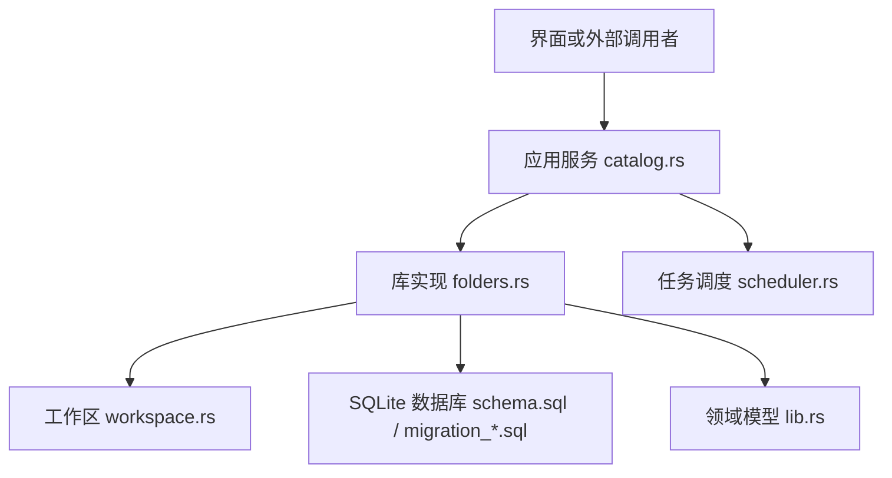
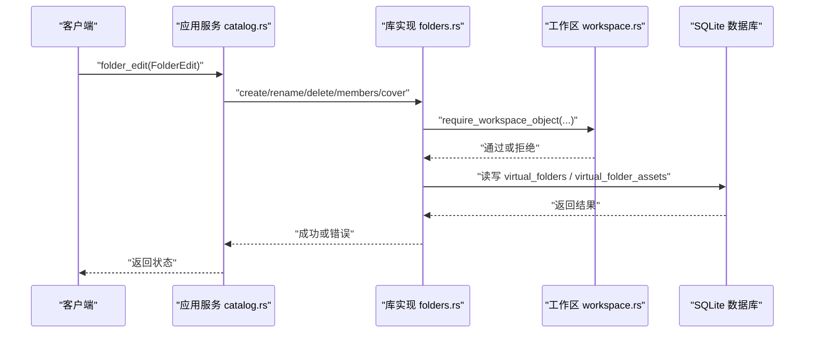
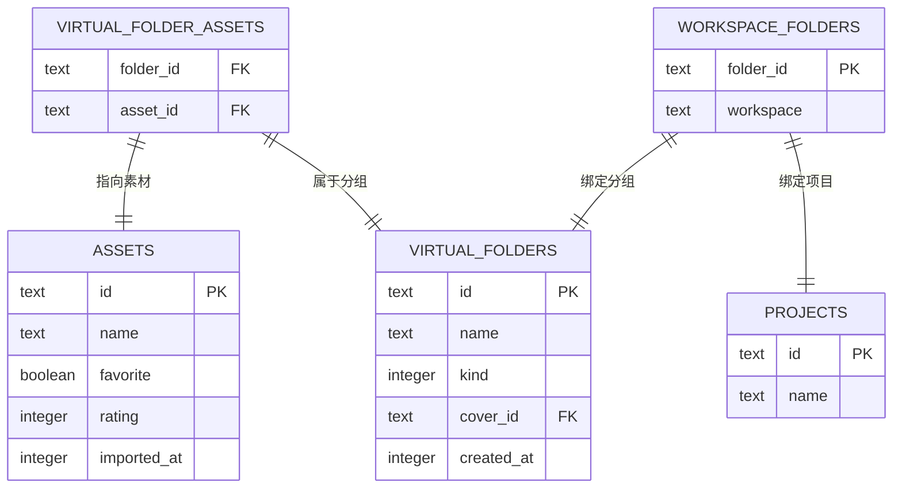
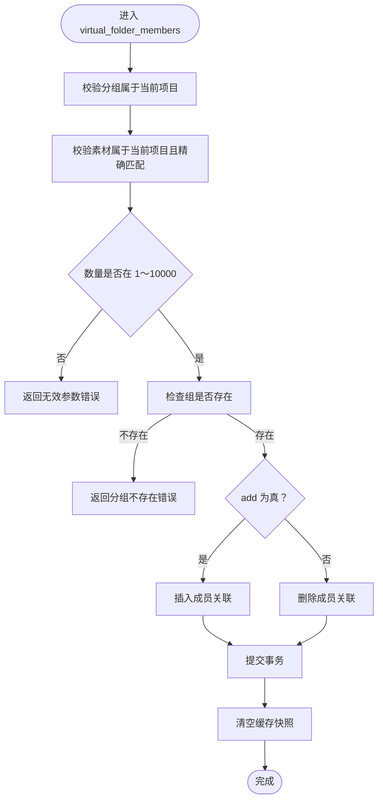
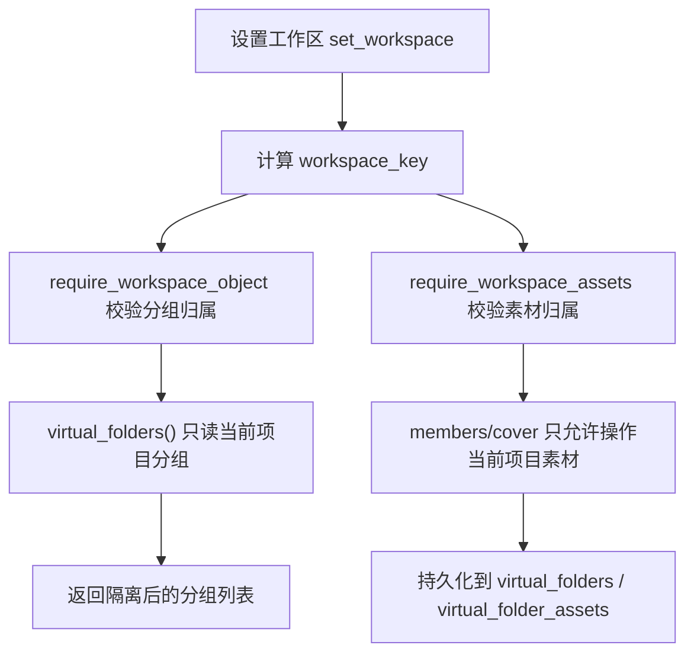
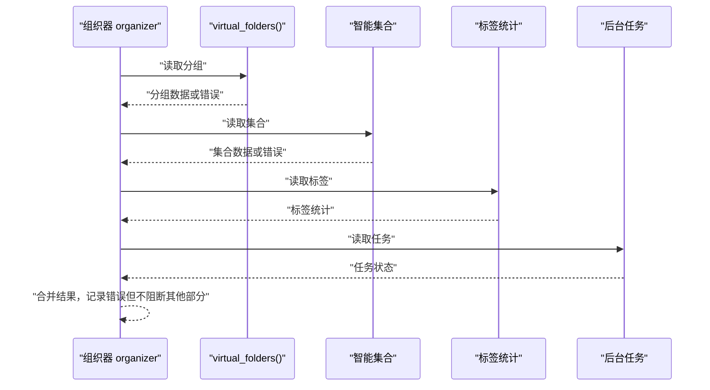
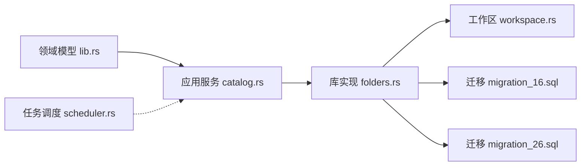

# 虚拟文件夹 (Virtual Folders)

> Repo Wiki 节点 `virtual-folders`
> 导出自 Qoder 知识库快照 `8fbe02f6-57c2-4874-b725-1a8130851fd9`，代码基线 `7a7a8e75e18bd90294e09cd422dd7ed5a04813a0`（分支 main，zh-CN）。

<cite>
**本文引用的文件**   
- [workspace.rs](../../../../crates/moriq-library/src/catalog/workspace.rs)
- [folders.rs](../../../../crates/moriq-library/src/catalog/folders.rs)
- [migration_16.sql](../../../../crates/moriq-library/src/database/migrations/migration_16.sql)
- [migration_26.sql](../../../../crates/moriq-library/src/database/migrations/migration_26.sql)
- [schema.sql](../../../../crates/moriq-library/src/database/schema.sql)
- [lib.rs（领域模型）](../../../../crates/moriq-domain/src/lib.rs)
- [catalog.rs（应用服务）](../../../../crates/moriq-app/src/catalog.rs)
- [scheduler.rs（任务调度）](../../../../crates/moriq-app/src/scheduler.rs)
- [workspace_tests.rs（工作区测试）](../../../../crates/moriq-library/src/tests/workspace_tests.rs)
</cite>

## 目录
1. [引言](#引言)
2. [项目结构](#项目结构)
3. [核心组件](#核心组件)
4. [架构总览](#架构总览)
5. [详细组件分析](#详细组件分析)
6. [依赖关系分析](#依赖关系分析)
7. [性能与一致性](#性能与一致性)
8. [故障排查](#故障排查)
9. [结论](#结论)

## 引言
虚拟文件夹是 Moriq Space 目录管理系统中“与物理文件系统解耦”的动态分组能力。它不移动或复制素材，而是在数据库层维护“虚拟文件夹—素材”的关联关系，从而允许用户按收藏、主题或业务目标对素材进行灵活组织。每个虚拟文件夹都绑定到某个“项目”，通过工作区隔离机制确保不同项目之间的虚拟文件夹互不可见、互不影响。

虚拟文件夹支持以下关键能力：
- 查询当前项目的虚拟文件夹及其摘要信息，包括封面和成员数量。
- 创建普通分组或收藏分组。
- 重命名和删除虚拟文件夹。
- 向分组添加或移除素材成员。
- 设置分组封面，并保证封面一定是当前分组成员。
- 与组织器系统协作，提供稳定的管理视图，同时具备错误隔离能力。

## 项目结构
虚拟文件夹功能横跨领域模型、库实现、数据库迁移与应用服务：
- 领域模型定义虚拟文件夹的数据结构和编辑指令。
- 库实现提供具体方法，如 `virtual_folders`、`create_virtual_folder`、`rename_virtual_folder`、`delete_virtual_folder`、`virtual_folder_members`、`virtual_folder_cover`。
- 数据库迁移定义 `virtual_folders` 和 `virtual_folder_assets` 表，以及工作区映射表。
- 应用服务将 UI 操作转换为库方法调用，并通过写入队列保障并发安全。
- 工作区模块负责项目范围校验和对象归属检查。



**图表来源**
- [catalog.rs（应用服务）](../../../../crates/moriq-app/src/catalog.rs)
- [folders.rs（库实现）](../../../../crates/moriq-library/src/catalog/folders.rs)
- [workspace.rs（工作区）](../../../../crates/moriq-library/src/catalog/workspace.rs)
- [schema.sql（基础模式）](../../../../crates/moriq-library/src/database/schema.sql)
- [migration_16.sql（虚拟文件夹表）](../../../../crates/moriq-library/src/database/migrations/migration_16.sql)
- [migration_26.sql（工作区表）](../../../../crates/moriq-library/src/database/migrations/migration_26.sql)
- [lib.rs（领域模型）](../../../../crates/moriq-domain/src/lib.rs)
- [scheduler.rs（任务调度）](../../../../crates/moriq-app/src/scheduler.rs)

**章节来源**
- [folders.rs:1-120](../../../../crates/moriq-library/src/catalog/folders.rs#L1-L120)
- [workspace.rs:1-200](../../../../crates/moriq-library/src/catalog/workspace.rs#L1-L200)
- [migration_16.sql:1-5](../../../../crates/moriq-library/src/database/migrations/migration_16.sql#L1-L5)
- [migration_26.sql:1-47](../../../../crates/moriq-library/src/database/migrations/migration_26.sql#L1-L47)
- [lib.rs（领域模型）:290-340](../../../../crates/moriq-domain/src/lib.rs#L290-L340)
- [catalog.rs（应用服务）:90-130](../../../../crates/moriq-app/src/catalog.rs#L90-L130)

## 核心组件
虚拟文件夹的核心由以下部分组成：

| 组件 | 职责 | 关键位置 |
|---|---|---|
| 领域模型 VirtualFolder | 描述虚拟文件夹的 id、名称、是否收藏分组、封面、成员数量 | [lib.rs（领域模型）:307-320](../../../../crates/moriq-domain/src/lib.rs#L307-L320) |
| 编辑指令 FolderEdit | 统一表示创建、重命名、删除、成员变更、封面设置等操作 | [lib.rs（领域模型）:320-340](../../../../crates/moriq-domain/src/lib.rs#L320-L340) |
| 库方法 virtual_folders | 读取当前项目的所有虚拟文件夹及封面、成员数 | [folders.rs:1-60](../../../../crates/moriq-library/src/catalog/folders.rs#L1-L60) |
| 库方法 create_virtual_folder | 创建虚拟文件夹并登记工作区归属 | [folders.rs:60-100](../../../../crates/moriq-library/src/catalog/folders.rs#L60-L100) |
| 库方法 rename_virtual_folder | 校验名称和项目归属后更新名称 | [folders.rs:100-140](../../../../crates/moriq-library/src/catalog/folders.rs#L100-L140) |
| 库方法 delete_virtual_folder | 删除虚拟文件夹及成员关联，保留素材本体 | [folders.rs:140-180](../../../../crates/moriq-library/src/catalog/folders.rs#L140-L180) |
| 库方法 virtual_folder_members | 批量添加或移除成员，并校验项目范围 | [folders.rs:180-240](../../../../crates/moriq-library/src/catalog/folders.rs#L180-L240) |
| 库方法 virtual_folder_cover | 设置封面，要求封面是当前分组成员 | [folders.rs:240-246](../../../../crates/moriq-library/src/catalog/folders.rs#L240-L246) |
| 工作区隔离 require_workspace_object | 确保对象属于当前项目 | [workspace.rs:120-180](../../../../crates/moriq-library/src/catalog/workspace.rs#L120-L180) |
| 应用服务 folder_edit | 把 UI 编辑命令路由到对应库方法 | [catalog.rs（应用服务）:90-130](../../../../crates/moriq-app/src/catalog.rs#L90-L130) |

**章节来源**
- [lib.rs（领域模型）:290-340](../../../../crates/moriq-domain/src/lib.rs#L290-L340)
- [folders.rs:1-246](../../../../crates/moriq-library/src/catalog/folders.rs#L1-L246)
- [workspace.rs:120-180](../../../../crates/moriq-library/src/catalog/workspace.rs#L120-L180)
- [catalog.rs（应用服务）:90-130](../../../../crates/moriq-app/src/catalog.rs#L90-L130)

## 架构总览
虚拟文件夹的请求流程从应用服务进入库实现，再经过工作区校验落盘到 SQLite。封面和成员数据通过关联表与资产表连接，而工作区表保证虚拟文件夹只属于特定项目。



**图表来源**
- [catalog.rs（应用服务）:90-130](../../../../crates/moriq-app/src/catalog.rs#L90-L130)
- [folders.rs:1-246](../../../../crates/moriq-library/src/catalog/folders.rs#L1-L246)
- [workspace.rs:120-180](../../../../crates/moriq-library/src/catalog/workspace.rs#L120-L180)
- [migration_16.sql:1-5](../../../../crates/moriq-library/src/database/migrations/migration_16.sql#L1-L5)
- [migration_26.sql:1-47](../../../../crates/moriq-library/src/database/migrations/migration_26.sql#L1-L47)

## 详细组件分析

### 虚拟文件夹的概念与作用
虚拟文件夹不是真实目录，而是数据库中一组逻辑分组：
- 它不改变素材的物理路径或存储位置。
- 它通过 `virtual_folders` 表保存分组元数据。
- 它通过 `virtual_folder_assets` 表保存分组与素材的关联。
- 它通过 `workspace_folders` 表绑定到项目，实现工作区隔离。
- 它可以作为普通分组或收藏分组，用于快速定位重要素材。



**图表来源**
- [migration_16.sql:1-5](../../../../crates/moriq-library/src/database/migrations/migration_16.sql#L1-L5)
- [migration_26.sql:1-47](../../../../crates/moriq-library/src/database/migrations/migration_26.sql#L1-L47)
- [schema.sql:1-42](../../../../crates/moriq-library/src/database/schema.sql#L1-L42)

**章节来源**
- [migration_16.sql:1-5](../../../../crates/moriq-library/src/database/migrations/migration_16.sql#L1-L5)
- [migration_26.sql:1-47](../../../../crates/moriq-library/src/database/migrations/migration_26.sql#L1-L47)
- [folders.rs:1-246](../../../../crates/moriq-library/src/catalog/folders.rs#L1-L246)

### API 方法说明

#### virtual_folders：查询当前项目的虚拟文件夹
该方法返回当前工作区下的所有虚拟文件夹，包含：
- 分组 id、名称、是否收藏分组。
- 封面素材 id：优先使用显式设置的封面；若失效则回退到最近的有效成员。
- 有效成员数量：仅统计未删除的素材。

查询逻辑会同时读取 `virtual_folders`、`virtual_folder_assets`、`assets` 和 `workspace_folders`，并按 kind 和 name 排序。

**章节来源**
- [folders.rs:1-60](../../../../crates/moriq-library/src/catalog/folders.rs#L1-L60)

#### create_virtual_folder：创建虚拟文件夹或收藏分组
该方法接收名称和是否收藏分组标志：
- 校验名称长度。
- 生成新的分组 id。
- 插入 `virtual_folders`。
- 在 `workspace_folders` 中登记当前项目归属。
- 返回新分组 id。

**章节来源**
- [folders.rs:60-100](../../../../crates/moriq-library/src/catalog/folders.rs#L60-L100)

#### rename_virtual_folder：重命名文件夹
该方法在执行前调用工作区校验：
- 确认分组属于当前项目。
- 校验名称长度。
- 如果分组不存在则报错。
- 更新名称。

**章节来源**
- [folders.rs:100-140](../../../../crates/moriq-library/src/catalog/folders.rs#L100-L140)
- [workspace.rs:120-180](../../../../crates/moriq-library/src/catalog/workspace.rs#L120-L180)

#### delete_virtual_folder：删除文件夹及成员关联
该方法：
- 校验分组属于当前项目。
- 删除 `virtual_folders` 中的记录。
- 级联删除 `virtual_folder_assets` 中的成员关联。
- 不清理素材本体。

**章节来源**
- [folders.rs:140-180](../../../../crates/moriq-library/src/catalog/folders.rs#L140-L180)
- [migration_16.sql:1-5](../../../../crates/moriq-library/src/database/migrations/migration_16.sql#L1-L5)

#### virtual_folder_members：管理文件夹成员
该方法支持添加或移除成员：
- 校验分组属于当前项目。
- 校验素材属于当前项目且精确匹配。
- 限制单次操作数量为 1～10000。
- 批量写入或删除 `virtual_folder_assets`。
- 清空快照以触发后续查询刷新。



**图表来源**
- [folders.rs:180-240](../../../../crates/moriq-library/src/catalog/folders.rs#L180-L240)
- [workspace.rs:120-180](../../../../crates/moriq-library/src/catalog/workspace.rs#L120-L180)

**章节来源**
- [folders.rs:180-240](../../../../crates/moriq-library/src/catalog/folders.rs#L180-L240)

#### virtual_folder_cover：设置和管理封面图片
该方法：
- 校验分组属于当前项目。
- 校验待设封面素材属于当前项目。
- 校验封面必须是分组成员。
- 更新 `virtual_folders.cover_id`。

封面回退策略由 `virtual_folders()` 查询决定：当显式封面失效时，选择最近的有效成员作为封面。

**章节来源**
- [folders.rs:240-246](../../../../crates/moriq-library/src/catalog/folders.rs#L240-L246)
- [folders.rs:1-60](../../../../crates/moriq-library/src/catalog/folders.rs#L1-L60)

### 数据模型
虚拟文件夹相关数据结构如下：

| 实体 | 字段 | 含义 |
|---|---|---|
| VirtualFolder | id | 分组唯一标识 |
| VirtualFolder | name | 分组显示名称 |
| VirtualFolder | favorite_group | 是否为收藏分组 |
| VirtualFolder | cover | 封面素材 id，可为空 |
| VirtualFolder | count | 有效成员数量 |
| FolderEdit | Create(name, favorite_group) | 创建分组 |
| FolderEdit | Rename(folder, name) | 重命名分组 |
| FolderEdit | Delete(folder) | 删除分组 |
| FolderEdit | Members(folder, assets, add) | 批量增减成员 |
| FolderEdit | Cover(folder, asset) | 设置封面 |

**章节来源**
- [lib.rs（领域模型）:290-340](../../../../crates/moriq-domain/src/lib.rs#L290-L340)

### 数据库设计
虚拟文件夹相关的核心表如下：

| 表名 | 主要列 | 约束与说明 |
|---|---|---|
| virtual_folders | id、name、kind、cover_id、created_at | 主键 id；kind 区分普通分组和收藏分组；cover_id 引用 assets；created_at 记录创建时间 |
| virtual_folder_assets | folder_id、asset_id | 复合主键；folder_id 和 asset_id 均级联删除 |
| workspace_folders | folder_id、workspace | 绑定分组到项目 workspace；workspace 为项目 id |
| assets | id、name、favorite、rating、imported_at 等 | 素材本体表，虚拟文件夹不修改其物理位置 |

```mermaid
erDiagram
  VIRTUAL_FOLDERS {
    text id PK
    text name
    integer kind
    text cover_id
    integer created_at
  }

  VIRTUAL_FOLDER_ASSETS {
    text folder_id PK
    text asset_id PK
  }

  WORKSPACE_FOLDERS {
    text folder_id PK
    text workspace
  }

  ASSETS {
    text id PK
  }

  PROJECTS {
    text id PK
  }

  VIRTUAL_FOLDER_ASSETS --|> ASSETS : "asset_id"
  VIRTUAL_FOLDER_ASSETS --|> VIRTUAL_FOLDERS : "folder_id"
  WORKSPACE_FOLDERS --|> VIRTUAL_FOLDERS : "folder_id"
  WORKSPACE_FOLDERS --|> PROJECTS : "workspace"
```

**图表来源**
- [migration_16.sql:1-5](../../../../crates/moriq-library/src/database/migrations/migration_16.sql#L1-L5)
- [migration_26.sql:1-47](../../../../crates/moriq-library/src/database/migrations/migration_26.sql#L1-L47)
- [schema.sql:1-42](../../../../crates/moriq-library/src/database/schema.sql#L1-L42)

**章节来源**
- [migration_16.sql:1-5](../../../../crates/moriq-library/src/database/migrations/migration_16.sql#L1-L5)
- [migration_26.sql:1-47](../../../../crates/moriq-library/src/database/migrations/migration_26.sql#L1-L47)
- [schema.sql:1-42](../../../../crates/moriq-library/src/database/schema.sql#L1-L42)

### 工作区隔离机制
虚拟文件夹的工作区隔离通过以下方式实现：
- `set_workspace` 设置当前项目范围。
- `workspace_key` 将项目范围转为稳定字符串键。
- `require_workspace_object` 校验对象属于当前项目。
- `require_workspace_assets` 校验素材属于当前项目。
- `virtual_folders()` 查询时只返回当前工作区的分组。
- 删除项目时，通过触发器清理该项目的虚拟文件夹和相关对象。



**图表来源**
- [workspace.rs:1-200](../../../../crates/moriq-library/src/catalog/workspace.rs#L1-L200)
- [folders.rs:1-246](../../../../crates/moriq-library/src/catalog/folders.rs#L1-L246)
- [migration_26.sql:1-47](../../../../crates/moriq-library/src/database/migrations/migration_26.sql#L1-L47)

**章节来源**
- [workspace.rs:1-200](../../../../crates/moriq-library/src/catalog/workspace.rs#L1-L200)
- [migration_26.sql:1-47](../../../../crates/moriq-library/src/database/migrations/migration_26.sql#L1-L47)

### 与组织器系统的集成
虚拟文件夹是组织器的一部分。组织器会读取分组、收藏分组、标签、任务等信息；如果分组或集合读取失败，不会导致其他管理摘要被隐藏，而是以错误形式记录。



**图表来源**
- [folders.rs:200-246](../../../../crates/moriq-library/src/catalog/folders.rs#L200-L246)

**章节来源**
- [folders.rs:200-246](../../../../crates/moriq-library/src/catalog/folders.rs#L200-L246)

### 使用示例

#### 创建收藏分组
- 调用应用服务 `folder_edit`，传入 `Create("收藏分组", true)`。
- 库实现校验名称后创建虚拟文件夹并登记工作区。
- 成功后可通过 `virtual_folders()` 查看分组摘要。

**章节来源**
- [catalog.rs（应用服务）:90-130](../../../../crates/moriq-app/src/catalog.rs#L90-L130)
- [folders.rs:60-100](../../../../crates/moriq-library/src/catalog/folders.rs#L60-L100)

#### 管理素材成员
- 调用 `folder_edit`，传入 `Members(folder, assets, add=true)` 添加成员。
- 或传入 `add=false` 移除成员。
- 系统会校验分组和项目范围，并限制单次操作数量。

**章节来源**
- [folders.rs:180-240](../../../../crates/moriq-library/src/catalog/folders.rs#L180-L240)
- [workspace.rs:120-180](../../../../crates/moriq-library/src/catalog/workspace.rs#L120-L180)

#### 设置封面图片
- 先确保素材是分组成员。
- 调用 `folder_edit`，传入 `Cover(folder, asset)`。
- 若封面失效，`virtual_folders()` 会自动回退到最近的有效成员。

**章节来源**
- [folders.rs:240-246](../../../../crates/moriq-library/src/catalog/folders.rs#L240-L246)
- [folders.rs:1-60](../../../../crates/moriq-library/src/catalog/folders.rs#L1-L60)

#### 处理错误情况
常见错误包括：
- 名称为空或过长。
- 分组不存在。
- 封面不是分组成员。
- 素材不属于当前项目。
- 一次操作素材过多或过少。
- 跨项目访问受保护对象。

这些错误会通过 `Error::Invalid` 返回，并由应用服务转换为字符串错误消息。

**章节来源**
- [folders.rs:60-246](../../../../crates/moriq-library/src/catalog/folders.rs#L60-L246)
- [workspace.rs:120-180](../../../../crates/moriq-library/src/catalog/workspace.rs#L120-L180)

## 依赖关系分析
虚拟文件夹功能的依赖关系如下：
- 应用服务依赖领域模型中的 `VirtualFolder` 和 `FolderEdit`。
- 库实现依赖工作区模块进行项目范围校验。
- 库实现依赖数据库迁移定义的表和约束。
- 任务调度器与工作区无关，但会在后台任务失败时暂停任务，避免影响虚拟文件夹的正常交互。



**图表来源**
- [lib.rs（领域模型）:290-340](../../../../crates/moriq-domain/src/lib.rs#L290-L340)
- [catalog.rs（应用服务）:90-130](../../../../crates/moriq-app/src/catalog.rs#L90-L130)
- [folders.rs:1-246](../../../../crates/moriq-library/src/catalog/folders.rs#L1-L246)
- [workspace.rs:1-200](../../../../crates/moriq-library/src/catalog/workspace.rs#L1-L200)
- [migration_16.sql:1-5](../../../../crates/moriq-library/src/database/migrations/migration_16.sql#L1-L5)
- [migration_26.sql:1-47](../../../../crates/moriq-library/src/database/migrations/migration_26.sql#L1-L47)
- [scheduler.rs:1-200](../../../../crates/moriq-app/src/scheduler.rs#L1-L200)

**章节来源**
- [catalog.rs（应用服务）:90-130](../../../../crates/moriq-app/src/catalog.rs#L90-L130)
- [folders.rs:1-246](../../../../crates/moriq-library/src/catalog/folders.rs#L1-L246)
- [workspace.rs:1-200](../../../../crates/moriq-library/src/catalog/workspace.rs#L1-L200)
- [migration_16.sql:1-5](../../../../crates/moriq-library/src/database/migrations/migration_16.sql#L1-L5)
- [migration_26.sql:1-47](../../../../crates/moriq-library/src/database/migrations/migration_26.sql#L1-L47)
- [scheduler.rs:1-200](../../../../crates/moriq-app/src/scheduler.rs#L1-L200)

## 性能与一致性
- 虚拟文件夹成员查询通过单条 SQL 聚合分组、封面和成员数，减少多次往返。
- 封面回退逻辑在查询层实现，避免写入额外封面回退表。
- 成员增删使用事务批量操作，降低中间状态风险。
- 工作区校验在每次写操作前执行，防止跨项目误改。
- 删除分组会级联清理成员关联，保持数据一致。
- 背景任务调度具有失败重试和退避策略，避免虚拟文件夹相关 UI 阻塞。

[本节为通用性能指导，不直接分析具体代码行]

## 故障排查
常见问题和排查建议：

| 问题 | 可能原因 | 排查方式 |
|---|---|---|
| 无法创建分组 | 名称为空或过长 | 检查输入名称长度 |
| 重命名失败 | 分组不存在或不属于当前项目 | 检查分组 id 和工作区 |
| 删除分组无效 | 分组不属于当前项目 | 检查工作区是否切换 |
| 添加成员失败 | 素材不属于当前项目 | 检查素材所在项目 |
| 封面设置失败 | 封面不是分组成员 | 先添加素材再设置封面 |
| 分组列表为空 | 当前工作区下没有分组 | 检查 `set_workspace` |
| 组织器部分数据缺失 | 分组或集合读取失败 | 查看组织器错误集合 |

**章节来源**
- [folders.rs:60-246](../../../../crates/moriq-library/src/catalog/folders.rs#L60-L246)
- [workspace.rs:120-180](../../../../crates/moriq-library/src/catalog/workspace.rs#L120-L180)
- [workspace_tests.rs:1-200](../../../../crates/moriq-library/src/tests/workspace_tests.rs#L1-L200)

## 结论
虚拟文件夹为 Moriq Space 提供了强大且安全的动态分组能力。它通过数据库层面的关联表实现素材逻辑组织，同时借助工作区表严格隔离项目边界。API 设计围绕创建、重命名、删除、成员管理和封面设置展开，既满足日常整理需求，又保证错误可追踪、数据可恢复。与组织器的集成进一步提升了管理视图的稳定性，使虚拟文件夹成为项目内素材导航的重要工具。