# 维护工具集 (Maintenance)

> Repo Wiki 节点 `maintenance-tools`
> 导出自 Qoder 知识库快照 `8fbe02f6-57c2-4874-b725-1a8130851fd9`，代码基线 `7a7a8e75e18bd90294e09cd422dd7ed5a04813a0`（分支 main，zh-CN）。

<cite>
**本文引用的文件**   
- [backup.rs](../../../../crates/moriq-library/src/maintenance/backup.rs)
- [orphans.rs](../../../../crates/moriq-library/src/maintenance/orphans.rs)
- [purge.rs](../../../../crates/moriq-library/src/maintenance/purge.rs)
- [storage.rs](../../../../crates/moriq-library/src/maintenance/storage.rs)
- [maintenance.rs](../../../../crates/moriq-library/src/maintenance/maintenance.rs)
- [app_maintenance.rs](../../../../crates/moriq-app/src/maintenance.rs)
- [scheduler.rs](../../../../crates/moriq-app/src/scheduler.rs)
- [app_lib.rs](../../../../crates/moriq-app/src/lib.rs)
</cite>

## 目录
1. [引言](#引言)
2. [项目结构](#项目结构)
3. [核心组件](#核心组件)
4. [架构总览](#架构总览)
5. [详细组件分析](#详细组件分析)
6. [依赖关系分析](#依赖关系分析)
7. [性能与资源特性](#性能与资源特性)
8. [故障排查指南](#故障排查指南)
9. [结论](#结论)
10. [附录：任务触发、配置与报告](#附录任务触发配置与报告)

## 引言
本文件系统化说明 Moriq Space 的维护工具集，覆盖以下能力：
- 备份：全量快照、独立克隆、压缩加密扩展点、恢复前校验。
- 孤儿检测：引用检查、隔离恢复、安全删除。
- 清理：临时文件清理、缓存回收、存储空间释放。
- 存储统计：容量分析、分类占用、去重硬链接、可取消扫描。
- 维护框架：一致性检查、损坏修复、进度与异常处理。
- 任务机制：定时任务、手动触发、自动检测、调度与监控。
- 配置项、执行参数与结果报告格式。

该文档面向使用者与维护人员，既提供高层流程，也给出与源码对应的实现路径。

## 项目结构
维护功能集中在两个层次：
- 库层（moriq-library）：负责数据库与文件系统层面的原子性、一致性与错误恢复。
- 应用层（moriq-app）：负责并发控制、任务调度、用户交互和跨进程边界。

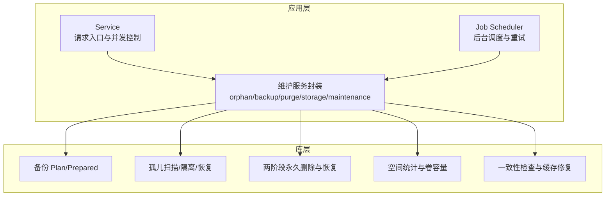

**图表来源**
- [app_lib.rs:1-120](../../../../crates/moriq-app/src/lib.rs#L1-L120)
- [scheduler.rs:1-120](../../../../crates/moriq-app/src/scheduler.rs#L1-L120)
- [app_maintenance.rs:1-120](../../../../crates/moriq-app/src/maintenance.rs#L1-L120)

**章节来源**
- [app_lib.rs:1-120](../../../../crates/moriq-app/src/lib.rs#L1-L120)
- [scheduler.rs:1-120](../../../../crates/moriq-app/src/scheduler.rs#L1-L120)
- [app_maintenance.rs:1-120](../../../../crates/moriq-app/src/maintenance.rs#L1-L120)

## 核心组件
| 组件 | 职责 | 关键行为 | 典型输出 |
|---|---|---|---|
| 备份 | 冻结目录与数据库快照，复制并验证原片哈希 | 计划→复制→发布；支持独立克隆；排除进行中导入 | 备份路径、已复制文件数、校验状态 |
| 孤儿检测 | 扫描未登记旧受管文件，建立候选快照 | 分页读取候选、身份指纹比对、移入隔离区 | 候选数量、字节数、示例路径、移动/跳过计数 |
| 清理 | 回收站两阶段永久删除与恢复日志 | 暂存→提交→清理；失败回滚或保留双方文件 | 删除计数、是否仍有待清理 |
| 存储统计 | 统计目录占用、去重硬链接、查询卷容量 | 分类统计、增量更新、可取消 | 总量、可用量、类别分布、链接数 |
| 维护 | 完整性检查、缩略图与主色缓存修复 | 只读快照、流式校验、写入端复核 | 检查/损坏/警告/修复计数 |

**章节来源**
- [backup.rs:1-120](../../../../crates/moriq-library/src/maintenance/backup.rs#L1-L120)
- [orphans.rs:1-120](../../../../crates/moriq-library/src/maintenance/orphans.rs#L1-L120)
- [purge.rs:1-120](../../../../crates/moriq-library/src/maintenance/purge.rs#L1-L120)
- [storage.rs:1-120](../../../../crates/moriq-library/src/maintenance/storage.rs#L1-L120)
- [maintenance.rs:1-120](../../../../crates/moriq-library/src/maintenance/maintenance.rs#L1-L120)

## 架构总览
维护工具采用“计划—执行—发布”三段式模式：
- 计划阶段在写线程中完成数据库与租约冻结，生成轻量级 Plan。
- 执行阶段在阻塞工作线程或独立调度器中运行，避免阻塞写入队列。
- 发布阶段由写线程再次校验库身份后提交最终结果。

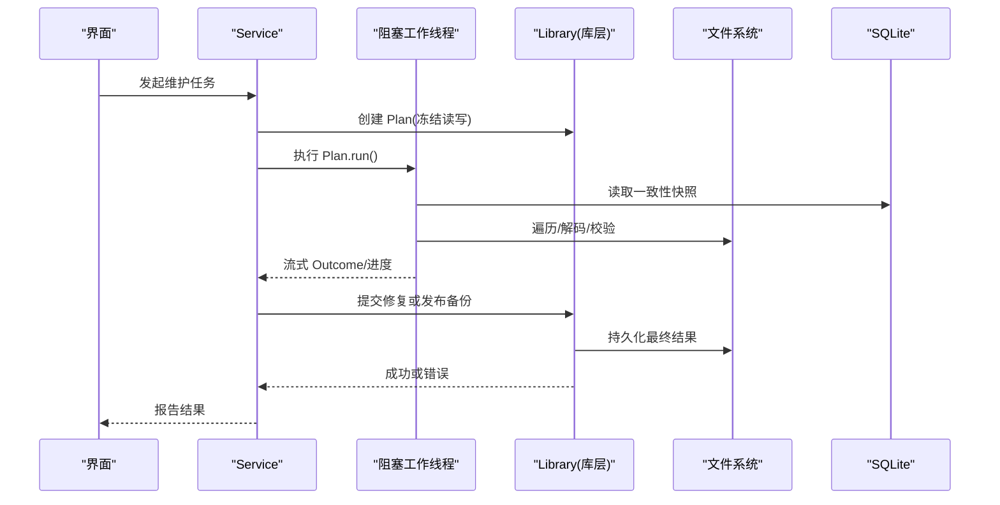

**图表来源**
- [app_maintenance.rs:120-244](../../../../crates/moriq-app/src/maintenance.rs#L120-L244)
- [maintenance.rs:120-300](../../../../crates/moriq-library/src/maintenance/maintenance.rs#L120-L300)
- [backup.rs:120-260](../../../../crates/moriq-library/src/maintenance/backup.rs#L120-L260)

## 详细组件分析

### 备份（Backup）
#### 设计要点
- 使用不可变硬链接构建冻结目录，使后续编辑不污染备份输入。
- 数据库备份时强制关闭 WAL，确保副本不包含仅处于 WAL 中的未提交变更。
- 排除进行中的导入暂存，但保留已中断导入的记录以便恢复。
- 独立克隆会重置库标识、清空同步任务和通知重试状态。
- 发布前对备份内原片执行 SHA-256 校验，防止损坏副本被发布。

#### 流程概览
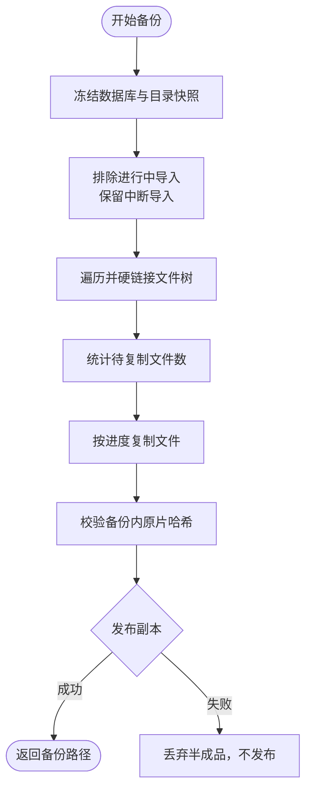

**图表来源**
- [backup.rs:1-200](../../../../crates/moriq-library/src/maintenance/backup.rs#L1-L200)
- [backup.rs:201-426](../../../../crates/moriq-library/src/maintenance/backup.rs#L201-L426)

#### 关键类与方法
- `Plan`：表示已冻结的备份计划，持有临时目录、父目录、名称与库锁。
- `Prepared`：表示已完成复制的备份准备对象，发布前仍可由调用方检查取消标志。
- `Control`：包含取消标志与已复制/总数原子计数器，供进度回调使用。

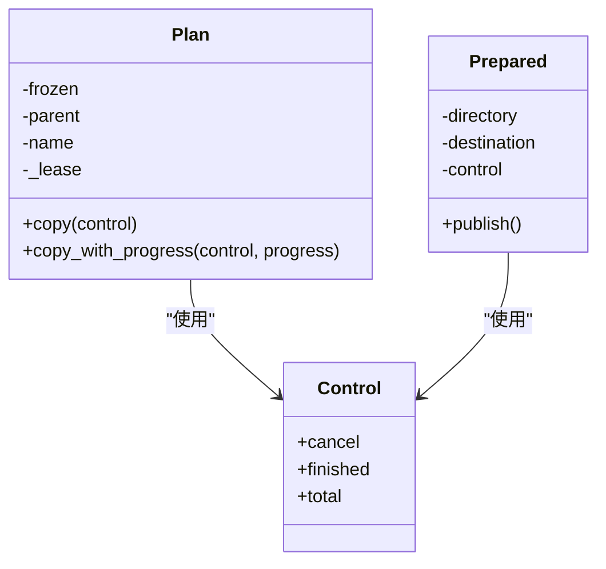

**图表来源**
- [backup.rs:1-80](../../../../crates/moriq-library/src/maintenance/backup.rs#L1-L80)
- [backup.rs:201-260](../../../../crates/moriq-library/src/maintenance/backup.rs#L201-L260)

#### 应用层协作
- `clone_library` 与 `backup` 均通过 `copy_library` 统一入口。
- 复制阶段进入阻塞工作线程，发布阶段回到写线程做身份校验。

**章节来源**
- [backup.rs:1-426](../../../../crates/moriq-library/src/maintenance/backup.rs#L1-L426)
- [app_maintenance.rs:140-200](../../../../crates/moriq-app/src/maintenance.rs#L140-L200)

### 孤儿检测（Orphans）
#### 检测机制
- 扫描 `assets` 与 `versions` 下修改时间早于阈值的旧文件。
- 排除符号链接与 Windows 重解析点，避免将外部目标计入。
- 使用临时 SQLite 表记录候选文件的相对路径、大小、修改时间与平台文件身份。
- 通过游标分页读取候选，避免一次性加载整个库。

#### 隔离与恢复
- 将确认候选移动到 `recovery/orphans/{uuid}.bin`，并记录隔离日志。
- 恢复时拒绝覆盖现有文件或已重新登记的路径。
- 支持按页恢复或删除，失败时保留中间状态以便下次继续。

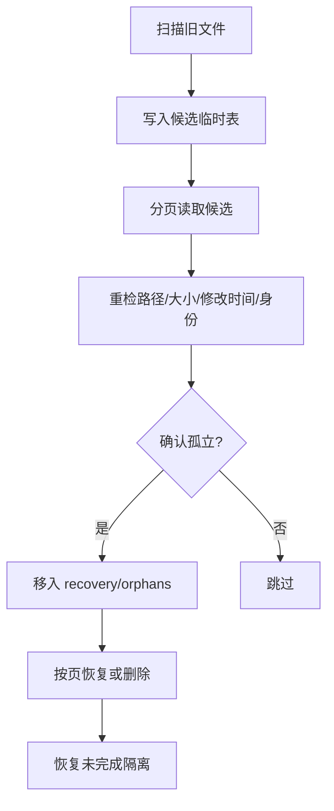

**图表来源**
- [orphans.rs:1-200](../../../../crates/moriq-library/src/maintenance/orphans.rs#L1-L200)
- [orphans.rs:201-355](../../../../crates/moriq-library/src/maintenance/orphans.rs#L201-L355)

#### 数据结构
- `Scan`：封装根路径、库 ID、读池与库锁。
- `Plan`：封装临时候选快照、计数、示例路径与库锁。
- `Candidate`：单个候选文件的路径、大小、修改时间与身份字符串。

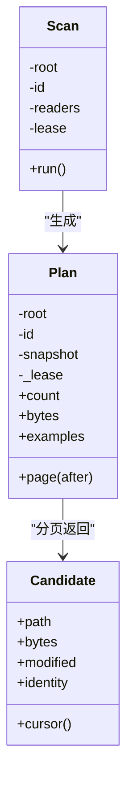

**图表来源**
- [orphans.rs:1-120](../../../../crates/moriq-library/src/maintenance/orphans.rs#L1-L120)
- [orphans.rs:120-200](../../../../crates/moriq-library/src/maintenance/orphans.rs#L120-L200)

#### 应用层协作
- 异步分页拉取候选，并在写线程中执行隔离与恢复。
- 汇总移动、跳过与字节数到 `OrphanReport`。

**章节来源**
- [orphans.rs:1-355](../../../../crates/moriq-library/src/maintenance/orphans.rs#L1-L355)
- [app_maintenance.rs:1-120](../../../../crates/moriq-app/src/maintenance.rs#L1-L120)

### 清理（Purge）
#### 两阶段删除协议
1. 准备阶段：收集受管文件、预览、缩略图与 Synco 交接文件，写入 `purge_jobs` 与 `purge_files` 日志。
2. 迁移阶段：将源文件移动到 `trash/purge-{job}/*.part`。
3. 提交阶段：删除数据库关联，标记 job 为已提交。
4. 收尾阶段：删除隔离目录；若失败则保留未知文件并告警。

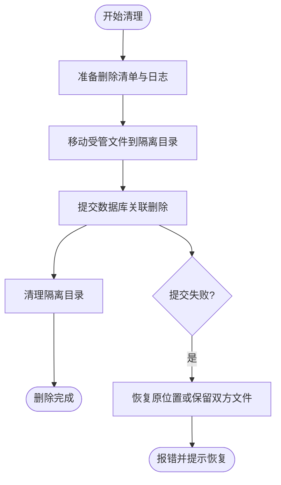

**图表来源**
- [purge.rs:1-200](../../../../crates/moriq-library/src/maintenance/purge.rs#L1-L200)
- [purge.rs:201-552](../../../../crates/moriq-library/src/maintenance/purge.rs#L201-L552)

#### 安全约束
- 仅允许删除受管路径前缀，如 `assets/`、`versions/`、`thumbnails/256/`、`previews/`、`interop/outgoing/`。
- 路径不得包含符号链接或重解析点。
- 仅能永久删除已在回收站中的素材，且每批限制 1～10000 项。
- 若存在未完成删除恢复，需先检查通知与备份。

**章节来源**
- [purge.rs:1-552](../../../../crates/moriq-library/src/maintenance/purge.rs#L1-L552)
- [app_maintenance.rs:100-180](../../../../crates/moriq-app/src/maintenance.rs#L100-L180)

### 存储统计（Storage）
#### 统计维度
- 卷总容量与可用容量。
- 托管原片与追加版本的注册字节数。
- 物理分配字节数、唯一文件字节数、硬链接路径数。
- 分类统计：托管原片、追加版本、可重建图片缓存、索引、Synco 交接副本、恢复与暂存数据、数据库升级备份、数据库与元数据。

#### 去重策略
- 使用平台文件身份编码为键，去重硬链接。
- 忽略符号链接与 Windows 重解析点，避免统计外部目标。

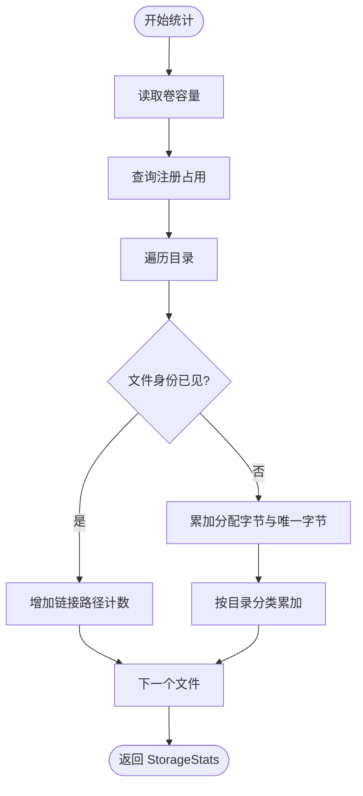

**图表来源**
- [storage.rs:1-200](../../../../crates/moriq-library/src/maintenance/storage.rs#L1-L200)
- [storage.rs:201-261](../../../../crates/moriq-library/src/maintenance/storage.rs#L201-L261)

**章节来源**
- [storage.rs:1-261](../../../../crates/moriq-library/src/maintenance/storage.rs#L1-L261)
- [app_maintenance.rs:200-244](../../../../crates/moriq-app/src/maintenance.rs#L200-L244)

### 维护（Maintenance）
#### 一致性检查
- 运行数据库完整性检查与外键检查。
- 将版本信息导出到临时快照表，避免长时间持有读取事务。
- 根据平台原生路径或本地相对路径定位源文件。

#### 缓存修复
- 若缩略图无效或缺失，解码源文件生成新缩略图。
- 若主色缺失，计算并更新 `dominant_color`。
- 所有修复在写线程复核版本号与源路径后应用，过期修复会被拒绝。

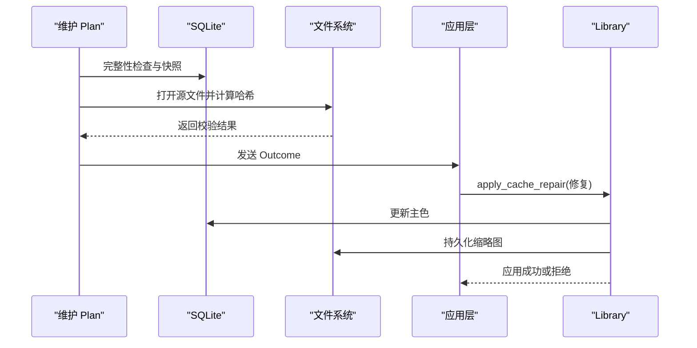

**图表来源**
- [maintenance.rs:120-300](../../../../crates/moriq-library/src/maintenance/maintenance.rs#L120-L300)
- [maintenance.rs:300-412](../../../../crates/moriq-library/src/maintenance/maintenance.rs#L300-L412)
- [app_maintenance.rs:160-244](../../../../crates/moriq-app/src/maintenance.rs#L160-L244)

**章节来源**
- [maintenance.rs:1-412](../../../../crates/moriq-library/src/maintenance/maintenance.rs#L1-L412)
- [app_maintenance.rs:160-244](../../../../crates/moriq-app/src/maintenance.rs#L160-L244)

## 依赖关系分析
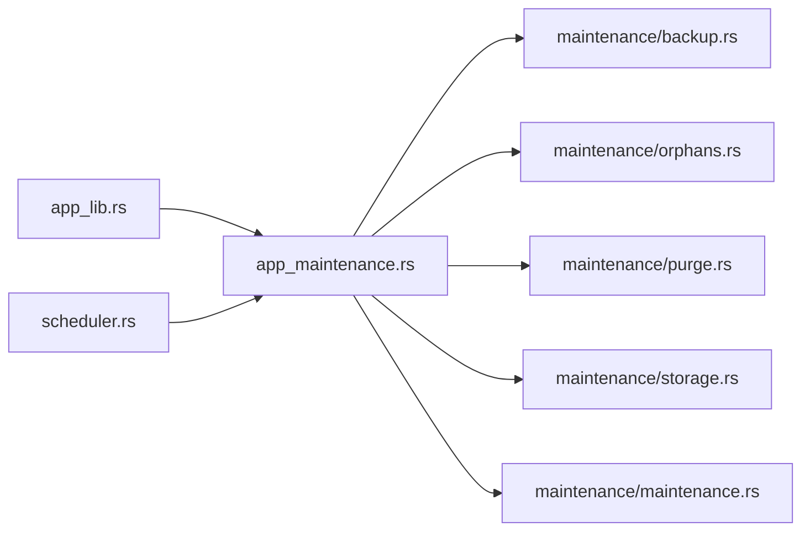

**图表来源**
- [app_lib.rs:1-120](../../../../crates/moriq-app/src/lib.rs#L1-L120)
- [app_maintenance.rs:1-244](../../../../crates/moriq-app/src/maintenance.rs#L1-L244)
- [scheduler.rs:1-120](../../../../crates/moriq-app/src/scheduler.rs#L1-L120)

**章节来源**
- [app_lib.rs:1-120](../../../../crates/moriq-app/src/lib.rs#L1-L120)
- [app_maintenance.rs:1-244](../../../../crates/moriq-app/src/maintenance.rs#L1-L244)
- [scheduler.rs:1-120](../../../../crates/moriq-app/src/scheduler.rs#L1-L120)

## 性能与资源特性
- 备份复制使用深度受限的递归遍历，避免一次性收集大目录列表。
- 孤儿扫描使用临时 SQLite 表与分页游标，减少内存峰值。
- 维护任务将数据库快照放入临时文件，释放长事务，允许导入与编辑继续。
- 存储统计使用栈式目录遍历与文件身份去重，避免重复计算硬链接。
- 所有长耗时操作均支持取消标志，并在关键分支检查取消状态。

[本节为通用性能讨论，不直接分析具体代码行]

## 故障排查指南
| 问题 | 可能原因 | 建议处理 |
|---|---|---|
| 备份未发布 | 复制过程中取消或原片哈希校验失败 | 检查取消标志与备份目录中是否存在半成品 |
| 孤儿隔离失败 | 路径无效、文件大小或身份变化 | 查看隔离日志，必要时从备份恢复 |
| 永久删除失败 | 存在未完成删除恢复或路径不安全 | 检查通知与备份，确认路径不含链接 |
| 存储统计缓慢 | 大量文件与硬链接 | 启用取消并观察 `files` 计数增长 |
| 维护任务卡住 | 媒体解码预算不足或磁盘空间不足 | 等待预算释放，并确保剩余空间足够暂存 |

**章节来源**
- [backup.rs:120-426](../../../../crates/moriq-library/src/maintenance/backup.rs#L120-L426)
- [orphans.rs:120-355](../../../../crates/moriq-library/src/maintenance/orphans.rs#L120-L355)
- [purge.rs:200-552](../../../../crates/moriq-library/src/maintenance/purge.rs#L200-L552)
- [storage.rs:120-261](../../../../crates/moriq-library/src/maintenance/storage.rs#L120-L261)
- [maintenance.rs:120-412](../../../../crates/moriq-library/src/maintenance/maintenance.rs#L120-L412)

## 结论
Moriq Space 的维护工具集以冻结快照、两阶段协议与流式检查为核心，兼顾一致性与可用性。备份提供可恢复快照与独立克隆；孤儿检测提供安全隔离与可恢复删除；清理保证删除幂等与可恢复；存储统计提供准确的空间分析与去重；维护框架在只读快照上执行校验与修复，并通过写线程复核确保安全。

[本节为总结性内容，不直接分析具体代码行]

## 附录：任务触发、配置与报告

### 任务触发机制
- 定时任务：后台调度器循环驱动任务，连续失败指数退避并暂停任务。
- 手动触发：通过 `Service` 暴露的方法直接调用维护、备份、孤儿、清理与存储统计。
- 自动检测：库生命周期与导入/编辑流程中触发背景任务，例如缩略图与完整性检查。

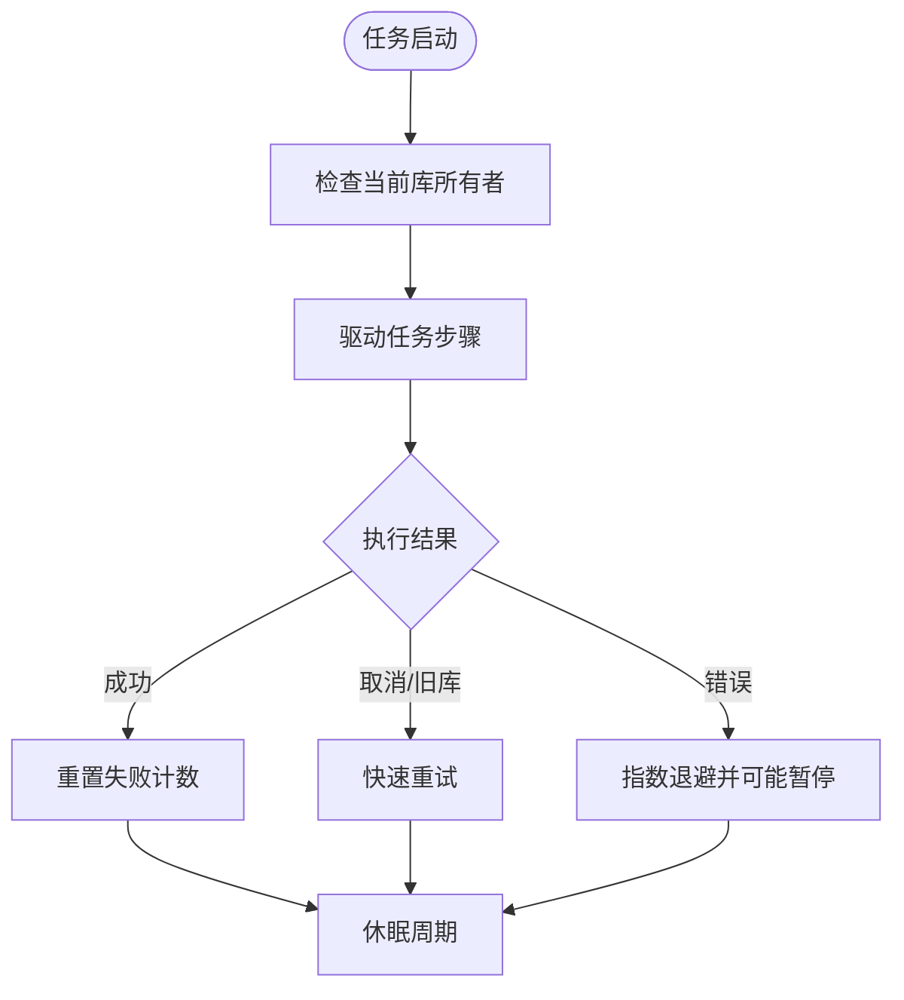

**图表来源**
- [scheduler.rs:1-120](../../../../crates/moriq-app/src/scheduler.rs#L1-L120)

**章节来源**
- [scheduler.rs:1-120](../../../../crates/moriq-app/src/scheduler.rs#L1-L120)

### 配置选项与执行参数
| 功能 | 配置项或参数 | 含义 |
|---|---|---|
| 备份 | `independent` | 是否生成独立克隆，重置库标识 |
| 备份 | `Control.cancel` | 取消备份复制 |
| 孤儿 | `after` | 分页游标 |
| 孤儿 | `purge` | 恢复页面时选择删除而非还原 |
| 清理 | 批量大小 | 每批最多 10000 项，应用层按 1000 分块 |
| 存储 | `Control.files` | 已扫描文件计数 |
| 存储 | `Control.cancel` | 取消扫描 |
| 维护 | `repair` | 是否尝试修复缩略图与主色 |
| 维护 | `Control.finished/total` | 进度计数 |

**章节来源**
- [app_lib.rs:100-200](../../../../crates/moriq-app/src/lib.rs#L100-L200)
- [app_maintenance.rs:1-244](../../../../crates/moriq-app/src/maintenance.rs#L1-L244)

### 结果报告格式
| 报告类型 | 关键字段 |
|---|---|
| 备份 | 备份路径、已复制文件数、校验状态 |
| 孤儿 | `moved`、`bytes`、`skipped`、示例路径、候选计数 |
| 清理 | `deleted`、`cleanup_pending` |
| 存储 | `volume_total`、`volume_available`、`allocated`、`unique_file_bytes`、`linked_paths`、`categories` |
| 维护 | `checked`、`missing`、`damaged`、`warnings`、`repaired`、`cancelled` |

**章节来源**
- [app_maintenance.rs:1-244](../../../../crates/moriq-app/src/maintenance.rs#L1-L244)
- [maintenance.rs:1-412](../../../../crates/moriq-library/src/maintenance/maintenance.rs#L1-L412)