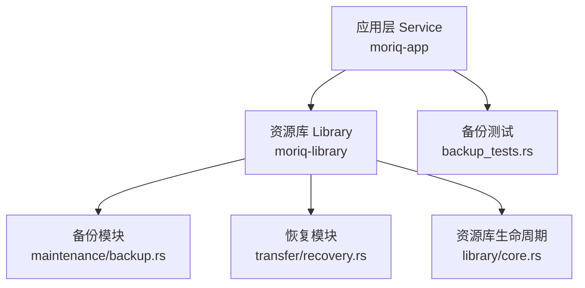
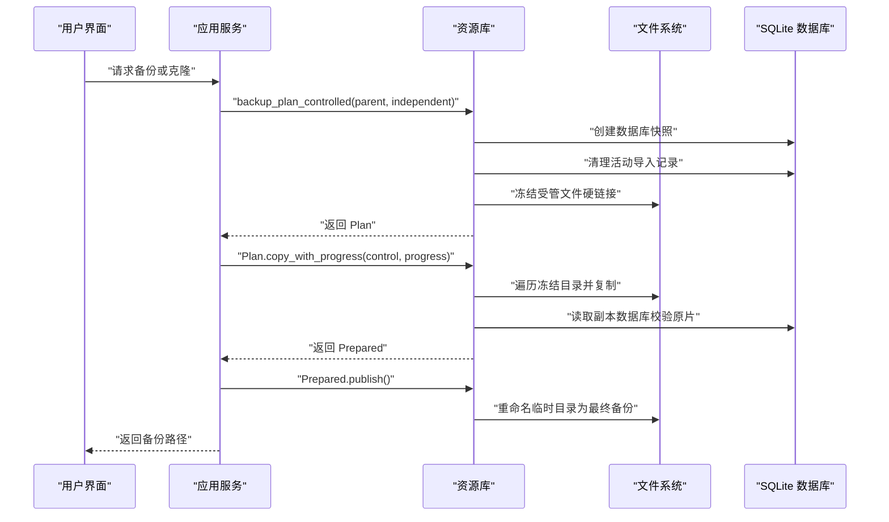
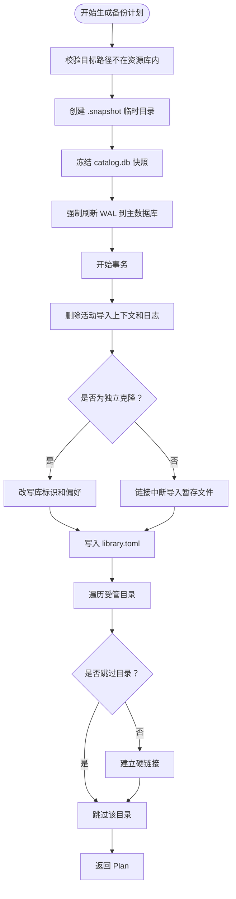
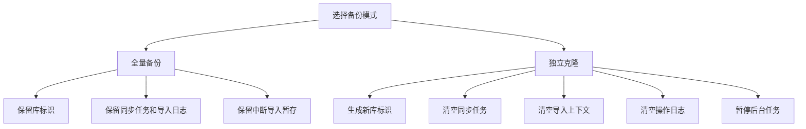
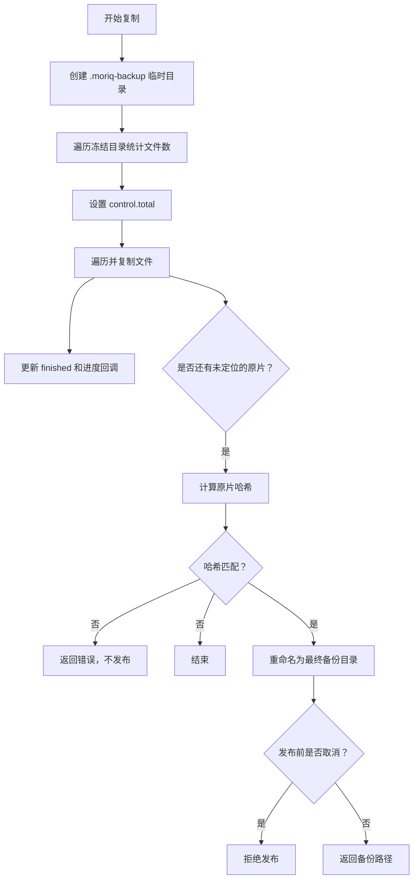
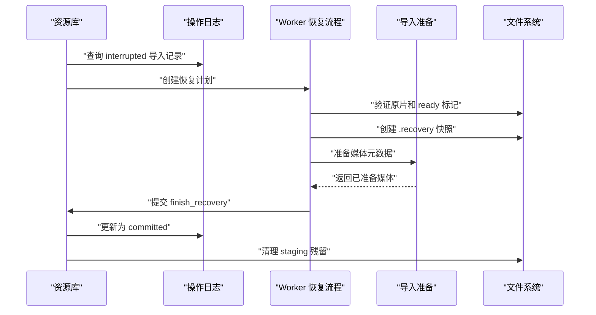
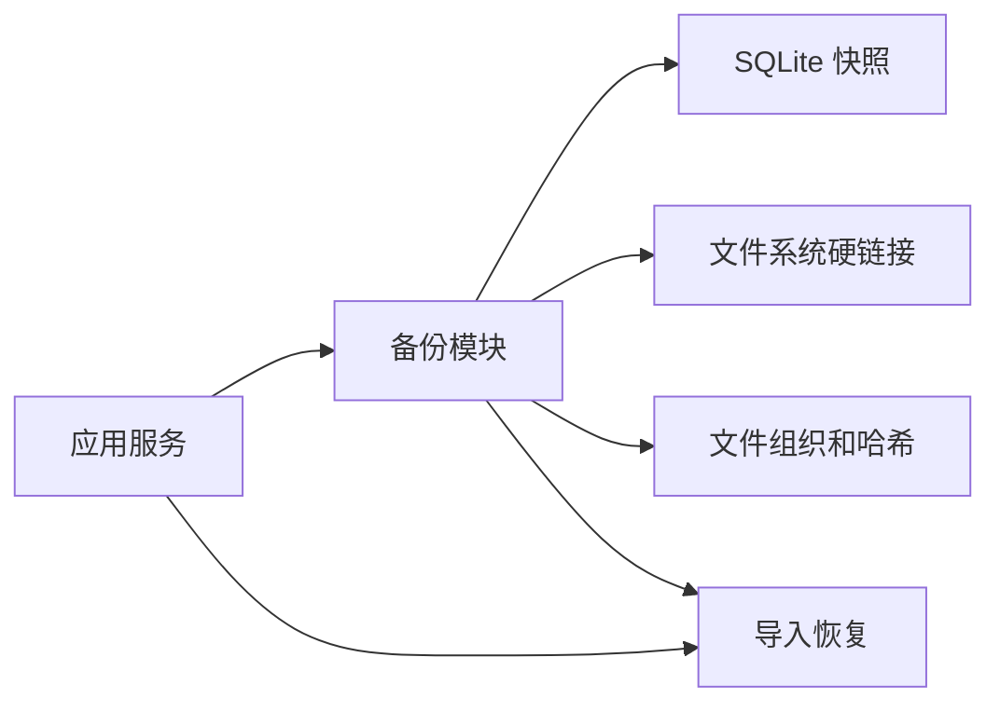

# 备份系统 (Backup)

> Repo Wiki 节点 `backup-system`
> 导出自 Qoder 知识库快照 `8fbe02f6-57c2-4874-b725-1a8130851fd9`，代码基线 `7a7a8e75e18bd90294e09cd422dd7ed5a04813a0`（分支 main，zh-CN）。

<cite>
**本文引用的文件**   
- [crates/moriq-library/src/maintenance/backup.rs](../../../../crates/moriq-library/src/maintenance/backup.rs)
- [crates/moriq-app/src/maintenance.rs](../../../../crates/moriq-app/src/maintenance.rs)
- [crates/moriq-app/src/backup_tests.rs](../../../../crates/moriq-app/src/backup_tests.rs)
- [crates/moriq-library/src/library/core.rs](../../../../crates/moriq-library/src/library/core.rs)
- [crates/moriq-library/src/transfer/recovery.rs](../../../../crates/moriq-library/src/transfer/recovery.rs)
</cite>

## 目录
1. [简介](#简介)
2. [项目结构与职责划分](#项目结构与职责划分)
3. [核心概念与数据模型](#核心概念与数据模型)
4. [架构总览](#架构总览)
5. [详细组件分析](#详细组件分析)
6. [依赖关系分析](#依赖关系分析)
7. [性能与并发特性](#性能与并发特性)
8. [故障排查指南](#故障排查指南)
9. [结论](#结论)

## 简介
本文面向 Moriq Space 的备份系统，聚焦以下目标：
- 解释备份计划生成阶段如何保证数据库一致性、冻结文件链接并生成清单。
- 区分全量备份与独立克隆，说明 `independent` 参数的作用范围。
- 说明复制阶段的进度控制、取消支持与失败回滚策略。
- 介绍备份验证机制，包括原片校验和完整性检查。
- 说明备份恢复流程中的依赖检查和一致性验证。
- 汇总备份配置选项，包括目标路径约束、排除目录列表、压缩加密支持现状。
- 提供实际 API 使用示例，展示 `backup_plan`、`copy_with_progress` 等调用方式。
- 说明与导入暂存数据的交互，包括中断导入的处理策略。

本说明以仓库中 `moriq-library` 的核心库实现为主，并以 `moriq-app` 作为服务层调用入口进行对照。

## 项目结构与职责划分
备份相关代码主要分布在两个 crate：
- `moriq-library`：实现资源库级备份计划、快照冻结、文件链接、清单写入、发布前校验和恢复逻辑。
- `moriq-app`：对外暴露 `Service` 接口，封装单写者协调、线程调度、身份校验和任务编排。



**图表来源**
- [crates/moriq-app/src/maintenance.rs:107-140](../../../../crates/moriq-app/src/maintenance.rs#L107-L140)
- [crates/moriq-library/src/maintenance/backup.rs:34-214](../../../../crates/moriq-library/src/maintenance/backup.rs#L34-L214)
- [crates/moriq-library/src/transfer/recovery.rs:1-229](../../../../crates/moriq-library/src/transfer/recovery.rs#L1-L229)
- [crates/moriq-library/src/library/core.rs:1-200](../../../../crates/moriq-library/src/library/core.rs#L1-L200)

**章节来源**
- [crates/moriq-app/src/maintenance.rs:1-140](../../../../crates/moriq-app/src/maintenance.rs#L1-L140)
- [crates/moriq-library/src/maintenance/backup.rs:1-214](../../../../crates/moriq-library/src/maintenance/backup.rs#L1-L214)

## 核心概念与数据模型
### 备份控制对象
`Control` 是复制阶段的共享控制结构，包含三个原子字段：
- `cancel`：取消信号，允许在扫描、复制、校验过程中随时停止。
- `finished`：已复制完成的项目数。
- `total`：待复制项目总数。

该结构由上层应用通过 `BackupControl` 复用，用于 UI 进度显示和取消操作。

### 备份计划
`Plan` 表示一个已经冻结的一致性快照，其内部保存：
- 临时目录句柄，用于持有数据库副本和硬链接文件树。
- 源资源库根路径、名称和独占锁租赁，防止快照期间被替换。
- 在复制阶段不再访问原始数据库连接，而是直接读取冻结目录。

### 已准备副本
`Prepared` 表示已完成复制但尚未发布的中间状态，包含：
- 临时备份目录。
- 最终目标路径。
- 控制对象，用于发布前的取消检查。

**章节来源**
- [crates/moriq-library/src/maintenance/backup.rs:9-26](../../../../crates/moriq-library/src/maintenance/backup.rs#L9-L26)
- [crates/moriq-library/src/maintenance/backup.rs:28-33](../../../../crates/moriq-library/src/maintenance/backup.rs#L28-L33)
- [crates/moriq-library/src/maintenance/backup.rs:201-214](../../../../crates/moriq-library/src/maintenance/backup.rs#L201-L214)

## 架构总览
备份流程分为两个明确阶段：

1. **计划生成阶段**：在资源库写入端执行，负责数据库一致性快照、排除活动导入暂存、冻结受管文件链接、写入清单，并返回 `Plan`。
2. **复制与发布阶段**：离开写入端，在独立线程中遍历冻结目录、建立副本、执行原片校验，最后才将临时目录重命名为最终备份路径。



**图表来源**
- [crates/moriq-app/src/maintenance.rs:122-140](../../../../crates/moriq-app/src/maintenance.rs#L122-L140)
- [crates/moriq-library/src/maintenance/backup.rs:34-214](../../../../crates/moriq-library/src/maintenance/backup.rs#L34-L214)

## 详细组件分析

### 备份计划生成：数据库一致性与文件冻结
`Library::backup_plan` 和 `Library::backup_plan_controlled` 是备份计划的核心入口。

关键行为如下：
- 校验目标路径不能位于资源库根目录内，避免覆盖自身。
- 在资源库 `backups` 子目录下的临时目录中创建 `.snapshot-*` 目录。
- 使用 SQLite 的 `backup` 接口生成 `catalog.db` 一致性快照。
- 强制将 WAL 日志模式切换为 `DELETE`，确保不会复制仅存在于 WAL 中的未提交变更。
- 开启事务后删除活动导入上下文和未完成导入日志，保留 `interrupted` 状态的导入以便恢复。
- 根据 `independent` 参数决定是否修改库标识、同步任务和通知状态。
- 写入 `library.toml` 清单。
- 遍历 `DIRECTORIES`，跳过缩略图、预览、备份、索引和暂存目录；独立模式下还跳过 `interop/`。
- 对普通文件和目录建立硬链接，使后续源库编辑不影响快照。
- 非独立模式下，重新查询 `interrupted` 导入并链接对应的暂存文件。
- 打开并同步数据库文件，返回持有临时目录和库锁的 `Plan`。



**图表来源**
- [crates/moriq-library/src/maintenance/backup.rs:34-139](../../../../crates/moriq-library/src/maintenance/backup.rs#L34-L139)

**章节来源**
- [crates/moriq-library/src/maintenance/backup.rs:34-139](../../../../crates/moriq-library/src/maintenance/backup.rs#L34-L139)

### 全量备份与独立克隆的区别
#### 全量备份
- 保留源资源库的 `library_id`。
- 保留同步任务、导入上下文和操作日志。
- 保留中断导入的暂存文件链接。
- 适用于迁移、归档和灾难恢复。

#### 独立克隆
- 生成新的 `library_id`。
- 重写清单名称，追加“克隆”后缀。
- 清空 `synco_tasks`、`import_context`、`operation_journal`。
- 更新 `display_name` 偏好。
- 清除可重试通知。
- 暂停仍在运行或排队的外部后台任务。
- 不链接中断导入暂存。
- 适用于需要隔离身份、互不干扰的二次使用场景。



**图表来源**
- [crates/moriq-library/src/maintenance/backup.rs:70-110](../../../../crates/moriq-library/src/maintenance/backup.rs#L70-L110)

**章节来源**
- [crates/moriq-library/src/maintenance/backup.rs:70-110](../../../../crates/moriq-library/src/maintenance/backup.rs#L70-L110)

### 复制阶段：进度控制、取消支持与失败回滚
`Plan::copy` 和 `Plan::copy_with_progress` 负责把冻结快照复制到目标位置。

关键点：
- 进入独立的临时目录 `.moriq-backup-*`，避免污染最终备份空间。
- 先遍历冻结目录统计文件数量，设置 `control.total`。
- 再次遍历，递归创建目录并使用 `organize::copy_owned` 复制文件。
- 每复制一个文件就更新 `control.finished` 并调用进度回调。
- 复制完成后，打开副本数据库，查找没有对应文件位置的资产版本。
- 对这些资产版本计算哈希并与数据库中记录的期望值比较。
- 如果原片哈希不一致，直接报错且不发布半成品。
- 成功后重命名临时目录为最终路径，例如 `{库名}-副本-{UUID}.moriq`。
- `publish()` 会再次检查取消信号，若已取消则拒绝发布。



**图表来源**
- [crates/moriq-library/src/maintenance/backup.rs:140-214](../../../../crates/moriq-library/src/maintenance/backup.rs#L140-L214)

**章节来源**
- [crates/moriq-library/src/maintenance/backup.rs:140-214](../../../../crates/moriq-library/src/maintenance/backup.rs#L140-L214)

### 备份验证机制
备份验证发生在复制完成后、发布前：
- 从副本数据库查询存在资产版本但没有文件位置的条目。
- 按相对路径解析原片位置。
- 若文件存在且哈希与数据库记录不一致，返回错误，阻止发布。
- 这种设计保证备份中的媒体内容与元数据保持一致。

此外，`link_tree` 在构建冻结快照时也会检测符号链接，发现符号链接会直接报错，要求先检查资源库完整性。

**章节来源**
- [crates/moriq-library/src/maintenance/backup.rs:160-188](../../../../crates/moriq-library/src/maintenance/backup.rs#L160-L188)
- [crates/moriq-library/src/maintenance/backup.rs:250-282](../../../../crates/moriq-library/src/maintenance/backup.rs#L250-L282)

### 备份恢复流程
恢复逻辑集中在 `transfer/recovery.rs`，主要用于处理中断导入。

恢复入口包括：
- `recovery_plans`：查询当前资源库中处于 `interrupted` 状态的导入记录。
- `Plan::freeze`：在 worker 侧验证原片长度、ready 标记，并在 `backups` 下建立不可变快照。
- `Work::prepare`：探测媒体信息，必要时校验引用原片哈希。
- `finish_recovery`：校验所属资源库、记录未变化后安装媒体，并将日志状态改为 `committed`。
- `recover_imports`：同步工具函数，逐个恢复导入，统计成功、重复和失败结果。



**图表来源**
- [crates/moriq-library/src/transfer/recovery.rs:1-229](../../../../crates/moriq-library/src/transfer/recovery.rs#L1-L229)

**章节来源**
- [crates/moriq-library/src/transfer/recovery.rs:1-229](../../../../crates/moriq-library/src/transfer/recovery.rs#L1-L229)

### 与导入暂存数据的交互
备份生成阶段对导入暂存采取保守策略：
- 活动导入（未完成）的 `import_context` 和 `operation_journal` 会被清理，因此备份不包含正在进行的导入暂存。
- `interrupted` 状态的导入记录会保留，并在非独立备份中链接 `staging/{operation_id}.{part|thumb|ready}` 文件，以便恢复。
- 恢复流程会检查 `ready` 文件长度、原片大小和哈希，防止不完整或已被替换的文件进入恢复。

测试用例覆盖了以下行为：
- 活动导入暂存不会被备份。
- 中断导入可在备份后恢复。
- 备份不会修改源库的 `prepared` 状态日志。

**章节来源**
- [crates/moriq-library/src/maintenance/backup.rs:60-139](../../../../crates/moriq-library/src/maintenance/backup.rs#L60-L139)
- [crates/moriq-library/src/maintenance/backup.rs:384-426](../../../../crates/moriq-library/src/maintenance/backup.rs#L384-L426)
- [crates/moriq-library/src/transfer/recovery.rs:1-120](../../../../crates/moriq-library/src/transfer/recovery.rs#L1-L120)

### 服务层调用与身份保护
`moriq-app` 的 `Service` 提供了更贴近应用的 API：
- `clone_library(id, parent)`：创建独立克隆。
- `backup(id, parent)`：创建保留源库身份的全量备份。
- `copy_library(id, parent, independent, control)`：统一实现，先在写入端冻结快照，再在独立线程复制，最后回到写入端校验库身份并发布。

测试用例验证了：
- 慢速备份不会长时间占用写入端。
- 复制期间仍可正常读取库信息和执行写操作。
- 切换库后，旧 `Prepared` 的 `publish()` 会失败。
- 失败时不会留下 `.moriq-backup-*` 临时目录。

**章节来源**
- [crates/moriq-app/src/maintenance.rs:107-140](../../../../crates/moriq-app/src/maintenance.rs#L107-L140)
- [crates/moriq-app/src/backup_tests.rs:1-93](../../../../crates/moriq-app/src/backup_tests.rs#L1-L93)

## 依赖关系分析
备份系统依赖以下子系统：
- SQLite：通过 `rusqlite` 的 `backup` 接口和事务机制保证数据库一致性。
- 文件系统：依赖硬链接实现不可变快照，依赖 `tempfile` 管理临时目录。
- 组织模块：通过 `organize::copy_owned` 和 `organize::hash_file` 复制文件并计算哈希。
- 导入恢复：通过 `ingest::prepare` 完成媒体探测和校验。
- 应用服务：通过 `Service::call` 保证所有涉及活跃库身份的调用都在正确上下文中执行。



**图表来源**
- [crates/moriq-library/src/maintenance/backup.rs:34-214](../../../../crates/moriq-library/src/maintenance/backup.rs#L34-L214)
- [crates/moriq-library/src/transfer/recovery.rs:1-229](../../../../crates/moriq-library/src/transfer/recovery.rs#L1-L229)
- [crates/moriq-app/src/maintenance.rs:122-140](../../../../crates/moriq-app/src/maintenance.rs#L122-L140)

**章节来源**
- [crates/moriq-library/src/maintenance/backup.rs:34-214](../../../../crates/moriq-library/src/maintenance/backup.rs#L34-L214)
- [crates/moriq-library/src/transfer/recovery.rs:1-229](../../../../crates/moriq-library/src/transfer/recovery.rs#L1-L229)

## 性能与并发特性
- 计划生成阶段只冻结数据库元数据和文件名，受管原片是不可变的，因此不需要复制整个媒体库即可生成计划。
- 复制阶段采用深度受限遍历，避免一次性加载整个大库的文件列表到内存。
- 文件复制使用递归遍历和逐文件进度回调，适合长耗时任务。
- 取消信号贯穿冻结、复制、校验和发布各阶段。
- 应用层通过 `spawn_blocking` 将复制移出 UI 线程，同时保留数据库读操作可用。
- 目录层级限制为 128 层，防止极深路径导致异常。

**章节来源**
- [crates/moriq-library/src/maintenance/backup.rs:140-240](../../../../crates/moriq-library/src/maintenance/backup.rs#L140-L240)
- [crates/moriq-library/src/maintenance/backup.rs:224-240](../../../../crates/moriq-library/src/maintenance/backup.rs#L224-L240)
- [crates/moriq-app/src/maintenance.rs:122-140](../../../../crates/moriq-app/src/maintenance.rs#L122-L140)

## 故障排查指南
### 常见错误及含义
| 错误类型 | 可能原因 | 建议处理 |
|---|---|---|
| 目标路径位于资源库内 | 备份目标与源库重叠 | 选择资源库外部路径，建议使用其他磁盘 |
| 导入恢复记录身份无效 | 中断导入 ID 无法解析 | 检查 `staging` 目录和数据库一致性 |
| 备份中的原片校验不符 | 原片内容被替换或损坏 | 保留原片并重新导入，不要直接覆盖 |
| 恢复副本不完整 | `ready` 文件大小与实际不符 | 保留原片并重新导入 |
| 恢复期间副本长度改变 | 快照文件被外部修改 | 重新触发恢复流程 |
| 备份目录层级过深 | 路径超过 128 层 | 减少嵌套或使用扁平结构 |
| 备份发现符号链接 | 资源库包含不支持的链接 | 先检查资源库完整性 |
| 资源库清单与数据库身份不一致 | 清单与数据库不同步 | 从备份恢复或修复资源库 |

### 调试建议
- 检查 `backups` 目录下是否存在 `.snapshot-*` 或 `.recovery-*` 临时目录。
- 检查 `staging` 目录中是否存在 `*.part`、`*.thumb`、`*.ready` 文件。
- 查看 `operation_journal` 中 `phase='interrupted'` 的记录。
- 确认备份路径不是资源库根的子路径。
- 在长时间复制过程中观察 `control.total` 和 `control.finished` 的增长情况。

**章节来源**
- [crates/moriq-library/src/maintenance/backup.rs:44-139](../../../../crates/moriq-library/src/maintenance/backup.rs#L44-L139)
- [crates/moriq-library/src/maintenance/backup.rs:160-214](../../../../crates/moriq-library/src/maintenance/backup.rs#L160-L214)
- [crates/moriq-library/src/transfer/recovery.rs:40-120](../../../../crates/moriq-library/src/transfer/recovery.rs#L40-L120)
- [crates/moriq-library/src/library/core.rs:201-412](../../../../crates/moriq-library/src/library/core.rs#L201-L412)

## 结论
Moriq Space 的备份系统通过两阶段设计实现了高安全性和低侵入性：
- 计划生成阶段专注于数据库一致性、导入暂存清理和文件链接冻结。
- 复制阶段专注于进度可控、可取消、可验证的副本构建。
- 独立克隆通过改写库标识和相关状态，提供身份隔离能力。
- 备份恢复流程严格依赖导入日志、ready 标记和原片哈希，避免误恢复。
- 应用层通过服务协调器保证备份和恢复不会破坏活跃库的身份和并发访问。

对于生产使用，建议：
- 始终将备份目标放在资源库根之外。
- 使用独立克隆获取可独立使用的隔离副本。
- 使用全量备份进行归档和灾难恢复。
- 在复制过程中保留进度回调，以便监控长耗时任务。
- 在中断导入后优先尝试恢复，而不是直接删除暂存文件。

## 附录：API 使用示例

### 使用 `backup_plan` 生成备份计划
```rust
// 在资源库上生成保留源库身份的计划
let plan = library.backup_plan(&parent_path, false)?;
```

参考路径：
- [crates/moriq-library/src/maintenance/backup.rs:34-39](../../../../crates/moriq-library/src/maintenance/backup.rs#L34-L39)

### 使用 `copy_with_progress` 复制并报告进度
```rust
let control = backup::Control::default();
let prepared = plan.copy_with_progress(&control, |finished| {
    // 这里可以更新 UI 进度
});
let destination = prepared.publish()?;
```

参考路径：
- [crates/moriq-library/src/maintenance/backup.rs:140-214](../../../../crates/moriq-library/src/maintenance/backup.rs#L140-L214)

### 通过应用服务发起备份或克隆
```rust
// 全量备份
let path = service.backup(library_id, parent_path).await?;

// 独立克隆
let clone_path = service.clone_library(library_id, parent_path).await?;
```

参考路径：
- [crates/moriq-app/src/maintenance.rs:107-140](../../../../crates/moriq-app/src/maintenance.rs#L107-L140)

### 使用恢复 API 处理中断导入
```rust
let plans = library.recovery_plans()?;
for plan in plans {
    let work = plan.freeze(cancel.clone())?;
    let ready = work.prepare(cancel.clone())?;
    let imported = library.finish_recovery(ready)?;
}
```

参考路径：
- [crates/moriq-library/src/transfer/recovery.rs:120-229](../../../../crates/moriq-library/src/transfer/recovery.rs#L120-L229)

### 备份配置选项汇总
| 选项类别 | 当前实现状态 | 说明 |
|---|---|---|
| 目标路径约束 | 已实现 | 不允许目标路径以资源库根开头 |
| 排除目录列表 | 已实现 | 排除缩略图、预览、备份、搜索索引、布局索引和暂存；独立模式额外排除 `interop/` |
| 压缩支持 | 未在备份模块中实现 | 当前备份输出为展开目录结构 |
| 加密支持 | 未在备份模块中实现 | 当前备份输出不含内置加密 |
| 取消支持 | 已实现 | 计划生成、复制、校验和发布均支持取消 |
| 进度回调 | 已实现 | `copy_with_progress` 提供已复制项数回调 |
| 原片校验 | 已实现 | 发布前比对资产版本哈希 |
| 中断导入恢复 | 已实现 | 通过 `recovery_plans` 和 `finish_recovery` 恢复 |

**章节来源**
- [crates/moriq-library/src/maintenance/backup.rs:44-139](../../../../crates/moriq-library/src/maintenance/backup.rs#L44-L139)
- [crates/moriq-library/src/maintenance/backup.rs:140-214](../../../../crates/moriq-library/src/maintenance/backup.rs#L140-L214)
- [crates/moriq-library/src/transfer/recovery.rs:120-229](../../../../crates/moriq-library/src/transfer/recovery.rs#L120-L229)