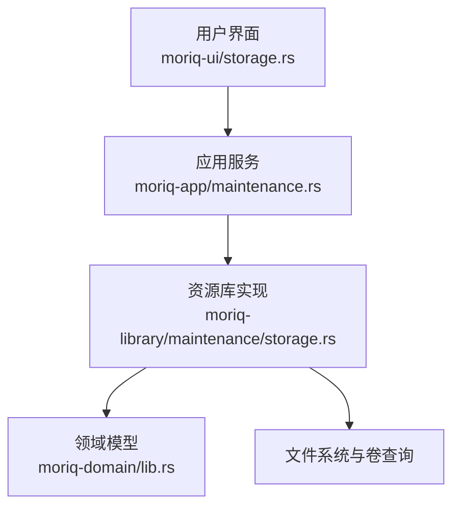
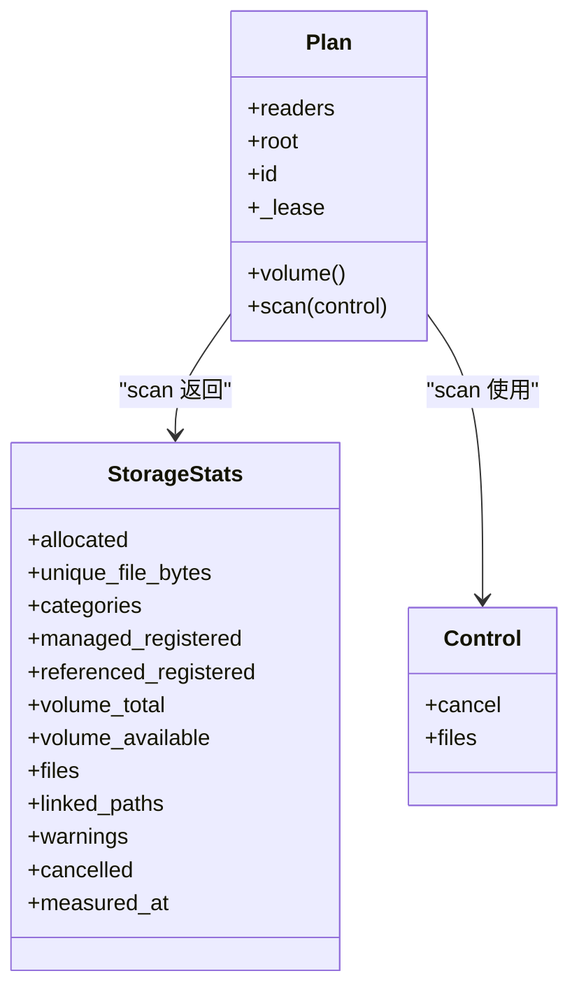
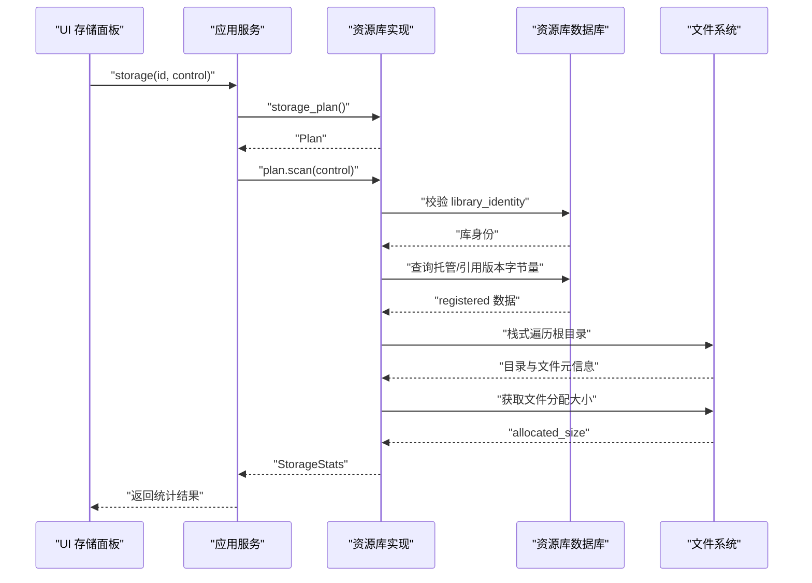
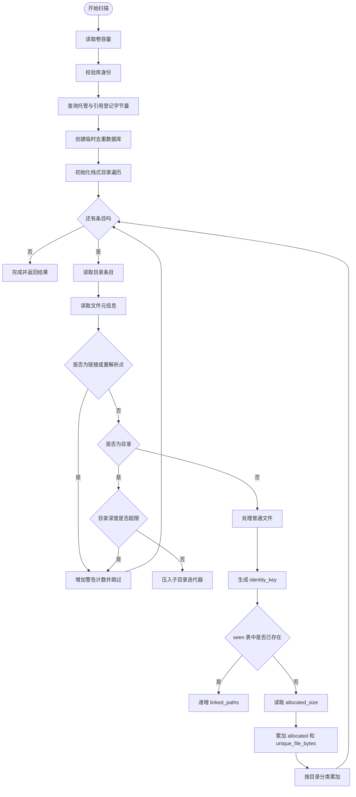
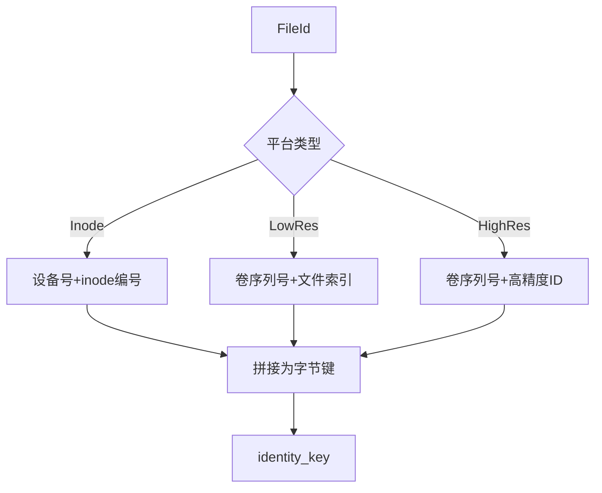

# 存储分析 (Storage Analytics)

> Repo Wiki 节点 `storage-analytics`
> 导出自 Qoder 知识库快照 `8fbe02f6-57c2-4874-b725-1a8130851fd9`，代码基线 `7a7a8e75e18bd90294e09cd422dd7ed5a04813a0`（分支 main，zh-CN）。

<cite>
**本文引用的文件**   
- [crates/moriq-library/src/maintenance/storage.rs](../../../../crates/moriq-library/src/maintenance/storage.rs)
- [crates/moriq-domain/src/lib.rs](../../../../crates/moriq-domain/src/lib.rs)
- [crates/moriq-app/src/maintenance.rs](../../../../crates/moriq-app/src/maintenance.rs)
- [crates/moriq-ui/src/storage.rs](../../../../crates/moriq-ui/src/storage.rs)
- [crates/moriq-library/src/tests/storage_regression_tests.rs](../../../../crates/moriq-library/src/tests/storage_regression_tests.rs)
</cite>

## 目录
1. [简介](#简介)
2. [项目结构中的存储分析位置](#项目结构中的存储分析位置)
3. [核心组件](#核心组件)
4. [架构总览](#架构总览)
5. [详细组件分析](#详细组件分析)
6. [依赖关系分析](#依赖关系分析)
7. [性能与大数据优化](#性能与大数据优化)
8. [统计指标说明](#统计指标说明)
9. [身份键与跨平台文件身份](#身份键与跨平台文件身份)
10. [文件分类系统](#文件分类系统)
11. [API 使用示例](#api-使用示例)
12. [错误处理与进度报告](#错误处理与进度报告)
13. [常见问题排查](#常见问题排查)
14. [结论](#结论)

## 简介
本文件系统性说明 Moriq Space 的“存储分析”能力。它负责回答以下问题：
- 当前资源库占用了多少实际磁盘空间？
- 哪些路径是硬链接或外部引用，如何避免重复统计？
- assets、versions、thumbnails、previews 等目录分别属于什么分类？
- 不同平台的 FileId 如何编码为 identity_key？
- 扫描流程如何在大型库中保持可取消、低内存占用和高吞吐？
- storage_plan、scan、volume 三个 API 如何协同工作？
- 结果中的 allocated_size、unique_file_bytes、linked_paths 应该如何理解？

## 项目结构中的存储分析位置
存储分析功能跨越四层：
- 领域模型层：定义 LibraryId、AssetId、StorageStats 等类型。
- 资源库实现层：实现 Plan::storage_plan、Plan::scan、Plan::volume，以及 identity_key、category 等核心逻辑。
- 应用服务层：封装异步调用、读计划、取消控制和任务编排。
- 用户界面层：展示存储面板、卷容量、分类明细和清理缓存操作。

**图表来源**
- [crates/moriq-ui/src/storage.rs:1-L257](../../../../crates/moriq-ui/src/storage.rs#L1-L257)
- [crates/moriq-app/src/maintenance.rs:227-L243](../../../../crates/moriq-app/src/maintenance.rs#L227-L243)
- [crates/moriq-library/src/maintenance/storage.rs:1-L261](../../../../crates/moriq-library/src/maintenance/storage.rs#L1-L261)
- [crates/moriq-domain/src/lib.rs:677-L691](../../../../crates/moriq-domain/src/lib.rs#L677-L691)

**章节来源**
- [crates/moriq-ui/src/storage.rs:1-L257](../../../../crates/moriq-ui/src/storage.rs#L1-L257)
- [crates/moriq-app/src/maintenance.rs:227-L243](../../../../crates/moriq-app/src/maintenance.rs#L227-L243)
- [crates/moriq-library/src/maintenance/storage.rs:1-L261](../../../../crates/moriq-library/src/maintenance/storage.rs#L1-L261)
- [crates/moriq-domain/src/lib.rs:677-L691](../../../../crates/moriq-domain/src/lib.rs#L677-L691)

## 核心组件
存储分析由以下关键对象组成：
- Plan：从已打开的资源库冻结读取上下文、根目录和库身份，提供 volume 和 scan。
- Control：用于 UI 控制扫描取消和实时文件计数。
- StorageStats：最终统计结果，包含分配空间、唯一字节数、分类、卷信息和取消状态。
- identity_key：将不同平台的 FileId 转为稳定字节键，用于硬链接去重。
- category：根据相对路径判断文件所属分类。

**图表来源**
- [crates/moriq-library/src/maintenance/storage.rs:1-L261](../../../../crates/moriq-library/src/maintenance/storage.rs#L1-L261)
- [crates/moriq-domain/src/lib.rs:677-L691](../../../../crates/moriq-domain/src/lib.rs#L677-L691)

**章节来源**
- [crates/moriq-library/src/maintenance/storage.rs:1-L261](../../../../crates/moriq-library/src/maintenance/storage.rs#L1-L261)
- [crates/moriq-domain/src/lib.rs:677-L691](../../../../crates/moriq-domain/src/lib.rs#L677-L691)

## 架构总览
存储分析的调用链从 UI 开始，经过应用服务，进入资源库实现层，最后访问数据库和文件系统。

**图表来源**
- [crates/moriq-ui/src/storage.rs:38-L120](../../../../crates/moriq-ui/src/storage.rs#L38-L120)
- [crates/moriq-app/src/maintenance.rs:227-L243](../../../../crates/moriq-app/src/maintenance.rs#L227-L243)
- [crates/moriq-library/src/maintenance/storage.rs:80-L220](../../../../crates/moriq-library/src/maintenance/storage.rs#L80-L220)

**章节来源**
- [crates/moriq-ui/src/storage.rs:38-L120](../../../../crates/moriq-ui/src/storage.rs#L38-L120)
- [crates/moriq-app/src/maintenance.rs:227-L243](../../../../crates/moriq-app/src/maintenance.rs#L227-L243)
- [crates/moriq-library/src/maintenance/storage.rs:80-L220](../../../../crates/moriq-library/src/maintenance/storage.rs#L80-L220)

## 详细组件分析

### 存储计划与卷容量
Plan 通过 storage_plan 冻结当前资源库的读取连接池、根目录和库身份。volume 直接查询根目录所在卷的总容量和可用空间。该设计保证后续扫描不会随资源库关闭而失效，同时避免在扫描期间持有写入锁。

- storage_plan：返回 Plan。
- Plan::volume：返回 (total_space, available_space)。

**章节来源**
- [crates/moriq-library/src/maintenance/storage.rs:1-L60](../../../../crates/moriq-library/src/maintenance/storage.rs#L1-L60)
- [crates/moriq-library/src/maintenance/storage.rs:60-L80](../../../../crates/moriq-library/src/maintenance/storage.rs#L60-L80)

### 扫描主流程
scan 执行以下关键步骤：
1. 读取卷容量。
2. 检查资源库身份是否与 Plan 绑定一致。
3. 从数据库计算托管版本和引用版本的登记字节量。
4. 创建临时 SQLite 数据库，建立 seen 表用于身份去重。
5. 使用栈式目录遍历根目录。
6. 跳过符号链接、Windows 重解析点、权限异常、目录过深和不可读项。
7. 对每个普通文件计算 identity_key，插入临时 seen 表去重。
8. 读取文件分配大小并累加到 allocated。
9. 累加 unique_file_bytes 为文件逻辑长度。
10. 按 relative path 分类累加 categories。
11. 更新 measured_at 时间戳并返回 StorageStats。

**图表来源**
- [crates/moriq-library/src/maintenance/storage.rs:80-L220](../../../../crates/moriq-library/src/maintenance/storage.rs#L80-L220)

**章节来源**
- [crates/moriq-library/src/maintenance/storage.rs:80-L220](../../../../crates/moriq-library/src/maintenance/storage.rs#L80-L220)

### 硬链接去重与外部引用
- 内部硬链接：同一物理文件在 assets 下被多个路径指向时，只有第一次计入 allocated 和 unique_file_bytes；后续相同 identity_key 的路径仅增加 linked_paths。
- 外部引用：import_referenced 的文件只登记其逻辑字节量，不扫描其来源磁盘，因此 referenced_registered 可能大于本地扫描到的分配空间。
- 测试验证了硬链接后 unique_file_bytes 和 allocated 不变，但 linked_paths 增加。

**章节来源**
- [crates/moriq-library/src/maintenance/storage.rs:80-L220](../../../../crates/moriq-library/src/maintenance/storage.rs#L80-L220)
- [crates/moriq-library/src/tests/storage_regression_tests.rs:1-L200](../../../../crates/moriq-library/src/tests/storage_regression_tests.rs#L1-L200)

### 身份键 identity_key 生成机制
identity_key 把不同平台的 FileId 统一成可比较的字节序列：
- Inode 平台：设备号 + inode 编号。
- Windows 低精度：卷序列号 + 文件索引。
- Windows 高精度：卷序列号 + 高精度文件标识。

这样可以避免仅靠文件名或路径进行去重，从而正确识别跨目录、跨挂载点的真实物理文件重复。

**图表来源**
- [crates/moriq-library/src/maintenance/storage.rs:20-L60](../../../../crates/moriq-library/src/maintenance/storage.rs#L20-L60)

**章节来源**
- [crates/moriq-library/src/maintenance/storage.rs:20-L60](../../../../crates/moriq-library/src/maintenance/storage.rs#L20-L60)

### 文件分类系统
category 根据受管相对路径的第一个组件进行分类：
- assets：托管原片及项目归档。
- versions：追加版本。
- thumbnails、previews：可重建图片缓存。
- indexes：索引。
- interop：Synco 交接副本。
- staging、recovery、trash：恢复与暂存数据。
- backups：数据库升级备份。
- 其他：数据库与元数据。

该分类用于展示各目录的实际分配空间，而不是简单按逻辑文件大小汇总。

**章节来源**
- [crates/moriq-library/src/maintenance/storage.rs:40-L60](../../../../crates/moriq-library/src/maintenance/storage.rs#L40-L60)
- [crates/moriq-ui/src/storage.rs:175-L220](../../../../crates/moriq-ui/src/storage.rs#L175-L220)

## 依赖关系分析
存储分析依赖以下层次：
- 领域模型：LibraryId、StorageStats。
- 资源库：Plan、Control、identity_key、category、scan。
- 应用服务：storage、volume，负责 read_plan 和线程调度。
- UI：StorageMessage、storage_message、storage_panel。

**图表来源**
- [crates/moriq-domain/src/lib.rs:677-L691](../../../../crates/moriq-domain/src/lib.rs#L677-L691)
- [crates/moriq-library/src/maintenance/storage.rs:1-L261](../../../../crates/moriq-library/src/maintenance/storage.rs#L1-L261)
- [crates/moriq-app/src/maintenance.rs:227-L243](../../../../crates/moriq-app/src/maintenance.rs#L227-L243)
- [crates/moriq-ui/src/storage.rs:1-L257](../../../../crates/moriq-ui/src/storage.rs#L1-L257)

**章节来源**
- [crates/moriq-domain/src/lib.rs:677-L691](../../../../crates/moriq-domain/src/lib.rs#L677-L691)
- [crates/moriq-library/src/maintenance/storage.rs:1-L261](../../../../crates/moriq-library/src/maintenance/storage.rs#L1-L261)
- [crates/moriq-app/src/maintenance.rs:227-L243](../../../../crates/moriq-app/src/maintenance.rs#L227-L243)
- [crates/moriq-ui/src/storage.rs:1-L257](../../../../crates/moriq-ui/src/storage.rs#L1-L257)

## 性能与大数据优化
存储分析针对大库做了多项优化：
- 栈式目录遍历：使用 Vec 维护目录迭代器栈，避免递归爆栈。
- 目录深度限制：当栈深度达到阈值时跳过该目录并计为警告，防止极深目录树导致内存膨胀。
- 临时 SQLite 去重：使用 PRAGMA journal_mode=OFF、synchronous=OFF 和 WITHOUT ROWID 表，减少 WAL 开销和内存占用。
- 批量写入：一次性 BEGIN 事务，INSERT OR IGNORE 去重。
- 取消响应：每轮目录循环前检查 AtomicBool cancel。
- 原子计数器：AtomicU64 files 暴露给 UI 显示“已检查文件数”。
- 非阻塞服务：应用层使用 read_plan 和 spawn_blocking，避免阻塞写入队列。

这些优化使扫描可以在数百万文件规模下保持可控内存、可中断和可观察。

**章节来源**
- [crates/moriq-library/src/maintenance/storage.rs:80-L220](../../../../crates/moriq-library/src/maintenance/storage.rs#L80-L220)
- [crates/moriq-app/src/maintenance.rs:227-L243](../../../../crates/moriq-app/src/maintenance.rs#L227-L243)

## 统计指标说明
StorageStats 字段含义如下：
- allocated：扫描到的实际分配空间总和，按 identity_key 去重后累加。
- unique_file_bytes：所有未重复文件的逻辑字节总量，反映内容体积而非分配块。
- categories：按目录分类的分配空间映射。
- managed_registered：托管版本在数据库中登记的字节总量。
- referenced_registered：外部引用版本在数据库中登记的字节总量。
- volume_total：资源库根目录所在卷的总容量。
- volume_available：资源库根目录所在卷的可用空间。
- files：扫描过程中成功处理的文件数量。
- linked_paths：因 identity_key 重复而被跳过的路径数量。
- warnings：权限不足、文件系统异常、跳过条目的累计数量。
- cancelled：是否在扫描中途被取消。
- measured_at：采样时间戳。

需要注意：
- allocated 不一定等于 unique_file_bytes，因为文件系统分配粒度、稀疏文件和硬链接会影响二者差异。
- managed_registered 与 referenced_registered 来自数据库，不代表本地扫描全部来源盘。
- volume_total 与 volume_available 只反映资源库根目录所在卷，不聚合多盘。

**章节来源**
- [crates/moriq-domain/src/lib.rs:677-L691](../../../../crates/moriq-domain/src/lib.rs#L677-L691)
- [crates/moriq-library/src/maintenance/storage.rs:80-L220](../../../../crates/moriq-library/src/maintenance/storage.rs#L80-L220)
- [crates/moriq-ui/src/storage.rs:175-L220](../../../../crates/moriq-ui/src/storage.rs#L175-L220)

## 身份键与跨平台文件身份
identity_key 的核心目标是把不同操作系统上的“同一个物理文件”映射到相同键值。这样即使文件出现在不同目录、不同挂载点，只要底层设备号和 inode、或 Windows 卷序列号与文件索引一致，就会被视为重复。

关键点：
- 不依赖文件名，避免重命名导致的误判。
- 不依赖绝对路径，支持移动挂载点和跨目录硬链接。
- 区分平台类型，避免 Inode 与 Windows 标识混淆。
- 作为临时 seen 表的 PRIMARY KEY，保证 INSERT OR IGNORE 的高效去重。

**章节来源**
- [crates/moriq-library/src/maintenance/storage.rs:20-L60](../../../../crates/moriq-library/src/maintenance/storage.rs#L20-L60)
- [crates/moriq-library/src/maintenance/storage.rs:80-L220](../../../../crates/moriq-library/src/maintenance/storage.rs#L80-L220)

## 文件分类系统
分类规则以受管相对路径的第一个组件为准：
- assets：原片和归档主体。
- versions：增量版本。
- thumbnails、previews：可重建缓存。
- indexes：搜索与检索辅助。
- interop：与其他工具交互产生的副本。
- staging、recovery、trash：导入暂存、恢复数据和回收站。
- backups：数据库迁移备份。
- 其他：数据库和元数据相关文件。

分类结果以字符串标签与字节数配对形式输出，UI 直接渲染该列表。

**章节来源**
- [crates/moriq-library/src/maintenance/storage.rs:40-L60](../../../../crates/moriq-library/src/maintenance/storage.rs#L40-L60)
- [crates/moriq-ui/src/storage.rs:175-L220](../../../../crates/moriq-ui/src/storage.rs#L175-L220)

## API 使用示例
下面给出面向开发者的使用方式说明。为避免泄露实现细节，此处只提供调用语义和使用建议。

### storage_plan
用途：
- 从已打开资源库获取 Plan。
- 冻结读取连接池、根目录和库身份。

典型用法：
- 先调用 storage_plan。
- 再调用 plan.volume 或 plan.scan。

注意：
- 如果资源库被关闭，Plan 仍可用于只读分析。
- 如果库身份变化，scan 会拒绝继续。

**章节来源**
- [crates/moriq-library/src/maintenance/storage.rs:1-L60](../../../../crates/moriq-library/src/maintenance/storage.rs#L1-L60)

### scan
用途：
- 执行完整存储扫描。
- 返回 StorageStats。

典型用法：
- 创建 Control。
- 在 UI 中定期读取 control.files。
- 设置 control.cancel 以停止扫描。

返回值重点：
- allocated、unique_file_bytes、categories。
- linked_paths、warnings、cancelled。
- volume_total、volume_available。

**章节来源**
- [crates/moriq-library/src/maintenance/storage.rs:80-L220](../../../../crates/moriq-library/src/maintenance/storage.rs#L80-L220)
- [crates/moriq-ui/src/storage.rs:38-L120](../../../../crates/moriq-ui/src/storage.rs#L38-L120)

### volume
用途：
- 快速读取资源库根目录所在卷的总容量和可用空间。
- 不需要完整扫描。

典型用法：
- 单独调用 volume。
- 在 UI 中独立展示卷容量。

**章节来源**
- [crates/moriq-library/src/maintenance/storage.rs:60-L80](../../../../crates/moriq-library/src/maintenance/storage.rs#L60-L80)
- [crates/moriq-app/src/maintenance.rs:236-L243](../../../../crates/moriq-app/src/maintenance.rs#L236-L243)

### 资源库身份绑定
Plan 保存 LibraryId，scan 会从数据库读取 library_identity 并比对。如果不一致，返回无效库身份错误。这防止跨库复用 Plan 或扫描过期快照。

**章节来源**
- [crates/moriq-library/src/maintenance/storage.rs:80-L120](../../../../crates/moriq-library/src/maintenance/storage.rs#L80-L120)

## 错误处理与进度报告
错误处理策略：
- 权限不足：symlink_metadata、read_dir、File::open 失败时，warnings 加一，继续扫描其他文件。
- 链接与重解析点：符号链接和 Windows 重解析点会被跳过并计为警告。
- 目录过深：超过栈深度限制时跳过该目录。
- 取消：每次目录循环检查 cancel，置位 cancelled 并尽早返回。
- 身份不一致：立即返回错误，阻止跨库误用。
- 卷容量异常：volume 抛出错误，UI 显示“卷容量暂不可用”。

进度报告：
- Control.files：原子计数器，UI 显示“已检查文件数”。
- StorageStats.warnings：累计跳过或异常条目。
- StorageStats.cancelled：是否中途停止。
- StorageStats.measured_at：采样时间戳。

**章节来源**
- [crates/moriq-library/src/maintenance/storage.rs:80-L220](../../../../crates/moriq-library/src/maintenance/storage.rs#L80-L220)
- [crates/moriq-ui/src/storage.rs:38-L120](../../../../crates/moriq-ui/src/storage.rs#L38-L120)
- [crates/moriq-ui/src/storage.rs:175-L220](../../../../crates/moriq-ui/src/storage.rs#L175-L220)

## 常见问题排查
- 为什么 allocated 小于 unique_file_bytes？  
  可能因为稀疏文件、压缩卷或文件系统分配策略导致分配块小于逻辑字节。
- 为什么 linked_paths 不为零？  
  表示存在相同 identity_key 的额外路径，通常是硬链接。
- 为什么 referenced_registered 很大但 allocated 较小？  
  外部引用只登记逻辑大小，不扫描来源盘。
- 为什么扫描被取消？  
  用户点击“停止统计”，或 Control.cancel 被设置为真。
- 为什么卷容量不可用？  
  根目录所在卷无法查询，可能是网络盘、挂载异常或权限不足。
- 为什么分类没有某个目录？  
  category 只统计普通文件，且按第一个组件匹配；空目录不会被统计。

**章节来源**
- [crates/moriq-library/src/maintenance/storage.rs:80-L220](../../../../crates/moriq-library/src/maintenance/storage.rs#L80-L220)
- [crates/moriq-ui/src/storage.rs:175-L220](../../../../crates/moriq-ui/src/storage.rs#L175-L220)

## 结论
Moriq Space 的存储分析通过 Plan、Control 和 StorageStats 构建了一个安全、可取消、可扩展的扫描体系。它以 identity_key 为核心实现硬链接去重，以临时 SQLite 降低内存压力，以栈式遍历避免递归风险，并以 category 提供直观的分类视图。对外暴露 storage_plan、scan、volume 三个 API，既适合后台维护任务，也适合交互式 UI 展示。对于大规模资源库，应优先使用 volume 获取卷信息，按需触发 scan，并通过 Control.files 和 warnings 监控进度与健康度。