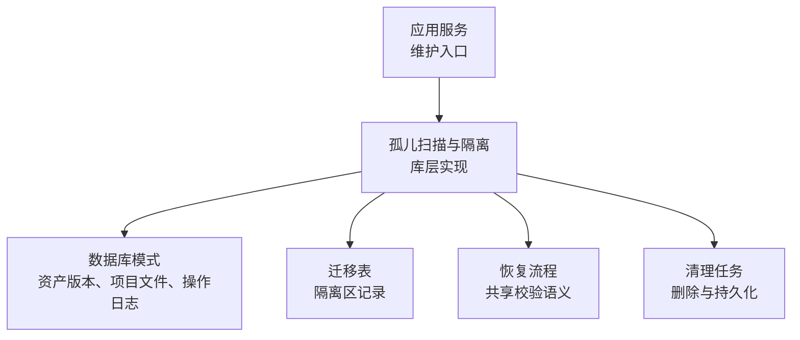
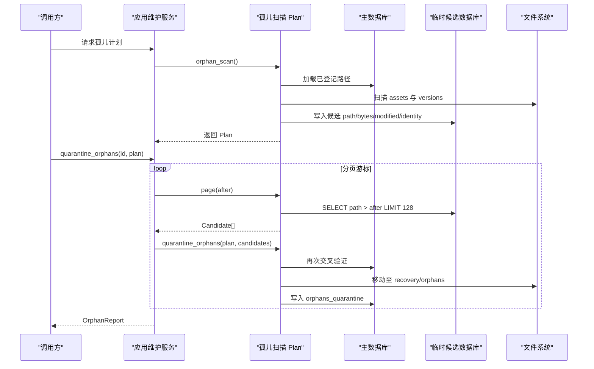
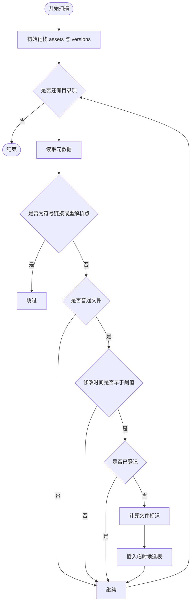
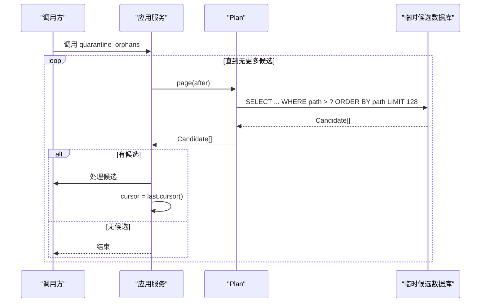
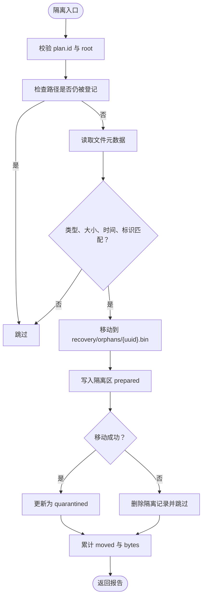
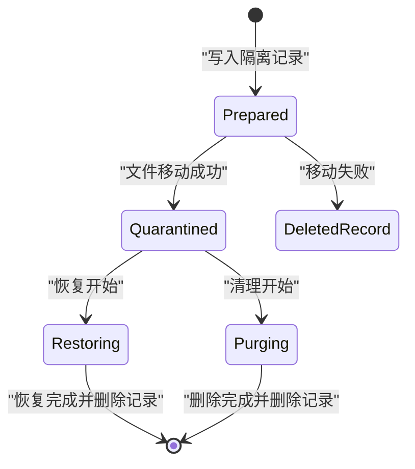
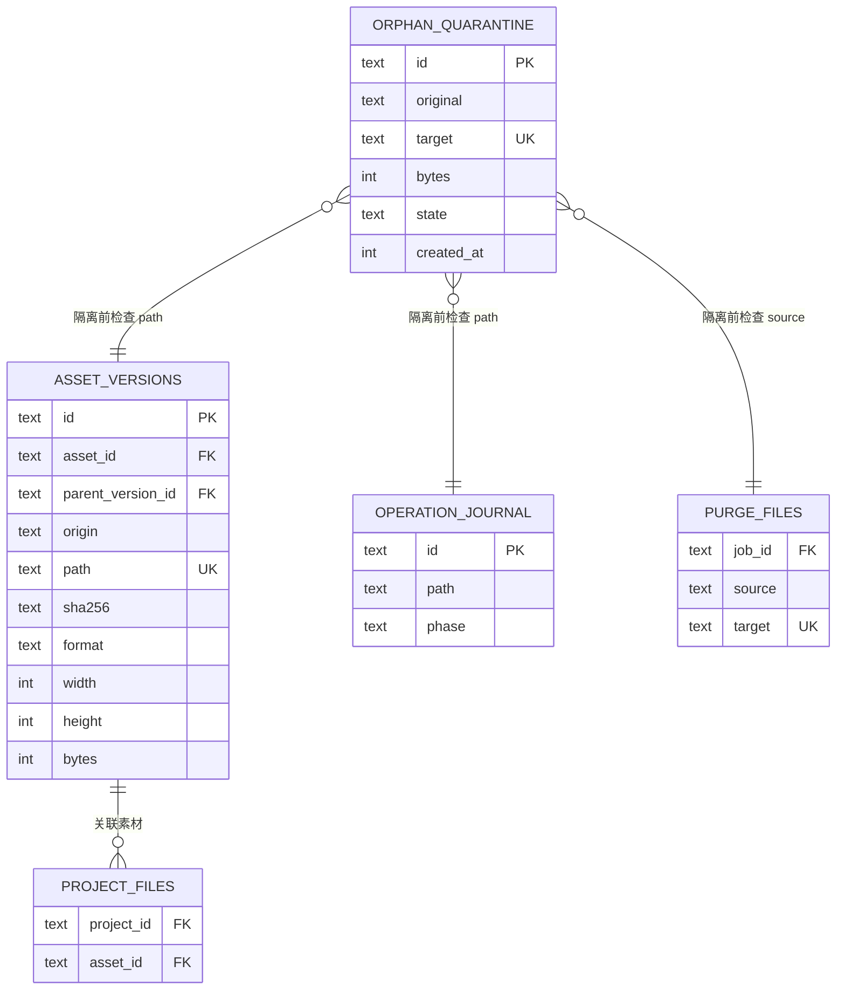

# 孤儿文件检测

> Repo Wiki 节点 `orphan-detection`
> 导出自 Qoder 知识库快照 `8fbe02f6-57c2-4874-b725-1a8130851fd9`，代码基线 `7a7a8e75e18bd90294e09cd422dd7ed5a04813a0`（分支 main，zh-CN）。

<cite>
**本文引用的文件**   
- [orphan.rs](../../../../crates/moriq-library/src/maintenance/orphans.rs)
- [maintenance.rs](../../../../crates/moriq-app/src/maintenance.rs)
- [schema.sql](../../../../crates/moriq-library/src/database/schema.sql)
- [migration_20.sql](../../../../crates/moriq-library/src/database/migrations/migration_20.sql)
- [recovery.rs](../../../../crates/moriq-library/src/transfer/recovery.rs)
- [purge.rs](../../../../crates/moriq-library/src/maintenance/purge.rs)
</cite>

## 目录
1. [简介](#简介)
2. [项目结构定位](#项目结构定位)
3. [核心组件](#核心组件)
4. [架构总览](#架构总览)
5. [详细组件分析](#详细组件分析)
6. [依赖关系分析](#依赖关系分析)
7. [性能与内存管理](#性能与内存管理)
8. [故障排查指南](#故障排查指南)
9. [结论](#结论)

## 简介
本文件说明 Moriq Space 的孤儿文件检测功能。该功能用于发现资产版本、项目文件和操作日志中未登记的文件，将它们识别为候选孤儿，并通过隔离区实现可恢复的安全隔离；同时提供分页查询接口和身份验证机制，确保只有属于原资源库且未被修改或替换的文件才会被移动或删除。文档还解释它与恢复流程和清理任务之间的协作关系。

## 项目结构定位
孤儿文件检测相关代码主要分布在以下位置：
- 库层实现：`crates/moriq-library/src/maintenance/orphans.rs`
- 应用服务编排：`crates/moriq-app/src/maintenance.rs`
- 数据库模式与迁移：`crates/moriq-library/src/database/schema.sql`、`crates/moriq-library/src/database/migrations/migration_20.sql`
- 恢复流程参考：`crates/moriq-library/src/transfer/recovery.rs`
- 删除与清理流程参考：`crates/moriq-library/src/maintenance/purge.rs`

图表来源
- [maintenance.rs:1-120](../../../../crates/moriq-app/src/maintenance.rs#L1-L120)
- [orphan.rs:1-120](../../../../crates/moriq-library/src/maintenance/orphans.rs#L1-L120)
- [schema.sql:1-42](../../../../crates/moriq-library/src/database/schema.sql#L1-L42)
- [migration_20.sql:1-4](../../../../crates/moriq-library/src/database/migrations/migration_20.sql#L1-L4)

章节来源
- [orphan.rs:1-355](../../../../crates/moriq-library/src/maintenance/orphans.rs#L1-L355)
- [maintenance.rs:1-244](../../../../crates/moriq-app/src/maintenance.rs#L1-L244)
- [schema.sql:1-42](../../../../crates/moriq-library/src/database/schema.sql#L1-L42)
- [migration_20.sql:1-4](../../../../crates/moriq-library/src/database/migrations/migration_20.sql#L1-L4)

## 核心组件
- `Scan`：冻结资源库根路径、库标识、读取池和文件租约，负责构建孤儿扫描输入。
- `Plan`：保存扫描计划，包括根路径、库标识、临时候选快照、统计计数、示例路径以及文件租约。
- `Candidate`：表示一个候选孤儿文件，包含相对路径、字节数、修改时间戳和平台文件标识。
- `OrphanReport`：隔离或恢复操作的汇总报告，包含已移动数量、字节数和跳过数量。
- 应用服务方法：
  - `orphan_plan`：在独立线程生成不可变计划。
  - `quarantine_orphans`：按游标分页读取候选并执行隔离。
  - `restore_orphans`：分批恢复隔离文件，支持强制清理。

章节来源
- [orphan.rs:1-120](../../../../crates/moriq-library/src/maintenance/orphans.rs#L1-L120)
- [maintenance.rs:1-120](../../../../crates/moriq-app/src/maintenance.rs#L1-L120)

## 架构总览
孤儿检测的整体流程分为三个阶段：
1. 扫描阶段：从受管目录扫描旧文件，过滤符号链接、重解析点和近期文件，并与资产版本、项目文件、操作日志及待清理列表交叉验证。
2. 分页复核阶段：通过临时数据库按路径游标分页读取候选，避免重复扫描整个资源库。
3. 隔离与恢复阶段：对候选进行身份再验证后移动到隔离区，并在需要时恢复或删除。

图表来源
- [maintenance.rs:1-120](../../../../crates/moriq-app/src/maintenance.rs#L1-L120)
- [orphan.rs:1-200](../../../../crates/moriq-library/src/maintenance/orphans.rs#L1-L200)

## 详细组件分析

### 扫描机制与候选识别规则
扫描从 `assets` 和 `versions` 两个受管目录开始，递归遍历目录树。候选文件的识别规则如下：
- 忽略符号链接和平台重解析点。
- 忽略非普通文件。
- 忽略修改时间晚于当前时间减去 24 小时的文件，以避免把正在写入的文件误判为孤儿。
- 排除已在资产版本、项目文件、操作日志或待清理列表中登记的路径。
- 使用平台文件标识作为候选身份的第三维度校验，减少同名替换导致的误判。

图表来源
- [orphan.rs:60-160](../../../../crates/moriq-library/src/maintenance/orphans.rs#L60-L160)

章节来源
- [orphan.rs:1-200](../../../../crates/moriq-library/src/maintenance/orphans.rs#L1-L200)

### 分页查询接口与游标机制
`Plan::page` 打开只读临时数据库，按路径排序并使用字符串游标分页，每页固定读取 128 条候选。`Candidate::cursor` 返回路径，作为下一页查询的 `after` 参数。这种方式避免了全量扫描，适合大资源库。

图表来源
- [orphan.rs:160-200](../../../../crates/moriq-library/src/maintenance/orphans.rs#L160-L200)
- [maintenance.rs:1-120](../../../../crates/moriq-app/src/maintenance.rs#L1-L120)

章节来源
- [orphan.rs:160-200](../../../../crates/moriq-library/src/maintenance/orphans.rs#L160-L200)
- [maintenance.rs:1-120](../../../../crates/moriq-app/src/maintenance.rs#L1-L120)

### 身份验证与隔离操作
隔离前会进行多重校验：
- 计划所属库标识和根路径必须与当前活动库一致。
- 候选路径必须在资产版本、项目文件、操作日志或待清理列表中不存在。
- 目标文件必须存在且不是符号链接或重解析点。
- 文件大小、修改时间和平台文件标识必须与扫描时记录的候选信息完全一致。
- 如果任一校验失败，候选会被跳过。

成功后，系统：
- 创建 `recovery/orphans` 目录。
- 将候选文件原子移动到 `recovery/orphans/{uuid}.bin`。
- 先写入隔离区记录，状态为 `prepared`，随后更新为 `quarantined`。
- 移动失败时会回滚隔离记录并计入跳过数。

图表来源
- [orphan.rs:120-240](../../../../crates/moriq-library/src/maintenance/orphans.rs#L120-L240)

章节来源
- [orphan.rs:120-240](../../../../crates/moriq-library/src/maintenance/orphans.rs#L120-L240)

### 隔离区与可恢复性设计
隔离区位于 `recovery/orphans`，每个文件以 UUID 命名，便于唯一标识和幂等恢复。隔离区记录保存在 `orphan_quarantine` 表中，状态包括：
- `prepared`：准备阶段。
- `quarantined`：已成功隔离。
- `restoring`：正在恢复。
- `purging`：正在清理。

系统提供两类恢复能力：
1. `recover_orphans`：启动时或定期检查未完成隔离或清理，根据源文件与目标文件是否存在决定修正状态或清理记录。
2. `restore_orphans_page`：分页恢复或清理隔离文件。恢复时拒绝覆盖现有文件或已被重新登记的路径；清理时标记为 `purging` 并删除目标文件。

图表来源
- [orphan.rs:200-355](../../../../crates/moriq-library/src/maintenance/orphans.rs#L200-L355)
- [migration_20.sql:1-4](../../../../crates/moriq-library/src/database/migrations/migration_20.sql#L1-L4)

章节来源
- [orphan.rs:200-355](../../../../crates/moriq-library/src/maintenance/orphans.rs#L200-L355)
- [migration_20.sql:1-4](../../../../crates/moriq-library/src/database/migrations/migration_20.sql#L1-L4)

### 与其他维护任务的协作
- 与恢复流程：恢复流程同样基于 `operation_journal` 和导入上下文进行强一致性校验。孤儿检测在隔离前也交叉验证 `operation_journal`，防止恢复中的文件被错误隔离。
- 与清理任务：清理任务使用两阶段提交，先将文件移动到暂存位置，再提交数据库变更，最后清理暂存。孤儿检测的隔离过程与之类似：先写日志，再移动文件，最终更新状态并删除记录。两者都强调失败回滚和后续恢复。

章节来源
- [recovery.rs:1-229](../../../../crates/moriq-library/src/transfer/recovery.rs#L1-L229)
- [purge.rs:1-200](../../../../crates/moriq-library/src/maintenance/purge.rs#L1-L200)

### API 使用示例说明
本节不直接展示代码，而是描述调用方式与返回值语义：

- 获取孤儿计划：
  - 调用应用服务的 `orphan_plan`，传入资源库标识。
  - 返回一个不可变的 `OrphanPlan`，其中包含临时候选快照、统计信息和示例路径。
  - 该计划可用于后续多次分页隔离，无需重复扫描整个资源库。

- 隔离孤儿：
  - 调用应用服务的 `quarantine_orphans`，传入资源库标识和已确认的 `OrphanPlan`。
  - 内部循环分页读取候选，逐批调用库层 `quarantine_orphans`。
  - 返回 `OrphanReport`，包含：
    - `moved`：成功隔离的文件数量。
    - `bytes`：成功隔离的字节总数。
    - `skipped`：因注册状态变化、文件变化或 I/O 失败而跳过的数量。

- 恢复隔离文件：
  - 调用应用服务的 `restore_orphans`，传入资源库标识和 `purge` 标志。
  - `purge=false`：尝试将隔离文件移回原始登记位置，若原位置已有文件或文件已重新登记则跳过。
  - `purge=true`：直接删除隔离文件。
  - 返回 `OrphanReport`，语义与隔离报告一致。

章节来源
- [maintenance.rs:1-120](../../../../crates/moriq-app/src/maintenance.rs#L1-L120)
- [orphan.rs:120-355](../../../../crates/moriq-library/src/maintenance/orphans.rs#L120-L355)

## 依赖关系分析
孤儿检测依赖以下数据库表和字段：
- `asset_versions.path`：资产版本登记路径。
- `project_files.path`：项目文件登记路径。
- `operation_journal.path`：操作日志登记路径。
- `purge_files.source`：待清理文件来源路径。
- `orphan_quarantine`：隔离区记录，包含隔离 ID、原始路径、目标路径、字节数、状态和创建时间。

图表来源
- [schema.sql:1-42](../../../../crates/moriq-library/src/database/schema.sql#L1-L42)
- [migration_20.sql:1-4](../../../../crates/moriq-library/src/database/migrations/migration_20.sql#L1-L4)

章节来源
- [schema.sql:1-42](../../../../crates/moriq-library/src/database/schema.sql#L1-L42)
- [migration_20.sql:1-4](../../../../crates/moriq-library/src/database/migrations/migration_20.sql#L1-L4)

## 性能与内存管理
- 临时数据库优化：
  - 使用 `PRAGMA journal_mode=OFF`、`PRAGMA synchronous=OFF` 降低写入开销。
  - 设置负缓存大小 `-2048`，提高候选表读取性能。
  - 候选表以 `path` 为主键并按路径排序，支持高效游标分页。
- 扫描范围控制：
  - 仅扫描 `assets` 和 `versions` 目录，避免扫描系统目录或外部挂载点。
  - 忽略符号链接和 Windows 重解析点，减少无效 I/O。
  - 使用 24 小时修改时间阈值，避免扫描活跃写入文件。
- 批量处理能力：
  - 分页大小固定为 128，平衡内存占用和网络往返。
  - 应用层使用阻塞任务执行临时数据库查询，避免阻塞写入队列。
- 内存管理策略：
  - 计划对象持有临时快照路径和文件租约，生命周期由 `Arc` 管理。
  - 恢复和清理任务共享媒体预算，避免与导入工作线程争抢内存。
  - 其他维护任务如缓存修剪使用固定字节预算（例如 4 GiB），保证整体稳定性。

章节来源
- [orphan.rs:60-200](../../../../crates/moriq-library/src/maintenance/orphans.rs#L60-L200)
- [maintenance.rs:1-244](../../../../crates/moriq-app/src/maintenance.rs#L1-L244)

## 故障排查指南
常见问题与处理建议：
- 计划失效：
  - 现象：调用隔离时提示库身份改变。
  - 原因：计划绑定的 `id` 或 `root` 与当前活动库不一致。
  - 处理：重新生成孤儿计划后再执行隔离。
- 候选被跳过：
  - 现象：报告中 `skipped` 增加但 `moved` 不变。
  - 可能原因：
    - 文件在扫描后被重新登记。
    - 文件大小、修改时间或平台文件标识发生变化。
    - 文件变为符号链接或非普通文件。
    - 移动失败或目标已存在。
  - 处理：检查文件状态和日志，必要时重新扫描。
- 隔离未完成：
  - 现象：`orphan_quarantine` 中存在非 `quarantined` 状态记录。
  - 处理：运行恢复逻辑 `recover_orphans`，系统会根据源文件和目标文件存在情况自动修正。
- 恢复失败：
  - 现象：恢复时报路径无效或记录不一致。
  - 可能原因：
    - 隔离记录路径不符合预期格式。
    - 原始路径不在受管目录前缀下。
    - 目标文件不存在但源文件仍存在。
  - 处理：检查 `recovery/orphans` 目录和数据库记录，必要时手动清理损坏记录。

章节来源
- [orphan.rs:120-355](../../../../crates/moriq-library/src/maintenance/orphans.rs#L120-L355)

## 结论
孤儿文件检测通过严格的候选识别规则、临时数据库分页查询、多维权重身份验证和可恢复的隔离区设计，实现了安全、稳定且可扩展的未登记文件清理能力。它与应用层的维护服务、恢复流程和清理任务保持一致的校验语义，能够在大规模资源库中保持低延迟和高可靠性。运维人员应定期生成新计划、监控隔离报告、利用恢复机制处理异常，并结合清理任务完成最终的数据治理。