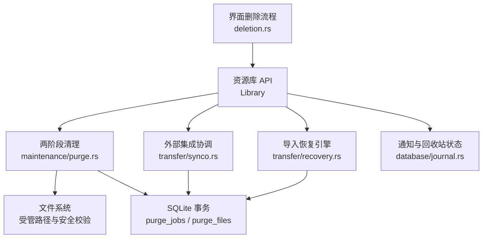
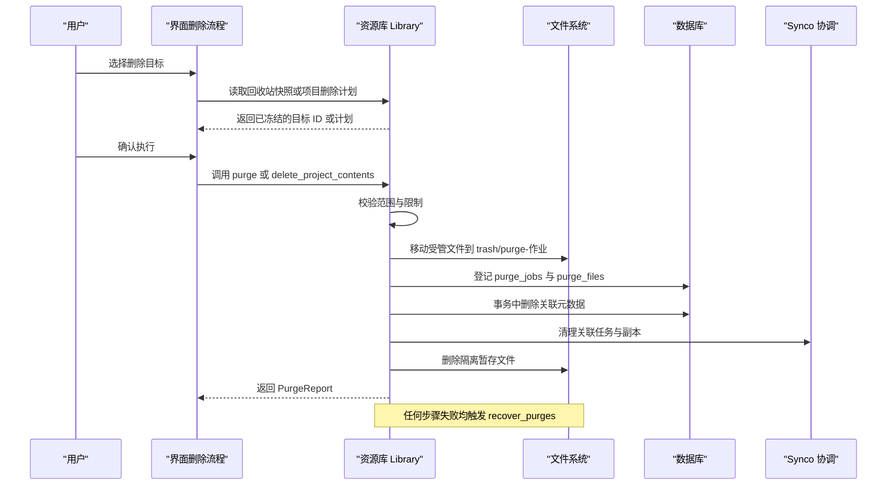
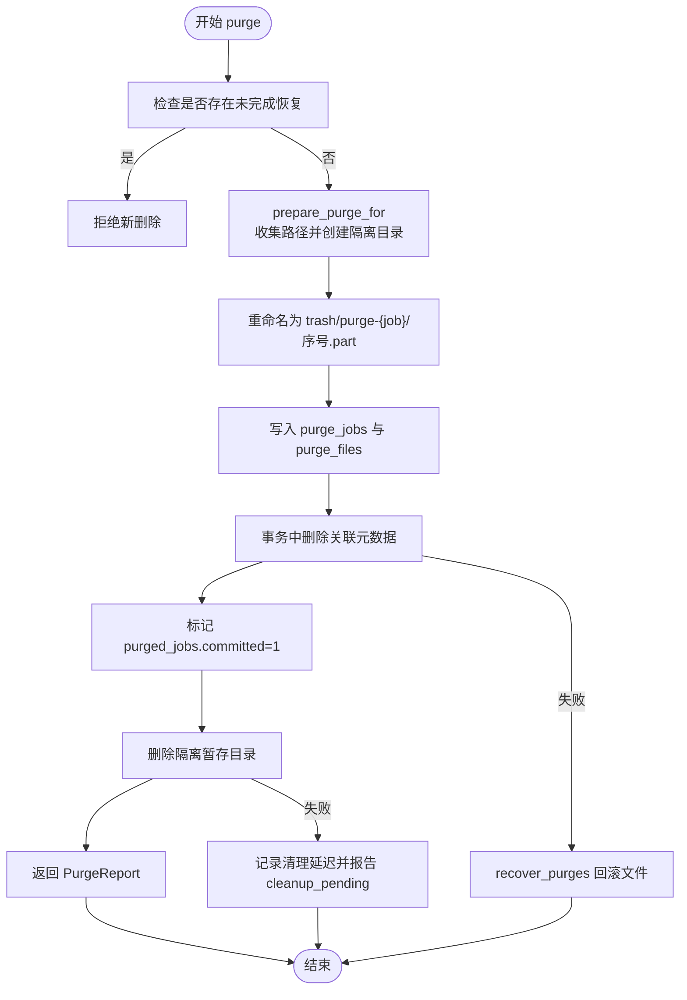
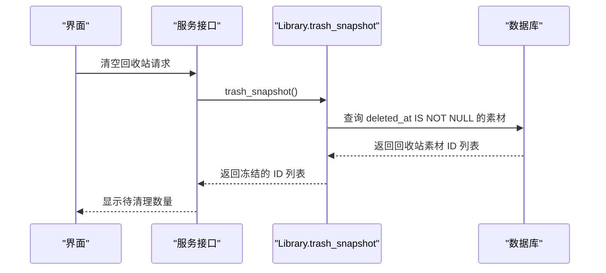
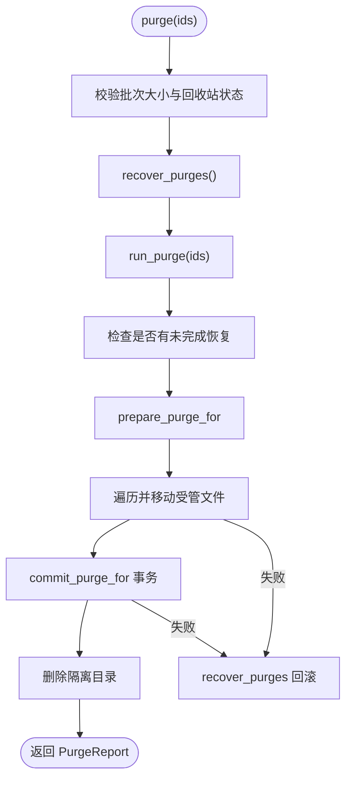
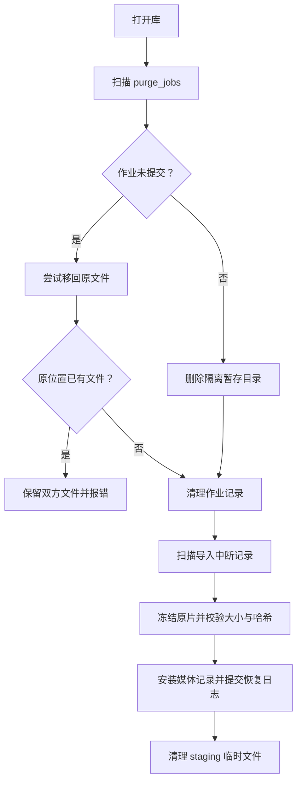
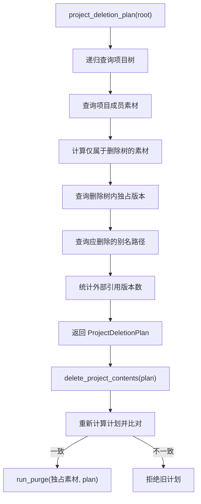
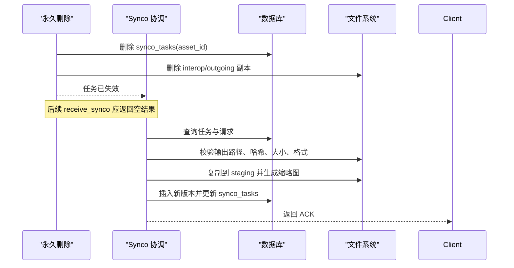
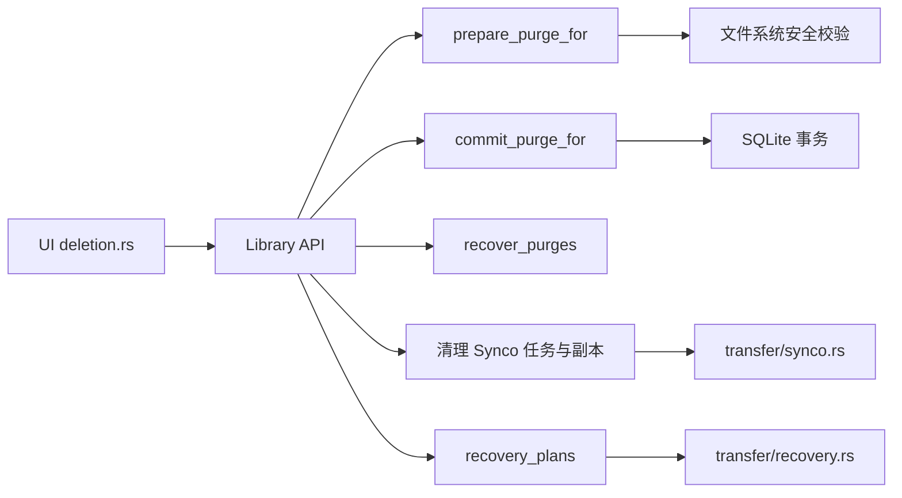

# 清理系统 (Purge)

> Repo Wiki 节点 `purge-system`
> 导出自 Qoder 知识库快照 `8fbe02f6-57c2-4874-b725-1a8130851fd9`，代码基线 `7a7a8e75e18bd90294e09cd422dd7ed5a04813a0`（分支 main，zh-CN）。

<cite>
**本文引用的文件**   
- [purge.rs](../../../../crates/moriq-library/src/maintenance/purge.rs)
- [synco.rs](../../../../crates/moriq-library/src/transfer/synco.rs)
- [recovery.rs](../../../../crates/moriq-library/src/transfer/recovery.rs)
- [journal.rs](../../../../crates/moriq-library/src/database/journal.rs)
- [project_deletion.rs](../../../../crates/moriq-library/src/catalog/project_deletion.rs)
- [deletion.rs](../../../../crates/moriq-ui/src/deletion.rs)
</cite>

## 目录
1. [引言](#引言)
2. [项目结构](#项目结构)
3. [核心组件](#核心组件)
4. [架构总览](#架构总览)
5. [详细组件分析](#详细组件分析)
6. [依赖关系分析](#依赖关系分析)
7. [性能考虑](#性能考虑)
8. [故障排查指南](#故障排查指南)
9. [结论](#结论)

## 引言
本文件系统性说明 Moriq Space 的清理与删除体系，重点围绕两阶段删除、回收站语义、永久删除、恢复机制、项目级删除、Synco 协调、安全约束以及批量与事务优化。文档将面向不同技术背景读者，先给出高层流程，再逐步深入到实现细节和可操作的使用建议。

## 项目结构
清理能力主要分布在以下模块：
- 维护层：两阶段删除、暂存移动、恢复日志、项目删除计划与执行。
- 传输层：与外部 Synco 任务的协调、任务生命周期、副本清理。
- 恢复层：导入中断后的恢复计划、冻结原片、提交恢复记录。
- 数据库层：活动与通知、资产回收站状态查询。
- UI 层：删除确认、批量清空回收站、项目删除确认与执行。

**图表来源**
- [deletion.rs:1-200](../../../../crates/moriq-ui/src/deletion.rs#L1-L200)
- [purge.rs:1-200](../../../../crates/moriq-library/src/maintenance/purge.rs#L1-L200)
- [synco.rs:1-200](../../../../crates/moriq-library/src/transfer/synco.rs#L1-L200)
- [recovery.rs:1-200](../../../../crates/moriq-library/src/transfer/recovery.rs#L1-L200)
- [journal.rs:1-200](../../../../crates/moriq-library/src/database/journal.rs#L1-L200)

**章节来源**
- [deletion.rs:1-200](../../../../crates/moriq-ui/src/deletion.rs#L1-L200)
- [purge.rs:1-200](../../../../crates/moriq-library/src/maintenance/purge.rs#L1-L200)

## 核心组件
- 两阶段清理：先在磁盘上把待删文件移动到隔离的暂存目录，再提交数据库元数据；失败时回滚到原位置。
- 回收站：通过素材记录的删除时间字段标识软删除；永久删除只允许对已标记删除的素材执行。
- 项目删除：递归计算项目树、成员、共享素材、别名与引用，生成删除计划并复用两阶段清理。
- Synco 协调：在删除前清理关联任务与发送副本，接收回执时严格校验路径、哈希、尺寸、格式与归属。
- 恢复机制：基于导入中断日志准备不可变原片快照，完成后提交恢复记录并清理临时文件。
- UI 删除工作流：冻结目标范围、二次确认、调用服务接口，处理成功、部分完成或错误结果。

**章节来源**
- [purge.rs:1-200](../../../../crates/moriq-library/src/maintenance/purge.rs#L1-L200)
- [project_deletion.rs:1-84](../../../../crates/moriq-library/src/catalog/project_deletion.rs#L1-L84)
- [synco.rs:1-200](../../../../crates/moriq-library/src/transfer/synco.rs#L1-L200)
- [recovery.rs:1-200](../../../../crates/moriq-library/src/transfer/recovery.rs#L1-L200)
- [deletion.rs:1-200](../../../../crates/moriq-ui/src/deletion.rs#L1-L200)

## 架构总览
清理系统的控制流可以概括为“确认范围 → 暂存移动 → 提交元数据 → 收尾清理 → 异常恢复”。

**图表来源**
- [deletion.rs:120-200](../../../../crates/moriq-ui/src/deletion.rs#L120-L200)
- [purge.rs:60-200](../../../../crates/moriq-library/src/maintenance/purge.rs#L60-L200)
- [synco.rs:200-350](../../../../crates/moriq-library/src/transfer/synco.rs#L200-L350)

## 详细组件分析

### 两阶段删除与恢复日志
两阶段删除由准备、提交和恢复三部分构成：

- 准备阶段
  - 校验当前存在未完成恢复时会拒绝新删除。
  - 收集所有需要处理的受管文件，包括原片、缩略图、预览、项目别名、Synco 发送副本等。
  - 为每个源路径检查是否仍被其他素材使用；若仍被占用则拒绝永久删除。
  - 将所有文件重命名到 `trash/purge-作业ID` 下的 `.part` 文件。
  - 写入 `purge_jobs` 和 `purge_files`，记录源路径与暂存路径。

- 提交阶段
  - 在一个数据库事务中删除 Synco 任务、项目文件、文件位置、项目资产、标签、排序等关联。
  - 解除版本父版本关系后删除版本表，最后删除素材记录。
  - 若是项目删除，还会清理导入上下文、操作日志、项目资产和项目本身，并在最后重置全局排序。
  - 提交后将 `purge_jobs.committed` 置为真。

- 恢复阶段
  - 打开库时扫描未完成的删除作业。
  - 未提交作业：若暂存文件存在且原文件不存在，则移回原位置；否则保留双方文件并报错。
  - 已提交作业：仅删除隔离暂存目录中的文件；若目录下存在未知文件，会警告但不再阻止后续清理。
  - 清理完成后从 `purge_jobs` 移除作业记录。

**图表来源**
- [purge.rs:60-200](../../../../crates/moriq-library/src/maintenance/purge.rs#L60-L200)
- [purge.rs:201-552](../../../../crates/moriq-library/src/maintenance/purge.rs#L201-L552)

**章节来源**
- [purge.rs:60-200](../../../../crates/moriq-library/src/maintenance/purge.rs#L60-L200)
- [purge.rs:201-552](../../../../crates/moriq-library/src/maintenance/purge.rs#L201-L552)

### 回收站与 deleted_at 字段
- 回收站表示素材处于软删除状态。素材记录存在但带删除时间，不会立即从数据库中移除。
- 回收站快照通过查询 `deleted_at IS NOT NULL` 并结合工作区过滤得到素材 ID 列表。
- 永久删除入口会再次筛选仍在回收站中的素材，只有真正已删除的素材才进入底层清理。
- 删除时间字段还用于排除非回收站素材参与 Synco 发送与展示切换。

典型交互如下：

**图表来源**
- [purge.rs:25-60](../../../../crates/moriq-library/src/maintenance/purge.rs#L25-L60)
- [deletion.rs:40-120](../../../../crates/moriq-ui/src/deletion.rs#L40-L120)

**章节来源**
- [purge.rs:25-60](../../../../crates/moriq-library/src/maintenance/purge.rs#L25-L60)
- [journal.rs:40-80](../../../../crates/moriq-library/src/database/journal.rs#L40-L80)

### 永久删除执行流程
永久删除的核心方法是 `purge`，它对外暴露的约束包括：
- 每批只能删除 1 到 10000 个素材。
- 仅允许删除已在回收站中的素材。
- 打开库时自动恢复历史未完成删除。
- 内部委托 `run_purge` 执行两阶段流程。

`run_purge` 的关键行为：
- 禁止已有未完成恢复的作业继续新建删除。
- 调用 `prepare_purge_for` 生成作业 ID 与源到目标的映射。
- 逐个验证源路径属于受管区域，目标路径不含链接且不存在。
- 移动成功后提交数据库事务；任一移动或提交失败都会触发恢复。
- 提交后尝试删除隔离目录；若收尾失败则返回 `cleanup_pending=true`，提示后续维护。

**图表来源**
- [purge.rs:60-200](../../../../crates/moriq-library/src/maintenance/purge.rs#L60-L200)

**章节来源**
- [purge.rs:60-200](../../../../crates/moriq-library/src/maintenance/purge.rs#L60-L200)

### 路径安全检查与管理区域约束
清理系统对文件路径有多层保护：

- 管理区域白名单
  - 允许删除的路径必须位于受管目录前缀下，例如 `assets/`、`versions/`、`thumbnails/256/`、`previews/`、`interop/outgoing/`。
  - 不在白名单内的路径会被拒绝，避免误删用户文件或库外内容。

- 链接防护
  - 在解析最终路径前，逐组件检查是否包含符号链接。
  - 即使链接指向库内其他文件，也会被拒绝，防止绕过权限或目录边界。

- 所有权校验
  - 对每个待删文件，反向查找其所有者素材或项目文件。
  - 如果文件仍被未选中素材使用，则拒绝删除。

- 普通文件校验
  - 仅允许普通文件被移动或删除；目录、设备节点或其他特殊类型会被拒绝。

这些校验共同确保清理操作不会越权访问或删除不受管理的文件。

**章节来源**
- [purge.rs:1-60](../../../../crates/moriq-library/src/maintenance/purge.rs#L1-L60)
- [purge.rs:201-552](../../../../crates/moriq-library/src/maintenance/purge.rs#L201-L552)

### 恢复机制：失败回滚、部分恢复与冲突解决
恢复机制覆盖两种场景：

1. 删除恢复
   - 打开库时扫描 `purge_jobs`。
   - 未提交作业：优先恢复原文件；若原位置已有文件则保留双方文件并报错。
   - 已提交作业：仅清理隔离目录；未知文件不阻塞后续清理，但记录警告。
   - 无论成功或失败，都会清理作业记录。

2. 导入恢复
   - 从 `operation_journal` 与 `import_context` 读取中断导入。
   - 在工作者侧进行原片探测、硬链接快照、大小校验。
   - 对引用型原片额外校验哈希，防止远程或外部原片被替换。
   - 成功后安装媒体记录，更新阶段为 `committed`，并清理 `staging` 中的临时文件。

**图表来源**
- [purge.rs:201-552](../../../../crates/moriq-library/src/maintenance/purge.rs#L201-L552)
- [recovery.rs:1-229](../../../../crates/moriq-library/src/transfer/recovery.rs#L1-L229)

**章节来源**
- [purge.rs:201-552](../../../../crates/moriq-library/src/maintenance/purge.rs#L201-L552)
- [recovery.rs:1-229](../../../../crates/moriq-library/src/transfer/recovery.rs#L1-L229)

### 项目级删除的特殊处理
项目删除不是简单删除一个项目记录，而是递归计算影响范围：

- 递归项目树：根项目及其所有子项目。
- 成员与独占素材：区分仅属于删除树的项目成员与被其他项目共享的素材。
- 版本与别名：删除树内独占版本的别名，但保留共享素材的 canonical 路径。
- 引用统计：统计删除树内版本被外部文件引用的次数。
- 导入中断清理：删除相关 `import_context` 与 `operation_journal`，并清理 `staging` 中的临时文件。
- 排序重置：在所有项目素材删除后重建全局排序。

项目删除计划会在执行前重新计算并比对；若范围变化则拒绝沿用旧计划。

**图表来源**
- [project_deletion.rs:1-84](../../../../crates/moriq-library/src/catalog/project_deletion.rs#L1-L84)
- [purge.rs:201-552](../../../../crates/moriq-library/src/maintenance/purge.rs#L201-L552)

**章节来源**
- [project_deletion.rs:1-84](../../../../crates/moriq-library/src/catalog/project_deletion.rs#L1-L84)
- [purge.rs:201-552](../../../../crates/moriq-library/src/maintenance/purge.rs#L201-L552)

### 与 Synco 任务的协调机制
清理系统与 Synco 的协调体现在两个方面：

1. 删除前清理
   - 永久删除时删除 `synco_tasks` 中对应素材的任务。
   - 清理 `interop/outgoing` 中的发送副本。
   - 删除后无法再用该任务重试或接收回执。

2. 接收回执时的安全校验
   - 校验任务身份、客户端 ID、来源项目和图片 ID。
   - 校验任务状态集合，拒绝未知状态。
   - 对就绪结果校验格式、哈希、字节数、宽高、魔数和解码限制。
   - 拒绝网络路径、资源库路径及上层含 `.moriq` 扩展名的路径。
   - 将结果复制到 staging，再硬链接到 `versions`，并生成缩略图。
   - 提交版本、主色和任务状态；确认后幂等地返回 ACK。

**图表来源**
- [purge.rs:201-552](../../../../crates/moriq-library/src/maintenance/purge.rs#L201-L552)
- [synco.rs:200-554](../../../../crates/moriq-library/src/transfer/synco.rs#L200-L554)

**章节来源**
- [synco.rs:1-200](../../../../crates/moriq-library/src/transfer/synco.rs#L1-L200)
- [synco.rs:200-554](../../../../crates/moriq-library/src/transfer/synco.rs#L200-L554)

### 清理任务的 API 使用示例
以下示例描述如何从应用或服务侧调用清理 API。为避免直接粘贴代码，这里以步骤形式说明。

- 清空回收站
  1. 调用 `trash_snapshot(library_id)` 获取回收站素材 ID 列表。
  2. 向用户展示数量并请求确认。
  3. 调用 `empty_trash(library_id, ids)` 或直接调用 `purge(library_id, ids)`。
  4. 处理 `PurgeReport`，关注 `deleted` 数量和 `cleanup_pending`。

- 删除选中素材
  1. 从回收站视图获取选中的素材 ID。
  2. 调用 `purge(library_id, ids)`。
  3. 若返回 `cleanup_pending=true`，提示用户稍后运行维护清理。

- 删除项目
  1. 调用 `project_deletion_plan(library_id, project_id)` 获取计划。
  2. 向用户展示受影响的项目、素材、共享素材和别名。
  3. 用户确认后调用 `delete_project_contents(library_id, plan)`。
  4. 若返回范围变化错误，要求刷新计划并重新确认。

- 批量分片清理
  - 对于大量回收站素材，可将 `trash_snapshot` 返回的 ID 分批传给 `purge_trash_chunk`。
  - 该方法会重新筛选仍在回收站中的素材，然后调用内部 `purge`。

注意：
- 单次 `purge` 最多处理 10000 项。
- `purge_trash_chunk` 适合 UI 或调度器按固定批次驱动清理。
- `run_purge` 是内部方法，通常不应由外部直接调用；API 入口应为 `purge`、`purge_trash_chunk`、`empty_trash` 或 `delete_project_contents`。

**章节来源**
- [purge.rs:25-120](../../../../crates/moriq-library/src/maintenance/purge.rs#L25-L120)
- [deletion.rs:60-200](../../../../crates/moriq-ui/src/deletion.rs#L60-L200)

### 安全考虑
清理系统的安全策略涵盖路径、链接、权限和外部集成：

- 路径遍历防护
  - 所有路径经过安全解析，只允许受管目录前缀。
  - 同步检查路径组件链中的符号链接。

- 链接检测
  - 删除路径或其任意父组件是符号链接时拒绝。
  - Synco 结果路径拒绝网络引用和资源库内部路径。

- 权限与所有权
  - 文件必须属于待删素材或项目别名；否则拒绝。
  - 共享素材不会被删除 canonical 路径，只删除不再需要的别名。

- 外部集成一致性
  - 删除时清除 Synco 任务与发送副本。
  - 接收回执时严格校验任务身份、状态、格式、哈希、大小和路径。
  - 已交付但未注册回传版本的情况会明确报错，要求打开接收结果的原始库或从备份恢复。

**章节来源**
- [purge.rs:1-60](../../../../crates/moriq-library/src/maintenance/purge.rs#L1-L60)
- [synco.rs:200-554](../../../../crates/moriq-library/src/transfer/synco.rs#L200-L554)

### 性能优化策略
- 批量处理
  - `purge` 支持单批最多 10000 项。
  - `purge_trash_chunk` 用于分片清理回收站。
  - Synco 发送限制为每批 1～100 项。

- 去重与一次性枚举
  - 准备阶段使用集合去重素材 ID 和路径。
  - 预览文件按版本聚合，避免对每个版本重复扫描。

- 事务管理
  - 元数据删除在单个事务中完成。
  - 导入恢复与 Synco 结果接收也使用事务保证一致性。

- I/O 优化
  - 使用硬链接减少重复存储。
  - 临时文件放在 staging 或隔离目录，失败时快速清理。
  - 缩略图与主图分别生成并持久化。

- 查询优化
  - 使用有界分页读取活动与通知。
  - 回收站快照与工作区过滤结合，避免全库扫描。

**章节来源**
- [purge.rs:201-552](../../../../crates/moriq-library/src/maintenance/purge.rs#L201-L552)
- [synco.rs:1-200](../../../../crates/moriq-library/src/transfer/synco.rs#L1-L200)
- [journal.rs:80-160](../../../../crates/moriq-library/src/database/journal.rs#L80-L160)

## 依赖关系分析
清理系统的主要依赖关系如下：

**图表来源**
- [deletion.rs:1-200](../../../../crates/moriq-ui/src/deletion.rs#L1-L200)
- [purge.rs:60-552](../../../../crates/moriq-library/src/maintenance/purge.rs#L60-L552)
- [synco.rs:200-554](../../../../crates/moriq-library/src/transfer/synco.rs#L200-L554)
- [recovery.rs:1-229](../../../../crates/moriq-library/src/transfer/recovery.rs#L1-L229)

**章节来源**
- [deletion.rs:1-200](../../../../crates/moriq-ui/src/deletion.rs#L1-L200)
- [purge.rs:60-552](../../../../crates/moriq-library/src/maintenance/purge.rs#L60-L552)

## 性能考虑
- 大回收站清理建议分批调用 `purge_trash_chunk`，避免单次调用超过内部上限。
- 项目删除前先导出或删除计划截图，便于审计受影响范围。
- 对频繁变更的库，建议在低峰期执行大规模永久删除。
- 若 `cleanup_pending=true`，应运行维护任务清理残留隔离目录。
- 对 Synco 高并发场景，应避免同时发起大量发送与删除操作，以免产生中间态任务。

[本节为通用性能建议，不直接分析具体文件]

## 故障排查指南
常见问题与处理建议：

- 提示“存在尚未完成的删除恢复”
  - 原因：上次删除中途退出，留有 `purge_jobs`。
  - 处理：重新打开库，让系统自动恢复；如需强制，先检查 `trash` 目录并保留备份。

- 提示“删除路径包含链接”
  - 原因：待删路径或其父目录包含符号链接。
  - 处理：取消链接或改用真实文件路径。

- 提示“文件仍被其他素材使用”
  - 原因：某个文件仍被未选中素材引用。
  - 处理：扩大删除范围，或将共享素材改为复制而非引用。

- 提示“删除范围已改变，请刷新后重新确认”
  - 原因：项目结构、成员或共享关系发生变化。
  - 处理：重新生成项目删除计划并确认。

- 提示“恢复副本不完整”
  - 原因：导入中断后 staging 或原片不完整。
  - 处理：保留原片并重新导入；不要删除 recovery 生成的快照。

- 清理后仍有未知文件
  - 原因：隔离目录中存在未注册文件。
  - 处理：手动检查 `trash/purge-*`，确认不属于系统后再清理。

**章节来源**
- [purge.rs:60-200](../../../../crates/moriq-library/src/maintenance/purge.rs#L60-L200)
- [purge.rs:201-552](../../../../crates/moriq-library/src/maintenance/purge.rs#L201-L552)
- [recovery.rs:1-229](../../../../crates/moriq-library/src/transfer/recovery.rs#L1-L229)

## 结论
Moriq Space 的清理系统通过两阶段删除、严格的受管路径校验、回收站语义、项目级计划与恢复日志，提供了安全、可恢复且可扩展的数据删除能力。它与 Synco 外部集成紧密协调，既能在删除时清理任务与副本，也能在接收回执时严格验证输入。批量处理、事务管理和硬链接策略在保证一致性的同时兼顾了性能。实际使用中，建议始终通过 UI 或稳定 API 调用清理流程，并重视恢复日志、备份与权限边界。

[本节为总结性内容，不直接分析具体文件]