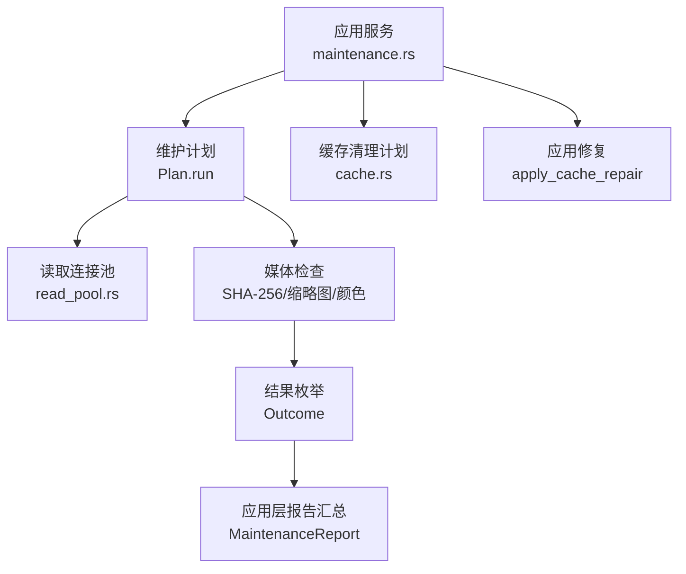
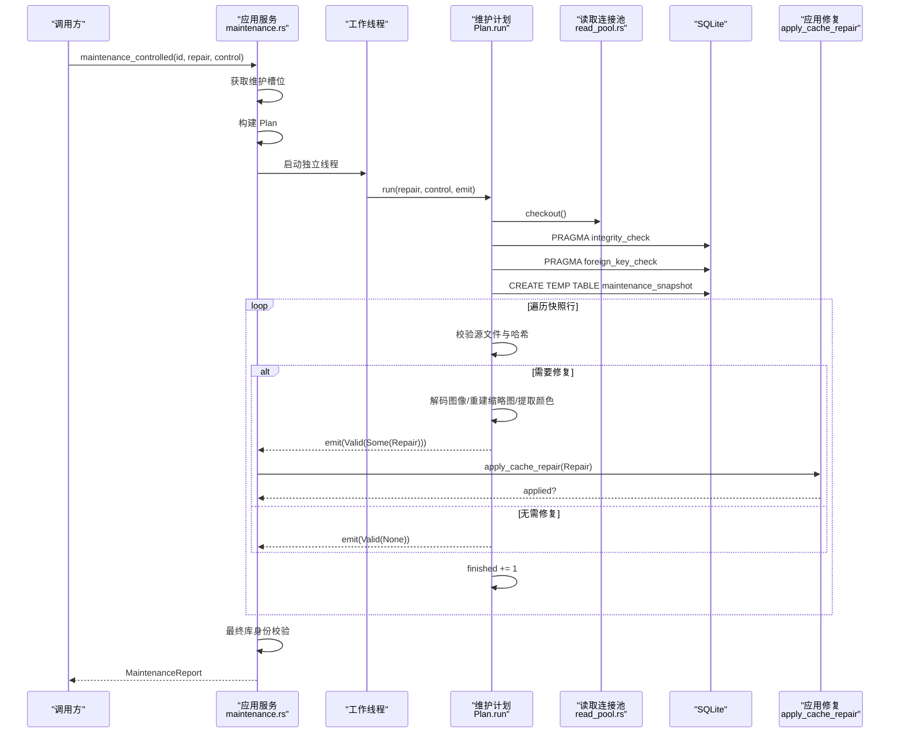
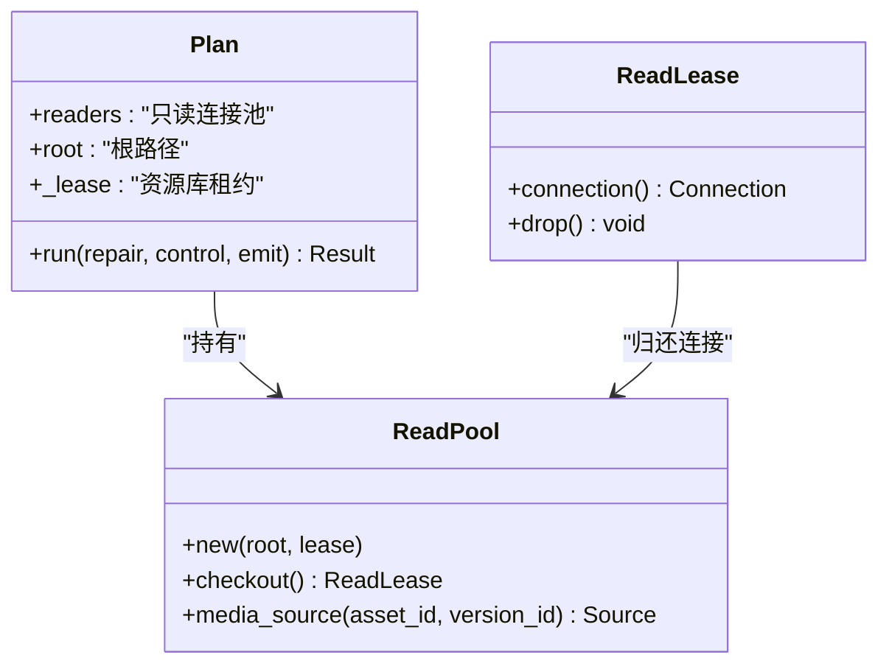
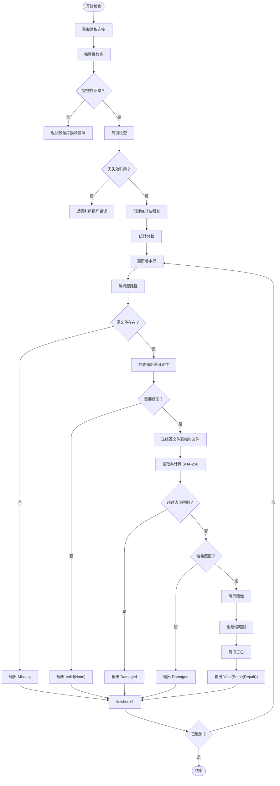
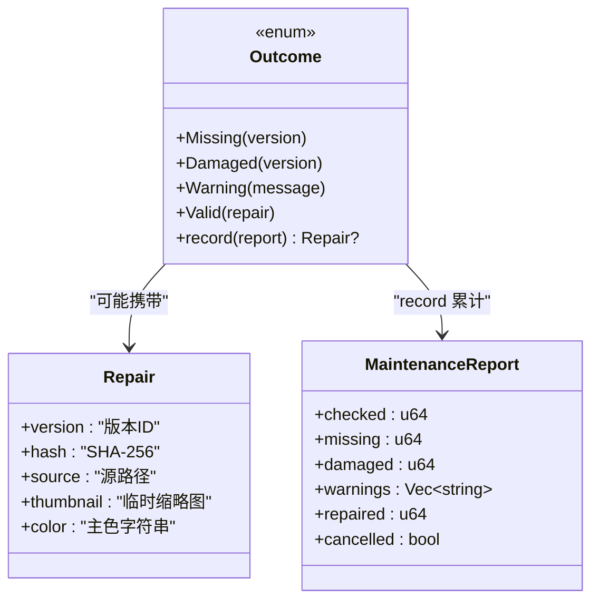
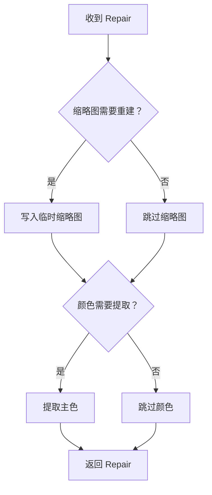
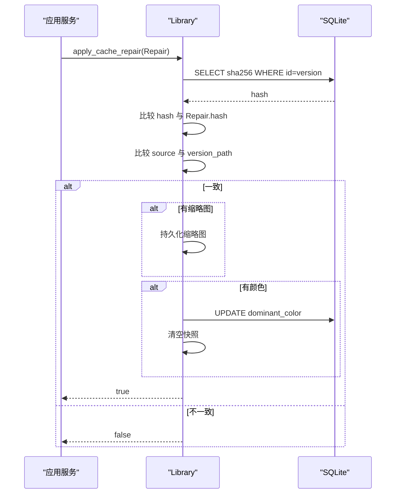
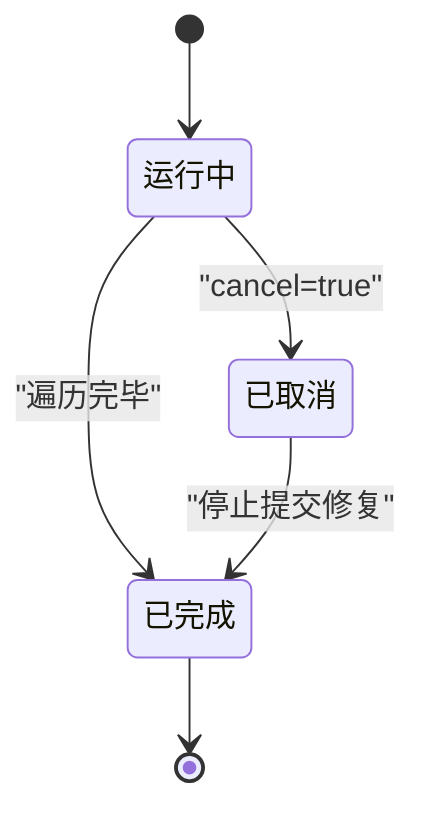
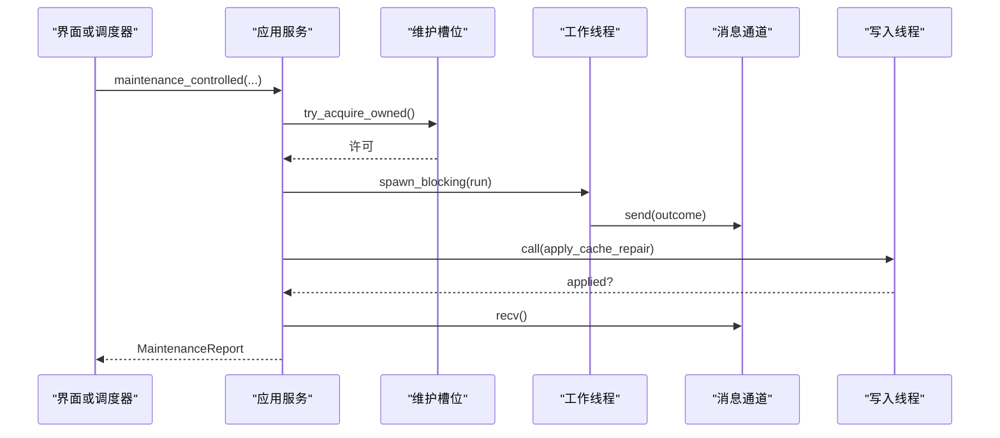
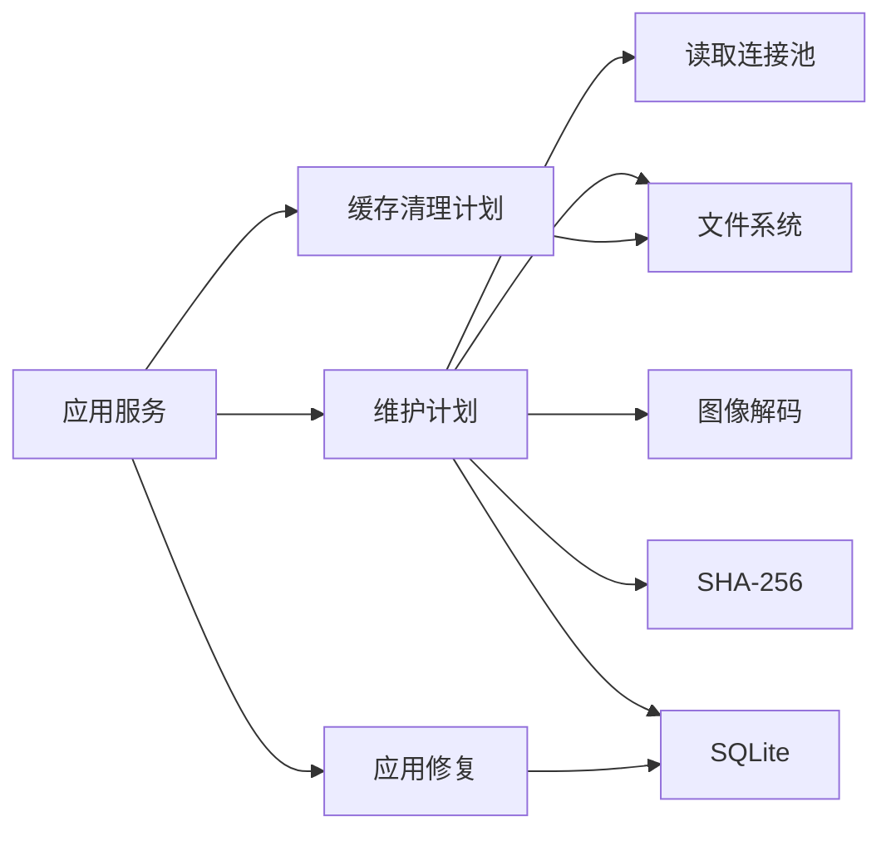

# 维护框架 (Maintenance Framework)

> Repo Wiki 节点 `maintenance-framework`
> 导出自 Qoder 知识库快照 `8fbe02f6-57c2-4874-b725-1a8130851fd9`，代码基线 `7a7a8e75e18bd90294e09cd422dd7ed5a04813a0`（分支 main，zh-CN）。

<cite>
**本文引用的文件**
- [maintenance.rs](../../../../crates/moriq-app/src/maintenance.rs)
- [maintenance.rs](../../../../crates/moriq-library/src/maintenance/maintenance.rs)
- [read_pool.rs](../../../../crates/moriq-library/src/database/read_pool.rs)
- [cache.rs](../../../../crates/moriq-library/src/media/cache.rs)
</cite>

## 目录
1. [简介](#简介)
2. [项目结构](#项目结构)
3. [核心组件](#核心组件)
4. [架构总览](#架构总览)
5. [详细组件分析](#详细组件分析)
6. [依赖关系分析](#依赖关系分析)
7. [性能与资源特性](#性能与资源特性)
8. [故障排查指南](#故障排查指南)
9. [结论](#结论)

## 简介
本文件面向 Moriq Space 的维护框架，聚焦于以下目标：
- 说明维护计划 Plan 的生成机制、读取连接池获取方式以及资源租约管理。
- 解释媒体检查流程，包括数据库完整性验证、外键约束检查和版本文件校验。
- 说明修复机制的工作原理，包括缩略图重建、颜色信息提取和缓存更新。
- 定义结果枚举 Outcome 的四种状态及其处理路径。
- 说明应用修复 apply_cache_repair 的版本一致性检查机制。
- 给出维护任务的 API 使用示例，包括 maintenance_plan、run 和 apply_cache_repair。
- 解释进度控制机制，包括取消支持与完成计数。
- 说明与异步协调器的集成方式，包括事件回调与状态同步。
- 总结错误处理策略，包括数据库损坏检测与恢复建议。

## 项目结构
维护能力由两层协作实现：
- 应用层服务门面位于 `crates/moriq-app/src/maintenance.rs`，负责暴露高层维护 API、协调预算、执行分批操作并汇总报告。
- 库层维护实现位于 `crates/moriq-library/src/maintenance/maintenance.rs`，负责冻结快照、读取连接池、媒体检查、修复候选生成和结果统计。
- 读取连接池位于 `crates/moriq-library/src/database/read_pool.rs`，提供只读连接复用、租约保护与临时表清理。
- 缓存清理逻辑位于 `crates/moriq-library/src/media/cache.rs`，用于按预算淘汰可重建的预览与缩略图缓存。

**图表来源**
- [maintenance.rs:1-200](../../../../crates/moriq-app/src/maintenance.rs#L1-L200)
- [maintenance.rs:1-200](../../../../crates/moriq-library/src/maintenance/maintenance.rs#L1-L200)
- [read_pool.rs:1-97](../../../../crates/moriq-library/src/database/read_pool.rs#L1-L97)
- [cache.rs:1-87](../../../../crates/moriq-library/src/media/cache.rs#L1-L87)

**章节来源**
- [maintenance.rs:1-244](../../../../crates/moriq-app/src/maintenance.rs#L1-L244)
- [maintenance.rs:1-412](../../../../crates/moriq-library/src/maintenance/maintenance.rs#L1-L412)
- [read_pool.rs:1-97](../../../../crates/moriq-library/src/database/read_pool.rs#L1-L97)
- [cache.rs:1-87](../../../../crates/moriq-library/src/media/cache.rs#L1-L87)

## 核心组件
- 应用层维护服务：对外暴露 orphan_plan、quarantine_orphans、restore_orphans、trim_cache、trash_snapshot、empty_trash、clone_library、backup、copy_library、maintenance、purge、storage、volume 等接口；内部通过 read_plan 将计划冻结在读取端，再在独立线程执行。
- 库层维护计划：Plan 持有读取连接池、根路径和资源库锁租约；run 方法负责创建临时快照、执行完整性检查、逐版本扫描媒体、产出 Outcome 并响应取消。
- 读取连接池：ReadPool 提供 checkout 获取只读连接，并通过 _lease 保持资源库生命周期；ReadLease 在 Drop 时回滚事务、清理临时表并归还连接。
- 缓存清理计划：Plan 遍历 previews 与 thumbnails/256，记录可重建缓存并按修改时间和字节数淘汰，直到剩余容量低于预算。

**章节来源**
- [maintenance.rs:1-244](../../../../crates/moriq-app/src/maintenance.rs#L1-L244)
- [maintenance.rs:1-412](../../../../crates/moriq-library/src/maintenance/maintenance.rs#L1-L412)
- [read_pool.rs:1-97](../../../../crates/moriq-library/src/database/read_pool.rs#L1-L97)
- [cache.rs:1-87](../../../../crates/moriq-library/src/media/cache.rs#L1-L87)

## 架构总览
维护任务的整体流程如下：
1. 调用方发起维护请求，例如 maintenance_controlled。
2. 应用层获取互斥的维护槽位，避免并发检查阻塞写入队列。
3. 应用层在写入线程中构建 Plan，冻结目录、连接池和租约。
4. 应用层在独立工作线程中运行 Plan.run，并在运行前申请共享解码内存预算。
5. Plan.run 从读取连接池取出连接，执行数据库完整性检查与外键检查，再创建临时快照表。
6. 对每个版本，计算 SHA-256、校验缩略图可用性、必要时解码源文件重建缩略图或提取主色。
7. 每行检查完成后通过 emit 回调向应用层发送 Outcome；应用层在写入线程中调用 apply_cache_repair 进行版本一致性校验后提交修复。
8. 应用层汇总 MaintenanceReport，并在最后再次校验库身份。

**图表来源**
- [maintenance.rs:1-244](../../../../crates/moriq-app/src/maintenance.rs#L1-L244)
- [maintenance.rs:1-412](../../../../crates/moriq-library/src/maintenance/maintenance.rs#L1-L412)
- [read_pool.rs:1-97](../../../../crates/moriq-library/src/database/read_pool.rs#L1-L97)

**章节来源**
- [maintenance.rs:1-244](../../../../crates/moriq-app/src/maintenance.rs#L1-L244)
- [maintenance.rs:1-412](../../../../crates/moriq-library/src/maintenance/maintenance.rs#L1-L412)

## 详细组件分析

### 维护计划 Plan 的生成与租约管理
Plan 的生成由 Library.maintenance_plan 完成，它返回一个包含以下字段的对象：
- readers：指向只读连接池 Arc<ReadPool>。
- root：资源库根路径。
- _lease：资源库文件锁租约，确保在读取期间库不会被释放。

读取连接池 ReadPool 的职责包括：
- 维护空闲连接列表 idle。
- checkout 返回 ReadLease；若空闲池为空则新建只读连接，并设置 busy_timeout 与临时存储参数。
- ReadLease.connection 暴露当前连接，Drop 时回滚事务、删除临时表并将连接归还池中（最多保留四个）。

**图表来源**
- [maintenance.rs:1-200](../../../../crates/moriq-library/src/maintenance/maintenance.rs#L1-L200)
- [read_pool.rs:1-97](../../../../crates/moriq-library/src/database/read_pool.rs#L1-L97)

**章节来源**
- [maintenance.rs:1-200](../../../../crates/moriq-library/src/maintenance/maintenance.rs#L1-L200)
- [read_pool.rs:1-97](../../../../crates/moriq-library/src/database/read_pool.rs#L1-L97)

### 媒体检查流程
Plan.run 的检查流程如下：
1. 检查 Control.cancel，允许外部取消。
2. 从读取连接池 checkout 连接。
3. 执行 PRAGMA integrity_check，若返回值不是 ok，则返回 Invalid 错误。
4. 执行 PRAGMA foreign_key_check，若存在失效引用，则返回 Invalid 错误。
5. 创建临时表 maintenance_snapshot，聚合 asset_versions 与 file_locations 的信息。
6. 计算 total 并写入 Control.total，供进度统计。
7. 遍历快照行，根据 platform 与 native_path 解析绝对路径，或回退到相对路径。
8. 若源文件不存在，输出 Missing(version)。
9. 检查缩略图 thumbnails/256/{version}.png 是否可解码，限制最大宽高为 256、最大分配大小为 1MB。
10. 当需要修复且缩略图无效或缺少颜色时，检查磁盘剩余空间，并在 staging 目录创建临时文件以冻结源文件内容。
11. 逐块读取源文件，累计长度，超过 64GB 则输出 Damaged。
12. 比较 SHA-256 与数据库记录，不一致则输出 Damaged。
13. 若需修复，解码图像并重建缩略图 PNG，同时计算 dominant_color。
14. 输出 Valid(None) 或 Valid(Some(Repair))。
15. 每次迭代结束后递增 Control.finished。

**图表来源**
- [maintenance.rs:200-412](../../../../crates/moriq-library/src/maintenance/maintenance.rs#L200-L412)

**章节来源**
- [maintenance.rs:200-412](../../../../crates/moriq-library/src/maintenance/maintenance.rs#L200-L412)

### 结果枚举 Outcome 的设计
Outcome 表示单个版本的检查结果：
- Missing(version)：源文件缺失。
- Damaged(version)：源文件校验失败或体积异常。
- Warning(message)：非致命问题，例如路径不完整、解码失败等。
- Valid(repair?)：版本有效；可选携带 Repair 结构体，表示需要写入端复核并应用的修复。

record 方法负责把结果计入 MaintenanceReport：
- checked 始终加一。
- missing、damaged 分别累加。
- warnings 最多保留 50 条。
- Valid(Some(repair)) 不直接计入警告，而是返回修复候选给上层。

**图表来源**
- [maintenance.rs:1-200](../../../../crates/moriq-library/src/maintenance/maintenance.rs#L1-L200)

**章节来源**
- [maintenance.rs:1-200](../../../../crates/moriq-library/src/maintenance/maintenance.rs#L1-L200)

### 修复机制与缓存更新
修复候选 Repair 包含版本标识、哈希值、源路径、可选临时缩略图和可选颜色。其工作原理如下：
- 如果缩略图不可读或颜色字段为空，则解码源文件重建 PNG 缩略图。
- 如果颜色字段为空，则从图像中提取主色。
- 所有修复都先放入 staging 目录的临时文件中，避免直接覆盖生产缓存。
- 最终由应用层在写入线程中调用 apply_cache_repair 确认并提交。

**图表来源**
- [maintenance.rs:200-412](../../../../crates/moriq-library/src/maintenance/maintenance.rs#L200-L412)

**章节来源**
- [maintenance.rs:200-412](../../../../crates/moriq-library/src/maintenance/maintenance.rs#L200-L412)

### 应用修复 apply_cache_repair 的版本检查机制
apply_cache_repair 在执行任何写入之前会进行严格的一致性检查：
1. 查询 asset_versions 表中对应 version 的 sha256。
2. 比较数据库中哈希与 Repair.hash。
3. 比较版本路径 source 与当前 library.version_path(version, false) 返回的路径。
4. 任一不一致，直接返回未应用，防止覆盖被重定位的外部引用缓存。
5. 若缩略图存在，则持久化到 thumbnails/256/{version}.png。
6. 若颜色存在，则更新 asset_versions.dominant_color，并清空 snapshot 缓存。

**图表来源**
- [maintenance.rs:1-200](../../../../crates/moriq-library/src/maintenance/maintenance.rs#L1-L200)

**章节来源**
- [maintenance.rs:1-200](../../../../crates/moriq-library/src/maintenance/maintenance.rs#L1-L200)

### 维护任务 API 使用示例
以下为典型用法描述，不包含具体代码内容：

- 生成维护计划
  - 调用 Library.maintenance_plan 获取 Plan。
  - Plan 已冻结读取连接池、根路径与资源库租约。
  - 适用于离线检查、测试或自定义执行流程。

- 执行维护任务
  - 调用 Service.maintenance(id, repair) 使用默认控制执行检查或修复。
  - 内部调用 maintenance_controlled，获取维护槽位、构建 Plan、在独立线程运行、汇总报告。
  - 可通过 MaintenanceControl.cancel 取消任务；通过 Control.finished 与 Control.total 观察进度。

- 应用修复
  - 在 receive Outcome::Valid(Some(repair)) 后，调用 Library.apply_cache_repair(repair)。
  - 仅当版本哈希与路径一致时才真正写入缩略图或颜色。
  - 返回布尔值表示修复是否实际应用。

- 批量缓存清理
  - 调用 Service.trim_cache(id, clear)。
  - 内部构造 media cache Plan，清除应用层缓存映射，然后在独立线程执行 trim。
  - clear 为真时删除全部可重建缓存；否则按 4GiB 预算淘汰。

- 孤立文件与回收站
  - orphan_plan 冻结输入并生成 OrphanPlan。
  - quarantine_orphans 分页隔离孤立文件。
  - restore_orphans 分页恢复隔离文件。
  - trash_snapshot 获取当前回收站资产 ID 列表。
  - empty_trash 按 1000 个 ID 一批永久删除。

**章节来源**
- [maintenance.rs:1-244](../../../../crates/moriq-app/src/maintenance.rs#L1-L244)
- [maintenance.rs:1-412](../../../../crates/moriq-library/src/maintenance/maintenance.rs#L1-L412)

### 进度控制与取消支持
控制结构 Control 提供三个原子字段：
- cancel：外部取消信号。
- finished：已完成检查的数量。
- total：待检查版本总数。

关键行为：
- Plan.run 在多个关键点检查 cancel。
- 应用层 maintenance_controlled 在工作线程中循环接收 Outcome，若检测到 cancel 则继续消费但不再应用新修复。
- 应用层最终将 report.cancelled 设置为 cancel 状态。
- 测试用例验证取消后 pending 修复会被丢弃，且资源库租约会被释放，允许重新打开库。

**图表来源**
- [maintenance.rs:1-244](../../../../crates/moriq-app/src/maintenance.rs#L1-L244)
- [maintenance.rs:1-412](../../../../crates/moriq-library/src/maintenance/maintenance.rs#L1-L412)

**章节来源**
- [maintenance.rs:1-244](../../../../crates/moriq-app/src/maintenance.rs#L1-L244)
- [maintenance.rs:1-412](../../../../crates/moriq-library/src/maintenance/maintenance.rs#L1-L412)

### 与异步协调器的集成
维护任务采用异步协调模式：
- 应用层维护槽位 maintenance_slot 保证同一时间只有一个维护任务运行。
- 工作线程通过 tokio::task::spawn_blocking 执行 Plan.run。
- 工作线程与应用层之间通过 mpsc::channel 传递 Outcome。
- 工作线程在开始前尝试申请共享解码内存预算 import_memory，若不足则休眠重试。
- 应用层在写入线程中调用 apply_cache_repair，确保数据库写入与资源库身份校验安全。

**图表来源**
- [maintenance.rs:1-244](../../../../crates/moriq-app/src/maintenance.rs#L1-L244)

**章节来源**
- [maintenance.rs:1-244](../../../../crates/moriq-app/src/maintenance.rs#L1-L244)

### 错误处理策略
维护框架的错误处理分为数据库级、媒体级与一致性级：

- 数据库损坏检测
  - integrity_check 失败时返回 Invalid 错误，提示数据库完整性检查未通过。
  - foreign_key_check 发现失效引用时返回 Invalid 错误，建议保留原库并从备份恢复。

- 媒体损坏检测
  - 源文件大小超过 64GB 时视为损坏。
  - SHA-256 与数据库不一致时视为损坏。
  - 缩略图无法解码或修复解码无像素时产生 Warning 或 Invalid。

- 一致性保护
  - apply_cache_repair 拒绝哈希或路径不一致的修复。
  - 应用层在维护完成后再次检查库身份，避免过期修复污染数据。

- 恢复建议
  - 数据库完整性失败：停止写入，保留原库，从备份恢复。
  - 外键失效：不要直接强制修复，优先从备份重建。
  - 缓存损坏：允许 rebuild，但若版本元数据不一致，应优先修复元数据而非覆盖缓存。

**章节来源**
- [maintenance.rs:200-412](../../../../crates/moriq-library/src/maintenance/maintenance.rs#L200-L412)
- [maintenance.rs:1-244](../../../../crates/moriq-app/src/maintenance.rs#L1-L244)

## 依赖关系分析
维护框架的关键依赖关系如下：
- 应用服务依赖维护计划与缓存计划。
- 维护计划依赖读取连接池与 SQLite。
- 媒体检查依赖文件系统、图像解码、哈希计算与组织路径解码。
- 应用修复依赖写入线程与数据库更新。
- 缓存清理依赖文件系统与临时 SQLite 快照。

**图表来源**
- [maintenance.rs:1-244](../../../../crates/moriq-app/src/maintenance.rs#L1-L244)
- [maintenance.rs:1-412](../../../../crates/moriq-library/src/maintenance/maintenance.rs#L1-L412)
- [read_pool.rs:1-97](../../../../crates/moriq-library/src/database/read_pool.rs#L1-L97)
- [cache.rs:1-87](../../../../crates/moriq-library/src/media/cache.rs#L1-L87)

**章节来源**
- [maintenance.rs:1-244](../../../../crates/moriq-app/src/maintenance.rs#L1-L244)
- [maintenance.rs:1-412](../../../../crates/moriq-library/src/maintenance/maintenance.rs#L1-L412)
- [read_pool.rs:1-97](../../../../crates/moriq-library/src/database/read_pool.rs#L1-L97)
- [cache.rs:1-87](../../../../crates/moriq-library/src/media/cache.rs#L1-L87)

## 性能与资源特性
- 读取连接池复用：最多保留四个空闲连接，减少频繁建立连接的开销。
- WAL 读取事务隔离：Plan.run 使用临时快照表，避免长时间占用 WAL 写事务，允许导入与编辑继续。
- 媒体预算控制：维护解码器与导入任务共享全局内存预算，避免同时解码导致内存峰值过高。
- 磁盘空间检查：修复前检查 staging 目录所在卷的可用空间，避免写入中途失败。
- 渐进式取消：在文件读取、哈希计算、回调发射等多个点检查 cancel，降低取消延迟。
- 缓存淘汰顺序：按 modified 时间与路径排序，优先淘汰较旧或较小的可重建缓存。

[本节为通用性能说明，不直接分析具体文件]

## 故障排查指南
常见问题与排查步骤：

- 数据库完整性检查失败
  - 现象：维护任务立即返回 Invalid。
  - 原因：SQLite integrity_check 返回非 ok。
  - 建议：停止写入，保留原库，从备份恢复。

- 外键约束失效
  - 现象：维护任务返回引用损坏错误。
  - 原因：foreign_key_check 发现失效引用。
  - 建议：不要手动修复引用，优先从备份重建库。

- 源文件缺失
  - 现象：Outcome 为 Missing。
  - 原因：asset_versions.path 或 file_locations.native_path 对应的文件不存在。
  - 建议：恢复文件或修正引用路径后再运行维护。

- 哈希不一致
  - 现象：Outcome 为 Damaged。
  - 原因：源文件内容变化或损坏。
  - 建议：恢复原始文件；若缓存损坏但元数据正确，可重建缩略图与颜色。

- 修复未应用
  - 现象：apply_cache_repair 返回 false。
  - 原因：版本哈希或路径与当前库状态不一致。
  - 建议：重新生成维护计划，避免使用过期的 Repair。

- 维护任务卡住
  - 现象：长时间无进度。
  - 原因：解码内存预算不足或文件过大。
  - 建议：检查系统内存、关闭其他解码任务；确认文件体积不超过限制。

**章节来源**
- [maintenance.rs:200-412](../../../../crates/moriq-library/src/maintenance/maintenance.rs#L200-L412)
- [maintenance.rs:1-244](../../../../crates/moriq-app/src/maintenance.rs#L1-L244)

## 结论
Moriq Space 的维护框架通过 Plan 冻结读取上下文、读取连接池复用、临时快照表与严格的版本一致性检查，实现了安全、可取消、可观测的媒体维护流程。Outcome 将缺失、损坏、警告与有效修复清晰分离，apply_cache_repair 确保只有经过校验的修复才能影响数据库与缓存。应用层通过维护槽位、内存预算、进度计数与异步回调，将长期运行的维护任务与用户交互解耦。对于数据库损坏、引用失效或缓存不一致等场景，框架提供了明确的错误类型与恢复建议，适合在生产环境中可靠运行。