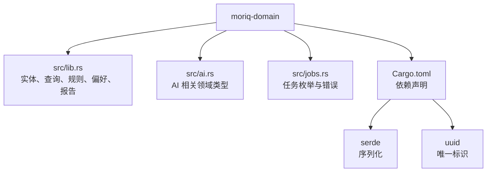
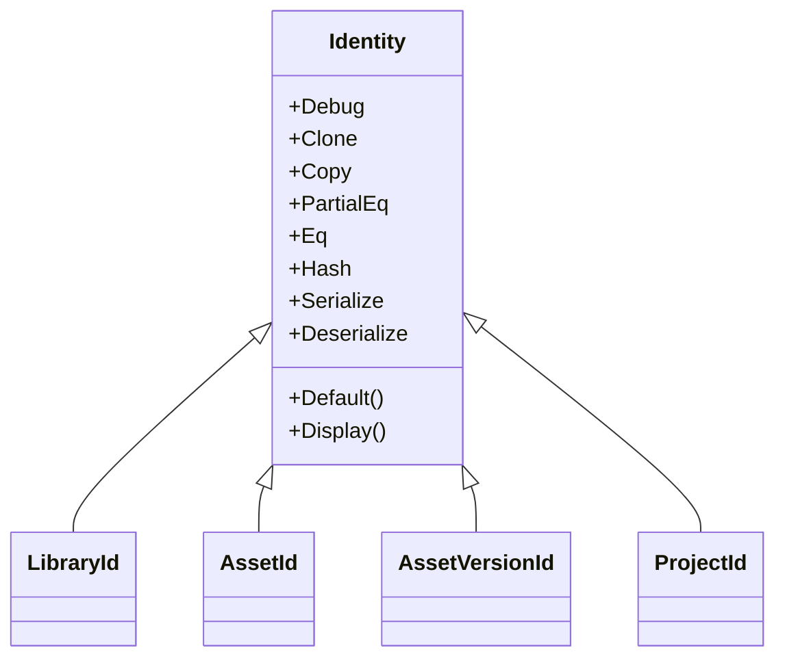
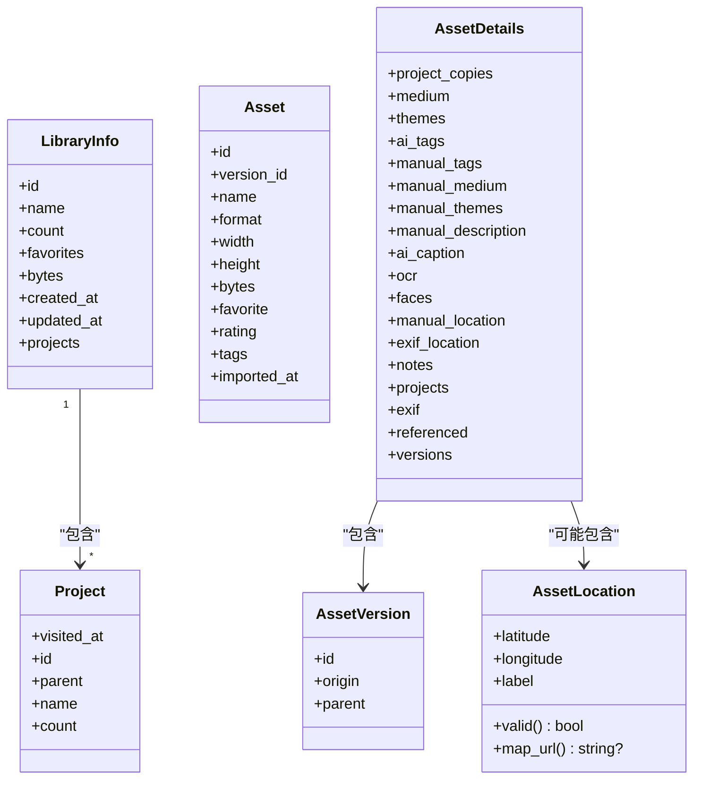
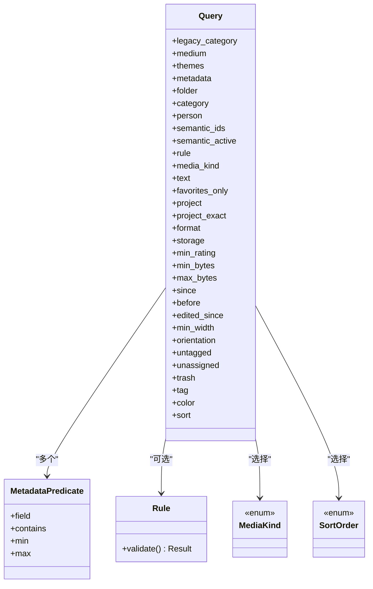
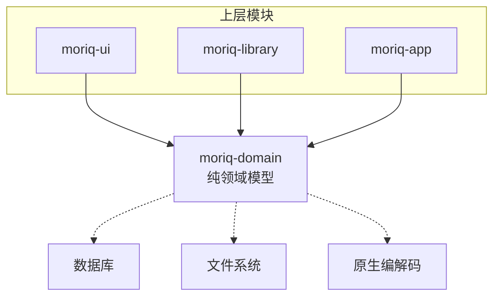
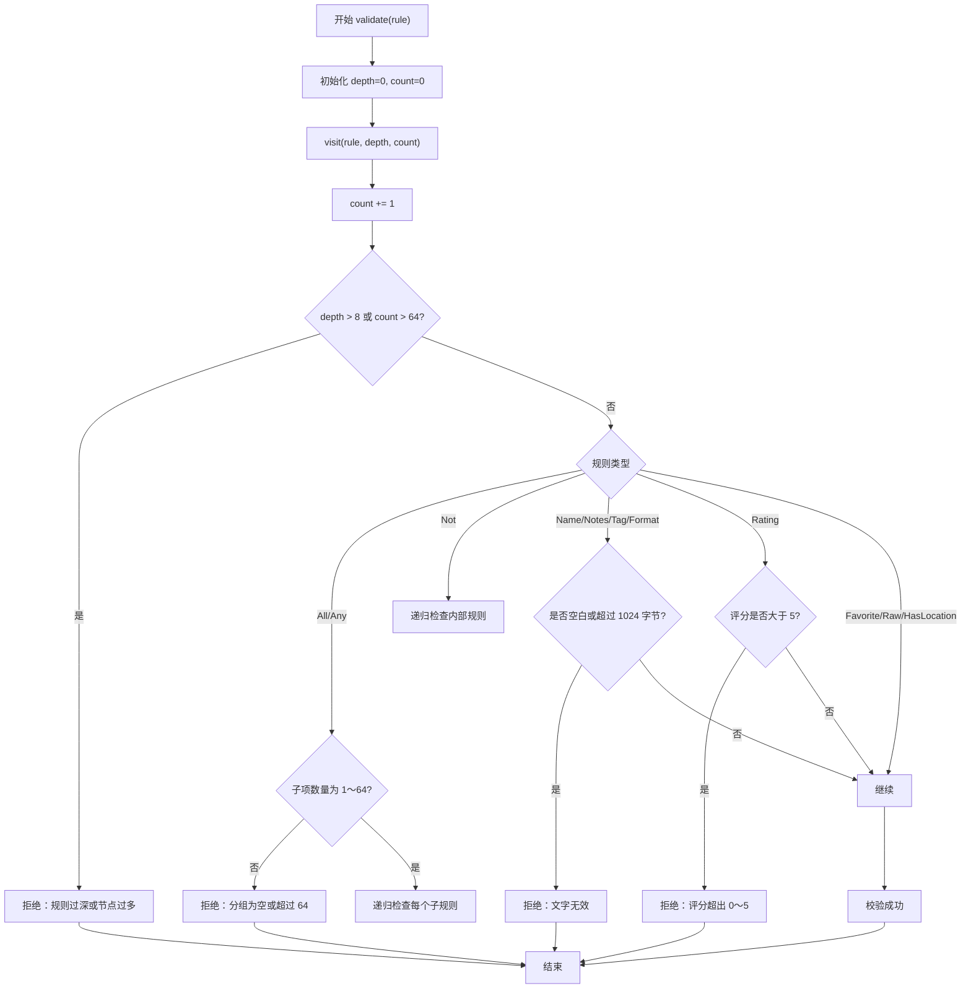
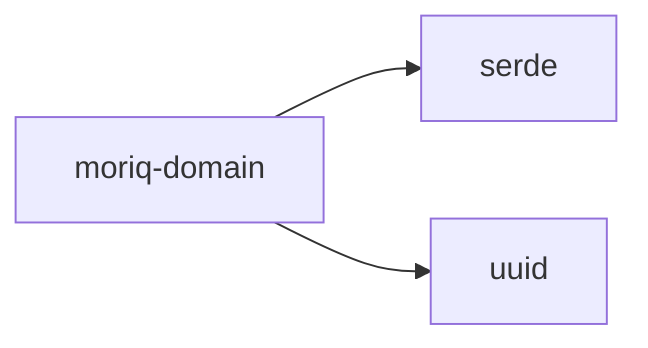

# 领域模型层 (moriq-domain)

> Repo Wiki 节点 `domain-model`
> 导出自 Qoder 知识库快照 `8fbe02f6-57c2-4874-b725-1a8130851fd9`，代码基线 `7a7a8e75e18bd90294e09cd422dd7ed5a04813a0`（分支 main，zh-CN）。

<cite>
**本文引用的文件**
- [Cargo.toml](../../crates/moriq-domain/Cargo.toml)
- [lib.rs](../../crates/moriq-domain/src/lib.rs)
</cite>

## 目录
1. [引言](#引言)
2. [项目结构](#项目结构)
3. [核心组件](#核心组件)
4. [架构总览](#架构总览)
5. [详细组件分析](#详细组件分析)
6. [依赖关系分析](#依赖关系分析)
7. [性能与预算限制](#性能与预算限制)
8. [故障排查指南](#故障排查指南)
9. [结论](#结论)

## 引言
moriq-domain 是 Moriq Space 的纯领域模型层，职责是定义稳定的业务实体、身份标识、查询模型、偏好设置和报告数据结构。它不直接依赖文件系统、数据库或渲染器，而是通过纯数据和有限方法表达领域语义；输入验证、预算限制和类型安全都内嵌在数据结构和接口中，从而让上层应用专注于 I/O、UI 与工作流编排。

该模块的核心设计理念：
- 强类型身份标识：避免把字符串或数字 ID 误用为其他实体的 ID。
- 可序列化、可比较的数据对象：便于缓存、日志、测试与跨进程传输。
- 受限查询模型：Query、Rule、MetadataPredicate 明确限定条件空间，防止 SQL 注入式滥用与无界计算。
- 纯函数式边界：实体方法只做状态校验、范围检查、简单计算，不发起网络或磁盘 I/O。

**章节来源**
- [lib.rs:1-10](../../crates/moriq-domain/src/lib.rs#L1-L10)

## 项目结构
moriq-domain 是一个小型 Rust crate，只包含少量源文件和极少的第三方依赖。

**图表来源**
- [Cargo.toml:1-10](../../crates/moriq-domain/Cargo.toml#L1-L10)
- [lib.rs:1-10](../../crates/moriq-domain/src/lib.rs#L1-L10)

**章节来源**
- [Cargo.toml:1-10](../../crates/moriq-domain/Cargo.toml#L1-L10)
- [lib.rs:1-10](../../crates/moriq-domain/src/lib.rs#L1-L10)

## 核心组件
本节聚焦领域模型中最关键的三类内容：身份标识、核心业务实体、查询模型。

### 身份标识设计模式
模块通过 `identity!` 宏为不同业务域生成独立的强类型 UUID 包装结构体，包括 LibraryId、AssetId、AssetVersionId、ProjectId。每个身份类型具备以下特性：
- 基于 uuid::Uuid 的内部存储。
- Debug、Clone、Copy、PartialEq、Eq、Hash。
- Serialize/Deserialize，支持 JSON 等格式。
- Default 会生成新的随机 UUID，避免新对象复用旧 ID。
- Display 输出标准 UUID 文本。

这种设计的价值在于：
- 编译期区分不同实体的 ID，例如不能把 ProjectId 传给期望 AssetId 的 API。
- 保持不可变性与轻量性（Copy）。
- 允许按 ID 去重、索引、缓存键使用。

**图表来源**
- [lib.rs:11-33](../../crates/moriq-domain/src/lib.rs#L11-L33)

**章节来源**
- [lib.rs:11-33](../../crates/moriq-domain/src/lib.rs#L11-L33)

### 核心业务实体
| 类型 | 关键字段 | 含义与约束 |
|---|---|---|
| LibraryInfo | id、name、count、favorites、bytes、created_at、updated_at、projects | 库级概览信息，包含资源数量、收藏数、字节大小、时间戳及关联项目列表。 |
| Project | visited_at、id、parent、name、count | 项目元信息；parent 表示层级关系；visited_at 用于访问顺序或最近访问策略。 |
| Asset | id、version_id、name、format、width、height、bytes、favorite、rating、tags、imported_at | 媒体资产快照，不包含二进制内容，仅描述名称、格式、尺寸、评分、标签与导入时间。 |
| AssetVersion | id、origin、parent | 版本链中的节点，origin 表示来源，parent 指向父版本。 |
| AssetDetails | project_copies、themes、ai_tags、manual_tags、faces、versions、notes、exif、referenced | 面向 UI 的详细展示模型，聚合 AI 标注、手动标签、人脸、EXIF、引用状态等。 |
| AssetLocation | latitude、longitude、label | 地理位置，提供有效范围检查和地图链接生成。 |

重要约束与行为：
- AssetLocation::valid 要求经纬度有限且落在地理有效区间，label 长度不超过 1024 字节、字符数不超过 256。
- AssetLocation::map_url 仅在 valid 返回 true 时生成 OpenStreetMap 链接。
- 多数实体没有私有字段，强调“纯数据”和“易序列化”，复杂不变性由上层校验与业务逻辑保障。

**图表来源**
- [lib.rs:35-64](../../crates/moriq-domain/src/lib.rs#L35-L64)
- [lib.rs:201-262](../../crates/moriq-domain/src/lib.rs#L201-L262)
- [lib.rs:665-711](../../crates/moriq-domain/src/lib.rs#L665-L711)

**章节来源**
- [lib.rs:35-64](../../crates/moriq-domain/src/lib.rs#L35-L64)
- [lib.rs:201-262](../../crates/moriq-domain/src/lib.rs#L201-L262)
- [lib.rs:665-711](../../crates/moriq-domain/src/lib.rs#L665-L711)

### 查询模型与类型安全
Query 是用户界面与检索系统之间的统一查询载体，包含媒体种类、主题、分类、人物、语义 ID、规则、文本、时间范围、尺寸范围、评分、标签、颜色、排序等多个维度。其关键特点：
- 所有字段都是可选或带默认值，适合逐步构建查询。
- Rule 字段允许以树形表达式组合更复杂的过滤逻辑。
- MediaKind 与 SortOrder 是受限枚举，避免非法排序或媒体类型。
- Query 本身不含 SQL 或路径，防止将外部输入直接映射到底层执行引擎。

MetadataPredicate 表示受限制的元数据条件：
- field：字段名。
- contains：包含子串。
- min/max：数值范围。
- 注释明确“SQL 和文件系统路径不会进入这棵树”。

Rule 是树形布尔表达式：
- All/Any：与/或分组。
- Not：取反。
- Name/Notes/Tag/Format/Rating/Favorite/Raw/HasLocation：具体原子条件。
- Rule::validate 对整棵规则树进行深度、节点数和字符串字面量长度的预算校验。

**图表来源**
- [lib.rs:66-124](../../crates/moriq-domain/src/lib.rs#L66-L124)
- [lib.rs:126-144](../../crates/moriq-domain/src/lib.rs#L126-L144)

**章节来源**
- [lib.rs:66-144](../../crates/moriq-domain/src/lib.rs#L66-L144)

## 架构总览
从调用方向看，moriq-domain 通常被 moriq-ui、moriq-library 等上层模块消费：
- UI 层构造 Query、Rule、BatchPatch、UserSettings 等纯数据对象。
- Library 层负责将这些对象转换为数据库查询、文件系统操作或原生编解码任务。
- Domain 层本身不关心这些实现细节，只提供稳定、可测试、可序列化的数据契约。

该图强调 domain 层的“被动数据契约”角色：上层可以创建、传递、持久化、比较这些对象，但 domain 层自身不发起 I/O。

[本图为概念性架构图，不对应具体代码行，因此不提供图表来源]

## 详细组件分析

### Rule 验证流程与预算限制
Rule::validate 是领域层最重要的安全边界之一。它递归遍历规则树，同时维护当前深度和已处理节点计数，并在任一超限情况立即失败。

关键限制：
- 递归深度上限：8 层。
- 节点总数上限：64 个。
- 分组 All/Any 的子项数量必须在 1～64。
- 字符串字段 Name/Notes/Tag/Format 必须非空且不超过 1024 字节。
- Rating 取值范围为 0～5。

**图表来源**
- [lib.rs:126-173](../../crates/moriq-domain/src/lib.rs#L126-L173)

**章节来源**
- [lib.rs:126-173](../../crates/moriq-domain/src/lib.rs#L126-L173)

### 如何构建安全的查询规则
在实际使用中，建议遵循以下原则：
1. 优先使用简单原子规则，如 Tag、Format、Rating、Favorite、HasLocation。
2. 使用 All 表达“同时满足”，使用 Any 表达“至少满足其一”。
3. 避免过度嵌套 Not，尽量扁平化表达式。
4. 任何来自用户输入的字符串都必须先经过 Rule::validate。
5. 将 Rule 放入 Query.rule，再交给上层检索服务。

示例思路（不展示代码）：
- “标签包含人像且评分不低于 4”：使用 Tag 与 Rating 组合，并通过 All 分组。
- “名称或备注中包含旅行关键词”：使用 Name 与 Notes 组合，并通过 Any 分组。
- “排除已收藏素材”：使用 Not(Favorite)。
- 大型组合查询：拆分为多个小查询或在上层做分页与结果合并，避免接近 64 个节点的上限。

**章节来源**
- [lib.rs:66-173](../../crates/moriq-domain/src/lib.rs#L66-L173)

### 如何使用 identity! 宏创建强类型 ID
典型用法：
- 通过 LibraryId::default 生成新的库 ID。
- 通过 AssetId、ProjectId 作为结构体字段参与哈希、相等性比较。
- 在 UI 中显示 ID 时直接使用 Display，输出标准 UUID。
- 在 JSON 序列化时保留 UUID 文本形式，便于调试和日志记录。

实践建议：
- 不要暴露原始 Uuid 给高层 UI；对外暴露强类型 ID。
- 不要混用不同身份的 ID；例如不要把 ProjectId 传给需要 AssetId 的方法。
- 对持久化 ID 建议使用确定性来源（如数据库生成），而不要在业务层重复赋值。

**章节来源**
- [lib.rs:11-33](../../crates/moriq-domain/src/lib.rs#L11-L33)

### 其他重要领域对象
| 类型 | 用途 | 关键行为 |
|---|---|---|
| Organizer | 组织视图聚合 | 聚合 AI 配置、虚拟文件夹、人物、标签、集合、统计、后台任务等。 |
| BackgroundJob | 后台任务状态 | 携带任务类型、状态、优先级、进度、失败信息。 |
| JobCommand | 任务控制命令 | 重试失败、暂停、恢复、取消、调整优先级。 |
| Edit / BatchPatch | 批量编辑意图 | 表达收藏、评分、标签增删、项目归属、备注变更。 |
| UserSettings / ImportPreferences / AiPreferences / SyncoPreferences | 用户与应用偏好 | 提供默认值、并发工作线程计算、内存预算校验。 |
| ImageRegion | 图像区域 | 表示矩形区域坐标、层级，常用于人脸或裁剪区域。 |
| ProjectDeletionPlan | 删除计划 | 冻结待删除的项目、资产、版本、别名和共享资产集合。 |
| ExportOptions / ExportFormat / Resampling / ExportLayout | 导出配置 | 指定格式、质量、旋转、重采样算法、布局方式。 |
| AssetLocation | 地理位置 | 提供 valid 校验与 map_url 生成。 |
| Page / Neighborhood | 分页与邻接浏览 | 描述总页数、偏移量、当前页资产，以及选中资产及其位置。 |
| ImportReport / PurgeReport / CacheReport / OrphanReport / MaintenanceReport | 各种操作报告 | 汇总成功、失败、跳过、警告、中断等统计。 |

**章节来源**
- [lib.rs:201-711](../../crates/moriq-domain/src/lib.rs#L201-L711)

## 依赖关系分析
moriq-domain 的外部依赖非常克制：
- serde：用于数据对象的序列化与反序列化，使领域模型可用于日志、缓存、传输协议和测试夹具。
- uuid：用于强类型身份标识的唯一值生成。

**图表来源**
- [Cargo.toml:1-10](../../crates/moriq-domain/Cargo.toml#L1-L10)

耦合特征：
- 低耦合：domain 层不依赖 moriq-ui、moriq-library、moriq-runtime 等上层模块。
- 高内聚：所有领域语义集中在少量结构体和枚举中。
- 可测试性强：无需真实数据库或文件系统即可构造完整 Query、Rule、Edit、ImportPreferences 等对象。

潜在风险：
- 如果上层直接将用户输入透传到 Rule 字符串字段而不调用 validate，可能导致无效或恶意规则进入检索管线。
- 大量使用 Vec<String> 和 Vec<T> 作为通用容器时，应避免无界增长；应由上层分页或截断。

**章节来源**
- [Cargo.toml:1-10](../../crates/moriq-domain/Cargo.toml#L1-L10)
- [lib.rs:1-10](../../crates/moriq-domain/src/lib.rs#L1-L10)

## 性能与预算限制
moriq-domain 的性能关注点主要集中在“输入预算”和“纯计算开销”上：

1. Rule 预算
   - 最大深度：8 层。
   - 最大节点数：64。
   - 分组子项数量：1～64。
   - 字符串字段：最多 1024 字节。
   - 评分：0～5。

2. ImportPreferences 并发预算
   - effective_workers：自动模式下取逻辑 CPU 数的一半，并钳制到 2～16；用户显式设置时钳制到 1～32。
   - validated：workers 不超过 32，memory_mib 必须在 256～4096。

3. AssetLocation 有效性
   - 经纬度必须有限且落在地理有效范围。
   - label 长度不超过 1024 字节、字符数不超过 256。

这些限制共同构成“防御型领域模型”：即使上层传入异常输入，domain 层也能快速失败，而不是在后续数据库或原生层造成更大代价。

**章节来源**
- [lib.rs:126-173](../../crates/moriq-domain/src/lib.rs#L126-L173)
- [lib.rs:420-506](../../crates/moriq-domain/src/lib.rs#L420-L506)
- [lib.rs:665-711](../../crates/moriq-domain/src/lib.rs#L665-L711)

## 故障排查指南
常见错误及定位方式：

| 现象 | 可能原因 | 排查建议 |
|---|---|---|
| 规则校验失败 | Rule 树过深、节点过多、分组为空或过大 | 打印 Rule 树结构，检查 All/Any/Not 的组合深度；确保每个分组有 1～64 个子项。 |
| 规则文字报错 | Name/Notes/Tag/Format 为空或超过 1024 字节 | 清理前后空白；限制用户输入长度；避免拼接超长模板。 |
| 评分报错 | Rating 超过 5 | 检查 UI 评分控件和导入数据，确保值为 0～5。 |
| 导入并发异常 | workers 或 memory_mib 超出允许范围 | 使用 validated 检查；确认 effective_workers 的计算是否符合预期。 |
| 地图链接为空 | AssetLocation.valid 返回 false | 检查经纬度是否在合法范围，label 是否过长。 |
| 查询结果异常 | Query 字段未正确设置 | 对比 Query 各字段与 UI 筛选条件；确认 Rule 是否正确填入 Query.rule。 |

推荐调试步骤：
1. 将 Query 或 Rule 序列化到日志或测试断言。
2. 先运行 Rule::validate，再交给检索服务。
3. 对 ImportPreferences 调用 validated 后再启动导入。
4. 对 AssetLocation 调用 valid 后再打开地图链接。

**章节来源**
- [lib.rs:126-173](../../crates/moriq-domain/src/lib.rs#L126-L173)
- [lib.rs:420-506](../../crates/moriq-domain/src/lib.rs#L420-L506)
- [lib.rs:665-711](../../crates/moriq-domain/src/lib.rs#L665-L711)

## 结论
moriq-domain 通过强类型身份标识、受限查询模型、严格预算校验和无 I/O 的纯数据设计，为 Moriq Space 提供了稳定可靠的领域契约。它不是功能实现层，而是“业务语言”的数据表达层：上层可以安全地构造 Query、Rule、Edit、Preference 等对象，再由 library 或 app 层决定如何持久化、检索、渲染和执行。

最佳实践总结：
- 始终使用 identity! 生成的强类型 ID。
- 所有 Rule 在使用前调用 validate。
- 所有 Location、ImportPreferences 等带范围的对象使用 valid 或 validated。
- 保持 domain 层无 I/O，把副作用放在上层。
- 将复杂查询拆分为更小、更易验证的规则树，避免触碰预算上限。