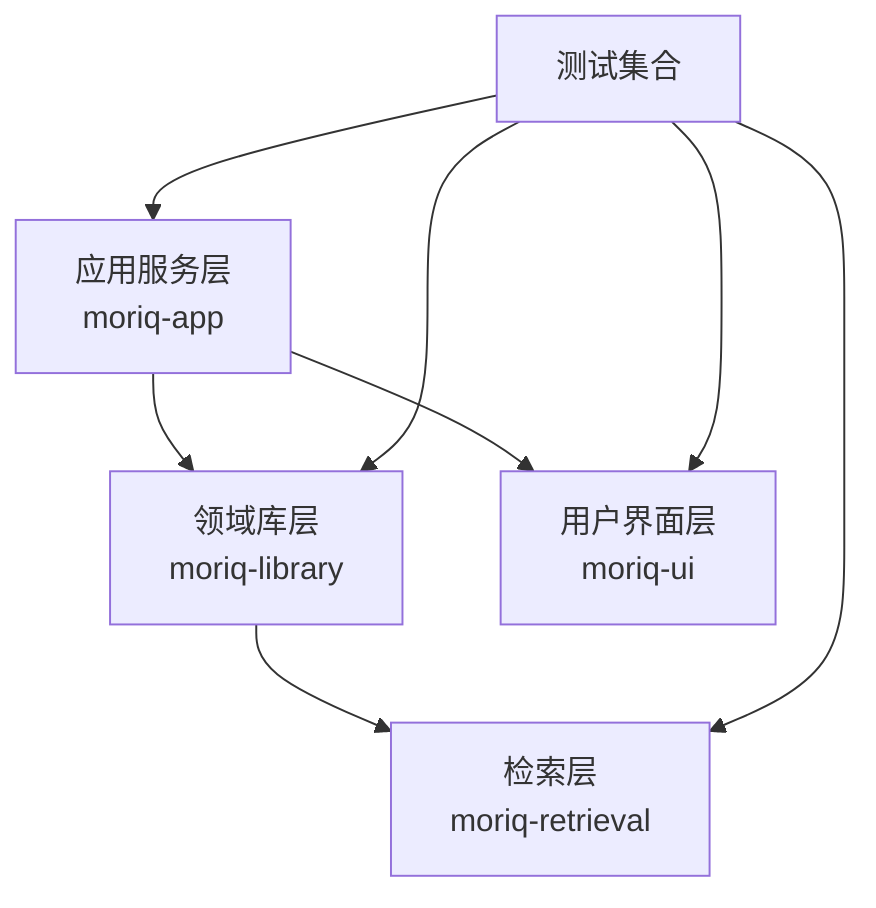
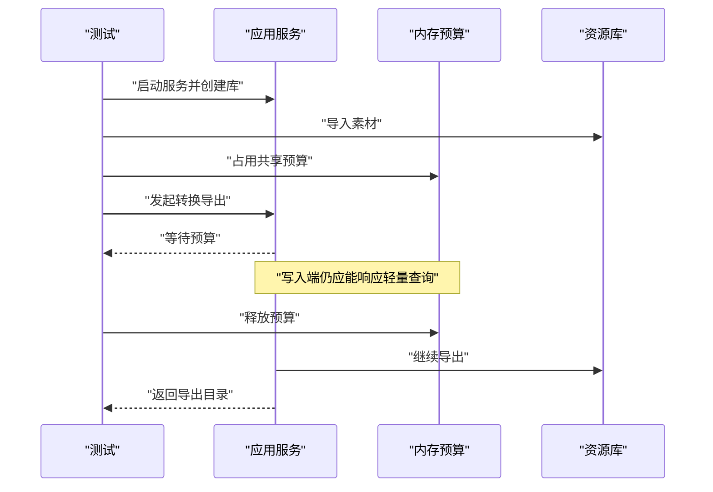
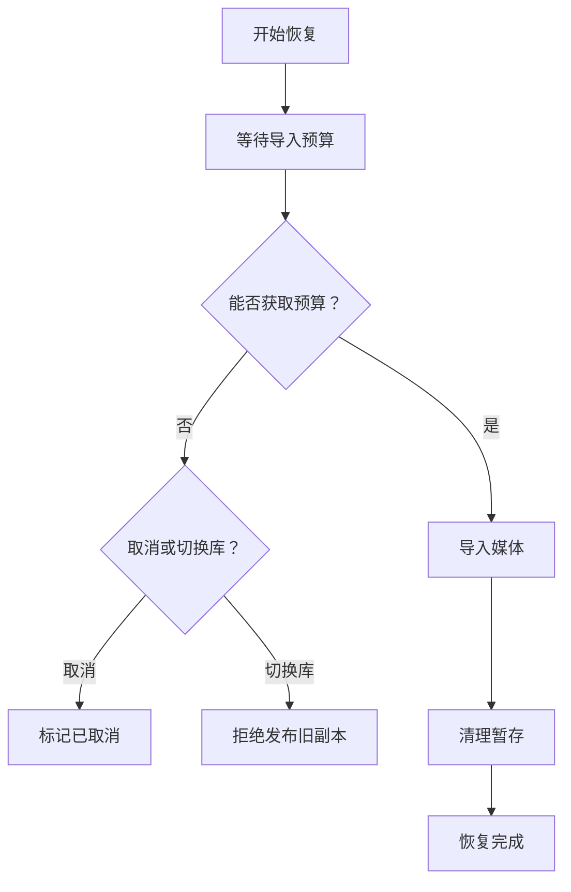

# 测试策略

> Repo Wiki 节点 `testing-strategy`
> 导出自 Qoder 知识库快照 `8fbe02f6-57c2-4874-b725-1a8130851fd9`，代码基线 `7a7a8e75e18bd90294e09cd422dd7ed5a04813a0`（分支 main，zh-CN）。

## 当前回归补充（2026-11-07）

以下记录对应本次 1.2.0 开发包，数量是当日结果，不是固定验收门槛。完整打包检查记录为 340 项测试通过，工作区默认另有 3 项跳过；其中依赖内置运行组件的 CPU 生命周期测试随后显式执行并通过。源码规范、格式和工作区全目标、全特性 Clippy 检查通过。

本轮回归覆盖：

- Qwen 卡片只提交分类与标签描述；外层重新分析只提交选中任务，取消或范围失效不入队。
- 内外人物卡片的改名、删除、重复提交保护、错误保留输入及旧回执拒绝。
- 删除人物保留原片和人工未归组记录；人脸迁移序号不会与保留检测冲突。
- 人脸完成状态包含成功空结果，排除旧版本及回收站，不伪造内容分类。
- 普通进度保留头像批次，图库刷新合并并等新布局与页面就绪后提交。
- 侧栏选择、页面切换和减少动态效果的控制逻辑，以及模型批次结束、取消和关闭的驻留行为。

下载边界测试不联网，模拟中断、错误内容、缓存损坏和离线情况；CPU 生命周期测试需要先准备运行组件：

```powershell
./scripts/test-verified-download.ps1
cargo test -p moriq-ai cpu_faces::tests::bundled_cpu_runtime_obeys_residency_and_batch_lifetime --locked -- --ignored --exact
```

打包时还核对了 50 个运行组件的摘要，用空白 PNG 实际运行 CPU 工作进程，确认能成功返回空人脸列表。人物卡片、改名和删除确认做过隔离样例界面检查；完整动态效果实机复测尚未完成。上述结果不代表真实照片分组质量、NAS 联机、清洁系统安装或公开发布验收。

测试入口：[UI 回归](../crates/moriq-ui/src/ui_regression_tests.rs)、[界面测试](../crates/moriq-ui/src/interface_tests.rs)、[推理测试](../crates/moriq-app/src/inference_tests.rs)、[CPU 运行器测试](../crates/moriq-ai/src/cpu_faces.rs)、[下载测试](../scripts/test-verified-download.ps1)。当前操作契约见 [AI 工作室与人物整理](AI%20工作室与人物整理.md)。后文为旧快照的测试架构说明。

## 历史测试说明

<cite>
**本文引用的文件**   
- [Cargo.toml](../Cargo.toml)
- [moriq-app/tests.rs](../crates/moriq-app/src/tests.rs)
- [moriq-app/backup_tests.rs](../crates/moriq-app/src/backup_tests.rs)
- [moriq-app/export_budget_tests.rs](../crates/moriq-app/src/export_budget_tests.rs)
- [moriq-app/inference_tests.rs](../crates/moriq-app/src/inference_tests.rs)
- [moriq-app/recovery_tests.rs](../crates/moriq-app/src/recovery_tests.rs)
- [moriq-library/tests/library.rs](../crates/moriq-library/src/tests/library.rs)
- [moriq-library/tests/ai_content_tests.rs](../crates/moriq-library/src/tests/ai_content_tests.rs)
- [moriq-library/tests/ai_profile_tests.rs](../crates/moriq-library/src/tests/ai_profile_tests.rs)
- [moriq-library/tests/project_isolation_tests.rs](../crates/moriq-library/src/tests/project_isolation_tests.rs)
- [moriq-library/tests/storage_regression_tests.rs](../crates/moriq-library/src/tests/storage_regression_tests.rs)
- [moriq-library/tests/workspace_tests.rs](../crates/moriq-library/src/tests/workspace_tests.rs)
- [moriq-ui/ui_regression_tests.rs](../crates/moriq-ui/src/ui_regression_tests.rs)
- [moriq-ui/interface_tests.rs](../crates/moriq-ui/src/interface_tests.rs)
- [moriq-ui/preferences_tests.rs](../crates/moriq-ui/src/preferences_tests.rs)
- [moriq-ui/features/batch/tests.rs](../crates/moriq-ui/src/features/batch/tests.rs)
- [moriq-retrieval/tests.rs](../crates/moriq-retrieval/src/tests.rs)
</cite>

## 目录

1. [引言](#引言)
2. [项目结构与测试布局](#项目结构与测试布局)
3. [核心测试分层](#核心测试分层)
4. [单元测试规范](#单元测试规范)
5. [集成测试与端到端验证](#集成测试与端到端验证)
6. [视觉回归与界面状态回归测试](#视觉回归与界面状态回归测试)
7. [测试数据准备与夹具管理](#测试数据准备与夹具管理)
8. [性能基准测试设计](#性能基准测试设计)
9. [持续集成中的测试策略](#持续集成中的测试策略)
10. [覆盖率要求](#覆盖率要求)
11. [调试技巧与常见问题](#调试技巧与常见问题)
12. [结论](#结论)

## 引言

本仓库采用 Rust workspace 组织多 crate，核心应用层、领域库、UI 层和检索层各自维护测试。测试策略围绕以下目标展开：

- **可重复性**：所有测试使用临时文件或内存数据库，不依赖外部系统或持久环境。
- **隔离性**：项目、库、工作区、AI 模型和 UI 状态必须保持独立，避免并发或历史回执污染。
- **边界覆盖**：重点覆盖导入恢复、备份发布、导出预算、封面提交、AI 推理调度、项目隔离、数据库迁移和 UI 状态机。
- **回归安全**：通过存储回归、界面交互回归和检索范围测试，防止架构演进破坏已有行为。
- **性能可见性**：对元数据分页、搜索、重开等路径提供合成基准，但不把真实媒体吞吐作为常规验收标准。

该策略适用于新增功能、重构、迁移脚本、AI 分类流程和 UI 交互变更。

## 项目结构与测试布局

仓库的测试主要分布在四个位置：

| 层级 | 主要职责 | 典型文件 |
|---|---|---|
| 应用服务层 | 并发请求隔离、资源库服务、预算控制、恢复流程 | `crates/moriq-app/src/tests.rs`、`crates/moriq-app/src/backup_tests.rs`、`crates/moriq-app/src/export_budget_tests.rs`、`crates/moriq-app/src/inference_tests.rs`、`crates/moriq-app/src/recovery_tests.rs` |
| 领域库层 | 素材导入、元数据、AI 内容、项目隔离、存储审计、迁移 | `crates/moriq-library/src/tests/*.rs` |
| 用户界面层 | Iced 应用消息、侧栏导航、批量操作、偏好设置、封面保存 | `crates/moriq-ui/src/ui_regression_tests.rs`、`crates/moriq-ui/src/interface_tests.rs`、`crates/moriq-ui/src/preferences_tests.rs`、`crates/moriq-ui/src/features/batch/tests.rs` |
| 检索层 | 相似图片、语义检索、项目范围过滤 | `crates/moriq-retrieval/src/tests.rs` |



**图示来源**  
- [moriq-app/tests.rs:1-200](../crates/moriq-app/src/tests.rs#L1-L200)
- [moriq-library/tests/library.rs:1-200](../crates/moriq-library/src/tests/library.rs#L1-L200)
- [moriq-ui/ui_regression_tests.rs:1-200](../crates/moriq-ui/src/ui_regression_tests.rs#L1-L200)
- [moriq-retrieval/tests.rs:1-151](../crates/moriq-retrieval/src/tests.rs#L1-L151)

**章节来源**  
- [Cargo.toml:1-80](../Cargo.toml#L1-L80)

## 核心测试分层

### 第一层：纯逻辑单元测试

这类测试不启动完整 UI 或真实 AI 运行时，主要验证函数式行为和数据结构约束。

- 偏好设置状态合并、序列化与失败回滚。
- 批量操作作用域冻结、补丁构造、过期回执拒绝。
- 检索目录在相同项目范围内返回候选结果，并拒绝其他项目输入。

示例参考：

- [preferences_tests.rs:1-106](../crates/moriq-ui/src/preferences_tests.rs#L1-L106)
- [features/batch/tests.rs:1-76](../crates/moriq-ui/src/features/batch/tests.rs#L1-L76)
- [moriq-retrieval/tests.rs:1-151](../crates/moriq-retrieval/src/tests.rs#L1-L151)

### 第二层：组件与子系统测试

这类测试创建真实的库、临时目录、SQLite 数据库或简化 UI 应用状态，但屏蔽外部依赖。

- 素材导入、收藏、评分、标签、预览、重命名和目录迁移。
- 中断导入后重新打开库是否生成操作日志。
- 自定义 AI 分类配置、标签视图升级、定义变化取消旧任务。

示例参考：

- [library.rs:1-200](../crates/moriq-library/src/tests/library.rs#L1-L200)
- [ai_content_tests.rs:1-200](../crates/moriq-library/src/tests/ai_content_tests.rs#L1-L200)
- [ai_profile_tests.rs:1-200](../crates/moriq-library/src/tests/ai_profile_tests.rs#L1-L200)

### 第三层：应用服务集成测试

这类测试启动 `Service`，验证异步服务、共享内存预算、恢复流程、备份发布和推理调度。

- 并发项目请求保留冻结上下文。
- 封面提交等待预算时拒绝旧提交。
- 慢速备份不阻塞写入端。
- 转换导出等待共享预算但不阻塞写库。
- 恢复等待预算期间仍可响应信息查询。

示例参考：

- [moriq-app/tests.rs:1-200](../crates/moriq-app/src/tests.rs#L1-L200)
- [backup_tests.rs:1-93](../crates/moriq-app/src/backup_tests.rs#L1-L93)
- [export_budget_tests.rs:1-67](../crates/moriq-app/src/export_budget_tests.rs#L1-L67)
- [recovery_tests.rs:1-154](../crates/moriq-app/src/recovery_tests.rs#L1-L154)

### 第四层：界面与视觉回归测试

这类测试基于 UI 测试辅助构建应用状态，断言消息处理、选择状态、滚动状态、面板切换和历史导航。

- 恢复取消后忙碌状态保留到完成。
- Ctrl 点击和右键菜单保留批量选择。
- 打开和关闭弹出层不重建底层滚动控件。
- 封面保存单次飞行、绑定库身份、刷新卡片。

示例参考：

- [ui_regression_tests.rs:1-200](../crates/moriq-ui/src/ui_regression_tests.rs#L1-L200)
- [interface_tests.rs:1-200](../crates/moriq-ui/src/interface_tests.rs#L1-L200)

**章节来源**  
- [moriq-app/tests.rs:1-200](../crates/moriq-app/src/tests.rs#L1-L200)
- [moriq-library/tests/library.rs:1-200](../crates/moriq-library/src/tests/library.rs#L1-L200)
- [moriq-ui/ui_regression_tests.rs:1-200](../crates/moriq-ui/src/ui_regression_tests.rs#L1-L200)
- [moriq-retrieval/tests.rs:1-151](../crates/moriq-retrieval/src/tests.rs#L1-L151)

## 单元测试规范

### 命名与结构

- 使用 `#[test]` 或 `#[tokio::test]` 标记测试。
- 文件名按子系统划分，例如 `inference_tests.rs`、`backup_tests.rs`、`ai_content_tests.rs`。
- 测试函数名应表达业务断言，而不是实现细节；当前代码中大量使用中文注释说明意图。

### 同步与异步

- 同步测试直接断言返回值或数据库状态。
- 异步测试通常使用 `tokio::runtime::Runtime::new().block_on(...)` 执行异步块。
- 需要模拟长时间运行的任务时，使用通道、原子标志或超时断言。

### 错误断言

- 对外部错误或冲突场景使用显式错误断言。
- 对过期回执、冲突编辑、非法路径、无效清单使用失败分支验证。
- 对并发写入、预算竞争、取消信号使用 `tokio::time::timeout` 或原子标志。

### 清理与副作用

- 临时目录由 `tempfile::TempDir` 负责清理。
- 内存数据库由 SQLite 连接句柄生命周期管理。
- UI 测试只修改测试应用状态，不依赖操作系统窗口管理器。

### 复杂度预期

- 大多数单元测试为常数时间或线性时间，取决于断言的数据量。
- 涉及分页、批量标签读取、虚拟文件夹统计的测试可能接近 O(n)，但 n 通常很小。
- 合成基准测试明确标注为“合成元数据基准”，不用于真实吞吐验收。

**章节来源**  
- [preferences_tests.rs:1-106](../crates/moriq-ui/src/preferences_tests.rs#L1-L106)
- [features/batch/tests.rs:1-76](../crates/moriq-ui/src/features/batch/tests.rs#L1-L76)
- [moriq-retrieval/tests.rs:1-151](../crates/moriq-retrieval/src/tests.rs#L1-L151)

## 集成测试与端到端验证

### 应用服务并发与预算测试

应用服务测试重点验证：

1. 并发项目请求不会互相污染冻结上下文。
2. 聚合服务不会被单个项目调用污染。
3. 封面持久化到卡片后，切库会拒绝旧封面提交。
4. 原图图块命中缓存时使用较小交互内存预算。
5. 预览缓存损坏时会先升级预算再解码。
6. 转换导出等待共享预算，但仍允许写入端处理其他请求。



**图示来源**  
- [moriq-app/export_budget_tests.rs:1-67](../crates/moriq-app/src/export_budget_tests.rs#L1-L67)
- [moriq-app/tests.rs:1-200](../crates/moriq-app/src/tests.rs#L1-L200)

### 恢复与备份测试

恢复测试验证：

- 中断导入不会登记半成品。
- 恢复等待预算期间仍保持写入端响应。
- 取消恢复后注册的工作者被取消。
- 删除恢复未来对象后，后续恢复仍能完成。
- 慢速快照复制不阻塞写入端。
- 切库后拒绝发布旧库副本。



**图示来源**  
- [recovery_tests.rs:1-154](../crates/moriq-app/src/recovery_tests.rs#L1-L154)
- [backup_tests.rs:1-93](../crates/moriq-app/src/backup_tests.rs#L1-L93)

### AI 推理调度测试

推理测试通过 `FakeRunner` 替代真实 AI 运行时，验证：

- 应用检索服务共享冻结的项目作用域。
- 同项目内相似图片和语义检索返回正确结果。
- 其他项目的素材不会进入当前项目检索结果。
- 取消信号能够终止长时间推理。
- 测试模型的修订号可用于回执身份校验。

**章节来源**  
- [moriq-app/tests.rs:1-200](../crates/moriq-app/src/tests.rs#L1-L200)
- [moriq-app/export_budget_tests.rs:1-67](../crates/moriq-app/src/export_budget_tests.rs#L1-L67)
- [moriq-app/recovery_tests.rs:1-154](../crates/moriq-app/src/recovery_tests.rs#L1-L154)
- [moriq-app/backup_tests.rs:1-93](../crates/moriq-app/src/backup_tests.rs#L1-L93)
- [moriq-app/inference_tests.rs:1-200](../crates/moriq-app/src/inference_tests.rs#L1-L200)

## 视觉回归与界面状态回归测试

该项目没有传统像素级截图对比框架，而是通过**界面状态回归测试**保障视觉相关行为稳定。

### 测试重点

- 恢复任务的忙碌状态是否正确保留到完成。
- Ctrl 点击和右键菜单是否保留批量选择。
- 普通点击是否退出追加选择模式。
- 打开和关闭上下文菜单是否重建滚动控件。
- 封面保存是否单次飞行、绑定库身份、刷新库卡片。
- 侧栏切换项目时是否改变工作区而不意外跳转素材页。
- 语言、外观、AI 策略等设置变更后是否保留库、查询、选择和未保存表单。

### 推荐扩展方式

如果未来需要真正的像素回归，建议：

1. 固定渲染尺寸和主题。
2. 将关键界面渲染为图像或矢量描述。
3. 将基线图像保存在版本库。
4. 比较新渲染结果与基线的差异阈值。
5. 对已知平台差异添加条件跳过。

当前仓库更强调**状态机回归**，即保证消息处理和 UI 内部状态不变，而不是像素一致性。

**章节来源**  
- [ui_regression_tests.rs:1-200](../crates/moriq-ui/src/ui_regression_tests.rs#L1-L200)
- [interface_tests.rs:1-200](../crates/moriq-ui/src/interface_tests.rs#L1-L200)
- [preferences_tests.rs:1-106](../crates/moriq-ui/src/preferences_tests.rs#L1-L106)
- [features/batch/tests.rs:1-76](../crates/moriq-ui/src/features/batch/tests.rs#L1-L76)

## 测试数据准备与夹具管理

### 通用夹具模式

测试数据主要通过小型 PNG 像素图和临时目录构造：

- 使用 `tempfile::TempDir` 表示库根目录。
- 使用 `image::RgbImage::from_pixel(...).save(...)` 生成最小有效图片。
- 使用 `Library::create` 创建资源库。
- 使用 `Library::import` 或 `ImportFile` 构造导入流程。
- 使用 `tempfile::TempDir` 句柄自动清理文件系统。

示例参考：

- [library.rs:1-200](../crates/moriq-library/src/tests/library.rs#L1-L200)
- [ai_content_tests.rs:1-200](../crates/moriq-library/src/tests/ai_content_tests.rs#L1-L200)
- [project_isolation_tests.rs:1-200](../crates/moriq-library/src/tests/project_isolation_tests.rs#L1-L200)

### 高级夹具

部分测试需要更复杂的初始状态：

- 直接插入 `ai_embeddings`、`ai_analysis_runs`、`ai_effective_results` 等表，模拟 AI 分析结果。
- 使用 `downgrade_to_22` 将数据库降级到旧版本，验证迁移兼容。
- 注入触发器或伪造清单，验证迁移失败回滚。
- 构造暂停后台任务，验证外部引用扫描和 UNC 路径拒绝。

示例参考：

- [storage_regression_tests.rs:1-200](../crates/moriq-library/src/tests/storage_regression_tests.rs#L1-L200)
- [workspace_tests.rs:1-200](../crates/moriq-library/src/tests/workspace_tests.rs#L1-L200)
- [ai_content_tests.rs:1-200](../crates/moriq-library/src/tests/ai_content_tests.rs#L1-L200)

### UI 夹具

UI 测试通过 `crate::tests::app()` 和 `crate::tests::selected_asset()` 等辅助方法构造应用状态，然后手动设置屏幕、选中项、滚动位置和面板。

**章节来源**  
- [library.rs:1-200](../crates/moriq-library/src/tests/library.rs#L1-L200)
- [ai_content_tests.rs:1-200](../crates/moriq-library/src/tests/ai_content_tests.rs#L1-L200)
- [storage_regression_tests.rs:1-200](../crates/moriq-library/src/tests/storage_regression_tests.rs#L1-L200)
- [workspace_tests.rs:1-200](../crates/moriq-library/src/tests/workspace_tests.rs#L1-L200)
- [ui_regression_tests.rs:1-200](../crates/moriq-ui/src/ui_regression_tests.rs#L1-L200)

## 性能基准测试设计

### 现有基准

目前仓库中存在一个明确的合成元数据基准：

- 使用递归 CTE 批量插入大量资产和版本记录。
- 测量分页、搜索和重开的耗时。
- 明确标注不使用真实媒体或帧率验收。

该基准位于领域库测试中，并通过 `#[ignore]` 标记，表明它不是默认运行的小型快速测试。

### 基准设计原则

新增基准应遵循：

1. **合成优先**：不依赖真实大体积媒体。
2. **可重复**：每次运行使用固定种子和行数。
3. **有上限**：样本数量、迭代次数和超时需合理。
4. **明确语义**：基准名称和输出要说明被测路径，例如“分页”“搜索”“重开”。
5. **非验收**：基准用于观察趋势，不应单独作为发布门槛。
6. **隔离**：基准测试不得污染全局状态或共享临时目录。

### 建议扩展方向

适合加入基准的路径包括：

- 大库重开时间。
- 百万行级分页延迟。
- 批量标签读取性能。
- 虚拟文件夹统计性能。
- 导入恢复计划发现时间。
- 预览解码在不同缓存命中情况下的延迟。

当前仓库未引入 Criterion、iai 或其他基准框架，因此建议先用 `std::time::Instant` 输出结构化日志，再评估是否需要专用基准 crate。

**章节来源**  
- [library.rs:1-200](../crates/moriq-library/src/tests/library.rs#L1-L200)

## 持续集成中的测试策略

### 本地执行

Rust 测试可通过 cargo 工具链执行。由于仓库使用 workspace 和多个 crate，应分别关注：

- 编译阶段 lint 和类型检查。
- 单元测试快速路径。
- 需要数据库、文件系统和异步服务的集成测试。
- 标记为忽略的性能基准。

### 推荐 CI 阶段

| 阶段 | 目标 | 建议命令思路 |
|---|---|---|
| 构建 | 验证 workspace 编译、依赖锁定、lint | `cargo check`、`cargo build` |
| 快速测试 | 运行普通单元测试 | `cargo test --workspace` |
| 集成测试 | 运行需要文件系统、SQLite、异步服务的测试 | 单独运行相关 crate 测试 |
| 基准测试 | 仅在生产或人工触发时运行 | 运行标记为忽略的基准 |
| 打包 | 验证构建产物和资源 | 运行打包脚本 |

### 并行与稳定性

- 并发测试较多，CI 应避免过度并行导致时序不稳定。
- 对依赖时间窗口的测试（如 `tokio::time::timeout`）应使用合理超时。
- 对网络或 AI 运行时相关的测试应使用替身或跳过。
- 对平台相关逻辑（例如 Windows UNC 路径）应使用条件编译或平台检测。

### 失败处理

- 首次失败应保留临时目录路径以便本地复现。
- 对确定性失败立即修复，不要长期忽略。
- 对确实缓慢或不稳定的测试，使用 `#[ignore]` 并附带原因说明。

**章节来源**  
- [Cargo.toml:1-80](../Cargo.toml#L1-L80)

## 覆盖率要求

仓库中没有发现专门的覆盖率工具配置（例如 `llvm-cov`、`grcov`、`codecov`）。因此，覆盖率要求应理解为**以测试覆盖关键风险路径为主**，而不是单纯追求数字指标。

### 建议覆盖率目标

| 区域 | 最低目标 | 说明 |
|---|---:|---|
| 导入与恢复 | 高 | 涉及数据一致性和用户数据安全 |
| 项目隔离 | 高 | 不同项目不能互相污染 |
| AI 内容与分类 | 中高 | 分类回执、过期更新、定义变化需要保护 |
| UI 状态机 | 中高 | 消息处理、撤销、陈旧回执是关键风险点 |
| 迁移脚本 | 高 | 旧库升级必须有回滚或备份保障 |
| 检索层 | 高 | 项目范围和 Top-N 过滤容易出错 |

### 覆盖率实践建议

1. 对核心函数编写单元测试。
2. 对复杂状态机编写端到端状态回归测试。
3. 对错误分支至少有一个显式断言。
4. 对迁移路径使用降级夹具和备份断言。
5. 对性能敏感路径增加基准，但不把基准纳入覆盖率计算。

**章节来源**  
- [Cargo.toml:1-80](../Cargo.toml#L1-L80)

## 调试技巧与常见问题

### 常见测试问题

| 问题 | 现象 | 解决方式 |
|---|---|---|
| 异步超时 | 测试因 `tokio::time::timeout` 失败 | 检查预算是否释放、取消标志是否设置、任务是否真正结束 |
| 并发污染 | 两个项目共用分类或文件夹 | 确认使用 `for_project` 或项目作用域隔离 |
| 陈旧回执生效 | 旧 AI 或 UI 回执覆盖新状态 | 检查回执 ID、库身份、版本号 |
| 临时文件残留 | 测试失败后留下目录 | 使用 `tempfile::TempDir` 并确保测试不提前 drop |
| 数据库迁移失败 | 旧库无法打开 | 检查 `user_version`、备份是否存在、触发器是否注入 |
| UI 滚动状态丢失 | 弹出层打开后滚动位置重置 | 检查控件树是否被重建，保留滚动控件状态 |
| 随机排序 | 搜索结果顺序不稳定 | 显式断言排序键或结果集合 |
| 平台差异 | Windows 路径行为不同 | 使用 `#[cfg(windows)]` 或条件断言 |

### 调试步骤

1. **缩小范围**：将集成测试拆成最小可复现用例。
2. **禁用外部依赖**：用 `FakeRunner` 或内存数据库替代真实运行时。
3. **打印中间状态**：输出库计数、任务状态、回调结果。
4. **检查超时**：对长时间任务增加短期超时断言。
5. **检查原子状态**：对取消标志、忙碌标志、请求编号进行断言。
6. **检查文件系统**：确认暂存、备份、原始文件未被误删。
7. **检查数据库**：直接查询 `operation_journal`、`assets`、`ai_*` 表。
8. **回放 UI 消息序列**：按顺序调用 `update`，断言每个中间状态。

### 推荐调试习惯

- 使用 `println!` 或 tracing 输出关键路径，但不要提交调试日志。
- 对长耗时测试添加清晰注释说明为什么需要等待。
- 对可能失败的分支先写失败断言，再实现成功路径。
- 对并发测试明确写出“谁持有预算”“谁被阻塞”“谁被取消”。

**章节来源**  
- [moriq-app/inference_tests.rs:1-200](../crates/moriq-app/src/inference_tests.rs#L1-L200)
- [moriq-app/recovery_tests.rs:1-154](../crates/moriq-app/src/recovery_tests.rs#L1-L154)
- [ui_regression_tests.rs:1-200](../crates/moriq-ui/src/ui_regression_tests.rs#L1-L200)
- [ai_content_tests.rs:1-200](../crates/moriq-library/src/tests/ai_content_tests.rs#L1-L200)

## 结论

Moriq Space 的测试策略以 Rust 原生测试为基础，围绕应用服务、领域库、UI 状态机和检索范围构建多层防护：

- **单元测试**保证纯逻辑正确。
- **集成测试**保证并发、预算、恢复、备份和 AI 调度在真实异步环境中安全。
- **界面状态回归测试**保证 UI 消息处理、选择、滚动和历史导航稳定。
- **存储回归测试**保证迁移、备份、外键约束和危险路径安全。
- **合成基准**提供性能趋势观测，但不替代真实验收。

新增功能时应优先考虑：

1. 是否有并发或异步副作用。
2. 是否有项目或库作用域隔离需求。
3. 是否有陈旧回执或过期更新风险。
4. 是否涉及数据库迁移或文件系统访问。
5. 是否影响 UI 状态机或用户可见行为。

只要满足这些要求，测试就能持续保障 Moriq Space 在功能、性能和安全性上的演进质量。
