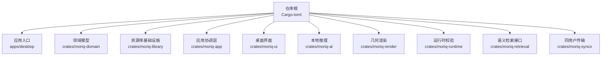
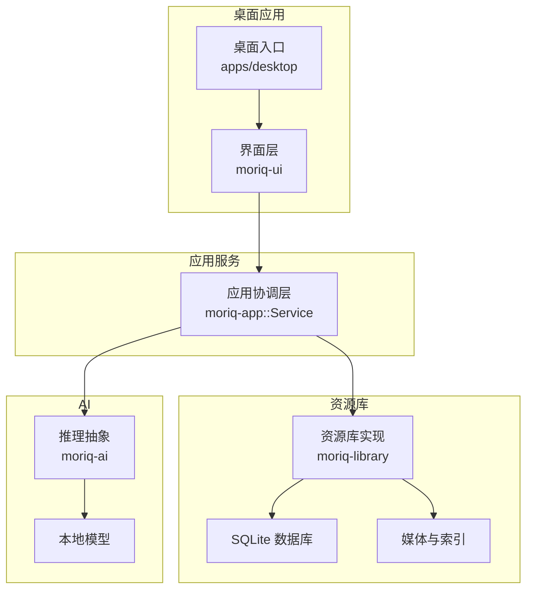
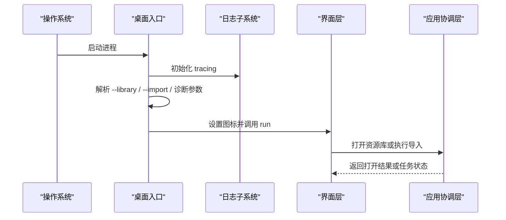
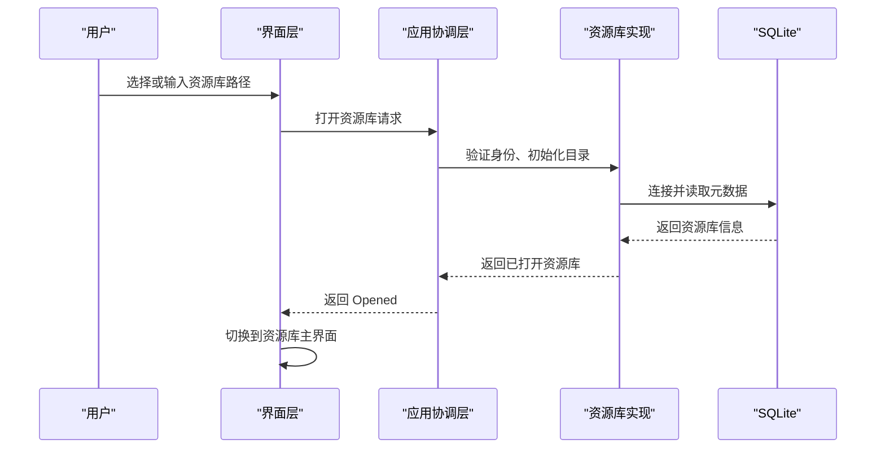
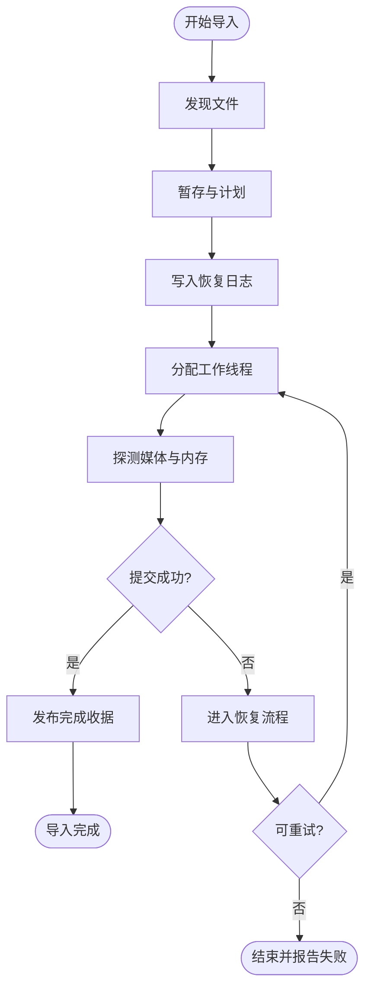
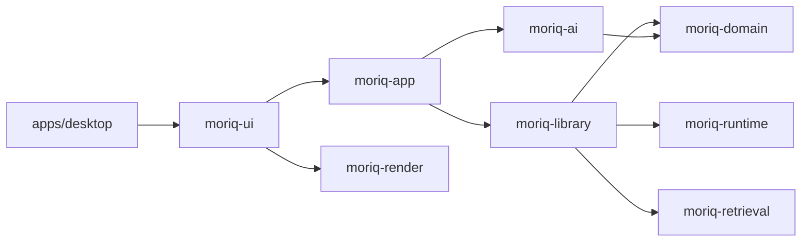

# 项目概览

> Repo Wiki 节点 `project-overview`
> 导出自 Qoder 知识库快照 `8fbe02f6-57c2-4874-b725-1a8130851fd9`，代码基线 `7a7a8e75e18bd90294e09cd422dd7ed5a04813a0`（分支 main，zh-CN）。

## 当前实现补充（2026-11-07）

AI 工作室将 Qwen 内容分类、标签描述与内置 YuNet + SFace CPU 人脸分组分开调度。外层重新分析可选择处理部分；人物和头像逐项显示，内外人物卡片均支持改名与删除分组，删除保留原照片。整理状态区分人脸分析完成和内容分类，页面刷新及侧栏动效沿用统一交互控制。

当前使用契约见 [AI 工作室与人物整理](AI%20工作室与人物整理.md)，架构见 [AI 功能集成](AI%20功能集成.md)，导航见 [Wiki 索引](INDEX.md)。以下为旧 Qoder 快照的项目概述，涉及旧 AI 默认流程时以上述维护页面为准。

## 历史概述

<cite>
**本文引用的文件**
- [ARCHITECTURE.md](../ARCHITECTURE.md)
- [Cargo.toml](../Cargo.toml)
- [apps/desktop/src/main.rs](../apps/desktop/src/main.rs)
- [apps/desktop/Cargo.toml](../apps/desktop/Cargo.toml)
- [crates/moriq-domain/src/lib.rs](../crates/moriq-domain/src/lib.rs)
- [crates/moriq-library/src/lib.rs](../crates/moriq-library/src/lib.rs)
- [crates/moriq-app/src/lib.rs](../crates/moriq-app/src/lib.rs)
- [crates/moriq-ui/src/lib.rs](../crates/moriq-ui/src/lib.rs)
- [crates/moriq-ai/Cargo.toml](../crates/moriq-ai/Cargo.toml)
</cite>

## 目录
1. [简介](#简介)
2. [项目结构](#项目结构)
3. [核心组件](#核心组件)
4. [架构总览](#架构总览)
5. [关键流程与数据流](#关键流程与数据流)
6. [依赖关系分析](#依赖关系分析)
7. [快速开始](#快速开始)
8. [性能与运行特性](#性能与运行特性)
9. [常见问题排查](#常见问题排查)
10. [结论](#结论)

## 简介
Moriq Space（墨屿）是一个面向 Windows 的本地素材资源库管理工具。它帮助创作者和团队在本地磁盘上统一存储、组织、浏览、编辑并导出图片与视频，同时提供 AI 能力，例如标签、描述、人脸分析和相似性检索。项目以 Rust 为核心语言，使用 Iced 构建桌面界面，使用 SQLite 持久化元数据，并通过 moriq-ai 模块集成 llama.cpp 等本地推理运行时。

该项目的核心价值在于：
- 把分散的图片、视频、原始格式媒体集中在一个可查询的资源库中。
- 通过项目、分类、标签、评分、收藏、文件夹和规则等维度组织素材。
- 提供导入、扫描、备份、清理、导出、同步等完整生命周期管理。
- 将 AI 推理作为可选能力嵌入到资源库工作流中，而不是替代本地存储。
- 强调数据安全：保留原始媒体、限制写入并发、维护恢复日志和版本边界。

## 项目结构
仓库采用 Rust workspace 多 crate 组织方式，顶层 Cargo.toml 声明成员为 `apps/desktop` 和 `crates/*`，并将部分 vendored 依赖纳入 patch。

**图表来源**
- [Cargo.toml:1-20](../Cargo.toml#L1-L20)

各 crate 的职责如下：
- `apps/desktop`：Windows 桌面入口、命令行参数解析、图标加载、日志初始化，最终调用 UI 启动。
- `moriq-ui`：基于 Iced 的图形界面，负责窗口、导航、画廊、预览、设置、任务、AI 面板等展示和交互。
- `moriq-app`：应用协调层 Service，封装调度、导入、缓存、设置、互操作、维护、推理等用例，对外暴露受控 API。
- `moriq-library`：阻塞式资源库实现，包含 SQLite 数据库、媒体解码、缩略图、索引、迁移、备份、导入导出、维护、任务等。
- `moriq-domain`：纯领域类型，如 LibraryId、AssetId、ProjectId、Asset、Query、Rule、JobKind、TaskError 等，不包含 I/O。
- `moriq-ai`：本地模型下载、硬件探测、llama.cpp 推理封装，提供 InferenceRunner。
- `moriq-render`：几何布局与视口计算，不直接读写磁盘。
- `moriq-retrieval`：受限范围的相似度与语义检索接口，要求显式指定 library、unassigned 或 project 作用域。
- `moriq-runtime`：共享运行时完整性校验。
- `moriq-synco`：同用户回环传输通道。

**章节来源**
- [Cargo.toml:1-20](../Cargo.toml#L1-L20)
- [ARCHITECTURE.md:10-30](../ARCHITECTURE.md#L10-L30)

## 核心组件
### 领域模型层：moriq-domain
moriq-domain 是纯类型层，定义资源库中的身份标识、资产、项目、查询条件、排序、AI 结果、任务状态等。它没有 I/O 依赖，因此可以被 UI、Library 和 App 共同复用。

重要概念包括：
- 身份标识：LibraryId、AssetId、AssetVersionId、ProjectId。
- 资产信息：名称、格式、尺寸、字节数、收藏、评分、标签、导入时间等。
- 查询树：支持按媒介、主题、人物、分类、语义 ID、规则、时间范围、尺寸、收藏、垃圾桶等组合筛选。
- 规则系统：All/Any/Not 组合，带深度、节点数和字段长度校验，防止无界查询。
- 任务协议：JobKind、JobState、ModelId、TaskError、TaskResult。

**章节来源**
- [crates/moriq-domain/src/lib.rs:1-120](../crates/moriq-domain/src/lib.rs#L1-L120)
- [crates/moriq-domain/src/lib.rs:120-220](../crates/moriq-domain/src/lib.rs#L120-L220)

### 资源库层：moriq-library
moriq-library 是资源库的核心实现，负责：
- 资源库目录结构与权限控制。
- SQLite 模式、迁移、只写者、读取池、事务与恢复日志。
- 媒体探测、颜色空间、缩放、矢量图、区域、视频播放。
- 编解码原生桥接、C++ worker、WIC worker。
- 导入、提交、恢复、导出、同步。
- 备份、孤儿检测、清理、存储健康检查。
- 任务取消、作业调度。
- AI 内容分析、人像、Qwen 人脸、相似性等扩展。

该 crate 明确禁止 UI 直接访问数据库或执行媒体 I/O，所有此类操作必须通过上层 Service 进入。

**章节来源**
- [crates/moriq-library/src/lib.rs:1-120](../crates/moriq-library/src/lib.rs#L1-L120)
- [crates/moriq-library/src/lib.rs:120-200](../crates/moriq-library/src/lib.rs#L120-L200)

### 应用协调层：moriq-app
moriq-app 的 Service 是 UI 的唯一后端入口。它：
- 维护项目作用域、媒体缓存、推理运行器、消息队列。
- 使用 Semaphore 限制导入并发、内存预算、维护任务、读取任务和通用任务。
- 暴露打开资源库、打开模型目录、判断视频格式、打开源码仓库、诊断日志开关等能力。
- 协调 Catalog、Media、Import、Maintenance、Interop、Settings、Inference 等模块。
- 保证请求具有项目上下文，切换 UI 不会劫持已排队任务。

Service 内部还定义了导入进度控制对象 ImportControl，用于向 UI 报告发现数量、活跃 worker、峰值、等待内存、最大单文件大小等信息。

**章节来源**
- [crates/moriq-app/src/lib.rs:1-120](../crates/moriq-app/src/lib.rs#L1-L120)
- [crates/moriq-app/src/lib.rs:120-200](../crates/moriq-app/src/lib.rs#L120-L200)

### 界面层：moriq-ui
moriq-ui 是基于 Iced 的原生界面。它负责：
- 页面路由：概览、素材、模型等屏幕。
- 资源库卡片、创建、重命名、最近打开。
- 画廊、邻居加载、分页、滚动、选中、比较。
- 查看器、图像适配、实际大小、缩放、拖拽中断。
- 上传、导入偏好、批量操作、删除、回收站。
- 文件夹、分类、收藏、规则、元数据、区域。
- 任务、维护、存储、日志、设置、偏好。
- 将业务请求交给 Service，并处理异步结果。

UI 不持有数据库连接，也不直接解码媒体；所有磁盘、目录和解码工作都委托给 Service。

**章节来源**
- [crates/moriq-ui/src/lib.rs:1-120](../crates/moriq-ui/src/lib.rs#L1-L120)

### AI 推理层：moriq-ai
moriq-ai 提供：
- 模型根目录获取。
- 本地模型下载与控制。
- 硬件能力探测。
- llama.cpp 推理封装。
- 与 moriq-runtime 共享运行时完整性校验。

它在应用层中通过 InferenceRunner 被注入，使 Library 准备不可变输入并提交与模型及修订绑定的一致性结果。

**章节来源**
- [crates/moriq-ai/Cargo.toml:1-21](../crates/moriq-ai/Cargo.toml#L1-L21)
- [ARCHITECTURE.md:10-30](../ARCHITECTURE.md#L10-L30)

## 架构总览
Moriq Space 的整体分层可以概括为“界面 → 应用协调 → 资源库 → 存储与媒体 → 可选 AI”。

**图表来源**
- [apps/desktop/src/main.rs:1-40](../apps/desktop/src/main.rs#L1-L40)
- [crates/moriq-ui/src/lib.rs:1-40](../crates/moriq-ui/src/lib.rs#L1-L40)
- [crates/moriq-app/src/lib.rs:1-60](../crates/moriq-app/src/lib.rs#L1-L60)
- [crates/moriq-library/src/lib.rs:1-40](../crates/moriq-library/src/lib.rs#L1-L40)
- [crates/moriq-ai/Cargo.toml:1-21](../crates/moriq-ai/Cargo.toml#L1-L21)

## 关键流程与数据流
### 启动与日志初始化
桌面入口 main 函数捕获启动错误并以对话框形式显示；run 函数根据目标平台选择日志目录，启用诊断日志时写入 desktop.log，否则输出到标准错误。随后解析命令行参数，设置窗口图标，并调用 UI 的 run 方法启动界面。

**图表来源**
- [apps/desktop/src/main.rs:1-40](../apps/desktop/src/main.rs#L1-L40)
- [apps/desktop/src/main.rs:41-97](../apps/desktop/src/main.rs#L41-L97)
- [crates/moriq-ui/src/lib.rs:1-40](../crates/moriq-ui/src/lib.rs#L1-L40)
- [crates/moriq-app/src/lib.rs:1-60](../crates/moriq-app/src/lib.rs#L1-L60)

### 打开资源库流程
用户在 UI 中选择或输入资源库路径后，Service 负责身份校验、目录准备、数据库连接、资源库信息加载，并向 UI 返回 Opened 结果。UI 仅负责展示，不直接持有数据库连接。

**图表来源**
- [crates/moriq-ui/src/lib.rs:1-120](../crates/moriq-ui/src/lib.rs#L1-L120)
- [crates/moriq-app/src/lib.rs:1-120](../crates/moriq-app/src/lib.rs#L1-L120)
- [crates/moriq-library/src/lib.rs:1-120](../crates/moriq-library/src/lib.rs#L1-L120)

### 导入与恢复流程
导入过程由 Service 协调，Library 负责阶段化写入、恢复日志、私有链接、探测内存和提交。中断导入使用与工具相同的恢复引擎，取消、丢弃调用方或切换资源库会停止待处理恢复。

**图表来源**
- [ARCHITECTURE.md:31-70](../ARCHITECTURE.md#L31-L70)
- [crates/moriq-app/src/lib.rs:120-200](../crates/moriq-app/src/lib.rs#L120-L200)
- [crates/moriq-library/src/lib.rs:120-200](../crates/moriq-library/src/lib.rs#L120-L200)

## 依赖关系分析
从 crate 依赖方向看，项目遵循自顶向下的单向依赖：
- apps/desktop 依赖 moriq-ui、iced、rfd、image、tracing-subscriber。
- moriq-ui 依赖 moriq-app、moriq-domain、moriq-render、iced。
- moriq-app 依赖 moriq-domain、moriq-library、moriq-ai、moriq-render、moriq-synco。
- moriq-library 依赖 moriq-domain、moriq-runtime、moriq-retrieval、rusqlite、image、moxcms、resvg 等。
- morq-ai 依赖 moriq-domain、moriq-runtime、reqwest、sysinfo。
- morq-domain、moriq-render、moriq-runtime、moriq-retrieval、moriq-synco 是相对底层或横切能力。

**图表来源**
- [apps/desktop/Cargo.toml:1-21](../apps/desktop/Cargo.toml#L1-L21)
- [crates/moriq-ui/Cargo.toml:1-25](../crates/moriq-ui/Cargo.toml#L1-L25)
- [crates/moriq-app/Cargo.toml:1-25](../crates/moriq-app/Cargo.toml#L1-L25)
- [crates/moriq-library/Cargo.toml:1-35](../crates/moriq-library/Cargo.toml#L1-L35)
- [crates/moriq-ai/Cargo.toml:1-21](../crates/moriq-ai/Cargo.toml#L1-L21)

**章节来源**
- [apps/desktop/Cargo.toml:1-21](../apps/desktop/Cargo.toml#L1-L21)
- [crates/moriq-ui/Cargo.toml:1-25](../crates/moriq-ui/Cargo.toml#L1-L25)
- [crates/moriq-app/Cargo.toml:1-25](../crates/moriq-app/Cargo.toml#L1-L25)
- [crates/moriq-library/Cargo.toml:1-35](../crates/moriq-library/Cargo.toml#L1-L35)
- [crates/moriq-ai/Cargo.toml:1-21](../crates/moriq-ai/Cargo.toml#L1-L21)

## 快速开始
### 安装与运行
1. 使用 Rust 工具链构建 workspace。仓库使用 Rust 2024 edition，workspace 中声明了 rust-version。
2. 构建桌面应用 crate `moriq-desktop`。
3. 首次运行后，可在界面中创建或打开资源库。
4. 如果启用诊断日志，日志默认位于平台相关目录，桌面应用会尝试写入 desktop.log。

常见命令行参数：
- `--library PATH`：启动时打开指定资源库。
- `--import PATH`：启动时导入文件或文件夹。
- 诊断 capture 功能需要启用 capture feature，并提供 `--panel`、`--capture`、`--screen`、`--exit-after-capture`、`--select-first` 等参数。

**章节来源**
- [Cargo.toml:1-20](../Cargo.toml#L1-L20)
- [apps/desktop/src/main.rs:1-40](../apps/desktop/src/main.rs#L1-L40)
- [apps/desktop/src/main.rs:41-97](../apps/desktop/src/main.rs#L41-L97)

### 基本使用场景
- 创建资源库：选择一个本地目录作为资源库根目录，应用会初始化 assets、versions、projects、thumbnails、previews、indexes、metadata、staging、trash、recovery、backups 等子目录。
- 导入素材：拖放文件或文件夹到窗口，或通过导入菜单选择路径。应用会扫描、探测媒体、生成缩略图并写入资源库。
- 浏览与搜索：使用分类、标签、人物、收藏、评分、格式、尺寸、时间范围、规则等条件组合查询。
- 编辑与管理：修改标签、评分、收藏、项目归属、文件夹、备注等，这些变更通过 Service 进入 Library 持久化。
- 导出：将选中的资产导出为目标格式或目录结构。
- 备份与维护：对数据库和不可变文件链接进行冻结备份，并进行孤儿检测、清理和存储健康检查。

**章节来源**
- [crates/moriq-library/src/lib.rs:120-200](../crates/moriq-library/src/lib.rs#L120-L200)
- [crates/moriq-ui/src/lib.rs:1-120](../crates/moriq-ui/src/lib.rs#L1-L120)

## 性能与运行特性
- 单一写者：SQLite 写入通过单个 writer 进行，避免并发写冲突。
- 并发预算：Service 使用多个 Semaphore 限制导入 worker、内存占用、维护任务、读取任务和通用任务。
- 内存预算：导入 worker 在进入解码前探测内存，并按共享预算 admission。
- 视图优化：UI 的查看器对滚轮缩放、适配、实际大小做缓动，重复利用现有 GPU 图像，减少重建。
- 开发优化：workspace profile 对 moriq-library、image、zune-jpeg、png、miniz_oxide、fast_image_resize 等包开启更高优化等级，提升解码与缩放性能。
- LTO：release profile 启用 thin LTO 并使用单 codegen unit，有助于整体优化。
- 安全 lint：workspace 禁用 unsafe_code，deny unwrap_used 和 expect_used，降低运行时意外崩溃风险。

**章节来源**
- [ARCHITECTURE.md:70-120](../ARCHITECTURE.md#L70-L120)
- [Cargo.toml:40-80](../Cargo.toml#L40-L80)
- [crates/moriq-app/src/lib.rs:120-200](../crates/moriq-app/src/lib.rs#L120-L200)

## 常见问题排查
### 无法启动
桌面入口会在 run 失败时弹出错误对话框。若启用了诊断日志，请检查日志文件是否写入成功，以及 LOCALAPPDATA 或 HOME 目录是否有写入权限。

**章节来源**
- [apps/desktop/src/main.rs:1-40](../apps/desktop/src/main.rs#L1-L40)

### 资源库被锁定
当另一个窗口或进程正在使用该资源库时，Library 会返回锁定错误。请先关闭其他实例或进程后再试。

**章节来源**
- [crates/moriq-library/src/lib.rs:120-200](../crates/moriq-library/src/lib.rs#L120-L200)

### 图片无法解码
图片解码失败通常表示文件损坏或格式不支持。Library 会将 image 错误包装为统一的媒体错误类型。

**章节来源**
- [crates/moriq-library/src/lib.rs:120-200](../crates/moriq-library/src/lib.rs#L120-L200)

### 导入卡住或中断
导入过程中可以通过 Service 的取消机制停止任务。中断导入会使用恢复引擎重新处理未完成阶段，但强制终止可能留下临时恢复目录，自动崩溃清理尚未完全验证。

**章节来源**
- [ARCHITECTURE.md:31-70](../ARCHITECTURE.md#L31-L70)
- [crates/moriq-app/src/lib.rs:120-200](../crates/moriq-app/src/lib.rs#L120-L200)

### 本地 AI 推理不可用
确认模型目录存在且可写，模型下载路径正确，硬件探测正常。Library 提交的结果必须与当前显示的模型 ID 和修订一致，旧版结果的收据会被拒绝。

**章节来源**
- [crates/moriq-ai/Cargo.toml:1-21](../crates/moriq-ai/Cargo.toml#L1-L21)
- [ARCHITECTURE.md:100-155](../ARCHITECTURE.md#L100-L155)

## 结论
Moriq Space 是一个以 Rust 构建、面向 Windows 的本地素材资源库管理工具。它通过清晰的 crate 分层把界面、应用协调、资源库、领域模型、AI 推理和渲染解耦，既保证了本地存储的安全性和一致性，又提供了现代桌面体验与可选 AI 能力。对于新用户，建议从创建资源库、导入素材、浏览与搜索入手；对于开发者，应优先理解 Service 的边界、Library 的单一写者和恢复机制，以及 UI 与 Service 之间的职责划分。
